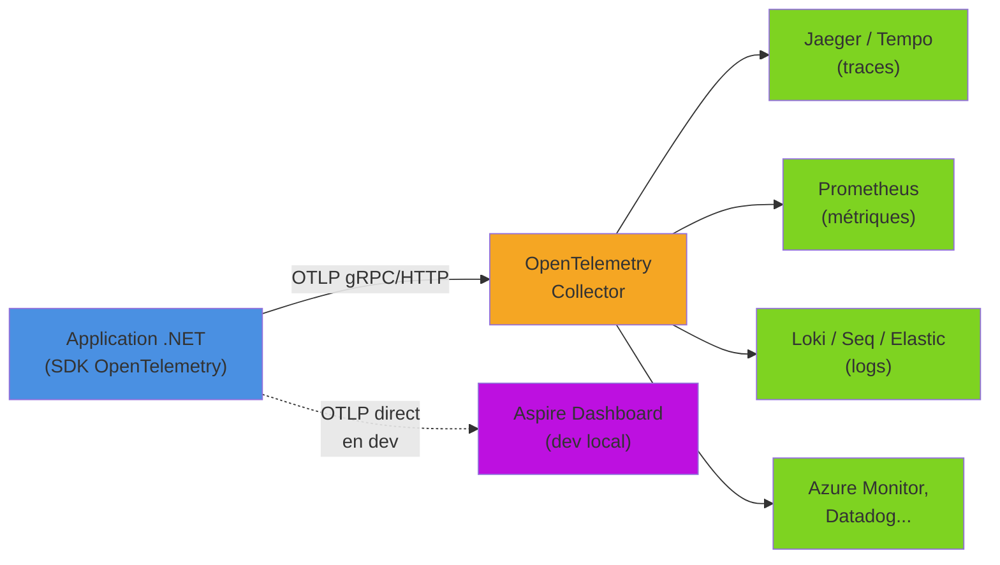
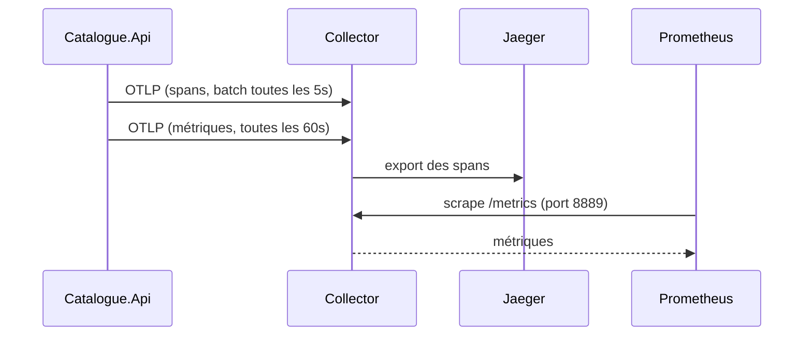

OpenTelemetry est un standard open source pour la collecte, l’export et l’analyse des données de télémétrie : **traces**, **métriques** et **logs**. Il permet d’observer le comportement des applications (performances, erreurs, dépendances) de façon unifiée, quel que soit le langage ou la plateforme. En .NET, il s’appuie sur des API déjà présentes dans le runtime (`ActivitySource`, `Meter`, `ILogger`), ce qui rend son adoption particulièrement naturelle.

<!--more-->

# Qu'est-ce qu'OpenTelemetry ?

## À quoi ça sert ?

- **Observabilité** : comprendre le fonctionnement interne des applications distribuées.
- **Traces** : suivre le parcours d’une requête à travers plusieurs services (distributed tracing).
- **Métriques** : surveiller les performances (temps de réponse, nombre de requêtes, etc.).
- **Logs** : centraliser et corréler les messages de log avec les traces.

## Fonctionnement

1. **Instrumentation** : ajout de bibliothèques OpenTelemetry dans le code ou utilisation d’auto-instrumentation.
2. **Collecte** : les données sont collectées automatiquement ou via des API.
3. **Export** : les données sont envoyées vers des outils d’observabilité (ex : Jaeger, Prometheus, Azure Monitor, Grafana, etc.).



L’application ne connaît qu’un seul protocole (OTLP) et une seule adresse. C’est le **collector** qui se charge de router chaque signal vers le bon backend : changer d’outil d’observabilité ne demande alors aucune modification du code.

## Les trois signaux en .NET

Une particularité de .NET : OpenTelemetry n’introduit pas de nouvelles API d’instrumentation. Il se branche sur les primitives du runtime.

| Signal | API .NET utilisée | Concept OpenTelemetry |
|---|---|---|
| Traces | `System.Diagnostics.ActivitySource` / `Activity` | Tracer / Span |
| Métriques | `System.Diagnostics.Metrics.Meter` | Meter / Instrument |
| Logs | `Microsoft.Extensions.Logging.ILogger` | Logger / LogRecord |

Conséquence directe : toute bibliothèque qui émet déjà des `Activity` ou des métriques via `Meter` (ASP.NET Core, `HttpClient`, EF Core, Polly...) est observable sans dépendre d’OpenTelemetry.

## Avantages

- **Standardisé** : même API pour tous les langages.
- **Interopérable** : compatible avec de nombreux outils d’analyse.
- **Extensible** : on peut ajouter ses propres métriques ou traces personnalisées.

# En dotnet

Pour ajouter OpenTelemetry dans une application ASP.NET Core, il suffit d’installer les packages nécessaires et de configurer les services dans `Program.cs`.

## Instrumentation

Installer les packages NuGet suivants :

```powershell
dotnet add package OpenTelemetry.Extensions.Hosting
dotnet add package OpenTelemetry.Instrumentation.AspNetCore
dotnet add package OpenTelemetry.Instrumentation.Http
dotnet add package OpenTelemetry.Instrumentation.Runtime
dotnet add package OpenTelemetry.Exporter.OpenTelemetryProtocol
```

| Package | Rôle |
|---|---|
| `OpenTelemetry.Extensions.Hosting` | Intégration avec l’hôte générique et l’injection de dépendances |
| `OpenTelemetry.Instrumentation.AspNetCore` | Traces et métriques des requêtes HTTP entrantes |
| `OpenTelemetry.Instrumentation.Http` | Traces et métriques des appels `HttpClient` sortants |
| `OpenTelemetry.Instrumentation.Runtime` | Métriques du runtime (GC, threads, exceptions...) |
| `OpenTelemetry.Exporter.OpenTelemetryProtocol` | Export via OTLP |

### Les traces

```csharp
// Ajout d'OpenTelemetry pour les traces
builder.Services.AddOpenTelemetry()
    .WithTracing(tracerProviderBuilder =>
    {
        tracerProviderBuilder
            .AddAspNetCoreInstrumentation(); // instrumentation automatique des requêtes HTTP
    });
```

### Les métriques

```csharp
// Ajout d'OpenTelemetry pour les métriques
builder.Services.AddOpenTelemetry()
    .WithMetrics(metricsProviderBuilder =>
    {
        metricsProviderBuilder
            .AddAspNetCoreInstrumentation(); // métriques HTTP automatiques
    });
```

### Les logs

Pour les logs, rien à changer dans le code applicatif : on continue d’utiliser `ILogger<T>`. OpenTelemetry s’ajoute simplement comme un **provider de logging** supplémentaire, à côté de la console :

```csharp
// Ajout d'OpenTelemetry comme provider de logs
builder.Logging.AddOpenTelemetry(options =>
{
    options.IncludeFormattedMessage = true; // inclut le message formaté ("Commande 42 créée")
    options.IncludeScopes = true;           // inclut les scopes (BeginScope)
    options.ParseStateValues = true;        // exporte les paramètres comme attributs
});
```

Le gros intérêt est la **corrélation automatique** : un log écrit pendant le traitement d’une requête tracée porte le `TraceId` et le `SpanId` de l’`Activity` courante. Dans le backend, on passe en un clic d’une trace à tous les logs émis pendant cette trace, et inversement.

```csharp
public class CommandeService(ILogger<CommandeService> logger)
{
    public async Task<Guid> CreerAsync(decimal montant, CancellationToken ct)
    {
        var id = Guid.NewGuid();

        // ✅ Message template : CommandeId et Montant deviennent des attributs
        //    structurés, filtrables dans le backend
        logger.LogInformation("Commande {CommandeId} créée pour {Montant} €", id, montant);

        // ❌ Interpolation : le message est figé, plus aucun attribut exploitable
        // logger.LogInformation($"Commande {id} créée pour {montant} €");

        await Task.CompletedTask;
        return id;
    }
}
```

Pour les chemins critiques, le générateur de source `[LoggerMessage]` évite les allocations (boxing des paramètres, parsing du template à chaque appel) :

```csharp
public static partial class CommandeLogs
{
    [LoggerMessage(Level = LogLevel.Information,
        Message = "Commande {CommandeId} créée pour {Montant} €")]
    public static partial void CommandeCreee(this ILogger logger, Guid commandeId, decimal montant);

    [LoggerMessage(Level = LogLevel.Warning,
        Message = "Stock insuffisant pour le produit {ProduitId}")]
    public static partial void StockInsuffisant(this ILogger logger, int produitId);
}

// Utilisation
logger.CommandeCreee(id, montant);
```

## Setup complet ASP.NET Core

En pratique, on configure les trois signaux d’un seul coup, avec une **ressource** commune. La ressource décrit l’émetteur de la télémétrie : `service.name` est l’attribut le plus important, c’est lui qui permet de distinguer les services dans le backend.

```csharp
using OpenTelemetry;
using OpenTelemetry.Logs;
using OpenTelemetry.Metrics;
using OpenTelemetry.Resources;
using OpenTelemetry.Trace;

var builder = WebApplication.CreateBuilder(args);

// 1. Logs : provider OpenTelemetry branché sur ILogger
builder.Logging.AddOpenTelemetry(logging =>
{
    logging.IncludeFormattedMessage = true;
    logging.IncludeScopes = true;
});

// 2. Traces + métriques + ressource commune + export OTLP
builder.Services.AddOpenTelemetry()
    .ConfigureResource(resource => resource
        .AddService(
            serviceName: "Catalogue.Api",
            serviceVersion: "1.2.0")
        .AddAttributes(new Dictionary<string, object>
        {
            ["deployment.environment.name"] = builder.Environment.EnvironmentName
        }))
    .WithTracing(tracing => tracing
        .AddAspNetCoreInstrumentation(options =>
        {
            // On ne trace pas les sondes de santé : bruit inutile
            options.Filter = ctx => !ctx.Request.Path.StartsWithSegments("/health");
        })
        .AddHttpClientInstrumentation()
        .AddSource(Telemetry.ActivitySourceName))   // traces métier personnalisées
    .WithMetrics(metrics => metrics
        .AddAspNetCoreInstrumentation()
        .AddHttpClientInstrumentation()
        .AddRuntimeInstrumentation()
        .AddMeter(Telemetry.MeterName))             // métriques métier personnalisées
    .UseOtlpExporter();                             // un seul exporteur pour les 3 signaux

builder.Services.AddSingleton<CommandeMetrics>();
builder.Services.AddScoped<CommandeService>();

var app = builder.Build();

app.MapGet("/health", () => Results.Ok());
app.MapPost("/commandes", async (decimal montant, CommandeService service, CancellationToken ct) =>
    Results.Ok(await service.CreerAsync(montant, ct)));

app.Run();
```

> `AddSource` et `AddMeter` sont indispensables pour la télémétrie personnalisée : par défaut, le SDK n’écoute **que** les sources explicitement enregistrées. Une `ActivitySource` non déclarée produit des `Activity` nulles, sans erreur.

## Traces et métriques personnalisées

L’instrumentation automatique couvre HTTP, mais les opérations métier (calcul de prix, appel à un moteur de règles, traitement d’un message) méritent leurs propres spans et compteurs.

```csharp
using System.Diagnostics;
using System.Diagnostics.Metrics;

public static class Telemetry
{
    public const string ActivitySourceName = "Catalogue.Api";
    public const string MeterName = "Catalogue.Api";

    // Une ActivitySource par composant, partagée (static) dans toute l'application
    public static readonly ActivitySource ActivitySource = new(ActivitySourceName);
}

public sealed class CommandeMetrics
{
    private readonly Counter<long> _commandesCreees;
    private readonly Histogram<double> _montant;

    // IMeterFactory est enregistré automatiquement par l'hôte ASP.NET Core
    public CommandeMetrics(IMeterFactory meterFactory)
    {
        var meter = meterFactory.Create(Telemetry.MeterName);

        _commandesCreees = meter.CreateCounter<long>(
            "catalogue.commandes.creees", unit: "{commande}",
            description: "Nombre de commandes créées");

        _montant = meter.CreateHistogram<double>(
            "catalogue.commandes.montant", unit: "EUR",
            description: "Montant des commandes");
    }

    public void CommandeCreee(string pays, double montant)
    {
        var tag = new KeyValuePair<string, object?>("pays", pays);
        _commandesCreees.Add(1, tag);
        _montant.Record(montant, tag);
    }
}
```

Et dans le code métier :

```csharp
public class CommandeService(ILogger<CommandeService> logger, CommandeMetrics metrics)
{
    public async Task<Guid> CreerAsync(decimal montant, CancellationToken ct)
    {
        // StartActivity retourne null si personne n'écoute : d'où le "?."
        using var activity = Telemetry.ActivitySource.StartActivity("CreerCommande");
        activity?.SetTag("commande.montant", montant);

        try
        {
            var id = Guid.NewGuid();
            await Task.Delay(50, ct); // simulation d'un traitement

            activity?.SetTag("commande.id", id);
            metrics.CommandeCreee("FR", (double)montant);
            logger.CommandeCreee(id, montant); // log corrélé à l'activité courante

            return id;
        }
        catch (Exception ex)
        {
            activity?.SetStatus(ActivityStatusCode.Error, ex.Message);
            activity?.AddException(ex);
            throw;
        }
    }
}
```

Le span `CreerCommande` apparaît comme enfant du span HTTP `POST /commandes` : la hiérarchie est reconstituée automatiquement grâce à `Activity.Current`.

# Open Telemetry Protocol (OTLP)

OTLP (**OpenTelemetry Protocol**) est le protocole standardisé utilisé par OpenTelemetry pour transmettre les données de télémétrie (**traces**, **métriques**, **logs**) entre les applications instrumentées et les outils d’observabilité (comme Jaeger, Prometheus, Grafana, etc.).

## Caractéristiques principales

- **Standardisé** : conçu pour être universel, quel que soit le langage ou la plateforme.
- **Supporte plusieurs formats** : gRPC (par défaut, performant, port `4317`) et HTTP/Protobuf (port `4318`).
- **Unifie** l’envoi des traces, métriques et logs via un seul protocole.

## Utilisation

- Les SDK OpenTelemetry exportent les données via OTLP vers des backends compatibles (Jaeger, Tempo, Azure Monitor, etc.).
- Il suffit de configurer un exporteur OTLP dans l'application.

```csharp
builder.Services.AddOpenTelemetry()
    .WithTracing(tracerProviderBuilder =>
    {
        tracerProviderBuilder
            .AddAspNetCoreInstrumentation() // instrumentation automatique des requêtes HTTP
            .AddOtlpExporter();
    });
```

La méthode `.AddOtlpExporter()` dans la configuration OpenTelemetry permet d’exporter les données de télémétrie (**traces**, **métriques**, ou **logs**) via le protocole OTLP (OpenTelemetry Protocol) vers un backend compatible (comme Jaeger, Tempo, Azure Monitor, etc.).

- Elle ajoute un exporteur OTLP à la pipeline OpenTelemetry.
- Par défaut, elle envoie les données à l’endpoint OTLP standard (`http://localhost:4317` en gRPC).
- On peut personnaliser l’endpoint, le protocole (gRPC ou HTTP/Protobuf) et d’autres options via une surcharge :

```csharp
.AddOtlpExporter(options =>
{
    options.Endpoint = new Uri("http://localhost:4317");
    options.Protocol = OpenTelemetry.Exporter.OtlpExportProtocol.Grpc;
});
```

Ainsi, il est possible d’adapter la configuration de l’exporteur OTLP selon l’infrastructure ou les besoins spécifiques.

En .NET avec OpenTelemetry il y a deux méthodes de configuration OTLP :

- **`AddOtlpExporter`**  
  Cette méthode est utilisée dans la configuration des services (ex : `builder.Services.AddOpenTelemetry()`) pour ajouter un exporteur OTLP à **un** signal donné. Il faut l'appeler sur chacun des points de collecte (traces, métriques, logs), ce qui permet par exemple d’envoyer les traces et les métriques vers des endpoints différents.

  Exemple :

  ```csharp
  builder.Services.AddOpenTelemetry()
      .WithTracing(tracerProviderBuilder =>
      {
          tracerProviderBuilder.AddOtlpExporter();
      });
  ```

- **`UseOtlpExporter`**  
  Cette méthode active l’exporteur OTLP pour **tous les signaux** (traces, métriques et logs) en un seul appel. Elle est pensée pour être pilotée par la configuration : endpoint, protocole et en-têtes sont lus depuis les variables d’environnement standard `OTEL_EXPORTER_OTLP_*`. Attention, elle ne peut pas être combinée avec `AddOtlpExporter` dans la même application.
  ```csharp
  builder.Services.AddOpenTelemetry()
      .WithTracing(tracerProviderBuilder => { /* instrumentations */ })
      .WithMetrics(metricsProviderBuilder => { /* instrumentations */ })
      .UseOtlpExporter();
  ```
  Toutes les infos sur [son utilisation sont ici](https://github.com/open-telemetry/opentelemetry-dotnet/blob/fb74013d644d56f44ef89dd57358947bd9f68345/src/OpenTelemetry.Exporter.OpenTelemetryProtocol/README.md#enable-otlp-exporter-for-all-signals)

## Configuration par variables d’environnement

Les SDK OpenTelemetry respectent un jeu de variables d’environnement standardisées, identiques dans tous les langages. C’est la façon la plus propre de changer de cible entre les environnements sans recompiler :

| Variable | Exemple | Rôle |
|---|---|---|
| `OTEL_SERVICE_NAME` | `Catalogue.Api` | Valeur de `service.name` (prioritaire sur le code) |
| `OTEL_RESOURCE_ATTRIBUTES` | `deployment.environment.name=prod` | Attributs de ressource supplémentaires |
| `OTEL_EXPORTER_OTLP_ENDPOINT` | `http://otel-collector:4317` | Adresse du collector ou du backend |
| `OTEL_EXPORTER_OTLP_PROTOCOL` | `grpc` ou `http/protobuf` | Protocole de transport |
| `OTEL_EXPORTER_OTLP_HEADERS` | `x-api-key=abc123` | En-têtes (authentification d’un SaaS) |

En développement, on les place dans `Properties/launchSettings.json` :

```json
{
  "profiles": {
    "http": {
      "commandName": "Project",
      "applicationUrl": "http://localhost:5080",
      "environmentVariables": {
        "ASPNETCORE_ENVIRONMENT": "Development",
        "OTEL_EXPORTER_OTLP_ENDPOINT": "http://localhost:4317",
        "OTEL_EXPORTER_OTLP_PROTOCOL": "grpc"
      }
    }
  }
}
```

# Visualiser la télémétrie en local

## Aspire Dashboard (le plus simple)

Le plus simple est d'utiliser le dashboard d'Aspire en mode standalone via Docker. Il n’est pas nécessaire d’utiliser Aspire pour l’orchestration : le dashboard est un simple conteneur qui reçoit de l’OTLP et affiche **traces, métriques et logs structurés** dans une même interface.

```powershell
docker run --rm -it -p 18888:18888 -p 4317:18889 -p 4318:18890 -e DOTNET_DASHBOARD_UNSECURED_ALLOW_ANONYMOUS=true --name aspire-dashboard mcr.microsoft.com/dotnet/aspire-dashboard:latest
```

- `18888` : interface web (http://localhost:18888).
- `18889` : réception OTLP gRPC, exposée sur le port standard `4317`.
- `18890` : réception OTLP HTTP, exposée sur le port standard `4318`.
- `DOTNET_DASHBOARD_UNSECURED_ALLOW_ANONYMOUS` : désactive l’authentification, **à réserver au poste de développement**.


> Les données sont conservées **en mémoire** uniquement : un redémarrage du conteneur efface tout. C’est un outil de développement, pas un backend de production.

## Jaeger (traces uniquement)

Jaeger est la référence historique du tracing distribué. Depuis sa version 2, il est lui-même construit sur le collector OpenTelemetry et accepte directement l’OTLP :

```powershell
docker run --rm -it -p 16686:16686 -p 4317:4317 -p 4318:4318 --name jaeger jaegertracing/jaeger:latest
```

L’interface est disponible sur http://localhost:16686. Jaeger ne gère que les traces : les métriques et logs envoyés en OTLP seront refusés (des erreurs d’export apparaîtront dans les logs de l’application). D’où l’intérêt du collector dès qu’on veut plusieurs backends.

## Le collector OpenTelemetry

Le collector est un binaire autonome (ou conteneur) qui reçoit, transforme et redistribue la télémétrie. Il découple l’application des backends et permet de centraliser le batching, le filtrage, l’échantillonnage ou la suppression d’attributs sensibles.

Un fichier `otel-collector.yaml` minimal qui envoie les traces vers Jaeger, expose les métriques pour Prometheus et affiche les logs dans sa propre sortie :

```yaml
receivers:
  otlp:
    protocols:
      grpc:
        endpoint: 0.0.0.0:4317
      http:
        endpoint: 0.0.0.0:4318

processors:
  batch: # regroupe les envois pour limiter les appels réseau

exporters:
  otlp/jaeger:
    endpoint: jaeger:4317
    tls:
      insecure: true
  prometheus:
    endpoint: 0.0.0.0:8889 # Prometheus vient "scraper" ce endpoint
  debug:
    verbosity: basic

service:
  pipelines:
    traces:
      receivers: [otlp]
      processors: [batch]
      exporters: [otlp/jaeger]
    metrics:
      receivers: [otlp]
      processors: [batch]
      exporters: [prometheus]
    logs:
      receivers: [otlp]
      processors: [batch]
      exporters: [debug]
```

Et le `docker-compose.yml` correspondant :

```yaml
services:
  otel-collector:
    image: otel/opentelemetry-collector-contrib:latest
    command: ["--config=/etc/otelcol/config.yaml"]
    volumes:
      - ./otel-collector.yaml:/etc/otelcol/config.yaml
    ports:
      - "4317:4317"   # OTLP gRPC (l'application envoie ici)
      - "4318:4318"   # OTLP HTTP
      - "8889:8889"   # métriques au format Prometheus

  jaeger:
    image: jaegertracing/jaeger:latest
    ports:
      - "16686:16686" # interface Jaeger
```

Côté application, rien ne change : elle envoie toujours en OTLP sur `localhost:4317`. Seul le collector sait où vont les données.



# En production

L’ajout de la télémétrie via OpenTelemetry dans une application .NET peut impacter les performances en production, principalement pour les raisons suivantes :

1. **Surcharge CPU et mémoire**
   La collecte de traces, métriques et logs ajoute du travail supplémentaire à chaque requête ou opération. Si le volume de données collectées est élevé (beaucoup de spans, logs détaillés, métriques fréquentes), cela peut augmenter l’utilisation CPU et mémoire.

2. **Latence réseau**
   OpenTelemetry exporte les données vers des backends (ex : Jaeger, Prometheus, OTLP collector) via le réseau. Si l’export est synchrone ou mal configuré, cela peut ralentir les réponses HTTP ou les traitements.

3. **Blocages ou contention**
   Certaines instrumentations (ex : Entity Framework, HTTP client) peuvent ajouter des hooks sur chaque appel, ce qui peut ralentir les accès à la base ou les appels externes. Si le buffer d’export est saturé, des pertes de données peuvent survenir.

4. **Volume de logs et traces**
   Un niveau de détail trop élevé (ex : logs de debug, traces sur toutes les méthodes) peut générer beaucoup de données, ce qui surcharge le système et le backend de télémétrie.

5. **Configuration non optimale**
   Par défaut, certaines instrumentations collectent beaucoup d’informations. Il est important d’ajuster la configuration (sampling, filtres, enrichissement) pour limiter l’impact.

**Bonnes pratiques pour limiter l’impact**

- **Utiliser le sampling** : ne pas tout tracer, mais seulement un pourcentage des requêtes.
- **Exporter en mode batch/asynchrone** : éviter l’export synchrone qui bloque les threads (c’est le comportement par défaut de l’exporteur OTLP).
- **Limiter les enrichissements et tags** : n’ajouter que les informations utiles.
- **Surveiller les ressources** : monitorer l’impact de la télémétrie sur le CPU, la mémoire et la latence.
- **Adapter la configuration selon l’environnement** : plus de détails en dev, moins en prod.

## Échantillonnage des traces

```csharp
builder.Services.AddOpenTelemetry()
    .WithTracing(tracing => tracing
        .AddAspNetCoreInstrumentation()
        // Conserve 10 % des traces, mais respecte la décision du service appelant :
        // une trace commencée ailleurs reste complète de bout en bout
        .SetSampler(new ParentBasedSampler(new TraceIdRatioBasedSampler(0.10))));
```

Le `ParentBasedSampler` est important dans un système distribué : sans lui, chaque service tirerait au sort indépendamment et on obtiendrait des traces trouées. Les métriques, elles, ne sont **pas** échantillonnées : elles restent exactes puisqu’elles sont agrégées en mémoire avant l’export.

## Filtrer les logs exportés

Le niveau de log s’applique par provider. On peut ainsi garder des logs `Debug` en console tout en n’exportant que les `Warning` des bibliothèques bavardes :

```json
{
  "Logging": {
    "LogLevel": {
      "Default": "Information"
    },
    "OpenTelemetry": {
      "LogLevel": {
        "Default": "Information",
        "Microsoft.AspNetCore": "Warning",
        "Microsoft.EntityFrameworkCore": "Warning"
      }
    }
  }
}
```

## ❌ / ✅ Les pièges courants

```csharp
// ❌ Une ActivitySource créée à chaque appel : coûteux et jamais écoutée
//    si son nom n'est pas déclaré via AddSource
using var activity = new ActivitySource("MonService").StartActivity("Traitement");

// ✅ Une instance statique, déclarée dans WithTracing(t => t.AddSource(...))
using var activity2 = Telemetry.ActivitySource.StartActivity("Traitement");

// ❌ Un tag à forte cardinalité sur une métrique : une série par utilisateur !
_commandesCreees.Add(1, new KeyValuePair<string, object?>("user.id", userId));

// ✅ Des dimensions bornées (pays, statut, type de produit)
_commandesCreees.Add(1, new KeyValuePair<string, object?>("pays", "FR"));
```

La cardinalité est le piège numéro un des métriques : chaque combinaison unique de tags crée une série temporelle, en mémoire dans l’application puis dans le backend. Les identifiants (utilisateur, commande, URL complète) ont leur place dans les **traces** et les **logs**, pas dans les métriques.

# Résumé

| Sujet | À retenir |
|---|---|
| **Traces** | `WithTracing` + `AddAspNetCoreInstrumentation`, `AddHttpClientInstrumentation`, `AddSource` pour le métier |
| **Métriques** | `WithMetrics` + instrumentations + `AddMeter`, instruments créés via `IMeterFactory` |
| **Logs** | `builder.Logging.AddOpenTelemetry`, on garde `ILogger<T>` et les message templates |
| **Ressource** | `ConfigureResource(r => r.AddService(...))` : `service.name` identifie le service |
| **Export** | `UseOtlpExporter()` pour les 3 signaux, configuré par `OTEL_EXPORTER_OTLP_*` |
| **Dev local** | Aspire Dashboard en conteneur (traces + métriques + logs) ou Jaeger (traces) |
| **Production** | Un collector entre l’application et les backends, sampling `ParentBased`, cardinalité maîtrisée |
