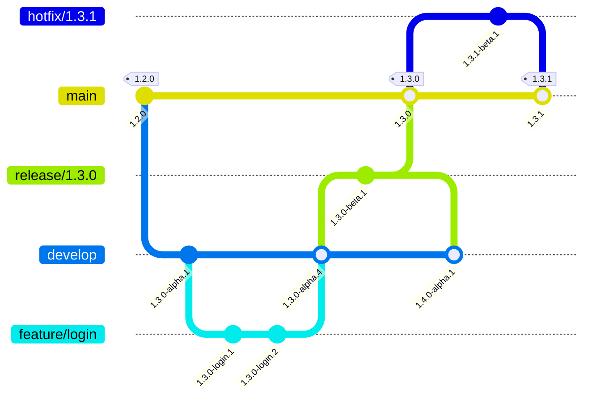

**GitVersion** est un outil open source qui automatise la gestion des versions sémantique (SemVer) dans les projets utilisant Git.

# À quoi sert GitVersion ?

- Il génère automatiquement un numéro de version basé sur l'historique Git, la branche courante et la stratégie de workflow (par exemple GitFlow ou GitHub Flow).
- Il évite de devoir incrémenter manuellement la version dans vos fichiers.
- Il s'intègre facilement dans les pipelines CI/CD (Azure DevOps, GitHub Actions, etc.) pour versionner vos builds, packages NuGet, ou artefacts.
<!--more-->

# Comment ça marche ?

## Analyse du dépôt Git

GitVersion lit les branches, tags et commits pour déterminer la version à appliquer selon la configuration (par défaut : GitFlow).

Le principe est toujours le même :

1. Trouver la **source de version** : le dernier tag SemVer accessible (`1.2.0`, `v1.2.0`), un nom de branche contenant une version (`release/1.3.0`), ou la valeur `next-version` de la configuration.
2. Appliquer l'**incrément** défini pour la branche courante (`Major`, `Minor`, `Patch`), ou celui demandé dans un message de commit.
3. Ajouter le **label** de pré-release de la branche (`alpha`, `beta`, nom de la feature...) et un numéro calculé à partir du nombre de commits depuis la source de version.

**Stratégie de versionnement**

Par défaut GitVersion suit la stratégie de Gitflow (décrite en détail dans l'article [Git Flow & Git Flow AVH](/2025/06/23/GitFlowAvh.html)) :

- Sur `main` : version stable (ex : 1.2.0)
- Sur `release/1.3.0` : version release (ex: 1.3.0-beta.1)
- Sur `develop` : version pré-release (ex : 1.3.0-alpha.5)
- Sur une branche `feature/xyz` : version snapshot (ex : 1.3.0-xyz.1)

## Le calcul de version en image

Le schéma suivant montre les versions calculées par GitVersion (configuration GitFlow par défaut) au fil d'un cycle de développement. Le numéro après le label dépend du nombre de commits depuis la source de version : les valeurs sont données à titre indicatif.



Ce qu'il faut retenir :

- `main` ne produit une version stable que grâce aux **tags** : c'est le tag `1.3.0` qui « fige » la version.
- `develop` est toujours une version mineure en avance sur la dernière release (`1.3.0-alpha`, puis `1.4.0-alpha` une fois `1.3.0` publiée).
- `release/1.3.0` et `hotfix/1.3.1` tirent leur version du **nom de la branche**.
- Une branche `feature` hérite de la version de sa branche source et utilise son nom comme label.

## Forcer un incrément depuis un message de commit

Sans toucher à la configuration, on peut demander un incrément particulier dans un message de commit :

```bash
git commit -m "Refonte de l'API publique +semver: major"
git commit -m "Ajout de l'export CSV +semver: minor"
git commit -m "Correction d'une coquille +semver: none"
```

## Sortie

GitVersion peut générer :

- Des variables d'environnement (pour CI/CD)
- Un fichier `version.json` ou `AssemblyInfo.cs`
- Des propriétés MSBuild pour .NET

Les principales variables produites :

| Variable               | Exemple                            | Usage typique                     |
| ---------------------- | ---------------------------------- | --------------------------------- |
| `MajorMinorPatch`      | `1.3.0`                            | Version « propre »                |
| `SemVer`               | `1.3.0-beta.1`                     | Version de package NuGet          |
| `FullSemVer`           | `1.3.0-beta.1+3`                   | Version avec métadonnées de build |
| `AssemblySemVer`       | `1.3.0.0`                          | `AssemblyVersion`                 |
| `InformationalVersion` | `1.3.0-beta.1+3.Branch.release-1.3.0.Sha.1a2b3c4...` | Traçabilité (branche + commit) |
| `BranchName`, `ShortSha` | `release/1.3.0`, `1a2b3c4`       | Nommage d'artefacts               |

## Exemple d'utilisation

- **Installation** :

installation globale :

```dotnetcli
dotnet tool install --global GitVersion.Tool
```

Installation au niveau de la solution dotnet

```dotnetcli
dotnet new tool-manifest
dotnet tool install GitVersion.Tool
```

- **Afficher la version de la branche en cours** :

```dotnetcli
dotnet gitversion
```

- **Afficher une seule variable** :

```dotnetcli
dotnet gitversion /showvariable SemVer
```

- **Intégration dans un pipeline** :
  Utilisez la version générée pour nommer vos packages, images Docker, etc.

> GitVersion a besoin de l'**historique complet** du dépôt (branches et tags). Sur un clone superficiel (*shallow clone*, fréquent en CI), le calcul échoue : pensez à récupérer tout l'historique.

# Configuration

Ajoutez un fichier `GitVersion.yml` à la racine du repo pour personnaliser le comportement (stratégie GitFlow, format des versions, etc.).

## Exemple de `GitVersion.yml` (GitVersion 6.x)

```yaml
# Modèle de départ : GitFlow/v1 (défaut), GitHubFlow/v1 ou TrunkBased/preview1
workflow: GitFlow/v1

# Mode de déploiement par défaut : ManualDeployment, ContinuousDelivery, ContinuousDeployment
mode: ContinuousDelivery

# Préfixe accepté pour les tags de version (ex : v1.2.0)
tag-prefix: '[vV]?'

# Version minimale à utiliser si aucun tag n'existe encore
next-version: 1.0.0

# AssemblyVersion = 1.3.0.0 (on évite d'y mettre le label de pré-release)
assembly-versioning-scheme: MajorMinorPatch

branches:
  main:
    label: ''               # pas de label : version stable
    increment: Patch
  develop:
    label: alpha
    increment: Minor
  release:
    label: beta
    mode: ManualDeployment
  feature:
    label: '{BranchName}'   # le nom de la branche devient le label
    increment: Inherit      # hérite de l'incrément de la branche source

ignore:
  sha: []                   # commits à ignorer dans le calcul
```

La configuration ne fait que **surcharger** le modèle choisi par `workflow` : on ne déclare que ce que l'on veut changer.

Les trois modes de déploiement :

| Mode                   | Comportement                                                                  |
| ---------------------- | ----------------------------------------------------------------------------- |
| `ManualDeployment`     | La version reste la même tant qu'elle n'est pas taguée ; les commits s'ajoutent dans les métadonnées (`1.3.0-beta.1+3`) |
| `ContinuousDelivery`   | Le numéro de pré-release augmente à chaque commit (`1.3.0-alpha.5`)           |
| `ContinuousDeployment` | Chaque commit produit une version distincte, pensée pour un déploiement automatique |

Pour vérifier une configuration, la commande `dotnet gitversion /showconfig` affiche la configuration effective (modèle + surcharges).

> **Migration depuis la v5** : la propriété `tag` d'une branche s'appelle désormais `label`, le mode `Mainline` a disparu au profit du workflow `TrunkBased`, et la sémantique des modes a évolué. Une configuration v5 doit être relue avant de passer en v6.

Pour plus de détails [la doc officielle](https://gitversion.net/docs/reference/configuration)

# Intégration GitHub Actions

Le projet [GitTools/actions](https://github.com/GitTools/actions) fournit deux actions : `setup` installe l'outil, `execute` calcule la version et l'expose en sorties et variables d'environnement.


```yaml
name: Build

on: push

jobs:
  build:
    runs-on: ubuntu-latest
    steps:
      - name: Checkout
        uses: actions/checkout@v4
        with:
          fetch-depth: 0          # obligatoire : GitVersion a besoin de tout l'historique

      - name: Installer GitVersion
        uses: gittools/actions/gitversion/setup@v4.7.0
        with:
          versionSpec: '6.x'

      - name: Calculer la version
        id: gitversion            # id utilisé pour lire les sorties
        uses: gittools/actions/gitversion/execute@v4.7.0

      - name: Afficher la version
        run: echo "Version : ${{ steps.gitversion.outputs.semVer }}"

      - uses: actions/setup-dotnet@v4
        with:
          dotnet-version: '10.0.x'

      # Utilisation de la version pour le package NuGet
      - name: Pack
        run: dotnet pack -c Release -p:Version=${{ steps.gitversion.outputs.semVer }}
```


Les sorties sont accessibles via `steps.<id>.outputs.<nom>` (`semVer`, `fullSemVer`, `majorMinorPatch`, `assemblySemVer`, `informationalVersion`, `shortSha`...) et, pour les étapes suivantes du même job, via les variables d'environnement `GitVersion_<Nom>` (ex : `env.GitVersion_SemVer`).

Si GitVersion est déjà déclaré comme outil local (manifeste `dotnet-tools.json`), on peut aussi se contenter de `dotnet tool restore` puis `dotnet gitversion /output buildserver`.

# GitVersion.MsBuild

`GitVersion.MsBuild` est un package NuGet qui permet d'intégrer automatiquement GitVersion dans le processus de build MSBuild/.NET, sans avoir besoin d'appeler la CLI séparément. Il est particulièrement utile pour les projets .NET qui utilisent `dotnet build`, ou des pipelines CI/CD.

## Fonctionnement

- **Ajout du package**  
  Ajoutez le package NuGet à votre projet ou solution :

```dotnetcli
dotnet add package GitVersion.MsBuild
```

- **Détection automatique**  
  Lors de chaque build (`dotnet build`, `msbuild`, ou build Visual Studio), GitVersion analyse votre dépôt Git et génère la version appropriée selon la configuration (par défaut : GitFlow, personnalisable via `GitVersion.yml`).
- **Injection dans le build**  
  Les propriétés de version générées (par exemple : `Version`, `AssemblyVersion`, `FileVersion`, `PackageVersion`) sont injectées automatiquement dans le build .NET, vos assemblies et vos packages NuGet.

Le package étant uniquement utile au build, il est conseillé de le référencer avec `PrivateAssets="all"` pour qu'il n'apparaisse pas comme dépendance de vos propres packages :

```xml
<ItemGroup>
  <PackageReference Include="GitVersion.MsBuild" Version="6.0.0">
    <PrivateAssets>all</PrivateAssets>
  </PackageReference>
</ItemGroup>
```

## Avantages

- **Aucune commande supplémentaire à exécuter** : la version est calculée à chaque build.
- **Intégration transparente** : fonctionne avec Visual Studio, `dotnet build`, et les pipelines CI/CD.
- **Versionnement cohérent** : la version de vos DLL, EXE, et packages NuGet reflète toujours l'état du dépôt Git.

> [!WARNING]
> la version 5 de `GitVersion.MsBuild` ne supporte plus dotnet framework, mais uniquement dotnet core. Visual studio 2022 étant en dotnet framework, lors d'une compilation de depuis visual studio il ne se passera rien. Les build depuis la CI via msbuild seront corrects.

# GitVersion, MinVer ou Nerdbank.GitVersioning ?

GitVersion n'est pas le seul outil de versionnement basé sur Git dans l'écosystème .NET. Deux alternatives sont très répandues :

- **[MinVer](https://github.com/adamralph/minver)** : un package MSBuild minimaliste qui ne regarde que les **tags**. Après le tag `1.2.0`, cinq commits plus loin, la version vaut `1.2.1-alpha.0.5`. Pour publier, on pose un tag. Configuration par propriétés MSBuild (`MinVerTagPrefix`, `MinVerMinimumMajorMinor`...).
- **[Nerdbank.GitVersioning](https://github.com/dotnet/Nerdbank.GitVersioning)** (NBGV) : la version majeure.mineure est écrite dans un fichier `version.json` versionné, et le patch est calculé à partir du nombre de commits (*git height*). Un outil `nbgv` aide à préparer les releases (`nbgv prepare-release`). Utilisé par de nombreux projets de la fondation .NET.

| Critère                    | GitVersion                              | MinVer                          | Nerdbank.GitVersioning               |
| -------------------------- | --------------------------------------- | ------------------------------- | ------------------------------------ |
| Source de la version       | Tags + branches + configuration         | Tags uniquement                 | Fichier `version.json` + git height  |
| Configuration              | `GitVersion.yml`                        | Propriétés MSBuild              | `version.json`                       |
| Tient compte des branches  | Oui (GitFlow, GitHub Flow, trunk)       | Non                             | Partiellement (branches publiques / non publiques) |
| Intégration                | CLI, package MSBuild, actions CI        | Package MSBuild (+ CLI)         | Package MSBuild, CLI `nbgv`          |
| Exemple entre deux releases | `1.3.0-alpha.5`                        | `1.2.1-alpha.0.5`               | `1.3.5-g1a2b3c4`                     |
| Complexité                 | Élevée, très paramétrable               | Très faible                     | Moyenne                              |
| Idéal pour                 | Équipes en Git Flow, plusieurs branches de release | Bibliothèques simples, trunk-based | Gros dépôts, versions pilotées par fichier |

En résumé : MinVer si l'on veut « juste des tags », NBGV si l'on préfère une version explicite dans le code, GitVersion si le workflow de branches doit se refléter dans les numéros de version.

# Résumé

| Besoin                                    | Solution                                                   |
| ----------------------------------------- | ---------------------------------------------------------- |
| Calculer la version en local              | `dotnet gitversion`                                        |
| Lire une variable                         | `dotnet gitversion /showvariable SemVer`                   |
| Personnaliser le calcul                   | `GitVersion.yml` (`workflow`, `mode`, `branches`)          |
| Vérifier la configuration effective      | `dotnet gitversion /showconfig`                            |
| Versionner automatiquement les assemblies | Package `GitVersion.MsBuild`                               |
| Versionner en CI GitHub                   | `gittools/actions/gitversion/setup` + `execute`, `fetch-depth: 0` |
| Forcer un incrément                       | `+semver: major` / `minor` / `patch` / `none` dans le commit |
| Alternative minimaliste                   | MinVer (tags) ou Nerdbank.GitVersioning (`version.json`)   |
