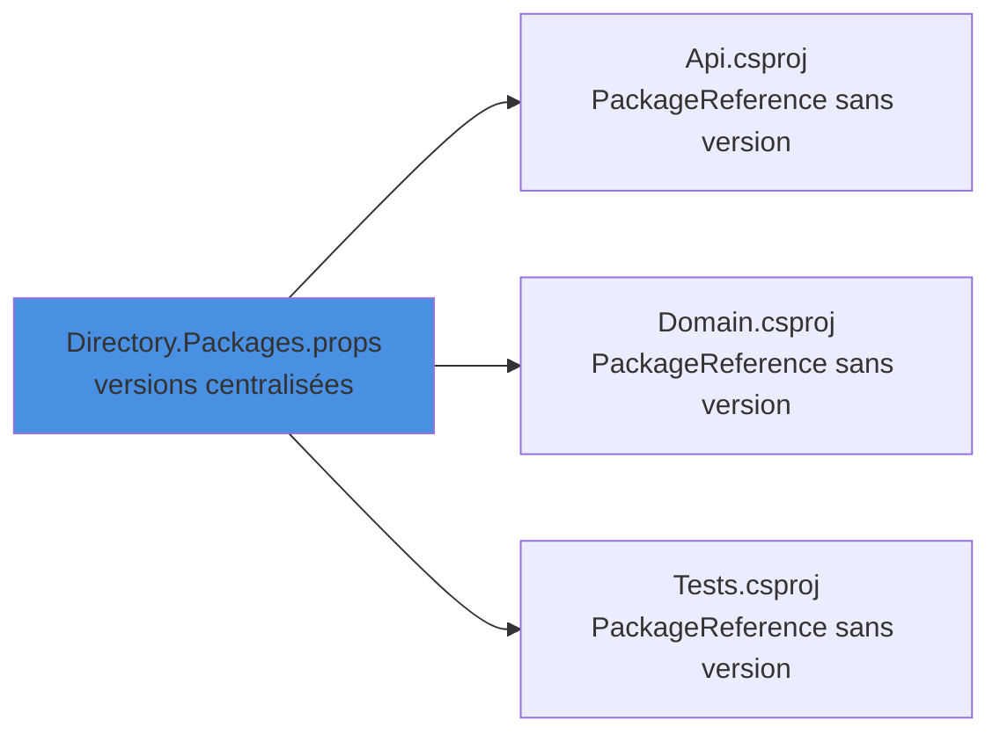

Voici une liste de commandes couramment utilisées pour faciliter le développement et la maintenance des applications .NET, et en particulier la gestion des paquets NuGet : lister et auditer les dépendances, comprendre d'où vient un package, mettre à jour, centraliser les versions, verrouiller la restauration et nettoyer les caches. Les commandes sont données pour le SDK .NET 10, avec leur équivalent pour les SDK plus anciens quand la syntaxe diffère.

<!--more-->

# Lister les packages d'un projet

## `dotnet package list` / `dotnet list package`

Depuis .NET 10, les commandes NuGet du CLI suivent l'ordre « nom puis verbe » : `dotnet package list`, `dotnet package add`, `dotnet package remove`... L'ancienne forme `dotnet list package` reste disponible et c'est la seule utilisable avec un SDK .NET 9 ou antérieur.

```bash
# .NET 10 : liste les packages référencés par le projet ou la solution du dossier courant
dotnet package list

# Équivalent pour .NET 9 et antérieur
dotnet list package

# Cibler explicitement un projet ou une solution
dotnet package list --project MaSolution.sln
```

> Avec .NET 10, la commande lance automatiquement une restauration si nécessaire (option `--no-restore` pour l'éviter). Avec les SDK précédents, il faut avoir fait un `dotnet restore` ou un `dotnet build` avant.

## Les options utiles

```bash
# Packages pour lesquels une version plus récente existe
dotnet package list --outdated

# Idem, en restant sur la même version majeure (ex : 8.0.1 -> 8.0.6, pas 9.0.0)
dotnet package list --outdated --highest-minor

# Idem, en restant sur la même version majeure.mineure (ex : 8.0.1 -> 8.0.6, pas 8.1.0)
dotnet package list --outdated --highest-patch

# Inclure les préversions dans la recherche
dotnet package list --outdated --include-prerelease

# Packages présentant des vulnérabilités connues
dotnet package list --vulnerable --include-transitive

# Packages marqués comme obsolètes (deprecated) par leur auteur
dotnet package list --deprecated

# Afficher aussi les dépendances transitives (les dépendances des dépendances)
dotnet package list --include-transitive

# Sortie JSON, pratique pour un script ou un rapport en CI
dotnet package list --include-transitive --vulnerable --format json > rapport-packages.json
```

Quelques remarques :

- `--vulnerable` ne peut pas être combiné avec `--outdated` ou `--deprecated`.
- `--include-transitive` n'est pas activé par défaut : sans lui, une vulnérabilité dans une dépendance indirecte passe inaperçue.
- `--highest-minor`, `--highest-patch` et `--include-prerelease` nécessitent `--outdated` (ou `--deprecated`).

# Comprendre d'où vient un package

La commande [dotnet nuget why](https://learn.microsoft.com/fr-fr/dotnet/core/tools/dotnet-nuget-why) affiche le graphe des dépendances d'un package particulier pour un projet ou une solution donné. C'est l'outil idéal quand `--include-transitive` ou l'audit signale un package que l'on n'a jamais référencé directement.

```powershell
dotnet nuget why <PROJECT|SOLUTION> <PACKAGE>

# Exemple : pourquoi System.Text.Json est-il présent dans la solution ?
dotnet nuget why MaSolution.sln System.Text.Json

# Limiter l'analyse à un framework cible
dotnet nuget why MaSolution.sln System.Text.Json --framework net10.0
```


Pour résoudre une vulnérabilité transitive, Microsoft recommande de mettre à jour en priorité le package le plus « proche » de vos références directes (celui qui tire la dépendance), avant de référencer directement la version corrigée.

## Voir l'arbre complet des packages

- Installer [dotnet-nuget-tree](https://github.com/JulioRamos0/dotnet-nuget-tree)
  ```powershell
  dotnet tool install --global dotnet-nuget-tree
  ```
- Exécuter
  ```powershell
  dotnet-nuget-tree
  ```

# Mettre à jour les packages

## Avec le SDK

Le SDK .NET 10 apporte `dotnet package update`, qui permet notamment de corriger d'un coup les packages vulnérables :

```bash
# Met à jour les packages vulnérables vers la première version sans vulnérabilité connue
dotnet package update --vulnerable

# Ajouter (ou mettre à jour vers la dernière version) un package précis
dotnet package add Serilog            # .NET 10
dotnet add package Serilog            # .NET 9 et antérieur
```

## Avec [dotnet-outdated-tool](https://github.com/dotnet-outdated/dotnet-outdated?tab=readme-ov-file)

`dotnet-outdated` reste très pratique pour mettre à jour en masse une solution, avec des règles fines.

- installer l'outil :
  ```powershell
  dotnet tool install --global dotnet-outdated-tool
  ```
- voir les mises à jour :
  ```powershell
  dotnet outdated
  ```
- appliquer les mises à jour :

  ```powershell
  dotnet outdated --upgrade
  ```

  L'option `--version-lock major` permet de bloquer les mises à jour majeures (ex : 8.0.1 vers 8.0.6 et non 9.0.1).
  L'option `--include microsoft` limite les mises à jour aux paquets contenant microsoft dans leur nom.

- appliquer les mises à jour mineures de tous les paquets Microsoft :
  ```powershell
  dotnet outdated --include Microsoft --version-lock major --upgrade
  ```

# Central Package Management (CPM)

Dans une solution avec beaucoup de projets, chaque `.csproj` porte ses propres versions de packages, et elles finissent par diverger. Le **Central Package Management** regroupe toutes les versions dans un seul fichier `Directory.Packages.props` à la racine du dépôt.



## Le fichier `Directory.Packages.props`

```xml
<Project>
  <PropertyGroup>
    <!-- Active la gestion centralisée des versions -->
    <ManagePackageVersionsCentrally>true</ManagePackageVersionsCentrally>
    <!-- Optionnel : permet de forcer la version des dépendances transitives -->
    <CentralPackageTransitivePinningEnabled>true</CentralPackageTransitivePinningEnabled>
  </PropertyGroup>

  <ItemGroup>
    <!-- Une seule ligne par package, pour toute la solution -->
    <PackageVersion Include="Microsoft.EntityFrameworkCore" Version="10.0.0" />
    <PackageVersion Include="Serilog.AspNetCore" Version="9.0.0" />
    <PackageVersion Include="xunit" Version="2.9.3" />
  </ItemGroup>

  <ItemGroup>
    <!-- Référencé automatiquement par TOUS les projets (analyseurs, outils de build...) -->
    <GlobalPackageReference Include="GitVersion.MsBuild" Version="6.0.0" />
  </ItemGroup>
</Project>
```

## Les projets

Les projets référencent les packages **sans version** :

```xml
<ItemGroup>
  <PackageReference Include="Microsoft.EntityFrameworkCore" />
  <PackageReference Include="Serilog.AspNetCore" />

  <!-- Exception ponctuelle : forcer une autre version pour ce projet uniquement -->
  <PackageReference Include="xunit" VersionOverride="2.8.1" />
</ItemGroup>
```

Avantages : une mise à jour = une ligne modifiée, des versions cohérentes dans toute la solution, et des revues de code plus simples. `dotnet package add` et `dotnet-outdated` savent tous deux mettre à jour `Directory.Packages.props`.

> Exemple d'utilisation de `GlobalPackageReference` : [GitVersion.MsBuild](/2025/06/19/GitVersion.html) pour versionner automatiquement tous les projets.

# Verrouiller la restauration : les lock files

Une version flottante (`1.*`) ou une dépendance transitive peut se résoudre différemment d'une machine à l'autre ou d'un jour à l'autre. Le fichier `packages.lock.json` fige le graphe complet (direct + transitif) avec les hash des packages.

```xml
<PropertyGroup>
  <!-- Génère / met à jour packages.lock.json à chaque restauration -->
  <RestorePackagesWithLockFile>true</RestorePackagesWithLockFile>

  <!-- En CI : échoue si le graphe ne correspond plus au lock file -->
  <RestoreLockedMode Condition="'$(CI)' == 'true'">true</RestoreLockedMode>
</PropertyGroup>
```

On peut aussi piloter ce comportement directement en ligne de commande :

```bash
# Crée le lock file sans modifier le projet
dotnet restore --use-lock-file

# CI : restauration stricte, échec si le lock file n'est pas à jour
dotnet restore --locked-mode

# Après une modification volontaire des dépendances : recalcule le lock file
dotnet restore --force-evaluate
```

Le fichier `packages.lock.json` doit être **commité** avec le projet. Placées dans un `Directory.Build.props`, ces propriétés s'appliquent à toute la solution.

# NuGetAudit : l'audit de sécurité à la restauration

Depuis le SDK .NET 8, chaque `dotnet restore` vérifie les packages contre la base de vulnérabilités (GitHub Advisory Database via nuget.org) et lève des avertissements :

| Code   | Sévérité   |
| ------ | ---------- |
| NU1901 | Faible     |
| NU1902 | Modérée    |
| NU1903 | Haute      |
| NU1904 | Critique   |

L'audit se configure avec trois propriétés MSBuild :

```xml
<PropertyGroup>
  <!-- true par défaut ; false pour désactiver complètement l'audit -->
  <NuGetAudit>true</NuGetAudit>
  <!-- direct : packages directs uniquement ; all : inclut les transitifs
       (défaut "all" pour les projets ciblant net10.0 ou plus, "direct" sinon) -->
  <NuGetAuditMode>all</NuGetAuditMode>
  <!-- Sévérité minimale signalée : low (défaut), moderate, high, critical -->
  <NuGetAuditLevel>moderate</NuGetAuditLevel>

  <!-- Faire échouer le build sur les vulnérabilités hautes et critiques -->
  <WarningsAsErrors>$(WarningsAsErrors);NU1903;NU1904</WarningsAsErrors>
</PropertyGroup>

<ItemGroup>
  <!-- Ignorer une alerte analysée et jugée non applicable (en dernier recours) -->
  <NuGetAuditSuppress Include="https://github.com/advisories/GHSA-xxxx-xxxx-xxxx" />
</ItemGroup>
```

# Forcer une restauration et nettoyer les caches

## Forcer la restauration

```bash
# Réévalue toutes les dépendances, même si les fichiers de restauration sont à jour
dotnet restore --force

# Ignore le cache HTTP (utile quand un feed vient de publier une version)
dotnet restore --no-http-cache
```

## Nettoyer les caches NuGet

NuGet utilise plusieurs dossiers locaux : le dossier global des packages (`~/.nuget/packages`), le cache HTTP, le dossier temporaire et le cache des plugins.

```bash
# Afficher l'emplacement de chaque cache
dotnet nuget locals all --list

# Tout vider (à faire en cas de package corrompu ou de comportement incompréhensible)
dotnet nuget locals all --clear

# Ne vider que le cache HTTP
dotnet nuget locals http-cache --clear
```

> Après un `--clear`, la prochaine restauration retélécharge tous les packages : c'est plus long, mais cela règle la plupart des problèmes de cache.

## Réinstaller tous les packages (Visual Studio)

Dans la console du Gestionnaire de package de Visual Studio (Package Manager Console), et uniquement pour les anciens projets `packages.config` :

```powershell
Update-Package -reinstall
```

Pour les projets SDK (`PackageReference`), l'équivalent est un `dotnet nuget locals all --clear` suivi d'un `dotnet restore --force`.

# Résumé

| Besoin                                   | Commande / configuration                                  |
| ---------------------------------------- | --------------------------------------------------------- |
| Lister les packages                      | `dotnet package list` (`dotnet list package` avant .NET 10) |
| Trouver les mises à jour                 | `dotnet package list --outdated [--highest-minor]`        |
| Trouver les vulnérabilités               | `dotnet package list --vulnerable --include-transitive`   |
| Trouver les packages obsolètes           | `dotnet package list --deprecated`                        |
| Comprendre une dépendance transitive     | `dotnet nuget why <solution> <package>`                   |
| Corriger les packages vulnérables        | `dotnet package update --vulnerable` (.NET 10)            |
| Mettre à jour en masse                   | `dotnet outdated --upgrade`                               |
| Centraliser les versions                 | `Directory.Packages.props` + `ManagePackageVersionsCentrally` |
| Figer le graphe de dépendances           | `RestorePackagesWithLockFile` + `dotnet restore --locked-mode` |
| Auditer à chaque restauration            | `NuGetAudit`, `NuGetAuditMode`, `NuGetAuditLevel`         |
| Forcer la restauration                   | `dotnet restore --force`                                  |
| Vider les caches                         | `dotnet nuget locals all --clear`                         |
