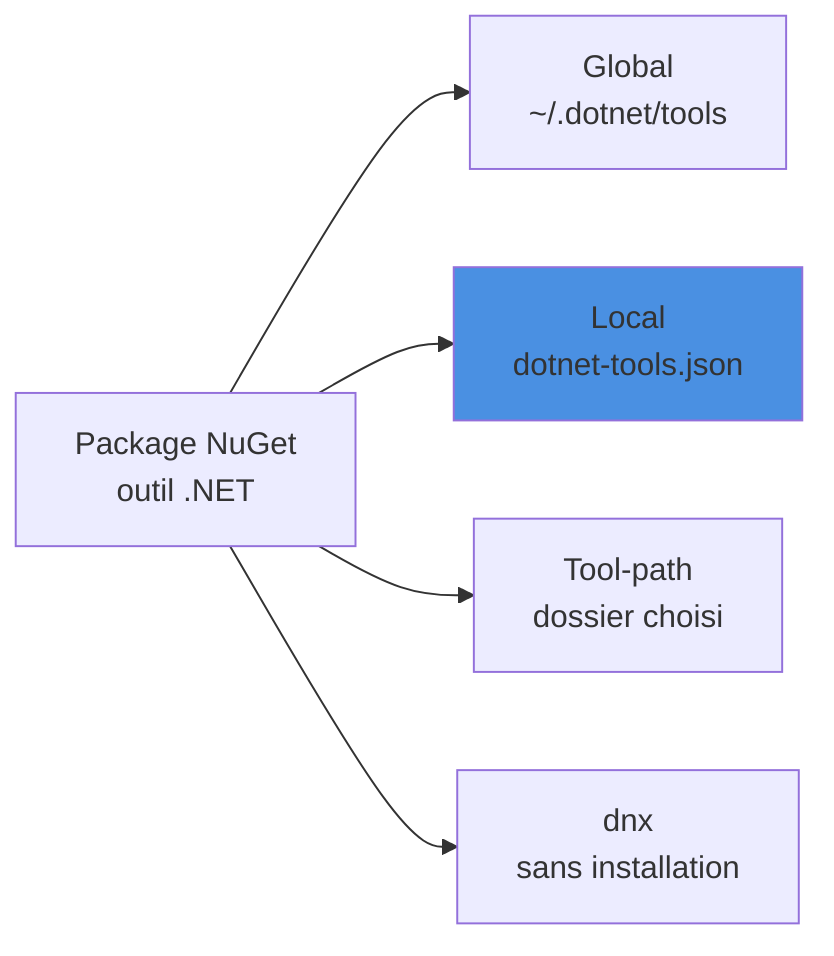

Comment installer des outils dotnet localement à un projet spécifique et non globalement, et partager la configuration avec le projet pour une meilleure reproductibilité. On verra aussi les différents modes d'installation (global, local, tool-path), l'exécution sans installation avec `dnx` introduite par .NET 10, la restauration en CI et la création de son propre outil.

<!--more-->

# Qu'est-ce qu'un outil .NET ?

Un outil .NET (*.NET tool*) est une application console empaquetée dans un package NuGet spécial. On le trouve sur nuget.org (filtre « .NET tool ») : `dotnet-ef`, `dotnet-outdated-tool`, `GitVersion.Tool`, `Husky`, `dotnet-counters`... Il existe trois façons de l'installer :



## Outil global

Installé une fois pour l'utilisateur, disponible partout via le `PATH` (dossier `~/.dotnet/tools` sous Linux/macOS, `%USERPROFILE%\.dotnet\tools` sous Windows).

```bash
# Installer
dotnet tool install --global dotnet-outdated-tool

# Lister les outils globaux
dotnet tool list --global

# Mettre à jour / désinstaller
dotnet tool update --global dotnet-outdated-tool
dotnet tool uninstall --global dotnet-outdated-tool
```

Pratique pour les outils personnels, mais la version n'est pas partagée avec l'équipe : chacun peut avoir une version différente.

## Outil dans un dossier spécifique (tool-path)

L'outil est installé dans un dossier choisi, qui n'est pas ajouté au `PATH`. Utile pour isoler un outil sur un agent de build ou dans une image Docker.

```bash
# Installer dans ./tools
dotnet tool install dotnet-ef --tool-path ./tools

# Exécuter en appelant directement l'exécutable
./tools/dotnet-ef --version

# Lister / désinstaller : on précise toujours le même dossier
dotnet tool list --tool-path ./tools
dotnet tool uninstall dotnet-ef --tool-path ./tools
```

## Outil local

L'outil est déclaré dans un manifeste `dotnet-tools.json` versionné avec le code : c'est le mode à privilégier pour tout ce dont le projet a besoin pour être construit (EF Core, GitVersion, Husky, générateurs...).

# Installer des outils spécifiques à un projet dotnet

1. **Créer le manifeste d'outils**  
   Dans le dossier de votre projet, exécutez :

   ```bash
   dotnet new tool-manifest
   ```

   Cela crée un fichier `dotnet-tools.json` qui va lister les outils utilisés localement. Depuis .NET 8, ce fichier est créé à la racine du dossier courant (les SDK plus anciens le plaçaient dans un sous-dossier `.config`). Les deux emplacements sont reconnus.

2. **Installer un outil local**  
   Par exemple, pour installer l'outil `dotnet-ef` :

   ```bash
   dotnet tool install dotnet-ef

   # Variante : crée le manifeste s'il n'existe pas encore
   dotnet tool install dotnet-ef --create-manifest-if-needed

   # Fixer une version précise
   dotnet tool install dotnet-ef --version 10.0.0
   ```

   L'outil est alors disponible uniquement pour ce projet (pas globalement).

3. **Utiliser l'outil**  
   Lancez l'outil avec :
   ```bash
   dotnet tool run dotnet-ef --help

   # Forme courte : les commandes commençant par "dotnet-" s'appellent sans le préfixe
   dotnet ef --help
   ```

**Avantage :**  
Les outils sont versionnés et partagés avec le projet, ce qui facilite la collaboration et la reproductibilité.

Le manifeste est recherché dans le dossier courant puis dans les dossiers parents : placé à la racine du dépôt, il sert donc à toute la solution.

# Syntaxe du fichier 'dotnet-tools.json'

Le fichier `dotnet-tools.json` est un manifeste JSON qui liste les outils .NET installés localement pour un projet. Sa structure est la suivante :

```json
{
  "version": 1,
  "isRoot": true,
  "tools": {
    "dotnet-ef": {
      "version": "8.0.0",
      "commands": ["dotnet-ef"]
    },
    "autre-outil": {
      "version": "x.y.z",
      "commands": ["nom-commande"]
    }
  }
}
```

- **version** : Version du format du manifeste (toujours 1).
- **isRoot** : Indique que ce manifeste est à la racine du projet : la recherche de manifestes dans les dossiers parents s'arrête ici.
- **tools** : Objet listant chaque outil installé.
- **dotnet-ef** : Nom de l'outil.
- **version** : Version installée de l'outil.
- **commands** : Liste des commandes exposées par l'outil.

Chaque outil ajouté avec `dotnet tool install` apparaît dans la section `tools` avec sa version et ses commandes. Pour mettre à jour un outil local, `dotnet tool update dotnet-ef` modifie la version dans le manifeste.

# Restaurer des outils

## Manuellement

Pour restaurer les outils listés dans le fichier `dotnet-tools.json`, utilisez la commande suivante dans le dossier du projet :

```bash
dotnet tool restore
```

Cette commande installe toutes les versions des outils spécifiées dans le manifeste, assurant que votre environnement local correspond à celui défini pour le projet.

## Automatiquement

Voici comment faire automatiquement un restore à chaque changement de branche Git. En se plaçant dans le répertoire racine du projet, où l'on a préalablement fait le `dotnet new tool-manifest` :

1. Installer Husky.net :

```bash
dotnet tool install Husky
```

2. Configurer Husky.net :

```bash
dotnet husky install
```

3. Ajouter un hook Husky.net pour exécuter le restore :

```bash
dotnet husky add post-checkout -c "dotnet tool restore"
```

4. Attachez Husky.net à l'un des projets présents dans le dossier. L'ouverture du projet dans Visual Studio provoquera l'installation de la tool box.

```bash
dotnet husky attach <path-to-project-file.csproj>
```

## En intégration continue

En CI, on restaure les outils juste après le checkout, puis on les appelle comme en local. Exemple avec GitHub Actions :

```yaml
jobs:
  build:
    runs-on: ubuntu-latest
    steps:
      - uses: actions/checkout@v4
        with:
          fetch-depth: 0          # historique complet, nécessaire pour GitVersion

      - uses: actions/setup-dotnet@v4
        with:
          dotnet-version: '10.0.x'

      # Installe les outils déclarés dans dotnet-tools.json
      - run: dotnet tool restore

      # Les outils sont ensuite utilisables comme en local
      - run: dotnet gitversion /output buildserver
      - run: dotnet ef migrations script --idempotent -o migrations.sql
```

Avec Azure DevOps, c'est la même chose : une tâche `script: dotnet tool restore` après le checkout. La version de chaque outil étant figée dans le manifeste, le build est reproductible et identique au poste du développeur. L'utilisation de [GitVersion](/2025/06/19/GitVersion.html) comme outil local est un bon exemple de ce scénario.

# Exécuter un outil sans l'installer : `dnx` (.NET 10)

Le SDK .NET 10 introduit `dotnet tool exec`, et son raccourci `dnx`, pour exécuter un outil en une seule commande sans installation permanente (sur le principe de `npx` côté Node.js). Le package est téléchargé dans le cache NuGet puis exécuté, sans modifier le `PATH` ni le manifeste.

```bash
# Exécute la dernière version de l'outil
dnx dotnetsay

# Forme longue équivalente
dotnet tool exec dotnetsay

# Version précise ou plage de versions avec la syntaxe @
dnx dotnetsay@2.1.0
dnx dotnetsay@2.*

# Passer des arguments à l'outil : tout ce qui suit "--"
dnx dotnetsay -- Bonjour le monde

# Utiliser un autre feed NuGet ou autoriser les préversions
dotnet tool exec --add-source https://mon-feed/v3/index.json mon-outil
dotnet tool exec --prerelease mon-outil
```

Si un manifeste local est présent, `dotnet tool exec` l'utilise pour choisir la version de l'outil. `dnx` est idéal pour essayer un outil ou pour un usage ponctuel en CI ; pour un outil utilisé régulièrement par le projet, le manifeste local reste préférable car la version y est explicite et versionnée.

# Créer son propre outil

N'importe quelle application console peut devenir un outil .NET. Il suffit de quelques propriétés dans le `.csproj` :

```xml
<Project Sdk="Microsoft.NET.Sdk">
  <PropertyGroup>
    <OutputType>Exe</OutputType>
    <TargetFramework>net10.0</TargetFramework>

    <!-- Empaquette l'application comme un outil .NET -->
    <PackAsTool>true</PackAsTool>
    <!-- Nom de la commande tapée par l'utilisateur (par défaut : nom de l'assembly) -->
    <ToolCommandName>montool</ToolCommandName>
    <!-- Dossier de sortie du .nupkg -->
    <PackageOutputPath>./nupkg</PackageOutputPath>

    <!-- Métadonnées du package -->
    <PackageId>MonEntreprise.MonTool</PackageId>
    <Version>1.0.0</Version>
    <Description>Un outil maison pour l'équipe</Description>
  </PropertyGroup>
</Project>
```

Le code reste celui d'une application console classique :

```csharp
// Program.cs : les arguments passés à "montool" arrivent dans args
var nom = args.Length > 0 ? args[0] : "le monde";
Console.WriteLine($"Bonjour {nom} !");
return 0; // code de retour exploité par la CI
```

On génère ensuite le package, puis on l'installe depuis le dossier local pour le tester :

```bash
# Produit ./nupkg/MonEntreprise.MonTool.1.0.0.nupkg
dotnet pack -c Release

# Installation globale depuis le dossier local
dotnet tool install --global --add-source ./nupkg MonEntreprise.MonTool

# Ou installation locale dans le manifeste d'un autre projet
dotnet tool install --add-source ./nupkg MonEntreprise.MonTool

# Ou exécution directe sans installation (.NET 10)
dotnet tool exec --add-source ./nupkg MonEntreprise.MonTool -- Alice

# Après installation globale, la commande est disponible
montool Alice
```

Pour le diffuser, on publie le `.nupkg` sur nuget.org ou sur un feed privé (Azure Artifacts, GitHub Packages) avec `dotnet nuget push`. Pour éviter de gérer le numéro de version à la main, [GitVersion](/2025/06/19/GitVersion.html) peut le calculer à partir de l'historique Git.

> Lors d'un nouveau test local avec la même version, pensez à désinstaller l'outil ou à incrémenter `Version` : le cache NuGet conserve le premier package installé pour une version donnée.

# Résumé

| Mode                 | Commande d'installation                       | Portée              | Partagé avec l'équipe |
| -------------------- | --------------------------------------------- | ------------------- | --------------------- |
| Global               | `dotnet tool install --global <outil>`        | Utilisateur (PATH)  | Non                   |
| Tool-path            | `dotnet tool install <outil> --tool-path <dir>` | Dossier choisi    | Non                   |
| Local                | `dotnet tool install <outil>` + manifeste     | Projet / dépôt      | Oui (`dotnet-tools.json`) |
| Sans installation    | `dnx <outil>` / `dotnet tool exec <outil>`    | Ponctuelle (cache)  | Non                   |

| Action                         | Commande                                       |
| ------------------------------ | ---------------------------------------------- |
| Créer le manifeste             | `dotnet new tool-manifest`                     |
| Restaurer les outils locaux    | `dotnet tool restore`                          |
| Lancer un outil local          | `dotnet tool run <commande>` ou `dotnet <commande>` |
| Créer un outil                 | `PackAsTool` + `ToolCommandName` puis `dotnet pack` |
| Tester un outil maison         | `dotnet tool install --add-source ./nupkg <PackageId>` |
