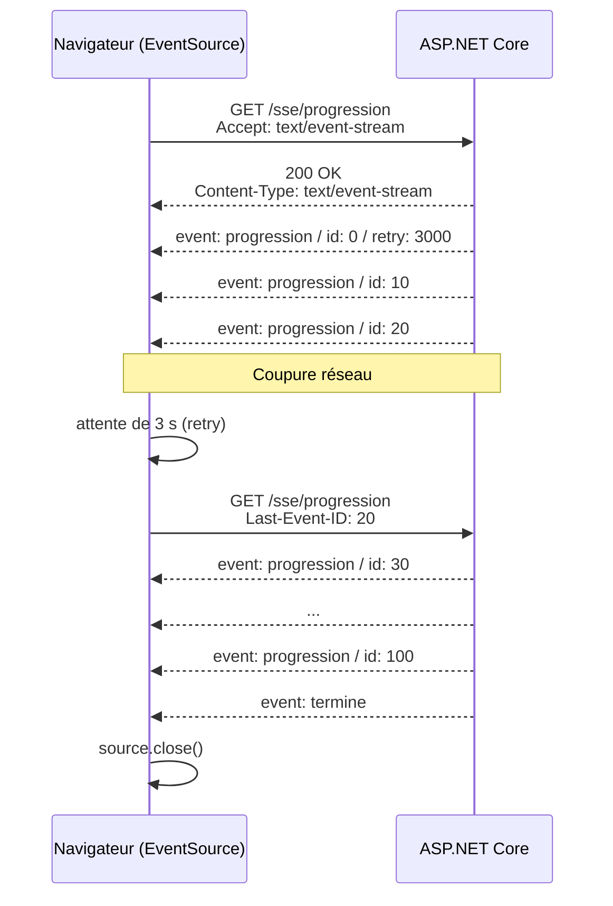

Server-Sent Events (SSE) permettent à un serveur d’envoyer des mises à jour en temps réel à un navigateur via une connexion HTTP unidirectionnelle. Contrairement aux WebSockets, SSE est plus simple et utilise le protocole HTTP standard. Avec .NET 10, ASP.NET Core propose enfin un support natif via `TypedResults.ServerSentEvents`, et le runtime fournit un parseur côté client : plus besoin d’écrire le protocole à la main.

<!--more-->

# Server-Sent Events (SSE)

Cas d’usage courants des Server-Sent Events (SSE) dans les applications web :

1. **Mises à jour de tableaux de bord**  
   Actualisation automatique des données affichées (statistiques, graphiques, monitoring).

2. **Flux d’actualités ou de réseaux sociaux**  
   Affichage en direct des nouveaux posts, commentaires ou messages.

3. **Suivi de progression**  
   Transmission de l’état d’avancement d’un traitement long (upload, génération de rapport).

4. **Monitoring système**  
   Surveillance en temps réel de serveurs, capteurs ou applications (logs, métriques).

5. **Streaming de réponses d’IA**  
   Les API de LLM renvoient leurs réponses token par token… en SSE.

SSE est particulièrement adapté pour les scénarios où le serveur doit pousser des informations vers le client dès qu’elles sont disponibles.

## Fonctionnement SSE

- **Connexion unidirectionnelle** : le client (navigateur) ouvre une connexion HTTP vers le serveur, qui reste ouverte.
- **Format des données** : le serveur envoie des événements au format texte (`text/event-stream`).
- **Réception côté client** : le client utilise l’API JavaScript `EventSource` pour recevoir les événements.

## Le format `text/event-stream`

Le protocole est volontairement minimaliste : du texte UTF-8, des lignes `champ: valeur`, et une ligne vide pour terminer chaque événement.

```text
event: progression
id: 10
retry: 3000
data: {"pourcentage":10,"libelle":"Étape 1"}

event: progression
id: 20
data: {"pourcentage":20,"libelle":"Étape 2"}

: une ligne commençant par ":" est un commentaire (souvent utilisé comme heartbeat)

```

| Champ | Rôle |
|---|---|
| `data` | Contenu de l’événement (plusieurs lignes `data:` sont concaténées) |
| `event` | Type de l’événement ; `message` par défaut s’il est absent |
| `id` | Identifiant ; le navigateur le renvoie dans l’en-tête `Last-Event-ID` à la reconnexion |
| `retry` | Délai de reconnexion en millisecondes, demandé par le serveur |

# Implémentation SSE avec ASP.NET Core (.NET 10)

## L’approche manuelle (avant .NET 10)

Avant .NET 10, on exposait un endpoint SSE en écrivant directement dans la réponse :

```csharp
app.MapGet("/sse", async (HttpContext context) =>
{
    context.Response.ContentType = "text/event-stream";
    var ct = context.RequestAborted; // annulé quand le client se déconnecte

    for (int i = 0; i < 10; i++)
    {
        await context.Response.WriteAsync($"data: Message {i} à {DateTime.Now}\n\n", ct);
        await context.Response.Body.FlushAsync(ct);
        await Task.Delay(1000, ct); // envoie toutes les secondes
    }
});
```

- Le header `Content-Type` doit être `text/event-stream`.
- Chaque message commence par `data:` et se termine par deux sauts de ligne.
- On utilise `FlushAsync()` pour pousser les données immédiatement.

Ça fonctionne, mais tout est à la charge du développeur : échappement des retours à la ligne dans `data`, sérialisation JSON, champs `id`/`retry`, gestion de la déconnexion…

## `TypedResults.ServerSentEvents` (.NET 10)

.NET 10 ajoute `TypedResults.ServerSentEvents` (et son équivalent `Results.ServerSentEvents`). Il prend un `IAsyncEnumerable<T>` et s’occupe de tout : en-têtes, formatage, flush après chaque événement, et sérialisation JSON quand `T` n’est pas une `string`.

La forme la plus simple : un flux de valeurs, avec un type d’événement optionnel.

```csharp
using System.Runtime.CompilerServices;

app.MapGet("/sse/heure", (CancellationToken ct) =>
{
    return TypedResults.ServerSentEvents(Heures(ct), eventType: "heure");

    static async IAsyncEnumerable<string> Heures([EnumeratorCancellation] CancellationToken ct)
    {
        while (!ct.IsCancellationRequested)
        {
            yield return DateTime.Now.ToString("HH:mm:ss");
            await Task.Delay(1000, ct);
        }
    }
});
```

Le `CancellationToken` injecté dans l’endpoint est lié à `HttpContext.RequestAborted` : quand le navigateur ferme la connexion, la boucle s’arrête proprement.

## `SseItem<T>` : contrôler `id`, `event` et `retry`

Pour aller plus loin, on renvoie des `SseItem<T>` (namespace `System.Net.ServerSentEvents`). En .NET 10, ce type expose `EventType`, mais aussi `EventId` et `ReconnectionInterval`, qui correspondent aux champs `id` et `retry` du protocole.

Exemple complet : un suivi de progression capable de **reprendre là où il s’était arrêté** après une coupure réseau.

```csharp
using System.Net.ServerSentEvents;
using System.Runtime.CompilerServices;

var builder = WebApplication.CreateBuilder(args);
var app = builder.Build();

app.UseDefaultFiles();
app.UseStaticFiles(); // sert wwwroot/index.html (client JS plus bas)

app.MapGet("/sse/progression", (HttpRequest request, CancellationToken ct) =>
{
    // À la reconnexion, le navigateur renvoie le dernier id reçu
    var dernierId = request.Headers["Last-Event-ID"].ToString();
    var depart = int.TryParse(dernierId, out var id) ? id + 10 : 0;

    return TypedResults.ServerSentEvents(Progression(depart, ct));

    static async IAsyncEnumerable<SseItem<ProgressionDto>> Progression(
        int depart, [EnumeratorCancellation] CancellationToken ct)
    {
        for (var i = depart; i <= 100; i += 10)
        {
            await Task.Delay(500, ct); // simulation d'un traitement

            yield return new SseItem<ProgressionDto>(
                new ProgressionDto(i, $"Étape {i / 10}"), eventType: "progression")
            {
                EventId = i.ToString(),                       // → "id: 10"
                ReconnectionInterval = TimeSpan.FromSeconds(3) // → "retry: 3000"
            };
        }

        // Événement final : le client doit fermer la connexion lui-même
        yield return new SseItem<ProgressionDto>(new ProgressionDto(100, "Terminé"), "termine");
    }
});

app.Run();

public record ProgressionDto(int Pourcentage, string Libelle);
```

Le `ProgressionDto` est sérialisé en JSON avec les options de l’application (camelCase par défaut) : `{"pourcentage":10,"libelle":"Étape 1"}`.

> ⚠️ Quand le serveur termine le flux, `EventSource` considère que la connexion a été perdue et **se reconnecte automatiquement**. D’où l’événement `termine` : c’est au client de fermer explicitement la connexion.

# Côté client

## Client JavaScript : `EventSource`

L’API `EventSource` est disponible dans tous les navigateurs modernes. Elle gère la connexion, le parsing et la reconnexion.

```html
<!-- wwwroot/index.html -->
<progress id="barre" max="100" value="0"></progress>
<span id="libelle"></span>

<script>
  const source = new EventSource("/sse/progression");

  // Événements typés ("event: progression") : addEventListener obligatoire
  source.addEventListener("progression", (e) => {
    const data = JSON.parse(e.data);
    document.getElementById("barre").value = data.pourcentage;
    document.getElementById("libelle").textContent = data.libelle;
    console.log("dernier id reçu :", e.lastEventId);
  });

  // Fin du traitement : on ferme, sinon le navigateur se reconnecte
  source.addEventListener("termine", () => {
    document.getElementById("libelle").textContent = "Terminé ✔";
    source.close();
  });

  // Événements sans type ("event" absent) : onmessage
  source.onmessage = (e) => console.log("message :", e.data);

  // Coupure réseau : EventSource retente seul après le délai "retry"
  source.onerror = () => {
    if (source.readyState === EventSource.CONNECTING) {
      console.warn("Connexion perdue, reconnexion en cours…");
    }
  };
</script>
```

Quelques limites à connaître :

- `EventSource` ne fait que des requêtes **GET** et ne permet pas d’ajouter d’en-têtes personnalisés (pas de `Authorization: Bearer`). L’authentification passe par cookie, ou par un jeton court en query string.
- En cross-origin, il faut `new EventSource(url, { withCredentials: true })` et une politique CORS adaptée.
- En **HTTP/1.1**, le navigateur limite à 6 connexions simultanées par domaine, onglets compris. En HTTP/2 (le cas par défaut avec Kestrel en HTTPS), les flux sont multiplexés et cette limite disparaît.

## Reconnexion et `Last-Event-ID`

Le mécanisme de reprise est entièrement standardisé :



1. Le serveur attribue un `id` à chaque événement et peut imposer un délai via `retry`.
2. Le navigateur mémorise le dernier `id` reçu.
3. En cas de coupure, il attend le délai `retry`, puis renvoie la requête avec l’en-tête `Last-Event-ID`.
4. Le serveur lit cet en-tête et reprend le flux au bon endroit.

C’est au serveur de savoir rejouer les événements manqués : ici c’est trivial (on recalcule à partir de l’id), mais pour un flux de notifications il faut conserver un historique (buffer en mémoire, table, stream Redis…).

## Client .NET : `SseParser`

Côté .NET, le namespace `System.Net.ServerSentEvents` (inclus dans .NET 10, disponible en package NuGet pour les versions antérieures et .NET Framework) fournit `SseParser`, qui transforme un `Stream` en `IAsyncEnumerable<SseItem<T>>`. Il ne gère pas la connexion : c’est le rôle d’`HttpClient`, et la reconnexion est à écrire soi-même.

```csharp
using System.Net.ServerSentEvents;
using System.Text.Json;

using var http = new HttpClient
{
    BaseAddress = new Uri("https://localhost:5001"),
    Timeout = Timeout.InfiniteTimeSpan // la connexion reste ouverte longtemps
};

string? lastEventId = null;
var retry = TimeSpan.FromSeconds(3);
var termine = false;

while (!termine)
{
    try
    {
        using var request = new HttpRequestMessage(HttpMethod.Get, "/sse/progression");
        request.Headers.Accept.ParseAdd("text/event-stream");
        if (!string.IsNullOrEmpty(lastEventId))
        {
            request.Headers.Add("Last-Event-ID", lastEventId); // reprise du flux
        }

        // ResponseHeadersRead : on n'attend pas la fin du corps (qui n'arrive jamais)
        using var response = await http.SendAsync(request, HttpCompletionOption.ResponseHeadersRead);
        response.EnsureSuccessStatusCode();
        await using var stream = await response.Content.ReadAsStreamAsync();

        var parser = SseParser.Create(stream); // SseParser<string>
        await foreach (var item in parser.EnumerateAsync())
        {
            // Le parseur mémorise le dernier id et le dernier retry reçus
            lastEventId = parser.LastEventId;
            if (parser.ReconnectionInterval > TimeSpan.Zero)
            {
                retry = parser.ReconnectionInterval;
            }

            switch (item.EventType)
            {
                case "progression":
                    var p = JsonSerializer.Deserialize<ProgressionDto>(item.Data, JsonSerializerOptions.Web)!;
                    Console.WriteLine($"{p.Pourcentage,3} % - {p.Libelle}");
                    break;
                case "termine":
                    termine = true;
                    break;
            }
        }
    }
    catch (HttpRequestException ex)
    {
        Console.WriteLine($"Connexion perdue : {ex.Message}");
    }

    if (!termine)
    {
        await Task.Delay(retry); // même logique que le navigateur
    }
}

public record ProgressionDto(int Pourcentage, string Libelle);
```

On peut aussi passer un délégué de désérialisation à `SseParser.Create` pour obtenir directement des objets typés, sans passer par une `string` intermédiaire :

```csharp
var parser = SseParser.Create(stream, (eventType, data) =>
    eventType == "progression"
        ? JsonSerializer.Deserialize<ProgressionDto>(data, JsonSerializerOptions.Web)
        : null);

await foreach (SseItem<ProgressionDto?> item in parser.EnumerateAsync())
{
    if (item.Data is { } p)
    {
        Console.WriteLine($"{p.Pourcentage} %");
    }
}
```

# Pousser des événements depuis un service

Un endpoint SSE n’est qu’une boucle qui produit des valeurs. Pour envoyer une notification depuis n’importe quel service de l’application, on peut intercaler un `Channel<T>` par abonné, géré par un singleton :

```csharp
using System.Collections.Concurrent;
using System.Runtime.CompilerServices;
using System.Threading.Channels;

public sealed class Notifications
{
    private readonly ConcurrentDictionary<Guid, Channel<string>> _abonnes = new();

    public (Guid Id, ChannelReader<string> Reader) Abonner()
    {
        var channel = Channel.CreateBounded<string>(new BoundedChannelOptions(100)
        {
            FullMode = BoundedChannelFullMode.DropOldest // un client lent ne bloque personne
        });
        var id = Guid.NewGuid();
        _abonnes[id] = channel;
        return (id, channel.Reader);
    }

    public void Desabonner(Guid id) => _abonnes.TryRemove(id, out _);

    public void Publier(string message)
    {
        foreach (var channel in _abonnes.Values)
        {
            channel.Writer.TryWrite(message);
        }
    }
}

// Program.cs
builder.Services.AddSingleton<Notifications>();

app.MapGet("/sse/notifications", (Notifications notifications, CancellationToken ct) =>
{
    var (id, reader) = notifications.Abonner();
    return TypedResults.ServerSentEvents(Lire(ct), eventType: "notification");

    async IAsyncEnumerable<string> Lire([EnumeratorCancellation] CancellationToken token)
    {
        try
        {
            await foreach (var message in reader.ReadAllAsync(token))
            {
                yield return message;
            }
        }
        finally
        {
            notifications.Desabonner(id); // le client s'est déconnecté
        }
    }
});

// N'importe où : un service, un BackgroundService, un autre endpoint
app.MapPost("/admin/annonce", (string texte, Notifications notifications) =>
{
    notifications.Publier(texte);
    return Results.Accepted();
});
```

Cela fonctionne très bien sur **une seule instance**. Dès qu’on passe à plusieurs instances, il faut un backplane (Redis pub/sub, broker…) pour que le message atteigne l’instance qui détient la connexion : c’est exactement ce que SignalR fournit clé en main.

# SSE face aux autres méthodes

Voici les principaux avantages et inconvénients des Server-Sent Events (SSE) par rapport à d’autres méthodes de communication en temps réel (WebSocket, SignalR) :

## Avantages des SSE

- **Simplicité d’implémentation**  
  SSE utilise HTTP standard, ce qui facilite la configuration côté serveur et client.

- **Unidirectionnel serveur → client**  
  Idéal pour les notifications, mises à jour ou flux de données où seul le serveur envoie des informations.

- **Gestion automatique de la reconnexion**  
  L’API `EventSource` côté client gère la reconnexion en cas de perte de connexion, avec reprise via `Last-Event-ID`.

- **Compatibilité avec les proxies et firewalls**  
  SSE fonctionne bien avec la plupart des infrastructures réseau, car il repose sur HTTP (pas d’upgrade de protocole).

- **Faible consommation de ressources**  
  Moins gourmand en ressources que les WebSockets pour des flux unidirectionnels, et parfaitement compatible HTTP/2.

## Inconvénients des SSE

- **Unidirectionnel uniquement**  
  Impossible d’envoyer des données du client vers le serveur via la même connexion (contrairement aux WebSockets). Le client utilise des requêtes HTTP classiques pour cela.

- **Texte uniquement**  
  Pas de données binaires : il faut passer par du JSON ou du Base64.

- **API navigateur limitée**  
  `EventSource` ne permet ni méthode autre que GET, ni en-têtes personnalisés.

- **Limite de connexions en HTTP/1.1**  
  6 connexions par domaine dans le navigateur ; la limite disparaît en HTTP/2 ou HTTP/3.

- **Proxies qui bufferisent**  
  Certains reverse proxies (nginx notamment) ou middlewares de compression retiennent la réponse : il faut désactiver le buffering sur ces routes.

- **Scalabilité**  
  Maintenir de nombreuses connexions ouvertes peut être difficile à grande échelle, et la diffusion multi-instances demande un backplane.

## Comparaison avec d’autres méthodes

| Critère | SSE | WebSocket | SignalR | Long polling |
|---|---|---|---|---|
| **Direction** | Serveur → client | Bidirectionnel | Bidirectionnel (RPC) | Serveur → client (simulé) |
| **Transport** | HTTP (1.1, 2, 3) | Upgrade TCP (`ws://`) | WebSocket, puis SSE, puis long polling en repli | Requêtes HTTP répétées |
| **Format** | Texte UTF-8 | Texte ou binaire | JSON ou MessagePack | Libre |
| **Reconnexion** | Native (`retry`, `Last-Event-ID`) | À coder | Native (`WithAutomaticReconnect`) | Implicite |
| **API côté .NET** | `TypedResults.ServerSentEvents`, `SseParser` | `app.UseWebSockets()`, `WebSocket` | `Hub`, `IHubContext<T>` | Endpoint classique |
| **Client navigateur** | `EventSource` natif | `WebSocket` natif | Bibliothèque `@microsoft/signalr` | `fetch` |
| **Envoi depuis un service** | À construire (`Channel<T>`) | À construire | `IHubContext<T>` injectable | À construire |
| **Groupes / utilisateurs** | Non | Non | Oui (`Clients.User`, `Groups`) | Non |
| **Scale-out** | Backplane maison | Backplane maison | Redis, Azure SignalR Service | Facile (stateless) |
| **Latence** | Faible | Très faible | Très faible | Moyenne (une requête par message) |
| **Cas typiques** | Progression, dashboard, streaming d’IA | Jeux, édition collaborative | Chat, notifications ciblées | Environnements très contraints |

- **WebSockets**

  - Bidirectionnel (client ↔ serveur)
  - Plus adapté aux applications interactives (chat, jeux)
  - Plus complexe à mettre en œuvre et à sécuriser

- **Long Polling**
  - Simule le temps réel : le client envoie une requête que le serveur garde ouverte jusqu’à avoir une donnée, puis le client recommence
  - Moins efficace, plus de latence et de consommation réseau

# En conclusion

Le SSE à travers un endpoint .NET convient aux cas simples localisés : comme il se base sur un endpoint, il n'est pas possible d'accéder directement et facilement à cet endpoint depuis un service quelconque pour envoyer une notification comme on le ferait avec l'injection de SignalR. Il faudrait également retrouver l'instance d'endpoint correspondant à l'utilisateur à notifier (le `Channel<T>` vu plus haut en est une ébauche). Si en plus l'application fait du scaling horizontal, il faudrait un mécanisme de communication inter-instances pour que le message remonte à la bonne instance du bon endpoint.

Le SSE .NET est parfait pour implémenter simplement des flux de retour asynchrone :

- une barre de progression sur un calcul un peu long ;
- un tableau de bord avec des données qui arrivent en continu ;
- le streaming d’une réponse générée progressivement (IA, export).

Dans ces exemples, le navigateur s'abonne à l'endpoint sur une instance et affiche les données qui arrivent en continu pour cette action de cet utilisateur.

Dans les autres cas, préférer SignalR, par exemple pour envoyer un message à un utilisateur, quelle que soit la page où il se trouve, pour lui dire qu'un de ses documents a été supprimé.

# Résumé

| Besoin | Outil |
|---|---|
| Endpoint SSE en .NET 10 | `TypedResults.ServerSentEvents(IAsyncEnumerable<T>)` |
| Contrôler `event`, `id`, `retry` | `SseItem<T>` avec `EventType`, `EventId`, `ReconnectionInterval` |
| Reprendre après coupure | Lire l’en-tête `Last-Event-ID` côté serveur |
| Client navigateur | `EventSource`, `addEventListener` pour les événements typés, `close()` en fin de flux |
| Client .NET | `HttpClient` + `SseParser.Create(stream).EnumerateAsync()` |
| Notifier depuis un service | `Channel<T>` sur une instance, SignalR au-delà |
