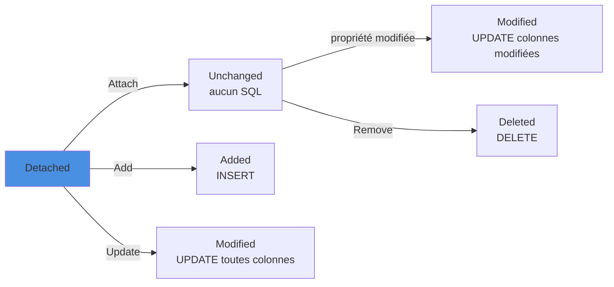

Ef core et le change tracker : Quand et pourquoi utiliser Attach, Update ou Entry pour rattacher des entités au DbContext

<!--more-->
 
# 1. Rôle du Change Tracker

Le Change Tracker d’Entity Framework Core a pour mission de suivre l’état des entités manipulées par un `DbContext`.  
Lorsque vous récupérez une entité via ce contexte (sans `AsNoTracking()`), EF Core :

- commence à suivre cette entité automatiquement,
- détecte les modifications apportées à ses propriétés,
- génère les commandes SQL appropriées lors de l’appel à `SaveChanges()`.

Dans ce cas, **il n’est pas nécessaire d’attacher explicitement l’entité**.

Chaque méthode fait passer l'entité dans un état précis, et c'est cet état qui détermine le SQL envoyé par `SaveChanges()` :



Les exemples SQL ci-dessous sont ceux d'EF Core 10 sur SQL Server (on peut les observer avec `LogTo(Console.WriteLine, LogLevel.Information)`).

# 2. Situations où l’attachement explicite est nécessaire

Vous devez utiliser `Attach`, `Update` ou manipuler l’état via `Entry` lorsque vous travaillez avec des entités **détachées**, c’est‑à‑dire des objets que le `DbContext` ne suit pas encore.

## 2.1. Mise à jour d’une entité reconstruite (DTO → entité)

Scénario : vous recevez un DTO depuis un client et vous construisez une entité avec un identifiant déjà existant, sans l’avoir relue depuis la base dans ce `DbContext`.

```csharp
var product = new Product
{
    Id = dto.Id,
    Name = dto.Name,
    Price = dto.Price
};

// Indiquer à EF que cette entité existe déjà en base
_context.Attach(product);
_context.Entry(product).State = EntityState.Modified;

await _context.SaveChangesAsync();
```

Ici, l’attachement est indispensable, car le contexte ne connaît pas encore cette instance.

SQL généré : **toutes** les colonnes non-clés sont mises à jour, puisque l'entité entière est marquée `Modified`.

```sql
SET NOCOUNT ON;
UPDATE [Products] SET [CategoryId] = @p0, [CreatedAt] = @p1, [Name] = @p2, [Price] = @p3
OUTPUT 1
WHERE [Id] = @p4;
```

> ❌ Piège : si `Product` possède d'autres colonnes (`CreatedAt`, `CategoryId`…) que le DTO ne renseigne pas, elles sont écrasées avec leur valeur par défaut (`null`, `0`, `0001-01-01`). Dans ce cas, préférer la mise à jour partielle (2.2) ou relire l'entité.

> Variante : `_context.Update(product)` réalise un `Attach` et marque l’ensemble du graphe comme `Modified`.

Plus précisément, `Update` parcourt le graphe : les entités dont la clé est renseignée passent en `Modified`, celles dont la clé générée vaut la valeur par défaut (`Id == 0`) passent en `Added`.

## 2.2. Mise à jour partielle de propriétés

Si vous souhaitez mettre à jour uniquement certaines propriétés :

```csharp
var product = new Product { Id = dto.Id };
_context.Attach(product);

product.Price = dto.Price;

_context.Entry(product).Property(p => p.Price).IsModified = true;

await _context.SaveChangesAsync();
```

L’appel à `Attach` permet au Change Tracker de suivre l’objet et de savoir quelles propriétés doivent être persistées.

```sql
SET NOCOUNT ON;
UPDATE [Products] SET [Price] = @p0
OUTPUT 1
WHERE [Id] = @p1;
```

Seule la colonne marquée est envoyée. Le `OUTPUT 1` permet à EF Core de vérifier qu'une ligne a bien été modifiée : si l'Id n'existe pas, `SaveChanges` lève une `DbUpdateConcurrencyException`.

## 2.3. Reprise d’une entité issue d’une requête `AsNoTracking()`

Les requêtes `AsNoTracking()` retournent des entités non suivies. Pour les modifier ensuite, il faut les rattacher au contexte :

```csharp
var product = await _context.Products
    .AsNoTracking()
    .FirstOrDefaultAsync(p => p.Id == id);

// Modifications
product.Price = newPrice;

// Rattachement au contexte
_context.Attach(product);
_context.Entry(product).State = EntityState.Modified;

await _context.SaveChangesAsync();
```

Sans cette étape, `SaveChanges()` n’a aucun effet sur cette entité.

Comme en 2.1, le passage à `Modified` génère un `UPDATE` de toutes les colonnes : le Change Tracker n'a pas de snapshot des valeurs d'origine (l'entité a été lue sans suivi), il ne peut donc pas savoir que seul `Price` a changé.

✅ Si l'on sait que l'entité va être modifiée, autant la lire **avec** suivi : EF Core ne mettra à jour que les colonnes réellement modifiées.

## 2.4. Gestion des relations avec des entités existantes

Lorsqu’une nouvelle entité doit être reliée à une entité déjà existante, connue uniquement par son identifiant :

```csharp
var order = new Order { /* ... */ };

var customer = new Customer { Id = customerId };
_context.Attach(customer); // entité existante

order.Customer = customer;

_context.Orders.Add(order);
await _context.SaveChangesAsync();
```

L’attachement du `Customer` indique à EF Core qu’il ne doit pas insérer un nouvel enregistrement pour ce client.

```sql
-- ✅ Avec Attach : un seul INSERT, sur Orders
SET NOCOUNT ON;
INSERT INTO [Orders] ([CustomerId], [OrderDate])
OUTPUT INSERTED.[Id]
VALUES (@p0, @p1);
```

❌ Sans `Attach`, `Add(order)` parcourt le graphe et marque aussi le `Customer` comme `Added` : EF Core tente un `INSERT INTO [Customers]` avec un Id explicite, qui échoue (`IDENTITY_INSERT` désactivé ou clé dupliquée).

✅ Encore plus simple quand la clé étrangère est exposée dans le modèle :

```csharp
var order = new Order { CustomerId = customerId /* ... */ };
_context.Orders.Add(order);
```

## 2.5. Réattachement d’un graphe provenant d’un autre contexte ou d’un autre processus

Si vous désérialisez un graphe d’entités obtenu ailleurs (autre `DbContext`, autre couche, autre service), il est nécessaire de le rattacher :

```csharp
_context.Attach(order);
// éventuellement, pour forcer une mise à jour globale :
_context.Entry(order).State = EntityState.Modified;

await _context.SaveChangesAsync();
```

Attention : `Entry(order).State = Modified` ne concerne **que** la commande ; les lignes du graphe restent `Unchanged` (ou `Added` si leur clé n'est pas renseignée). Les lignes supprimées côté client ne sont pas détectées non plus : EF Core ne sait pas qu'elles ont existé. Pour un graphe complexe, il est souvent plus sûr de recharger l'agrégat et d'appliquer les différences.

# 3. Situations où l’attachement n’est pas nécessaire

Vous n’avez **pas** besoin d’appeler `Attach` lorsque :

- l’entité a été chargée par le même `DbContext` **sans** `AsNoTracking()` :

```csharp
var product = await _context.Products.FirstAsync(p => p.Id == id);
product.Price = 10;

await _context.SaveChangesAsync(); // EF détecte la modification automatiquement
```

```sql
-- Le snapshot permet de n'envoyer que la colonne modifiée
UPDATE [Products] SET [Price] = @p0
OUTPUT 1
WHERE [Id] = @p1;
```

- vous ajoutez une nouvelle entité :

```csharp
_context.Products.Add(new Product { Name = "X" });
// `Add` attache l’entité avec l’état `Added`
await _context.SaveChangesAsync();
```

- vous ne faites que lire les données, sans intention de les modifier.

# 4. Contourner le Change Tracker : `ExecuteUpdate` et `ExecuteDelete`

Toutes les techniques précédentes passent par le Change Tracker, avec un aller-retour pour charger (ou attacher) chaque entité. Pour des modifications **en masse**, EF Core (depuis la version 7) propose `ExecuteUpdate` et `ExecuteDelete` : une seule commande SQL, exécutée immédiatement, sans charger aucune entité.

## 4.1. `ExecuteUpdateAsync`

```csharp
var now = DateTime.UtcNow;

// Augmente de 5 % tous les prix d'une catégorie
int nb = await _context.Products
    .Where(p => p.CategoryId == categoryId)
    .ExecuteUpdateAsync(s => s
        .SetProperty(p => p.Price, p => p.Price * 1.05m)
        .SetProperty(p => p.UpdatedAt, now));
```

```sql
UPDATE [p]
SET [p].[Price] = [p].[Price] * 1.05,
    [p].[UpdatedAt] = @now
FROM [Products] AS [p]
WHERE [p].[CategoryId] = @categoryId
```

La méthode retourne le nombre de lignes affectées. Il n'y a **pas** d'appel à `SaveChanges`.

Depuis EF Core 10, les setters acceptent une lambda classique (et plus seulement un arbre d'expression), ce qui simplifie les mises à jour conditionnelles :

```csharp
await _context.Products
    .Where(p => p.Id == dto.Id)
    .ExecuteUpdateAsync(s =>
    {
        s.SetProperty(p => p.Price, dto.Price);
        if (dto.Name is not null)
        {
            s.SetProperty(p => p.Name, dto.Name);
        }
    });
```

C'est une bonne alternative à la mise à jour partielle du 2.2, sans `Attach` ni stub.

## 4.2. `ExecuteDeleteAsync`

```csharp
var limite = DateTime.UtcNow.AddYears(-2);

int supprimees = await _context.Orders
    .Where(o => o.Status == OrderStatus.Cancelled && o.CreatedAt < limite)
    .ExecuteDeleteAsync();
```

```sql
DELETE FROM [o]
FROM [Orders] AS [o]
WHERE [o].[Status] = 3 AND [o].[CreatedAt] < @limite
```

Avec le Change Tracker, la même opération aurait nécessité de charger toutes les commandes, de les passer en `Deleted`, puis d'envoyer un `DELETE` par ligne (regroupés en lots).

## 4.3. Pièges de `ExecuteUpdate` / `ExecuteDelete`

- ❌ **Le Change Tracker n'est pas mis à jour** : une entité déjà chargée dans le contexte garde ses anciennes valeurs. Un `SaveChanges` ultérieur peut même écraser la mise à jour en masse.
- ❌ **Exécution immédiate, hors `SaveChanges`** : pour regrouper plusieurs `ExecuteXxx` et un `SaveChanges` de manière atomique, il faut une transaction explicite (`BeginTransactionAsync`).
- ❌ **Pas de logique côté EF** : les intercepteurs de `SaveChanges`, le remplissage automatique de colonnes d'audit, les jetons de concurrence et la suppression en cascade côté client ne s'appliquent pas. Seules les cascades configurées **dans la base** sont exécutées.
- ✅ Les filtres globaux (`HasQueryFilter`, soft delete, multi-tenant) s'appliquent bien au `Where`.

# 5. Pièges courants avec Attach

## 5.1. Une autre instance avec la même clé est déjà suivie

```csharp
var existing = await _context.Products.FindAsync(dto.Id); // suivie
var product = new Product { Id = dto.Id, Name = dto.Name };
_context.Attach(product);
// ❌ InvalidOperationException : The instance of entity type 'Product' cannot be tracked
//    because another instance with the key value '{Id: 42}' is already being tracked.
```

✅ Copier les valeurs sur l'instance suivie plutôt que d'en attacher une seconde :

```csharp
var existing = await _context.Products.FindAsync(dto.Id);
_context.Entry(existing!).CurrentValues.SetValues(dto); // propriétés de même nom
await _context.SaveChangesAsync(); // UPDATE des seules colonnes qui ont changé
```

## 5.2. Supprimer sans charger

```csharp
// Entité « stub » : seule la clé est renseignée
_context.Remove(new Product { Id = id });
await _context.SaveChangesAsync();
```

```sql
SET NOCOUNT ON;
DELETE FROM [Products]
OUTPUT 1
WHERE [Id] = @p0;
```

Fonctionne, mais lève une `DbUpdateConcurrencyException` si la ligne n'existe plus. Pour une suppression simple, `Where(p => p.Id == id).ExecuteDeleteAsync()` est plus direct et retourne `0` sans erreur.

## 5.3. Un contexte qui vit trop longtemps

Plus un `DbContext` suit d'entités, plus `DetectChanges` est coûteux et plus les conflits de clés (5.1) sont probables. Un contexte par requête HTTP (durée de vie `Scoped`) reste la règle ; dans un traitement par lots, `_context.ChangeTracker.Clear()` vide le suivi entre deux lots.

# 6. Synthèse des bonnes pratiques

En résumé, vous devez attacher une entité (via `Attach`, `Update` ou `Entry(entity).State = …`) **uniquement lorsque** :

1. L’objet n’a pas été chargé par le `DbContext` courant (ou l’a été via `AsNoTracking()`), **et**
2. Vous souhaitez qu’il participe à `SaveChanges()` (INSERT, UPDATE, DELETE, modification de relations, etc.).

Règle pratique :

- Entité chargée par le contexte (sans `AsNoTracking`) → **pas d’`Attach`**.
- Entité reconstruite à partir d’un DTO, avec un Id existant → **`Attach` ou `Update`**.
- Entité retournée par une requête `AsNoTracking()` que vous voulez modifier → **`Attach` avant la mise à jour**.
- Entité utilisée uniquement comme “référence” attachée à un nouvel objet (relation, clé étrangère) → **`Attach` la référence** pour éviter les `INSERT` involontaires.
- Modification ou suppression en masse, sans besoin des entités en mémoire → **`ExecuteUpdate` / `ExecuteDelete`**.

| Scénario | Méthode | État | SQL généré |
|---|---|---|---|
| Entité chargée puis modifiée | (rien) | `Modified` (colonnes changées) | `UPDATE` des colonnes modifiées |
| DTO complet avec Id | `Attach` + `State = Modified` / `Update` | `Modified` (toutes) | `UPDATE` de toutes les colonnes |
| DTO partiel | `Attach` + `IsModified = true` | `Modified` (ciblée) | `UPDATE` des colonnes marquées |
| Référence existante pour une relation | `Attach` | `Unchanged` | Aucun (seul l'`INSERT` du parent) |
| Nouvelle entité | `Add` | `Added` | `INSERT ... OUTPUT INSERTED.[Id]` |
| Suppression par Id | `Remove(stub)` | `Deleted` | `DELETE ... WHERE [Id] = @p0` |
| Mise à jour en masse | `ExecuteUpdateAsync` | — (pas de suivi) | Un seul `UPDATE ... FROM ... WHERE` |
| Suppression en masse | `ExecuteDeleteAsync` | — (pas de suivi) | Un seul `DELETE ... FROM ... WHERE` |
