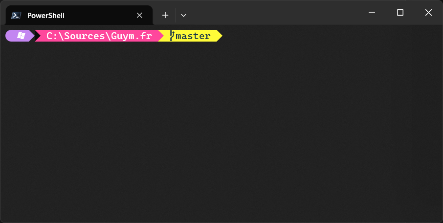
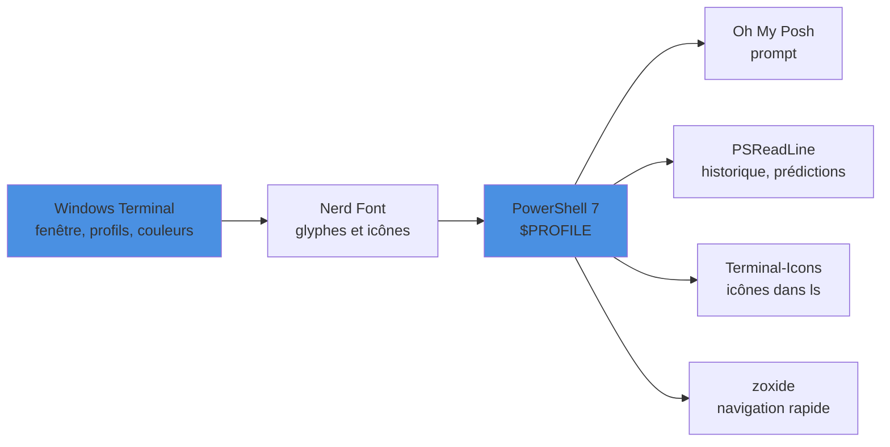

Améliorez l’apparence et les fonctionnalités de votre terminal PowerShell sous Windows avec une police adaptée, Oh My Posh pour le prompt, et PSReadLine pour un historique beaucoup plus efficace.

<!--more-->



L’objectif est d’empiler quelques briques simples, chacune ayant un rôle précis :



# Prérequis : PowerShell 7

Windows embarque encore Windows PowerShell 5.1. Les prédictions basées sur les plugins de PSReadLine et la plupart des modules récents visent PowerShell 7 : autant l’installer.

```powershell
winget install Microsoft.PowerShell
```

# Police de caractères

Microsoft Cascadia Code sous Windows, notamment dans VS Code et le Terminal.

1. Installer la police

https://github.com/microsoft/cascadia-code/releases

- Variants: Cascadia Code (ligatures), Cascadia Mono (sans ligatures), Cascadia Code PL (glyphes Powerline), Cascadia Code NF (Nerd Font : glyphes Powerline **et** icônes).

2. VS Code (éditeur)

- Fichier > Préférences > Paramètres > “Font Family” = Cascadia Code
- Activer “Font Ligatures”
- Ou via settings.json:

```json
{
  // ...existing code...
  "editor.fontFamily": "Cascadia Code, Consolas, 'Courier New', monospace",
  "editor.fontLigatures": true
  // ...existing code...
}
```

3. VS Code (terminal intégré)

- Paramètre:

```json
{
  // ...existing code...
  "terminal.integrated.fontFamily": "Cascadia Code PL"
  // ...existing code...
}
```

4. Windows Terminal

- Paramètres > Profiles > Defaults > Appearance > Font face: “Cascadia Code PL” (ou “Cascadia Code”/“Cascadia Mono” selon besoin).

5. Visual Studio

- Tools > Options > Environment > Fonts and Colors > Text Editor > Font: “Cascadia Code NF”.

Note: relancer les applications après l’installation de la police.

## Pourquoi une Nerd Font ?

Une police « classique » ne contient pas les symboles utilisés par les prompts modernes (logo Git, icône de dossier, flèches Powerline, logo .NET…). Une **Nerd Font** est une police patchée qui ajoute plusieurs milliers de glyphes. Sans elle, le prompt affiche des carrés ou des points d’interrogation.

❌ Prompt avec une police standard : `□ main □ □ 3`
✅ Prompt avec une Nerd Font : icônes de branche, de dossier, de langage, séparateurs arrondis.

Deux façons d’installer une Nerd Font :

```powershell
# Via winget
winget install NerdFonts.CaskaydiaCove

# Via Oh My Posh (une fois Oh My Posh installé, voir plus bas)
oh-my-posh font install            # menu interactif
oh-my-posh font install CascadiaCode
oh-my-posh font install meslo      # police recommandée par la doc Oh My Posh
```

> Sans droits administrateur, `oh-my-posh font install --user` installe la police pour l’utilisateur courant uniquement.

# Windows Terminal : settings.json

L’interface graphique des paramètres suffit pour les réglages courants, mais le fichier `settings.json` (bouton « Ouvrir le fichier JSON » en bas à gauche des paramètres, ou `Ctrl+Maj+,`) permet de versionner et de partager sa configuration.

```json
{
  "$schema": "https://aka.ms/terminal-profiles-schema",
  // Profil ouvert par défaut : PowerShell 7
  "defaultProfile": "{574e775e-4f2a-5b96-ac1e-a2962a402336}",
  "copyOnSelect": true,
  "profiles": {
    // Réglages appliqués à TOUS les profils
    "defaults": {
      "font": {
        "face": "CaskaydiaCove Nerd Font",
        "size": 11
      },
      "colorScheme": "Guym Dark",
      "opacity": 92,
      "useAcrylic": true,
      "padding": "8",
      "cursorShape": "bar"
    },
    "list": [
      {
        "guid": "{574e775e-4f2a-5b96-ac1e-a2962a402336}",
        "name": "PowerShell 7",
        "source": "Windows.Terminal.PowershellCore",
        // Ouvrir directement dans le dossier des sources
        "startingDirectory": "C:\\Sources"
      },
      {
        "name": "Windows PowerShell",
        "commandline": "powershell.exe",
        "hidden": true
      }
    ]
  },
  // Schémas de couleurs personnalisés
  "schemes": [
    {
      "name": "Guym Dark",
      "background": "#1E1E2E",
      "foreground": "#CDD6F4",
      "cursorColor": "#F5E0DC",
      "selectionBackground": "#585B70",
      "black": "#45475A",
      "red": "#F38BA8",
      "green": "#A6E3A1",
      "yellow": "#F9E2AF",
      "blue": "#89B4FA",
      "purple": "#CBA6F7",
      "cyan": "#94E2D5",
      "white": "#BAC2DE",
      "brightBlack": "#585B70",
      "brightRed": "#F38BA8",
      "brightGreen": "#A6E3A1",
      "brightYellow": "#F9E2AF",
      "brightBlue": "#89B4FA",
      "brightPurple": "#CBA6F7",
      "brightCyan": "#94E2D5",
      "brightWhite": "#A6ADC8"
    }
  ]
}
```

Points à retenir :

- `profiles.defaults` évite de dupliquer la police et les couleurs dans chaque profil.
- Le GUID `{574e775e-...}` est celui du profil PowerShell 7 généré automatiquement ; vérifiez-le dans la liste de vos profils.
- `hidden: true` masque un profil du menu sans le supprimer (Windows Terminal le régénérerait sinon).
- Des schémas prêts à l’emploi (Catppuccin, Dracula, One Half…) sont disponibles sur [windowsterminalthemes.dev](https://windowsterminalthemes.dev) : il suffit de copier le bloc JSON dans `schemes`.

# Terminal avec Oh My Posh

1. Installer

- Oh My Posh:

```powershell
winget install JanDeDobbeleer.OhMyPosh -s winget
```

- Police Nerd Font (pour les icônes). Recommandé: CaskaydiaCove (Cascadia patchée):

```powershell
winget install NerdFonts.CaskaydiaCove
```

2. Définir la police dans vos terminaux

- VS Code (terminal intégré) dans settings.json:

```json
{
  // ...existing code...
  "terminal.integrated.fontFamily": "CaskaydiaCove Nerd Font"
  // ...existing code...
}
```

- Windows Terminal: Paramètres > Profiles > Defaults > Appearance > Font face = “CaskaydiaCove Nerd Font”.

3. Initialiser dans PowerShell

- Créer/ouvrir le profil:

```powershell
if (!(Test-Path -Path $PROFILE)) { New-Item -ItemType File -Path $PROFILE -Force }
notepad $PROFILE
```

- Ajouter cette ligne puis enregistrer:

```powershell
oh-my-posh init pwsh --config "$env:POSH_THEMES_PATH\jandedobbeleer.omp.json" | Invoke-Expression
```

> Sur les versions récentes, `--config` accepte aussi directement un **nom de thème** (`--config jandedobbeleer`) ou une **URL**. Dans ces deux cas, le thème est téléchargé au démarrage du shell : un fichier local reste plus rapide.

4. Tester et changer de thème

- Lister les thèmes:

```powershell
Get-ChildItem $env:POSH_THEMES_PATH
```

- La galerie complète, avec captures d’écran, est disponible sur [ohmyposh.dev/docs/themes](https://ohmyposh.dev/docs/themes).

5. Mise à jour

```powershell
winget upgrade JanDeDobbeleer.OhMyPosh
```

## Créer son propre thème

Plutôt que de modifier un thème fourni (écrasé à chaque mise à jour), on exporte un thème de départ dans un fichier personnel :

```powershell
# Exporter un thème existant comme base de travail
oh-my-posh config export --config jandedobbeleer --output ~/.guym.omp.json
```

Le fichier est un JSON composé de **blocs** contenant des **segments** (chemin, Git, .NET, heure…). Exemple minimal, volontairement court :


```json
{
  "$schema": "https://raw.githubusercontent.com/JanDeDobbeleer/oh-my-posh/main/themes/schema.json",
  "version": 3,
  "final_space": true,
  "blocks": [
    {
      "type": "prompt",
      "alignment": "left",
      "segments": [
        {
          "type": "path",
          "style": "powerline",
          "powerline_symbol": "\ue0b0",
          "foreground": "#ffffff",
          "background": "#4A90E2",
          "template": " {{ .Path }} ",
          "properties": { "style": "folder" }
        },
        {
          "type": "git",
          "style": "powerline",
          "powerline_symbol": "\ue0b0",
          "foreground": "#193549",
          "background": "#A6E3A1",
          "template": " {{ .HEAD }} {{ if .Working.Changed }}*{{ end }} "
        },
        {
          "type": "dotnet",
          "style": "powerline",
          "powerline_symbol": "\ue0b0",
          "foreground": "#ffffff",
          "background": "#512BD4",
          "template": " \ue77f {{ .Full }} "
        }
      ]
    }
  ]
}
```


Puis on pointe le profil vers ce fichier : `oh-my-posh init pwsh --config ~/.guym.omp.json | Invoke-Expression`.

> Les noms exacts des propriétés évoluent avec les versions de schéma : l’éditeur (VS Code) valide le fichier grâce à `$schema`, ce qui évite les fautes de frappe.

# Historique du terminal avec PSReadLine

Après l’apparence du terminal, PSReadLine permet d’améliorer fortement le confort d’utilisation : édition de ligne, autocomplétion, prédictions et recherche d’historique.

1. Installer ou mettre à jour (PowerShell 5+ ou 7+)

```powershell
Install-Module PSReadLine -Scope CurrentUser -Force
```

2. Raccourcis utiles au quotidien

- Tab : menu de complétion.
- Flèche droite : accepter la prédiction.
- Alt+F : accepter le prochain mot suggéré.
- Taper un préfixe puis ↑/↓ : recherche d’historique par préfixe.
- Ctrl+R : recherche incrémentale dans l’historique.
- F2 : basculer entre la vue prédictive en ligne (`InlineView`) et la liste (`ListView`).
- Ctrl+Espace : afficher toutes les complétions possibles.

## Prédiction : InlineView ou ListView ?

| Vue | Affichage | Usage |
|---|---|---|
| `InlineView` | Suggestion grisée à droite du curseur | Discret, une seule proposition |
| `ListView` | Liste déroulante sous la ligne de commande | Plusieurs propositions, navigation avec ↑/↓ |

Avec `ListView`, on tape `dotnet t` et PSReadLine propose immédiatement les dernières commandes correspondantes (`dotnet test --filter ...`, `dotnet tool restore`…). La source `HistoryAndPlugin` combine l’historique et les prédicteurs installés (comme `Az.Tools.Predictor`).

3. Configuration conseillée dans `$PROFILE`

Ouvrir/éditer le profil :

```powershell
if (!(Test-Path -Path $PROFILE)) { New-Item -ItemType File -Path $PROFILE -Force }
notepad $PROFILE
```

Puis ajouter (et redémarrer le terminal) :

```powershell
Import-Module PSReadLine
Set-PSReadLineOption -EditMode Windows
Set-PSReadLineOption -PredictionSource HistoryAndPlugin
Set-PSReadLineOption -PredictionViewStyle ListView
Set-PSReadLineOption -BellStyle None

Set-PSReadLineKeyHandler -Key UpArrow -Function HistorySearchBackward
Set-PSReadLineKeyHandler -Key DownArrow -Function HistorySearchForward
Set-PSReadLineKeyHandler -Key Tab -Function MenuComplete
Set-PSReadLineKeyHandler -Key RightArrow -Function AcceptSuggestion
Set-PSReadLineKeyHandler -Key "Alt+f" -Function AcceptNextSuggestionWord
```

4. Optionnel : prédicteur Azure

```powershell
Install-Module Az.Tools.Predictor -Scope CurrentUser
Import-Module Az.Tools.Predictor
Enable-AzPredictor -AllSession
```

5. Diagnostic rapide

```powershell
Get-PSReadLineOption
Get-PSReadLineKeyHandler | Out-Host -Paging
```

> L’historique est stocké dans un simple fichier texte : `(Get-PSReadLineOption).HistorySavePath`. Attention aux mots de passe tapés en clair dans une commande : ils y restent.

# Modules complémentaires

## Terminal-Icons

Terminal-Icons ajoute des icônes et des couleurs à `Get-ChildItem` (`ls`, `dir`) selon le type de fichier (`.cs`, `.csproj`, `.json`, dossier `.git`…). Il nécessite une Nerd Font.

```powershell
Install-Module Terminal-Icons -Repository PSGallery -Scope CurrentUser
Import-Module Terminal-Icons
```

## zoxide

zoxide est un `cd` « intelligent » : il mémorise les dossiers visités et permet d’y revenir avec un fragment de nom.

```powershell
winget install ajeetdsouza.zoxide
```

Une fois initialisé dans le profil (voir ci-dessous) :

```powershell
cd C:\Sources\guym.fr\_posts   # première visite : zoxide enregistre le dossier
z posts                         # plus tard, depuis n'importe où
z guym                          # le dossier le plus « fréquent + récent » gagne
zi                              # sélection interactive (nécessite fzf)
```

# Un $PROFILE complet

Voici un profil qui assemble tout ce qui précède. Chaque bloc vérifie la présence de l’outil, pour que le profil ne casse pas sur une machine où il manque quelque chose.

```powershell
# =====================================================================
#  $PROFILE - PowerShell 7
#  Emplacement : $PROFILE (CurrentUserCurrentHost)
# =====================================================================

# --- Encodage : UTF-8 partout (évite les accents cassés) -------------
[Console]::OutputEncoding = [System.Text.Encoding]::UTF8
$OutputEncoding = [System.Text.Encoding]::UTF8

# --- Prompt : Oh My Posh ---------------------------------------------
if (Get-Command oh-my-posh -ErrorAction SilentlyContinue) {
    # Thème personnel exporté avec 'oh-my-posh config export'
    $theme = Join-Path $HOME '.guym.omp.json'
    if (-not (Test-Path $theme)) { $theme = 'jandedobbeleer' }
    oh-my-posh init pwsh --config $theme | Invoke-Expression
}

# --- Icônes dans ls / dir --------------------------------------------
if (Get-Module -ListAvailable Terminal-Icons) {
    Import-Module Terminal-Icons
}

# --- PSReadLine : édition, historique, prédictions -------------------
Import-Module PSReadLine
Set-PSReadLineOption -EditMode Windows
Set-PSReadLineOption -BellStyle None
Set-PSReadLineOption -HistoryNoDuplicates
Set-PSReadLineOption -MaximumHistoryCount 10000
Set-PSReadLineOption -PredictionSource HistoryAndPlugin
Set-PSReadLineOption -PredictionViewStyle ListView
Set-PSReadLineOption -Colors @{ InlinePrediction = '#8A8A8A' }

# Recherche par préfixe avec les flèches
Set-PSReadLineKeyHandler -Key UpArrow   -Function HistorySearchBackward
Set-PSReadLineKeyHandler -Key DownArrow -Function HistorySearchForward
# Complétion et suggestions
Set-PSReadLineKeyHandler -Key Tab        -Function MenuComplete
Set-PSReadLineKeyHandler -Key RightArrow -Function AcceptSuggestion
Set-PSReadLineKeyHandler -Key 'Alt+f'    -Function AcceptNextSuggestionWord
# F2 : bascule InlineView <-> ListView
Set-PSReadLineKeyHandler -Key F2         -Function SwitchPredictionView

# --- Complétion de la CLI dotnet (dotnet bui<Tab>) -------------------
Register-ArgumentCompleter -Native -CommandName dotnet -ScriptBlock {
    param($wordToComplete, $commandAst, $cursorPosition)
    dotnet complete --position $cursorPosition "$commandAst" | ForEach-Object {
        [System.Management.Automation.CompletionResult]::new($_, $_, 'ParameterValue', $_)
    }
}

# --- zoxide : 'z' et 'zi' ---------------------------------------------
# À placer en fin de profil (zoxide s'accroche au changement de dossier)
if (Get-Command zoxide -ErrorAction SilentlyContinue) {
    Invoke-Expression (& { (zoxide init powershell | Out-String) })
}

# --- Alias et petites fonctions --------------------------------------
Set-Alias -Name g -Value git
function .. { Set-Location .. }
function src { Set-Location C:\Sources }
```

Après modification, on recharge le profil sans fermer le terminal :

```powershell
. $PROFILE
```

> Si le démarrage devient lent, `pwsh -NoProfile` permet de comparer, et `Measure-Command { . $PROFILE }` de mesurer le coût du profil. Terminal-Icons et un thème distant (URL) sont les suspects habituels.

# Résumé

| Brique | Rôle | Installation |
|---|---|---|
| **Windows Terminal** | Fenêtre, onglets, profils, couleurs | Fourni avec Windows 11 / `settings.json` |
| **Nerd Font** | Glyphes Powerline et icônes | `oh-my-posh font install` ou `winget install NerdFonts.CaskaydiaCove` |
| **Oh My Posh** | Prompt riche (Git, .NET, chemin…) | `winget install JanDeDobbeleer.OhMyPosh` |
| **PSReadLine** | Historique, prédictions `ListView`, raccourcis | `Install-Module PSReadLine` |
| **Terminal-Icons** | Icônes dans `ls` | `Install-Module Terminal-Icons` |
| **zoxide** | Navigation rapide avec `z` | `winget install ajeetdsouza.zoxide` |

En combinant une police adaptée, Oh My Posh pour un prompt riche et PSReadLine pour l’édition et l’historique, votre terminal PowerShell devient un véritable outil de travail confortable et efficace.
