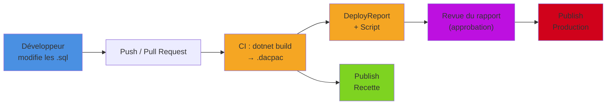

Un **DacPac** est un fichier compressé avec l’extension `.dacpac` utilisé pour déployer, gérer et versionner des bases de données SQL Server ou Azure SQL Database. Il encapsule la définition complète du schéma de la base de données (tables, vues, procédures stockées, fonctions, types, etc.) sous forme de métadonnées XML, ainsi que des informations sur les objets dépendants.

<!--more-->

# Qu'est-ce qu'un DacPac ?

## Structure détaillée d’un fichier DacPac

Un fichier `.dacpac` est en réalité une archive ZIP contenant plusieurs fichiers structurés :

- **model.xml** : le cœur du DacPac, ce fichier XML décrit l’ensemble du schéma de la base de données (objets, propriétés, relations).
- **Origin.xml** : informations sur l’origine du DacPac (outil et version ayant produit le package, date, checksums).
- **DacMetadata.xml** : nom et version de l’application data-tier.
- **predeploy.sql / postdeploy.sql** : scripts optionnels exécutés avant ou après le déploiement du schéma.
- **Références** : informations décrivant les dépendances vers d’autres bases ou packages.

Comme c’est un ZIP, on peut l’inspecter simplement :

```powershell
# Renommer en .zip (ou utiliser Expand-Archive après copie) pour explorer le contenu
Copy-Item .\Boutique.Database.dacpac .\Boutique.zip
Expand-Archive .\Boutique.zip -DestinationPath .\dacpac-contenu
Get-ChildItem .\dacpac-contenu
```

## Utilisations principales

- **Déploiement initial** : création d’une nouvelle base de données à partir du modèle contenu dans le DacPac.
- **Mise à jour (upgrade)** : comparaison du schéma du DacPac avec une base existante et génération automatique des scripts de migration nécessaires.
- **Contrôle de version** : le schéma (les fichiers `.sql` du projet) est versionné dans le système de gestion de code source pour suivre son évolution.
- **Automatisation DevOps** : intégration dans des pipelines CI/CD pour automatiser les déploiements et les tests de schéma.

## Une approche déclarative

La force du DacPac est d’être **déclaratif** (on parle d’approche *state-based*) : on décrit l’état cible de la base, et c’est l’outil qui calcule la différence avec la base existante pour produire le script `ALTER` adapté. C’est l’inverse des migrations EF Core (*migration-based*), où chaque changement est un script ordonné écrit (ou généré) à l’avance.

| Critère | DacPac (state-based) | Migrations EF Core (migration-based) |
|---|---|---|
| Source de vérité | Les fichiers `CREATE` du projet SQL | La suite des migrations C# |
| Script de mise à jour | Calculé au moment du déploiement | Figé à la création de la migration |
| Base dans un état inconnu | Pas de problème : on compare | Risqué : l’historique doit correspondre |
| Objets SQL avancés (procédures, index filtrés, permissions) | Natif | Via `migrationBuilder.Sql(...)` |
| Renommages, transformations de données | À guider (refactorlog, scripts pre/post) | Explicites dans la migration |
| Profil type | Équipe avec DBA, base partagée entre plusieurs applications | Base possédée par une seule application .NET |

## Avantages

- **Automatisation** : facilite le déploiement et la mise à jour des bases de données sans intervention manuelle.
- **Sécurité** : réduit les risques d’erreurs humaines lors des modifications de schéma.
- **Traçabilité** : permet de versionner précisément l’état du schéma à chaque étape du développement.
- **Portabilité** : simplifie la migration entre environnements (développement, test, production).
- **Comparaison de schémas** : outils intégrés pour comparer et synchroniser les différences entre le DacPac et une base cible.
- **Validation à la compilation** : une vue qui référence une colonne supprimée fait échouer le build, pas le déploiement en production.

## Limites

- **Pas de données** : un DacPac ne contient que le schéma, pas les données de la base. Pour transporter schéma **et** données, il existe le format cousin **BACPAC** (actions `Export` / `Import` de SqlPackage). Les données de référence se gèrent dans un script de post-déploiement.
- **Opérations complexes** : certaines transformations majeures ou manipulations de données nécessitent des scripts personnalisés.
- **Compatibilité** : certaines fonctionnalités spécifiques à une version de SQL Server peuvent ne pas être entièrement supportées.

# Créer un projet SQL SDK-style

Historiquement, les projets de base de données (`.sqlproj`) nécessitaient Visual Studio et SSDT pour être compilés. Le SDK **`Microsoft.Build.Sql`** apporte des projets « SDK-style », comme les projets C# modernes : un fichier projet court, tous les `.sql` du dossier inclus automatiquement, et surtout un build possible avec `dotnet build`, sur Windows, Linux ou macOS, donc dans n’importe quel agent de CI.

## Création du projet

```powershell
# Installer les templates de projets SQL
dotnet new install Microsoft.Build.Sql.Templates

# Créer le projet
dotnet new sqlproj -n Boutique.Database
```

## Le fichier `.sqlproj`

```xml
<?xml version="1.0" encoding="utf-8"?>
<Project DefaultTargets="Build">
  <Sdk Name="Microsoft.Build.Sql" Version="2.3.0" />

  <PropertyGroup>
    <Name>Boutique.Database</Name>
    <!-- Plateforme cible : ici SQL Server 2022 (Sql160) -->
    <DSP>Microsoft.Data.Tools.Schema.Sql.Sql160DatabaseSchemaProvider</DSP>
    <ModelCollation>1033, CI</ModelCollation>
    <!-- Les avertissements T-SQL (ex : référence non résolue) cassent le build -->
    <TreatTSqlWarningsAsErrors>True</TreatTSqlWarningsAsErrors>
  </PropertyGroup>

  <ItemGroup>
    <!-- Scripts exécutés avant / après le déploiement du schéma.
         Ils sont exclus automatiquement du modèle. -->
    <PreDeploy Include="Scripts\PreDeployment.sql" />
    <PostDeploy Include="Scripts\PostDeployment.sql" />
  </ItemGroup>

  <ItemGroup>
    <!-- Variable SQLCMD, valorisable au déploiement (/v:Environnement=Prod) -->
    <SqlCmdVariable Include="Environnement">
      <DefaultValue>Dev</DefaultValue>
      <Value>$(SqlCmdVar__1)</Value>
    </SqlCmdVariable>
  </ItemGroup>
</Project>
```

La propriété `DSP` détermine la plateforme cible : `Sql150` pour SQL Server 2019, `Sql160` pour 2022, `SqlAzureV12` pour Azure SQL Database… Le build valide la syntaxe et les fonctionnalités par rapport à cette plateforme.

> Si le schéma référence des objets système (`sys.objects`, procédures de `master`…), on ajoute une référence au package NuGet `Microsoft.SqlServer.Dacpacs.Master` pour que ces références soient résolues au build.

## Les objets de la base

Chaque objet est décrit par son ordre `CREATE`, un fichier par objet, rangés par schéma et type :

```text
Boutique.Database/
├── Boutique.Database.sqlproj
├── dbo/
│   ├── Tables/
│   │   ├── Categorie.sql
│   │   └── Produit.sql
│   ├── Views/
│   │   └── v_ProduitsActifs.sql
│   └── StoredProcedures/
│       └── usp_Produit_Desactiver.sql
├── Profiles/
│   └── Prod.publish.xml
└── Scripts/
    ├── PreDeployment.sql
    └── PostDeployment.sql
```

```sql
-- dbo/Tables/Produit.sql
CREATE TABLE [dbo].[Produit]
(
    [Id]          INT            IDENTITY (1, 1) NOT NULL,
    [CategorieId] INT            NOT NULL,
    [Libelle]     NVARCHAR (200) NOT NULL,
    [Prix]        DECIMAL (10, 2) NOT NULL,
    [Actif]       BIT            NOT NULL CONSTRAINT [DF_Produit_Actif] DEFAULT (1),
    CONSTRAINT [PK_Produit] PRIMARY KEY CLUSTERED ([Id]),
    CONSTRAINT [FK_Produit_Categorie] FOREIGN KEY ([CategorieId])
        REFERENCES [dbo].[Categorie] ([Id])
);
GO

CREATE NONCLUSTERED INDEX [IX_Produit_CategorieId]
    ON [dbo].[Produit] ([CategorieId])
    WHERE [Actif] = 1;
```

Pour ajouter une colonne plus tard, on n’écrit **pas** d’`ALTER TABLE` : on modifie simplement le `CREATE TABLE`. C’est SqlPackage qui générera l’`ALTER` au déploiement.

## Le script de post-déploiement

Le post-déploiement est exécuté à **chaque** publication : il doit donc être idempotent. C’est l’endroit idéal pour les données de référence :

```sql
-- Scripts/PostDeployment.sql
-- Données de référence : MERGE pour rester idempotent
MERGE INTO [dbo].[Categorie] AS cible
USING (VALUES
    (1, N'Livres'),
    (2, N'Musique'),
    (3, N'Jeux vidéo')
) AS source ([Id], [Libelle])
ON cible.[Id] = source.[Id]
WHEN MATCHED AND cible.[Libelle] <> source.[Libelle] THEN
    UPDATE SET [Libelle] = source.[Libelle]
WHEN NOT MATCHED BY TARGET THEN
    INSERT ([Id], [Libelle]) VALUES (source.[Id], source.[Libelle]);
GO

-- Données de démonstration uniquement hors production (variable SQLCMD)
IF '$(Environnement)' <> 'Prod'
BEGIN
    PRINT 'Insertion des données de test';
    -- :r inclut un autre fichier SQL du projet
    :r .\DonneesDeTest.sql
END
```

## Compiler : `dotnet build`

```powershell
dotnet build .\Boutique.Database\Boutique.Database.sqlproj -c Release
```

Le build valide le modèle complet (références entre objets, syntaxe, compatibilité avec la plateforme) et produit le fichier `bin/Release/Boutique.Database.dacpac`. Une faute dans une vue ou une colonne inexistante dans une procédure stockée est détectée ici, comme une erreur de compilation C# :

```text
Produit.sql(12,5): Build error SQL71501: Procedure: [dbo].[usp_Produit_Desactiver] has an
unresolved reference to object [dbo].[Produit].[EstActif].
```

# SqlPackage : extraire, publier, comparer

**SqlPackage** est l’outil en ligne de commande qui manipule les DacPac. Il s’installe comme un outil .NET, en global ou en local au dépôt (voir l’article sur [l’installation d’outils par projet](/2025/06/29/DotNetToolAndProject.html)) :

```powershell
# Installation globale
dotnet tool install -g Microsoft.SqlPackage

# Ou installation locale, versionnée avec le dépôt
dotnet new tool-manifest
dotnet tool install Microsoft.SqlPackage
```

## Extract : partir d’une base existante

```powershell
# Extraire le schéma d'une base existante dans un .dacpac
sqlpackage /Action:Extract `
    /SourceConnectionString:"Server=localhost;Database=Boutique;Integrated Security=True;TrustServerCertificate=True" `
    /TargetFile:.\Boutique.dacpac

# Extraire directement en fichiers .sql (un fichier par objet, rangés par schéma et type)
# pour initialiser un projet SQL à partir d'une base existante
sqlpackage /Action:Extract `
    /SourceConnectionString:"Server=localhost;Database=Boutique;Integrated Security=True;TrustServerCertificate=True" `
    /TargetFile:.\Boutique.Database `
    /p:ExtractTarget=SchemaObjectType
```

## Publish : déployer

```powershell
sqlpackage /Action:Publish `
    /SourceFile:.\bin\Release\Boutique.Database.dacpac `
    /TargetConnectionString:"Server=sql-recette;Database=Boutique;User Id=deploy;Password=***;TrustServerCertificate=True" `
    /p:BlockOnPossibleDataLoss=True `
    /p:DropObjectsNotInSource=False `
    /p:BackupDatabaseBeforeChanges=False `
    /v:Environnement=Recette
```

Si la base n’existe pas, elle est créée ; sinon elle est mise à niveau. Le déploiement est **idempotent** : publier deux fois le même DacPac ne fait rien la seconde fois.

## Script et DeployReport : vérifier avant de déployer

En production, on veut généralement **voir** ce qui va se passer avant de le faire :

```powershell
# Générer le script SQL de mise à jour, sans l'exécuter
sqlpackage /Action:Script `
    /SourceFile:.\bin\Release\Boutique.Database.dacpac `
    /TargetConnectionString:"Server=sql-prod;Database=Boutique;..." `
    /OutputPath:.\deploy-prod.sql

# Générer un rapport XML des opérations prévues (création, modification, suppression)
sqlpackage /Action:DeployReport `
    /SourceFile:.\bin\Release\Boutique.Database.dacpac `
    /TargetConnectionString:"Server=sql-prod;Database=Boutique;..." `
    /OutputPath:.\deploy-report.xml
```

Le rapport liste les opérations et les alertes, notamment les risques de perte de données :

```xml
<DeploymentReport xmlns="http://schemas.microsoft.com/sqlserver/dac/DeployReport/2012/02">
  <Alerts>
    <Alert Name="DataIssue">
      <Issue Value="The column [dbo].[Produit].[Description] is being dropped, data loss could occur." />
    </Alert>
  </Alerts>
  <Operations>
    <Operation Name="Alter">
      <Item Value="[dbo].[Produit]" Type="SqlTable" />
    </Operation>
    <Operation Name="Create">
      <Item Value="[dbo].[v_ProduitsActifs]" Type="SqlView" />
    </Operation>
  </Operations>
</DeploymentReport>
```

## Les options utiles

| Option | Défaut | Effet |
|---|---|---|
| `BlockOnPossibleDataLoss` | `True` | Stoppe le déploiement si une opération peut perdre des données (colonne supprimée, type réduit) |
| `DropObjectsNotInSource` | `False` | Supprime de la cible les objets absents du DacPac |
| `DoNotDropObjectTypes` | — | Types jamais supprimés, même avec `DropObjectsNotInSource` (ex : `Users;Logins`) |
| `ExcludeObjectTypes` | — | Types ignorés lors de la comparaison (ex : `Users;RoleMembership`) |
| `BackupDatabaseBeforeChanges` | `False` | Sauvegarde la base avant modification (SQL Server uniquement) |
| `GenerateSmartDefaults` | `False` | Fournit une valeur par défaut pour une nouvelle colonne `NOT NULL` sur une table non vide |
| `IncludeTransactionalScripts` | `False` | Encapsule le déploiement dans des transactions |
| `ScriptDatabaseOptions` | `True` | Aligne les options de la base (recovery model, compatibilité…) sur le projet |

```powershell
# ❌ En production : supprime tout ce qui n'est pas dans le projet,
#    y compris les utilisateurs créés par le DBA et les tables d'un autre outil
/p:DropObjectsNotInSource=True /p:BlockOnPossibleDataLoss=False

# ✅ Prudent : on bloque toute perte de données et on protège la sécurité
/p:BlockOnPossibleDataLoss=True /p:DropObjectsNotInSource=True `
/p:DoNotDropObjectTypes="Users;Logins;RoleMembership;Permissions"
```

## Le piège du renommage

SqlPackage compare des **états** : si une colonne `Prix` devient `PrixHT` dans le `CREATE TABLE`, il voit une colonne supprimée et une colonne ajoutée. Résultat : `DROP COLUMN`, perte de données (ou blocage grâce à `BlockOnPossibleDataLoss`). Deux solutions :

- utiliser le **refactoring « Renommer »** de Visual Studio / SSDT, qui enregistre l’intention dans un fichier `.refactorlog` ; SqlPackage génère alors un `sp_rename` ;
- ou effectuer le renommage dans le script de pré-déploiement, de façon idempotente :

```sql
-- Scripts/PreDeployment.sql
IF COL_LENGTH('dbo.Produit', 'Prix') IS NOT NULL
   AND COL_LENGTH('dbo.Produit', 'PrixHT') IS NULL
BEGIN
    EXEC sp_rename 'dbo.Produit.Prix', 'PrixHT', 'COLUMN';
END
```

# Le publish profile

Répéter les options sur chaque ligne de commande devient vite pénible. Un **publish profile** est un fichier MSBuild qui regroupe les options par environnement :

```xml
<?xml version="1.0" encoding="utf-8"?>
<!-- Profiles/Prod.publish.xml -->
<Project ToolsVersion="Current" xmlns="http://schemas.microsoft.com/developer/msbuild/2003">
  <PropertyGroup>
    <TargetDatabaseName>Boutique</TargetDatabaseName>
    <BlockOnPossibleDataLoss>True</BlockOnPossibleDataLoss>
    <DropObjectsNotInSource>True</DropObjectsNotInSource>
    <DoNotDropObjectTypes>Users;Logins;RoleMembership;Permissions</DoNotDropObjectTypes>
    <ExcludeObjectTypes>Users;Logins;RoleMembership;Permissions</ExcludeObjectTypes>
    <IncludeTransactionalScripts>True</IncludeTransactionalScripts>
    <ScriptDatabaseOptions>False</ScriptDatabaseOptions>
    <GenerateSmartDefaults>True</GenerateSmartDefaults>
  </PropertyGroup>
  <ItemGroup>
    <SqlCmdVariable Include="Environnement">
      <Value>Prod</Value>
    </SqlCmdVariable>
  </ItemGroup>
</Project>
```

La chaîne de connexion, qui contient un secret, reste **hors** du fichier versionné : on la passe en ligne de commande, et elle s’ajoute aux paramètres du profil.

```powershell
sqlpackage /Action:Publish `
    /SourceFile:.\bin\Release\Boutique.Database.dacpac `
    /Profile:.\Profiles\Prod.publish.xml `
    /TargetConnectionString:"$env:SQL_CONNECTION_STRING"
```

# Intégration continue avec GitHub Actions

## Le workflow de déploiement



Le DacPac est construit **une seule fois** puis promu d’environnement en environnement : la base de production reçoit exactement le même artefact que celui testé en recette.

## Exemple de pipeline


```yaml
# .github/workflows/database.yml
name: Base de données

on:
  push:
    branches: [main]
    paths: ['src/Boutique.Database/**']
  pull_request:
    paths: ['src/Boutique.Database/**']

jobs:
  build:
    runs-on: ubuntu-latest
    steps:
      - uses: actions/checkout@v4

      - uses: actions/setup-dotnet@v4
        with:
          dotnet-version: '10.0.x'

      # Valide le schéma : une référence cassée fait échouer la PR
      - name: Build du projet SQL
        run: dotnet build src/Boutique.Database/Boutique.Database.sqlproj -c Release

      - uses: actions/upload-artifact@v4
        with:
          name: dacpac
          path: src/Boutique.Database/bin/Release/Boutique.Database.dacpac

  deploy-prod:
    needs: build
    if: github.ref == 'refs/heads/main'
    runs-on: ubuntu-latest
    environment: production   # approbation manuelle configurée sur l'environnement
    steps:
      - uses: actions/checkout@v4   # pour récupérer le publish profile

      - uses: actions/setup-dotnet@v4
        with:
          dotnet-version: '10.0.x'

      - uses: actions/download-artifact@v4
        with:
          name: dacpac
          path: artifact

      - name: Installer SqlPackage
        run: |
          dotnet tool install -g Microsoft.SqlPackage
          echo "$HOME/.dotnet/tools" >> "$GITHUB_PATH"

      - name: Rapport de déploiement
        run: >
          sqlpackage /Action:DeployReport
          /SourceFile:artifact/Boutique.Database.dacpac
          /Profile:src/Boutique.Database/Profiles/Prod.publish.xml
          /TargetConnectionString:"${{ secrets.SQL_CONNECTION_STRING }}"
          /OutputPath:deploy-report.xml

      - uses: actions/upload-artifact@v4
        with:
          name: deploy-report
          path: deploy-report.xml

      - name: Publication
        run: >
          sqlpackage /Action:Publish
          /SourceFile:artifact/Boutique.Database.dacpac
          /Profile:src/Boutique.Database/Profiles/Prod.publish.xml
          /TargetConnectionString:"${{ secrets.SQL_CONNECTION_STRING }}"
```


Quelques remarques :

- La chaîne de connexion est stockée dans les **secrets** de l’environnement `production`, jamais dans le dépôt.
- L’environnement GitHub `production` peut exiger une approbation manuelle : le déploiement attend qu’un relecteur valide.
- Le rapport de déploiement est archivé comme artefact : on garde une trace de ce qui a été appliqué.
- Pour Azure SQL, l’action `azure/sql-action` encapsule le même fonctionnement (build du `.sqlproj` puis publish) ; l’appel direct à SqlPackage a l’avantage d’être identique en local et en CI.

## Exemple de workflow complet

1. Développer le schéma dans un projet SQL (SDK-style avec VS Code ou Visual Studio, ou SSDT classique).
2. Compiler le projet pour générer le DacPac à chaque modification (`dotnet build`).
3. Versionner les fichiers `.sql` dans le contrôle de source (Git, Azure DevOps, etc.) ; le DacPac, lui, est un artefact de build.
4. Déployer ou mettre à jour les bases de données cibles via le DacPac, manuellement ou dans un pipeline CI/CD.
5. Utiliser `DeployReport` et `Script` pour valider les différences avant déploiement.

## DacPac et SSDT

**SQL Server Data Tools (SSDT)** est l’environnement de développement intégré dans Visual Studio pour la conception, le développement et la gestion des bases de données SQL Server. SSDT permet de :

- Créer des projets de base de données, gérer le schéma sous forme de code source et générer facilement des fichiers DacPac.
- Modéliser la base de données sous forme de projet, facilitant la gestion du schéma dans un système de contrôle de version.
- Générer un DacPac à partir d’un projet SSDT pour déployer ou mettre à jour des bases de données.
- Comparer des schémas et automatiser le déploiement via DacPac, intégrés à Visual Studio et aux pipelines DevOps.

SSDT reste l’outil historique, avec ses designers et son refactoring. Les projets SDK-style `Microsoft.Build.Sql` reprennent le même format de modèle et produisent le même DacPac, mais sans dépendre de Visual Studio : c’est ce qui rend l’approche naturelle dans une CI Linux ou sous VS Code.

# Résumé

| Étape | Outil / commande |
|---|---|
| Créer le projet | `dotnet new sqlproj` (SDK `Microsoft.Build.Sql`) |
| Décrire le schéma | Un fichier `CREATE` par objet, scripts pre/post-déploiement idempotents |
| Compiler et valider | `dotnet build` → `bin/Release/*.dacpac` |
| Partir d’une base existante | `sqlpackage /Action:Extract` (`/p:ExtractTarget=SchemaObjectType` pour des fichiers) |
| Vérifier avant de déployer | `sqlpackage /Action:DeployReport` et `/Action:Script` |
| Déployer | `sqlpackage /Action:Publish` avec `BlockOnPossibleDataLoss=True` |
| Configurer par environnement | Publish profile `*.publish.xml` + variables SQLCMD (`/v:`) |
| Automatiser | GitHub Actions : build une fois, approbation, publish |
