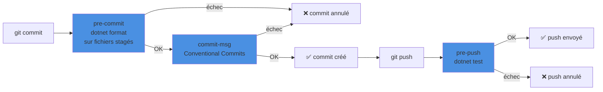

Husky est un outil qui permet de gérer des hooks Git, c'est-à-dire des scripts qui s'exécutent automatiquement à certains moments du cycle de vie Git (comme `pre-commit`, `post-checkout`, etc.). Dans le contexte des projets .NET, Husky présente plusieurs intérêts :

<!--more-->

## Husky

Les hooks Git natifs vivent dans `.git/hooks`, un dossier **non versionné** : chacun doit les installer à la main, et personne n'a les mêmes. Husky.Net règle ce problème en stockant les hooks dans un dossier `.husky/` commité avec le code, et en les décrivant dans un fichier `task-runner.json`.

En pratique, Husky sert à :

- **Automatiser** les vérifications répétitives (format, build, tests) au bon moment : avant un commit, avant un push, après un checkout.
- **Uniformiser l'environnement** : un `post-checkout` qui lance `dotnet tool restore` garantit que tout le monde utilise les mêmes versions d'outils (voir [Dotnet tools installer des outils par projets](/2025/06/29/DotNetToolAndProject.html)).
- **Partager les règles** avec toute l'équipe, puisque la configuration est dans le dépôt.
- **Détecter les problèmes tôt** : un code mal formaté ou un test cassé est bloqué sur le poste du développeur, avant d'arriver en CI.

### Le cycle git → hooks



Un hook qui retourne un code de sortie différent de `0` interrompt l'opération Git.

Pour exécuter des tests avec Husky dans un projet .NET, vous pouvez configurer un hook Git (comme `pre-commit` ou `pre-push`) pour lancer les tests automatiquement avant de permettre un commit ou un push. Voici les étapes détaillées :

## Exécuter des tests avec Husky

### 1. Installer Husky comme outil local

Si ce n'est pas encore fait, installez Husky comme outil local dans votre projet :

```bash
dotnet new tool-manifest
dotnet tool install Husky --local
```

### 2. Configurer Husky

Initialisez Husky pour activer les hooks Git :

```bash
dotnet husky install
```

Cette commande crée le dossier `.husky/` (avec un `task-runner.json` d'exemple) et configure Git (`core.hooksPath`) pour qu'il cherche ses hooks dans ce dossier.

### 3. Ajouter un hook pour exécuter des tests rapides

Ajoutez un hook `pre-commit` pour exécuter des tests rapides (par exemple uniquement les tests unitaires) avant un commit :

```bash
dotnet husky add pre-commit -c "dotnet test"
```

## Ce que fait ce hook :

- Avant chaque commit, Husky exécute la commande `dotnet test` ciblée sur les tests unitaires.
- Si les tests échouent, le commit est annulé, empêchant ainsi l'intégration de code non valide.

## Exemple de configuration complète

### Ajouter un hook `pre-push` pour exécuter la suite de tests complète avant un push :

```bash
dotnet husky add pre-push -c "dotnet test"
```

### Ajouter un hook `pre-commit` pour exécuter les tests avant un commit :

```bash
dotnet husky add pre-commit -c "dotnet test --no-build"
```

> **Note** : Utiliser `--no-build` dans le hook `pre-commit` peut accélérer les tests si le projet est déjà compilé.

## Personnalisation des tests

Vous pouvez personnaliser la commande `dotnet test` pour exécuter des tests spécifiques ou ajouter des options :

- Exécuter uniquement des tests d'un projet particulier :
  ```bash
  dotnet husky add pre-commit -c "dotnet test ./MyProject.Tests/MyProject.Tests.csproj"
  ```
- Exécuter des tests avec un filtre (par exemple, une catégorie spécifique) :
  ```bash
  dotnet husky add pre-commit -c "dotnet test --filter Category=Unit"
  ```

- Exécuter uniquement les tests d'architecture (par exemple marqués `Category=Architecture`, voir [Tests d'architecture en .NET](/2025/10/11/TestArchi.html)) avant un push :
  ```bash
  dotnet husky add pre-push -c "dotnet test --filter Category=Architecture"
  ```

## Centraliser avec task-runner.json

Écrire les commandes directement dans les hooks fonctionne, mais devient vite difficile à maintenir. Husky.Net propose un **task runner** : les hooks se contentent d'appeler un groupe de tâches, et les tâches sont décrites dans `.husky/task-runner.json`.

Les hooks deviennent alors très simples :

```bash
dotnet husky add pre-commit -c "dotnet husky run --group pre-commit"
dotnet husky add pre-push   -c "dotnet husky run --group pre-push"
dotnet husky add commit-msg -c 'dotnet husky run --name commit-message-linter --args "$1"'
```

Fichier `.husky/pre-commit` généré :

```bash
#!/bin/sh
. "$(dirname "$0")/_/husky.sh"

dotnet husky run --group pre-commit
```

Et le fichier `.husky/task-runner.json` complet :

```json
{
  "$schema": "https://alirezanet.github.io/Husky.Net/schema.json",
  "tasks": [
    {
      "name": "dotnet-format",
      "group": "pre-commit",
      "command": "dotnet",
      "args": ["format", "--verify-no-changes", "--include", "${staged}"],
      "include": ["**/*.cs"]
    },
    {
      "name": "build",
      "group": "pre-push",
      "command": "dotnet",
      "args": ["build", "--configuration", "Release", "/warnaserror"]
    },
    {
      "name": "unit-tests",
      "group": "pre-push",
      "command": "dotnet",
      "args": ["test", "--configuration", "Release", "--no-build", "--filter", "Category!=Integration"]
    },
    {
      "name": "commit-message-linter",
      "command": "dotnet",
      "args": ["husky", "exec", ".husky/csx/commit-lint.csx", "--args", "${args}"]
    },
    {
      "name": "restore-tools",
      "group": "post-checkout",
      "command": "dotnet",
      "args": ["tool", "restore"]
    }
  ]
}
```

Les tâches d'un même groupe s'exécutent dans l'ordre ; la première qui échoue arrête le hook. Pour tester un groupe sans faire de commit :

```bash
dotnet husky run --group pre-commit
```

### `dotnet format` sur les seuls fichiers stagés

La tâche `dotnet-format` mérite un détail :

- `${staged}` est une **variable** remplacée par la liste des fichiers ajoutés à l'index (`git add`). On ne vérifie donc que ce qui va réellement être commité, pas toute la solution.
- `include` filtre cette liste : seuls les fichiers `*.cs` sont passés à `dotnet format`. Si aucun fichier ne correspond, la tâche est simplement ignorée.
- `--verify-no-changes` ne modifie rien : la commande échoue (code de sortie non nul) si un fichier n'est pas correctement formaté.

❌ Sans `--verify-no-changes`, `dotnet format` corrige les fichiers… mais les corrections restent **non stagées** : le commit part avec l'ancienne version.
✅ Avec `--verify-no-changes`, le commit est bloqué ; on lance `dotnet format`, on refait `git add`, puis on commite.

Autres variables utiles : `${args}` (arguments passés au hook, comme le fichier du message de commit), `${last-commit}`, `${git-files}` et `${all-files}`.

## Valider les messages avec Conventional Commits

Le hook `commit-msg` reçoit en premier argument le chemin du fichier contenant le message. La tâche `commit-message-linter` le transmet (via `${args}`) à un script C# exécuté par `dotnet husky exec`.

Fichier `.husky/csx/commit-lint.csx` :

```csharp
using System.Text.RegularExpressions;

// Format attendu : type(scope optionnel): description
// ex. "feat(api): ajout du endpoint /clients"
//     "fix: correction du calcul de TVA"
private var pattern =
    @"^(?=.{1,90}$)(build|chore|ci|docs|feat|fix|perf|refactor|revert|style|test)(\([\w\-\.]+\))?!?: .{4,}$";

// Args[0] = chemin du fichier .git/COMMIT_EDITMSG
private var msg = File.ReadAllLines(Args[0])[0];

// On laisse passer les commits de merge générés par Git
if (msg.StartsWith("Merge "))
    return 0;

if (Regex.IsMatch(msg, pattern))
    return 0;

Console.ForegroundColor = ConsoleColor.Red;
Console.WriteLine("Message de commit invalide (Conventional Commits) :");
Console.ResetColor();
Console.WriteLine($"  \"{msg}\"");
Console.WriteLine("Exemples valides :");
Console.WriteLine("  feat(api): ajout de la pagination");
Console.WriteLine("  fix: correction du null sur Customer");
return 1;
```

```bash
git commit -m "correction"          # ❌ rejeté
git commit -m "fix: correction du null sur Customer"   # ✅ accepté
```

Des messages normalisés permettent ensuite de générer un changelog ou de calculer la version automatiquement (voir [GitVersion](/2025/06/19/GitVersion.html)).

## Installation automatique pour toute l'équipe

`dotnet husky install` doit être lancé une fois par clone. Pour éviter qu'un développeur l'oublie, on l'attache au `restore` MSBuild : dès le premier `dotnet build`, les outils sont restaurés et les hooks installés.

La commande suivante ajoute automatiquement le bloc nécessaire dans un projet :

```bash
dotnet husky attach ./src/MonApi/MonApi.csproj
```

On peut aussi l'écrire à la main, de préférence dans un `Directory.Build.targets` à la racine pour ne pas dépendre d'un projet en particulier :

```xml
<Project>
  <PropertyGroup>
    <!-- Racine du dépôt = dossier de ce fichier (séparateur final inclus) -->
    <HuskyRoot Condition="'$(HuskyRoot)' == ''">$(MSBuildThisFileDirectory)</HuskyRoot>
  </PropertyGroup>

  <!-- Après le restore, sauf si HUSKY=0 (CI) -->
  <Target Name="Husky" AfterTargets="Restore" Condition="'$(HUSKY)' != 0"
          Inputs="$(HuskyRoot).config/dotnet-tools.json"
          Outputs="$(HuskyRoot).husky/_/install.stamp">
    <Exec Command="dotnet tool restore"
          StandardOutputImportance="Low" StandardErrorImportance="High" />
    <Exec Command="dotnet husky install"
          StandardOutputImportance="Low" StandardErrorImportance="High"
          WorkingDirectory="$(HuskyRoot)" />
    <!-- Fichier témoin : évite de relancer l'installation à chaque build -->
    <Touch Files="$(HuskyRoot).husky/_/install.stamp" AlwaysCreate="true"
           Condition="Exists('$(HuskyRoot).husky/_')" />
    <ItemGroup>
      <FileWrites Include="$(HuskyRoot).husky/_/install.stamp" />
    </ItemGroup>
  </Target>
</Project>
```

> Le couple `Inputs`/`Outputs` rend la cible incrémentale : elle ne se relance que si `dotnet-tools.json` change. Pour un projet multi-cible, ajoutez `and '$(IsCrossTargetingBuild)' == 'true'` à la condition pour ne pas l'exécuter une fois par framework.

## Contourner les hooks et usage en CI

En local, il arrive de devoir commiter un travail en cours sans passer les vérifications :

```bash
git commit --no-verify -m "wip: sauvegarde avant changement de branche"
git push --no-verify
```

`--no-verify` (ou `-n` pour `commit`) saute `pre-commit` et `commit-msg` (et `pre-push` pour `push`). À utiliser ponctuellement : la CI reste le filet de sécurité.

En CI, les hooks n'ont pas d'intérêt (pas de commit) et l'installation peut échouer (pas de Git complet, outils absents). On désactive Husky avec la variable d'environnement `HUSKY=0`, testée par la condition de la cible MSBuild :

```yaml
# GitHub Actions
env:
  HUSKY: 0

steps:
  - uses: actions/checkout@v4
  - run: dotnet build --configuration Release
  # La CI rejoue elle-même les vérifications
  - run: dotnet format --verify-no-changes
  - run: dotnet test --configuration Release --no-build
```

## Résumé

| Élément | Rôle |
|---|---|
| `dotnet tool install Husky --local` | Husky versionné dans `dotnet-tools.json` |
| `dotnet husky install` | Active les hooks du dossier `.husky/` |
| `task-runner.json` | Décrit les tâches et leurs groupes (hooks) |
| `${staged}` + `include` | Limite une tâche aux fichiers stagés filtrés |
| `dotnet format --verify-no-changes` | Bloque un commit mal formaté sans modifier les fichiers |
| `commit-msg` + script `.csx` | Impose Conventional Commits |
| Cible MSBuild `Husky` | Installation automatique au premier `restore` |
| `--no-verify` | Contournement ponctuel en local |
| `HUSKY=0` | Désactive Husky en CI |
