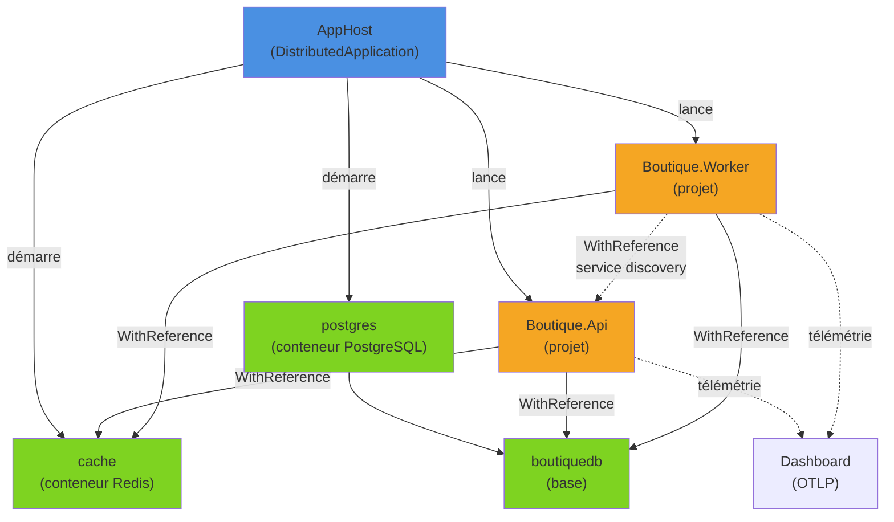
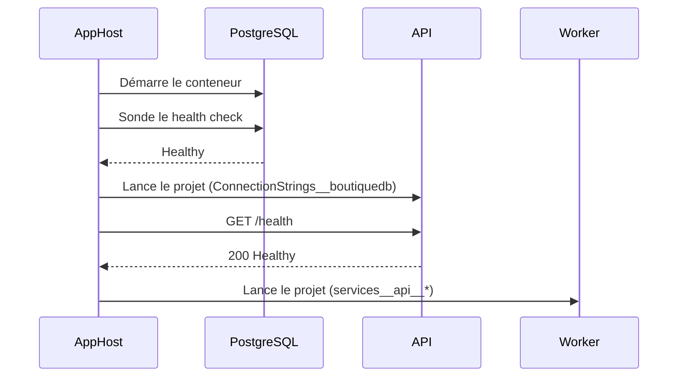

Lancer une API, un worker, un Redis et un PostgreSQL en local, câbler les chaînes de connexion, attendre que la base soit prête, puis retrouver une requête qui traverse trois processus dans des logs éparpillés : c'est le quotidien d'une application distribuée. **Aspire** (anciennement « .NET Aspire ») décrit toute cette topologie en C#, lance l'ensemble d'une seule commande et branche l'observabilité OpenTelemetry par défaut. Tour d'horizon avec Aspire 13.2, la version courante fin mars 2026.

<!--more-->

# 1. Aspire en quatre briques

Aspire n'est ni un framework applicatif ni un runtime : c'est une **pile d'outils pour le développement** (et, de plus en plus, le déploiement) d'applications distribuées. Elle repose sur quatre briques :

| Brique | Rôle |
|---|---|
| **AppHost** | Projet C# qui décrit les ressources (projets, conteneurs, bases…) et leurs dépendances. On le lance, il orchestre tout le reste. |
| **ServiceDefaults** | Projet partagé qui ajoute à chaque service OpenTelemetry, health checks, service discovery et résilience HTTP. |
| **Intégrations** | Packages NuGet : côté *hosting* (`Aspire.Hosting.Redis`, `Aspire.Hosting.PostgreSQL`…) pour l'AppHost, côté *client* (`Aspire.StackExchange.Redis`, `Aspire.Npgsql`…) pour les services. |
| **Dashboard** | Interface web lancée avec l'AppHost : ressources, logs console, logs structurés, traces, métriques. |

Quelques repères de versions :

- **Aspire 9.x** accompagnait .NET 9.
- **Aspire 13** (novembre 2025, avec .NET 10) abandonne le préfixe « .NET » : le produit devient simplement *Aspire*, avec un site dédié (aspire.dev) et une vocation polyglotte (Python, JavaScript…).
- **Aspire 13.2** (23 mars 2026) ajoute notamment l'écriture d'un AppHost en TypeScript et une CLI pensée pour les agents IA.

Cet article reste côté C#.

# 2. Installer la CLI et créer la solution

## La CLI `aspire`

Depuis Aspire 9.x, la CLI `aspire` est le point d'entrée recommandé. Elle s'installe par script ou comme outil global .NET :

```bash
# Windows (PowerShell)
irm https://aspire.dev/install.ps1 | iex

# macOS / Linux
curl -sSL https://aspire.dev/install.sh | bash

# Ou comme outil global .NET
dotnet tool install -g Aspire.Cli

aspire --version
```

Les commandes du quotidien :

```bash
aspire new            # sélecteur interactif de templates
aspire run            # lance l'AppHost et le dashboard
aspire add redis      # ajoute une intégration hosting à l'AppHost
aspire update         # met à jour les packages Aspire du projet
aspire update --self  # met à jour la CLI elle-même
```

## Les templates

`aspire new` propose notamment `aspire-starter` (API + Blazor + tests), `aspire-empty` (AppHost + ServiceDefaults seuls) ou `aspire-ts-cs-starter` (API + React). Pour la CI ou si l'on préfère `dotnet new`, les mêmes templates sont distribués dans le package `Aspire.ProjectTemplates` :

```bash
dotnet new install Aspire.ProjectTemplates

# Solution vide : AppHost + ServiceDefaults
dotnet new aspire -n Boutique

# Ou projet par projet, dans une solution existante
dotnet new aspire-apphost -n Boutique.AppHost
dotnet new aspire-servicedefaults -n Boutique.ServiceDefaults
```

On part d'une solution vide, puis on ajoute une API et un worker classiques :

```bash
cd Boutique
dotnet new webapi -n Boutique.Api
dotnet new worker -n Boutique.Worker
dotnet sln add Boutique.Api Boutique.Worker

# Les services référencent ServiceDefaults
dotnet add Boutique.Api reference Boutique.ServiceDefaults
dotnet add Boutique.Worker reference Boutique.ServiceDefaults

# L'AppHost référence les services qu'il orchestre
dotnet add Boutique.AppHost reference Boutique.Api Boutique.Worker
```

Le projet AppHost utilise un SDK MSBuild dédié, qui embarque depuis Aspire 13 la référence à `Aspire.Hosting.AppHost` :

```xml
<Project Sdk="Aspire.AppHost.Sdk/13.2.0">
  <PropertyGroup>
    <OutputType>Exe</OutputType>
    <TargetFramework>net10.0</TargetFramework>
    <ImplicitUsings>enable</ImplicitUsings>
    <Nullable>enable</Nullable>
  </PropertyGroup>
  <ItemGroup>
    <!-- Ajoutés par "aspire add" ou "dotnet add package" -->
    <PackageReference Include="Aspire.Hosting.PostgreSQL" Version="13.2.0" />
    <PackageReference Include="Aspire.Hosting.Redis" Version="13.2.0" />
  </ItemGroup>
</Project>
```

> Chaque référence de projet ajoutée à l'AppHost génère une classe dans l'espace de noms `Projects` : `Boutique.Api` devient `Projects.Boutique_Api`. C'est ce qui permet d'écrire `AddProject<Projects.Boutique_Api>()` avec vérification à la compilation.

# 3. L'AppHost : décrire la topologie

L'application d'exemple : une API reçoit des commandes, les enregistre dans PostgreSQL et pousse leur identifiant dans une liste Redis ; un worker dépile la liste et traite les commandes.



Le code complet de l'AppHost :

```csharp
// Boutique.AppHost/AppHost.cs
var builder = DistributedApplication.CreateBuilder(args);

// Conteneur Redis (+ RedisInsight pour explorer les clés)
var cache = builder.AddRedis("cache")
    .WithRedisInsight();

// Serveur PostgreSQL avec volume persistant et pgAdmin, puis une base
var postgres = builder.AddPostgres("postgres")
    .WithDataVolume()
    .WithPgAdmin();
var db = postgres.AddDatabase("boutiquedb");

// L'API : dépend de Redis et de la base
var api = builder.AddProject<Projects.Boutique_Api>("api")
    .WithReference(cache)
    .WithReference(db)
    .WaitFor(cache)
    .WaitFor(db)
    .WithHttpHealthCheck("/health")   // l'AppHost sonde /health
    .WithExternalHttpEndpoints();     // exposé publiquement au déploiement

// Le worker : mêmes dépendances, et il appelle l'API
builder.AddProject<Projects.Boutique_Worker>("worker")
    .WithReference(cache)
    .WithReference(db)
    .WithReference(api)
    .WaitFor(api);                    // l'API attend déjà Redis et la base

builder.Build().Run();
```

Un `aspire run` (ou F5 sur l'AppHost) démarre les conteneurs, lance les deux projets et ouvre le dashboard, sans chaîne de connexion écrite à la main.

> Un runtime de conteneurs (Docker Desktop ou Podman) doit tourner sur la machine pour les ressources de type conteneur.

# 4. Références et service discovery

## Ce que fait `WithReference`

`WithReference` ne crée aucune connexion réseau magique : il **injecte des variables d'environnement** dans le processus cible. Pour l'API, l'AppHost fournit notamment :

```bash
# Chaîne de connexion des ressources "cache" et "boutiquedb"
ConnectionStrings__cache=localhost:62341,password=...
ConnectionStrings__boutiquedb=Host=localhost;Port=62342;Username=postgres;Password=...;Database=boutiquedb

# Pour le worker, les endpoints de l'API référencée
services__api__http__0=http://localhost:5123
services__api__https__0=https://localhost:7123
```

Les ports sont attribués dynamiquement et les mots de passe générés (puis conservés dans les user secrets de l'AppHost). Grâce à la convention `ConnectionStrings__<nom>`, un simple `builder.Configuration.GetConnectionString("boutiquedb")` fonctionnerait déjà, avec ou sans Aspire.

## Les intégrations client

Côté service, on utilise plutôt les intégrations client, qui lisent cette chaîne de connexion **et** ajoutent health checks, traces et métriques :

```bash
dotnet add Boutique.Api package Aspire.Npgsql
dotnet add Boutique.Api package Aspire.StackExchange.Redis
dotnet add Boutique.Worker package Aspire.Npgsql
dotnet add Boutique.Worker package Aspire.StackExchange.Redis
```

```csharp
// Boutique.Api/Program.cs
using Npgsql;
using StackExchange.Redis;

var builder = WebApplication.CreateBuilder(args);

builder.AddServiceDefaults();                   // OTel, health checks, discovery, résilience
builder.AddNpgsqlDataSource("boutiquedb");      // NpgsqlDataSource en singleton
builder.AddRedisClient("cache");                // IConnectionMultiplexer en singleton

var app = builder.Build();
app.MapDefaultEndpoints();                      // /health et /alive (en développement)

// Création du schéma au démarrage (pour la démo uniquement)
await using (var cmd = app.Services.GetRequiredService<NpgsqlDataSource>().CreateCommand(
    "CREATE TABLE IF NOT EXISTS commandes (id SERIAL PRIMARY KEY, produit TEXT NOT NULL, traitee BOOLEAN NOT NULL DEFAULT FALSE)"))
{
    await cmd.ExecuteNonQueryAsync();
}

app.MapPost("/commandes", async (NouvelleCommande commande, NpgsqlDataSource dataSource, IConnectionMultiplexer redis) =>
{
    await using var cmd = dataSource.CreateCommand(
        "INSERT INTO commandes (produit) VALUES ($1) RETURNING id");
    cmd.Parameters.AddWithValue(commande.Produit);
    var id = (int)(await cmd.ExecuteScalarAsync())!;

    // On signale la commande au worker via une liste Redis
    await redis.GetDatabase().ListLeftPushAsync("commandes:a-traiter", id);

    return Results.Created($"/commandes/{id}", new { id });
});

app.MapGet("/commandes/{id:int}/statut", async (int id, NpgsqlDataSource dataSource) =>
{
    await using var cmd = dataSource.CreateCommand("SELECT traitee FROM commandes WHERE id = $1");
    cmd.Parameters.AddWithValue(id);
    return await cmd.ExecuteScalarAsync() is bool traitee
        ? Results.Ok(new { id, traitee })
        : Results.NotFound();
});

app.Run();

record NouvelleCommande(string Produit);
```

## Le service discovery

Pour appeler l'API depuis le worker, on n'écrit **pas** d'URL : on utilise le nom de la ressource déclaré dans l'AppHost. Le schéma `https+http://` signifie « HTTPS de préférence, sinon HTTP ».

```csharp
// Boutique.Worker/Program.cs
using Boutique.Worker;

var builder = Host.CreateApplicationBuilder(args);

builder.AddServiceDefaults();
builder.AddNpgsqlDataSource("boutiquedb");
builder.AddRedisClient("cache");

// "api" est résolu via la configuration services__api__*
builder.Services.AddHttpClient<ApiClient>(client =>
    client.BaseAddress = new Uri("https+http://api"));

builder.Services.AddHostedService<CommandeWorker>();

builder.Build().Run();
```

```csharp
// Boutique.Worker/CommandeWorker.cs
using Npgsql;
using StackExchange.Redis;

namespace Boutique.Worker;

public sealed class ApiClient(HttpClient http)
{
    public Task<HttpResponseMessage> GetStatutAsync(int id, CancellationToken ct) =>
        http.GetAsync($"/commandes/{id}/statut", ct);
}

public sealed class CommandeWorker(
    IConnectionMultiplexer redis,
    NpgsqlDataSource dataSource,
    ApiClient api,
    ILogger<CommandeWorker> logger) : BackgroundService
{
    protected override async Task ExecuteAsync(CancellationToken stoppingToken)
    {
        var db = redis.GetDatabase();

        while (!stoppingToken.IsCancellationRequested)
        {
            var valeur = await db.ListRightPopAsync("commandes:a-traiter");
            if (valeur.IsNullOrEmpty)
            {
                await Task.Delay(TimeSpan.FromSeconds(1), stoppingToken);
                continue;
            }

            var id = (int)valeur;
            await using var cmd = dataSource.CreateCommand(
                "UPDATE commandes SET traitee = TRUE WHERE id = $1");
            cmd.Parameters.AddWithValue(id);
            await cmd.ExecuteNonQueryAsync(stoppingToken);

            // Appel HTTP vers l'API : résolu par service discovery, protégé par la résilience
            var reponse = await api.GetStatutAsync(id, stoppingToken);
            logger.LogInformation("Commande {CommandeId} traitée (statut API : {StatusCode})",
                id, reponse.StatusCode);
        }
    }
}
```

## `WaitFor` : l'ordre de démarrage

Sans `WaitFor`, l'AppHost lance tout en parallèle : l'API démarre avant que PostgreSQL accepte les connexions et le `CREATE TABLE` échoue.

```csharp
// ❌ L'API peut démarrer avant la base
builder.AddProject<Projects.Boutique_Api>("api")
    .WithReference(db);

// ✅ L'API attend que la base soit "Healthy" (health check fourni par l'intégration)
builder.AddProject<Projects.Boutique_Api>("api")
    .WithReference(db)
    .WaitFor(db);
```

`WaitFor` attend que la ressource soit **démarrée et en bonne santé** selon ses health checks. Pour une ressource qui doit se terminer, par exemple un projet de migrations EF Core, on utilise `WaitForCompletion` :

```csharp
var migrations = builder.AddProject<Projects.Boutique_Migrations>("migrations")
    .WithReference(db)
    .WaitFor(db);

builder.AddProject<Projects.Boutique_Api>("api")
    .WithReference(db)
    .WaitForCompletion(migrations);  // démarre quand les migrations ont abouti
```



# 5. ServiceDefaults : les bonnes pratiques par défaut

Le projet `Boutique.ServiceDefaults` est un projet ordinaire (marqué `<IsAspireSharedProject>true</IsAspireSharedProject>`) qui contient un fichier `Extensions.cs`. Sa méthode principale, générée par le template :

```csharp
public static TBuilder AddServiceDefaults<TBuilder>(this TBuilder builder)
    where TBuilder : IHostApplicationBuilder
{
    builder.ConfigureOpenTelemetry();   // logs, traces, métriques + export OTLP
    builder.AddDefaultHealthChecks();   // check "self" tagué "live"

    builder.Services.AddServiceDiscovery();

    builder.Services.ConfigureHttpClientDefaults(http =>
    {
        http.AddStandardResilienceHandler();  // retry, circuit breaker, timeouts
        http.AddServiceDiscovery();           // résolution de "https+http://api"
    });

    return builder;
}
```

Trois blocs méritent qu'on s'y arrête :

- **OpenTelemetry** : instrumentation ASP.NET Core, `HttpClient` et runtime, plus un `AddSource(builder.Environment.ApplicationName)` pour les traces maison. L'export OTLP s'active dès que `OTEL_EXPORTER_OTLP_ENDPOINT` est défini, ce que fait l'AppHost en pointant vers le dashboard. Les notions présentées dans l'article [OpenTelemetry](/2025/05/01/OpenTelemetry.html) s'appliquent telles quelles : Aspire ne fait qu'écrire cette configuration à notre place.
- **Health checks** : `MapDefaultEndpoints` expose `/health` (tous les checks, y compris ceux ajoutés par `Aspire.Npgsql` et `Aspire.StackExchange.Redis`) et `/alive` (checks tagués `live`). Par défaut, uniquement en environnement `Development` : les exposer en production demande une réflexion sur la sécurité.
- **Résilience** : `AddStandardResilienceHandler` applique à **tous** les `HttpClient` le pipeline standard de `Microsoft.Extensions.Http.Resilience` (rate limiter, timeout global, retry, circuit breaker, timeout par tentative). C'est exactement le pipeline décrit dans l'article sur [Polly](/2026/02/15/polly.html), activé par défaut.

Le code est **généré dans la solution**, pas caché dans un package : on peut l'adapter librement (ajouter un `AddSource("Boutique.Commandes")` pour une `ActivitySource` métier, un exporteur Azure Monitor…).

# 6. Le dashboard

Au lancement, la console affiche l'URL du dashboard avec un jeton de connexion. On y trouve :

| Onglet | Contenu |
|---|---|
| **Resources** | Chaque projet, conteneur et base, avec son état, ses endpoints, ses variables d'environnement et son état de santé. Actions start / stop / restart. |
| **Console** | La sortie standard de chaque ressource, y compris des conteneurs. |
| **Structured logs** | Les logs OpenTelemetry, filtrables par ressource, niveau ou propriété (`CommandeId = 42`). |
| **Traces** | Les traces distribuées : un `POST /commandes` montre le span ASP.NET Core, la requête PostgreSQL, la commande Redis. |
| **Metrics** | Les métriques : requêtes HTTP, durées, GC, threads, pool de connexions… |

L'intérêt majeur, c'est la **corrélation** : depuis un log d'erreur du worker, un clic ouvre la trace complète, avec l'appel HTTP vers l'API, la résolution de service et les éventuelles tentatives de retry.

Deux points utiles :

- Le dashboard existe aussi en **mode autonome**, sous forme d'image conteneur (`mcr.microsoft.com/dotnet/aspire-dashboard`), pour servir de récepteur OTLP local à n'importe quelle application, même sans AppHost.
- Depuis Aspire 13, il embarque un **serveur MCP** (en préversion) qui permet à un assistant IA de lire les ressources, les logs et les traces.

# 7. Déploiement : un aperçu

L'AppHost décrit la topologie ; le même modèle sert à produire des artefacts de déploiement. On ajoute un **environnement de calcul** dans l'AppHost, puis on publie :

```csharp
// Docker Compose (package Aspire.Hosting.Docker)
builder.AddDockerComposeEnvironment("compose");

// ou Azure Container Apps (package Aspire.Hosting.Azure.AppContainers)
// builder.AddAzureContainerAppEnvironment("aca");
```

```bash
# Génère les artefacts (docker-compose.yaml, Bicep…) sans déployer
aspire publish -o ./artefacts

# Déploie directement vers la cible configurée
aspire deploy

# Alternative historique pour Azure : Azure Developer CLI
azd init
azd up
```

Aspire 13 a aussi introduit `aspire do`, qui découpe build, publication et déploiement en étapes avec dépendances (encore en préversion). L'essentiel : l'AppHost n'est **pas** qu'un outil de développement local.

# 8. Limites et points d'attention

- **Ce n'est pas un orchestrateur de production** : l'AppHost tourne sur le poste du développeur ou en CI. En production, ce sont Kubernetes, Container Apps ou Docker Compose qui exécutent l'application ; Aspire ne fait que générer leur configuration.
- **Dépendance à un runtime de conteneurs** : Docker ou Podman est indispensable dès qu'on déclare Redis, PostgreSQL & co. Le premier lancement peut être long (téléchargement des images).
- **Rythme de versions soutenu** : 9.0 → 13.2 en un peu plus d'un an, avec des renommages d'API (`AddNpmApp` remplacé par `AddJavaScriptApp` en 13, par exemple). `aspire update` aide, mais il faut suivre les notes de version.
- **Health checks exposés seulement en développement** par défaut : à reconsidérer consciemment pour la production (sondes Kubernetes).
- **Résilience appliquée à tous les `HttpClient`** : pratique, mais un appel non idempotent (POST de paiement) rejoué par le retry peut poser problème. Il faut parfois ajuster ou désactiver le pipeline pour certains clients.
- **Le dashboard n'est pas un backend d'observabilité** : les données sont en mémoire et perdues au redémarrage. En production, on exporte en OTLP vers Grafana, Azure Monitor, Datadog…
- **Surdimensionné pour un monolithe** avec une seule base : un `docker-compose.yml` suffit souvent.

# Résumé

| Concept | Rôle | API / commande |
|---|---|---|
| CLI | Créer, lancer, mettre à jour | `aspire new`, `aspire run`, `aspire add`, `aspire update` |
| Templates | Solution AppHost + ServiceDefaults | `dotnet new aspire`, `aspire-starter`, `aspire-apphost` |
| AppHost | Décrire la topologie en C# | `DistributedApplication.CreateBuilder`, `AddProject`, `AddRedis`, `AddPostgres` |
| Références | Injecter chaînes de connexion et endpoints | `WithReference` → `ConnectionStrings__*`, `services__*` |
| Ordre de démarrage | Attendre une ressource saine ou terminée | `WaitFor`, `WaitForCompletion`, `WithHttpHealthCheck` |
| Intégrations client | Client configuré + health checks + télémétrie | `AddNpgsqlDataSource`, `AddRedisClient` |
| Service discovery | Appeler un service par son nom | `https+http://api` |
| ServiceDefaults | OTel, health checks, résilience | `AddServiceDefaults`, `MapDefaultEndpoints` |
| Dashboard | Ressources, logs, traces, métriques | Lancé avec l'AppHost, ou image autonome |
| Déploiement | Générer ou déployer les artefacts | `aspire publish`, `aspire deploy`, `azd up` |

Aspire ne change pas la façon d'écrire une API ou un worker : il retire la plomberie qui les entoure. On décrit les dépendances une fois, en C#, et on obtient un démarrage reproductible, une configuration injectée et une observabilité de bout en bout dès la première exécution.
