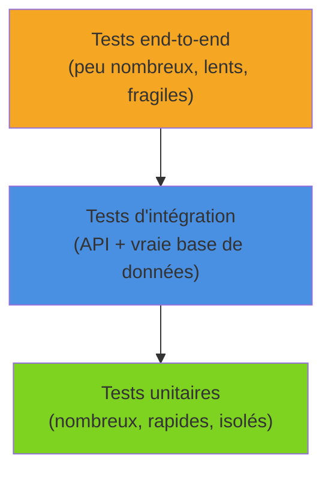
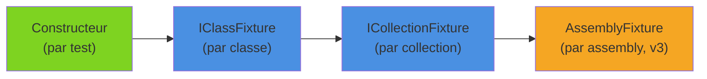

Écrire des tests, c'est facile ; écrire des tests lisibles, rapides et maintenables sur la durée, beaucoup moins. **xUnit v3**, disponible en version stable depuis fin 2024 et désormais en 3.2, apporte des changements de fond : projets de test exécutables, `TestContext`, fixtures d'assembly, support natif de Microsoft.Testing.Platform. Tour d'horizon sur un petit domaine concret : le calcul des pénalités de retard d'une bibliothèque.

<!--more-->

# 1. Le domaine d'exemple

Une bibliothèque prête des livres pour une durée donnée. Un livre rendu en retard coûte 0,20 € par jour, plafonné à 10 € ; les étudiants paient moitié prix et les abonnés Premium bénéficient de trois jours de grâce. Le domaine tient en deux types, volontairement simples :

```csharp
namespace Library.Domain;

public enum MemberTier { Standard, Student, Premium }

public sealed class Loan
{
    public Guid Id { get; init; } = Guid.NewGuid();
    public required string MemberId { get; init; }
    public required string Isbn { get; init; }
    public required DateOnly DueDate { get; init; }
    public DateOnly? ReturnedOn { get; private set; }
    public bool IsReturned => ReturnedOn is not null;

    // Jours de retard à une date donnée (ou à la date de retour si le livre est rendu)
    public int DaysLate(DateOnly asOf) =>
        Math.Max(0, (ReturnedOn ?? asOf).DayNumber - DueDate.DayNumber);

    public void Return(DateOnly on)
    {
        if (IsReturned)
            throw new InvalidOperationException($"L'emprunt {Isbn} a déjà été rendu.");
        ReturnedOn = on;
    }
}

public static class LateFeeCalculator
{
    public const decimal DailyRate = 0.20m;
    public const decimal MaxFee = 10.00m;
    public const int PremiumGraceDays = 3;

    // Pénalité de retard selon le nombre de jours et le profil de l'adhérent
    public static decimal Compute(int daysLate, MemberTier tier)
    {
        ArgumentOutOfRangeException.ThrowIfNegative(daysLate);

        var billableDays = tier == MemberTier.Premium
            ? Math.Max(0, daysLate - PremiumGraceDays)
            : daysLate;

        var fee = Math.Min(billableDays * DailyRate, MaxFee);
        return tier == MemberTier.Student ? Math.Round(fee * 0.5m, 2) : fee;
    }
}
```

Pas d'I/O, pas de dépendance : le terrain idéal pour des tests unitaires.

# 2. La pyramide des tests

Avant d'écrire la moindre assertion, il faut savoir **quoi** tester et **à quel niveau**. La pyramide des tests reste une bonne boussole :



| Niveau | Ce qu'on vérifie | Vitesse | Outils typiques |
|---|---|---|---|
| Unitaire | Une règle métier, une classe | Millisecondes | xUnit (+ doublures type NSubstitute) |
| Intégration | API + base réelle + sérialisation | Secondes | WebApplicationFactory, Testcontainers |
| End-to-end | Le système complet, UI comprise | Minutes | Playwright, hors périmètre ici |

À côté de cette pyramide, d'autres familles de tests ont leur place : les [tests d'architecture](/2025/10/11/TestArchi.html) pour garantir les règles de dépendances entre couches, et les benchmarks (BenchmarkDotNet) pour la performance. Cet article se concentre sur la base : les tests unitaires.

# 3. Créer le projet de test

## Templates et packages

```bash
# Installer les templates xUnit v3 (une seule fois)
dotnet new install xunit.v3.templates

# Créer le projet de test et le relier au projet testé
dotnet new xunit3 -n Library.Domain.Tests -o tests/Library.Domain.Tests
dotnet add tests/Library.Domain.Tests reference src/Library.Domain
dotnet sln add tests/Library.Domain.Tests
```

Le `.csproj` généré ressemble à ceci :

```xml
<Project Sdk="Microsoft.NET.Sdk">

  <PropertyGroup>
    <TargetFramework>net10.0</TargetFramework>
    <!-- Nouveauté v3 : un projet de test est un exécutable -->
    <OutputType>Exe</OutputType>
    <Nullable>enable</Nullable>
    <ImplicitUsings>enable</ImplicitUsings>
  </PropertyGroup>

  <ItemGroup>
    <Using Include="Xunit" />
  </ItemGroup>

  <ItemGroup>
    <PackageReference Include="xunit.v3" Version="3.2.2" />
    <!-- Nécessaires uniquement pour le mode VSTest (Test Explorer historique, anciens outils CI) -->
    <PackageReference Include="xunit.runner.visualstudio" Version="3.1.5" />
    <PackageReference Include="Microsoft.NET.Test.Sdk" Version="18.3.0" />
  </ItemGroup>

</Project>
```

Le changement majeur de la v3 : **le projet de test est un exécutable**. On peut donc le lancer directement avec `dotnet run`, sans runner externe, ce qui simplifie le débogage et l'exécution en CI.

## Microsoft.Testing.Platform

xUnit v3 supporte nativement **Microsoft.Testing.Platform** (MTP), la plateforme de test qui remplace progressivement VSTest. Dans la branche 3.x, le package `xunit.v3` embarque MTP v1 ; le package `xunit.v3.mtp-v2` permet de choisir explicitement MTP v2.

Avec le SDK .NET 10, on bascule `dotnet test` en mode MTP via un `global.json` à la racine de la solution :

```json
{
  "test": {
    "runner": "Microsoft.Testing.Platform"
  }
}
```

Avec un SDK 8 ou 9, on passe plutôt par la propriété MSBuild `TestingPlatformDotnetTestSupport`. Et pour profiter de la ligne de commande MTP lors d'un `dotnet run`, on ajoute `<UseMicrosoftTestingPlatformRunner>true</UseMicrosoftTestingPlatformRunner>`.

```bash
# Les trois façons de lancer les tests
dotnet test                              # via la plateforme configurée
dotnet run --project tests/Library.Domain.Tests
./tests/Library.Domain.Tests/bin/Debug/net10.0/Library.Domain.Tests.exe
```

# 4. Fact, Theory et données de test

## Fact : un cas, un test

```csharp
using Library.Domain;

namespace Library.Domain.Tests;

public class LoanTests
{
    [Fact]
    public void DaysLate_WhenReturnedAfterDueDate_ReturnsNumberOfDays()
    {
        // Arrange
        var loan = new Loan { MemberId = "M-001", Isbn = "978-2-07-036822-8", DueDate = new DateOnly(2026, 3, 10) };
        loan.Return(new DateOnly(2026, 3, 15));

        // Act
        var daysLate = loan.DaysLate(asOf: new DateOnly(2026, 4, 1));

        // Assert : c'est la date de retour qui compte, pas la date de consultation
        Assert.Equal(5, daysLate);
    }

    [Fact]
    public void Return_WhenAlreadyReturned_Throws()
    {
        var loan = new Loan { MemberId = "M-001", Isbn = "978-2-07-036822-8", DueDate = new DateOnly(2026, 3, 10) };
        loan.Return(new DateOnly(2026, 3, 9));

        var ex = Assert.Throws<InvalidOperationException>(() => loan.Return(new DateOnly(2026, 3, 12)));

        Assert.Contains("déjà été rendu", ex.Message);
    }
}
```

## Theory + InlineData : un test, plusieurs jeux de données

Dès que la même logique doit être vérifiée avec plusieurs entrées, on passe à `[Theory]` :

```csharp
public class LateFeeCalculatorTests
{
    [Theory]
    [InlineData(0, MemberTier.Standard, 0.00)]
    [InlineData(5, MemberTier.Standard, 1.00)]
    [InlineData(5, MemberTier.Student, 0.50)]
    [InlineData(5, MemberTier.Premium, 0.40)]   // 3 jours de grâce : 2 jours facturés
    [InlineData(100, MemberTier.Standard, 10.00)] // plafond
    public void Compute_ReturnsExpectedFee(int daysLate, MemberTier tier, double expected)
    {
        // InlineData n'accepte que des constantes : pas de decimal, d'où la conversion
        var fee = LateFeeCalculator.Compute(daysLate, tier);

        Assert.Equal((decimal)expected, fee);
    }

    [Theory]
    [InlineData(-1)]
    [InlineData(-30)]
    public void Compute_WithNegativeDays_Throws(int daysLate)
    {
        Assert.Throws<ArgumentOutOfRangeException>(() => LateFeeCalculator.Compute(daysLate, MemberTier.Standard));
    }
}
```

## MemberData et TheoryData : des données typées

Les attributs n'acceptent que des constantes de compilation. Pour des `decimal`, des objets ou des données calculées, on utilise `[MemberData]` combiné à `TheoryData<>`, qui apporte le **typage fort** :

```csharp
public class LateFeeCalculatorMemberDataTests
{
    // ✅ TheoryData : le compilateur vérifie le type de chaque ligne
    public static TheoryData<int, MemberTier, decimal> Fees => new()
    {
        { 5, MemberTier.Standard, 1.00m },
        { 3, MemberTier.Premium, 0.00m },
        { 100, MemberTier.Student, 5.00m }, // plafond, puis demi-tarif
    };

    [Theory]
    [MemberData(nameof(Fees))]
    public void Compute_ReturnsExpectedFee(int daysLate, MemberTier tier, decimal expected)
    {
        Assert.Equal(expected, LateFeeCalculator.Compute(daysLate, tier));
    }
}
```

```csharp
// ❌ À éviter : IEnumerable<object[]>, aucune vérification de type
public static IEnumerable<object[]> OldStyle =>
[
    [5, MemberTier.Standard, 1.00m],
    [5, "Student", "oops"], // compile, mais échoue à l'exécution
];
```

# 5. Nommage et pattern AAA

## Une convention de nommage

Le nom du test est la première chose qu'on lit quand il échoue en CI. Une convention répandue : **`Méthode_Scénario_RésultatAttendu`**.

| ❌ Nom peu utile | ✅ Nom explicite |
|---|---|
| `Test1` | `Compute_WithZeroDays_ReturnsZero` |
| `FeeTest` | `Compute_WithNegativeDays_ThrowsArgumentOutOfRange` |
| `ReturnOk` | `Return_WhenNotReturned_SetsReturnDate` |

L'essentiel est d'être **cohérent** dans toute la solution, et de nommer les classes de test d'après la classe testée (`LoanTests`, `LateFeeCalculatorTests`).

## Arrange / Act / Assert

Chaque test suit trois étapes clairement séparées :

1. **Arrange** : préparer les objets et les données.
2. **Act** : exécuter **une seule** action, celle qu'on teste.
3. **Assert** : vérifier le résultat.

```csharp
// ❌ Plusieurs actes et assertions mélangées : en cas d'échec, impossible de savoir quoi
[Fact]
public void Loan_Works()
{
    var loan = new Loan { MemberId = "M-001", Isbn = "978-2-07-036822-8", DueDate = new DateOnly(2026, 3, 10) };
    Assert.False(loan.IsReturned);
    loan.Return(new DateOnly(2026, 3, 15));
    Assert.Equal(5, loan.DaysLate(new DateOnly(2026, 3, 15)));
    Assert.Equal(1.00m, LateFeeCalculator.Compute(5, MemberTier.Standard));
    Assert.Throws<InvalidOperationException>(() => loan.Return(new DateOnly(2026, 3, 16)));
}
```

On préfère trois tests ciblés. Plusieurs `Assert` dans un même test ne posent pas de problème tant qu'ils vérifient **le même comportement**.

# 6. Les fixtures : partager un contexte coûteux

xUnit crée une **nouvelle instance de la classe de test pour chaque test**. Le constructeur fait office de *setup*, `Dispose`/`DisposeAsync` de *teardown*. C'est voulu : aucun état ne fuit d'un test à l'autre. Quand l'initialisation coûte cher (base de données, serveur, gros fichier), on la partage avec une fixture.



## IClassFixture : partagé entre les tests d'une classe

```csharp
using System.Text.Json;

// Fixture : créée une fois, avant le premier test de la classe
public sealed class CatalogFixture : IAsyncLifetime
{
    // ISBN → titre, chargé depuis un fichier copié dans le dossier de sortie
    public IReadOnlyDictionary<string, string> Titles { get; private set; } = default!;

    // v3 : InitializeAsync et DisposeAsync retournent des ValueTask
    public async ValueTask InitializeAsync()
    {
        await using var stream = File.OpenRead("Data/catalog.json");
        Titles = (await JsonSerializer.DeserializeAsync<Dictionary<string, string>>(stream))!;
    }

    public ValueTask DisposeAsync() => ValueTask.CompletedTask;
}

public class CatalogTests(CatalogFixture catalog) : IClassFixture<CatalogFixture>
{
    [Fact]
    public void Catalog_ContainsKnownIsbn()
    {
        Assert.True(catalog.Titles.ContainsKey("978-2-07-036822-8"));
    }
}
```

## ICollectionFixture : partagé entre plusieurs classes

```csharp
[CollectionDefinition("Catalog")]
public class CatalogCollection : ICollectionFixture<CatalogFixture>;

[Collection("Catalog")]
public class OverdueReportTests(CatalogFixture catalog) { /* ... */ }

[Collection("Catalog")]
public class ReminderLetterTests(CatalogFixture catalog) { /* ... */ }
```

Attention : les tests d'une même collection **ne s'exécutent pas en parallèle**. C'est souvent ce qu'on veut avec une ressource partagée mutable, typiquement une base de données que chaque test remet à zéro.

## Assembly fixtures : la nouveauté v3

xUnit v3 ajoute un niveau supplémentaire : une fixture unique pour **tout l'assembly**, sans interface ni attribut sur les classes de test.

```csharp
// N'importe où dans le projet, par exemple AssemblyInfo.cs
[assembly: AssemblyFixture(typeof(CatalogFixture))]

// Il suffit de demander la fixture dans le constructeur
public class LoanStatisticsTests(CatalogFixture catalog) { /* ... */ }
```

Contrairement à une collection, l'assembly fixture ne limite pas le parallélisme : elle doit donc être **thread-safe** ou en lecture seule.

# 7. TestContext, sortie et annulation

## Écrire dans la sortie du test

`Console.WriteLine` n'apparaît pas dans les résultats de test. On injecte `ITestOutputHelper` (désormais dans le namespace `Xunit`, `Xunit.Abstractions` a disparu en v3) :

```csharp
public class LateFeeDiagnosticsTests(ITestOutputHelper output)
{
    [Fact]
    public void Compute_IsLogged()
    {
        var fee = LateFeeCalculator.Compute(12, MemberTier.Student);

        output.WriteLine($"Pénalité calculée : {fee} €");

        Assert.Equal(1.20m, fee);
    }
}
```

## TestContext.Current

La v3 introduit `TestContext.Current`, accessible partout (y compris dans une méthode utilitaire ou une fixture) : test en cours, sortie, état du pipeline, et surtout un **jeton d'annulation**.

```csharp
[Fact]
public async Task Catalog_CanBeLoadedAsync()
{
    // Annulé si le test dépasse son timeout ou si l'utilisateur interrompt la session
    var ct = TestContext.Current.CancellationToken;

    var json = await File.ReadAllTextAsync("Data/catalog.json", ct);

    TestContext.Current.TestOutputHelper?.WriteLine($"{json.Length} caractères lus");
    Assert.NotEmpty(json);
}
```

L'analyseur **xUnit1051** signale tout appel à une méthode acceptant un `CancellationToken` qui ne reçoit pas `TestContext.Current.CancellationToken`. C'est une bonne habitude : un test bloqué peut alors être interrompu proprement au lieu de geler toute la CI. On combine avec `[Fact(Timeout = 5000)]` pour les tests asynchrones susceptibles de bloquer.

## Ignorer un test dynamiquement

```csharp
[Fact]
public void Export_OnWindowsOnly()
{
    // v3 : skip décidé à l'exécution
    Assert.SkipUnless(OperatingSystem.IsWindows(), "Nécessite Windows");
    // ...
}

[Fact(Explicit = true)] // exécuté seulement si on le demande explicitement
public void Slow_FullCatalogImport() { /* ... */ }
```

# Résumé

| Élément | Usage |
|---|---|
| `xunit.v3` + `OutputType Exe` | Projet de test exécutable (`dotnet run`) |
| `global.json` → `Microsoft.Testing.Platform` | `dotnet test` en mode MTP avec le SDK .NET 10 |
| `[Fact]` | Un cas de test sans paramètre |
| `[Theory]` + `[InlineData]` | Plusieurs jeux de données constants |
| `[MemberData]` + `TheoryData<>` | Données typées, calculées ou non constantes |
| `Méthode_Scénario_Résultat` + AAA | Tests lisibles et diagnostics clairs |
| `IClassFixture<T>` | Contexte partagé par une classe |
| `ICollectionFixture<T>` | Contexte partagé entre classes, exécution séquentielle |
| `[assembly: AssemblyFixture]` | Contexte partagé par tout l'assembly (v3) |
| `ITestOutputHelper` / `TestContext.Current` | Sortie de test, contexte, `CancellationToken` |
| `Assert.Skip*`, `Explicit = true` | Ignorer dynamiquement ou à la demande |

Les règles de pénalités sont désormais couvertes par des tests unitaires purs, rapides et lisibles. Dès qu'une classe dépend d'un dépôt, d'une horloge ou d'un service externe, on complète cette base avec des doublures de test (NSubstitute, `FakeTimeProvider`) ; dès qu'il faut vérifier l'API et la base réelles, avec des tests d'intégration. Les mécanismes vus ici, fixtures et `TestContext` en tête, restent les mêmes dans les deux cas.
