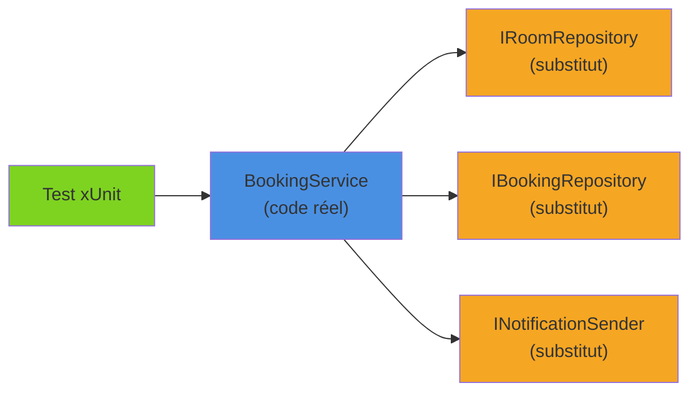

Dès qu'une classe dépend d'une base de données, d'un service externe ou d'un envoi d'e-mails, la tester unitairement impose de remplacer ces dépendances par des **doublures**. **NSubstitute** est la bibliothèque de mocking la plus lisible de l'écosystème .NET : pas de `Setup`, pas de `.Object`, juste des appels de méthode. On l'applique ici à un service de réservation de salles de réunion qui envoie des notifications, en voyant aussi quand il vaut mieux **ne pas** mocker.

<!--more-->

# 1. Le service à tester

Une entreprise met ses salles de réunion en libre réservation. Le service applicatif vérifie que la salle existe, qu'elle est assez grande et libre sur le créneau, enregistre la réservation puis envoie une confirmation à l'organisateur. Tous les types utilisés dans l'article sont définis ici :

```csharp
namespace Rooms.Application;

public sealed record Room(string Id, string Name, int Capacity);

public sealed class Booking
{
    public Guid Id { get; init; } = Guid.NewGuid();
    public required string RoomId { get; init; }
    public required string OrganizerEmail { get; init; }
    public required DateTimeOffset Start { get; init; }
    public required DateTimeOffset End { get; init; }
    public required int Attendees { get; init; }
}

public interface IRoomRepository
{
    Task<Room?> GetByIdAsync(string roomId, CancellationToken ct);
}

public interface IBookingRepository
{
    Task<bool> HasOverlapAsync(string roomId, DateTimeOffset start, DateTimeOffset end, CancellationToken ct);
    Task AddAsync(Booking booking, CancellationToken ct);
}

public interface INotificationSender
{
    Task SendBookingConfirmationAsync(Booking booking, CancellationToken ct);
}

public sealed record BookRoomRequest(
    string RoomId, string OrganizerEmail, DateTimeOffset Start, DateTimeOffset End, int Attendees);

public sealed class RoomUnavailableException(string roomId)
    : Exception($"La salle {roomId} est déjà réservée sur ce créneau.");

public sealed class BookingService(
    IRoomRepository rooms,
    IBookingRepository bookings,
    INotificationSender notifications)
{
    public async Task<Booking> BookAsync(BookRoomRequest request, CancellationToken ct)
    {
        if (request.End <= request.Start)
            throw new ArgumentException("Le créneau doit se terminer après son début.", nameof(request));

        var room = await rooms.GetByIdAsync(request.RoomId, ct)
            ?? throw new KeyNotFoundException($"Salle inconnue : {request.RoomId}");

        if (request.Attendees > room.Capacity)
            throw new ArgumentException($"{room.Name} accueille {room.Capacity} personnes au maximum.", nameof(request));

        // 1. Disponibilité
        if (await bookings.HasOverlapAsync(room.Id, request.Start, request.End, ct))
            throw new RoomUnavailableException(room.Id);

        // 2. Persistance
        var booking = new Booking
        {
            RoomId = room.Id,
            OrganizerEmail = request.OrganizerEmail,
            Start = request.Start,
            End = request.End,
            Attendees = request.Attendees
        };
        await bookings.AddAsync(booking, ct);

        // 3. Notification
        await notifications.SendBookingConfirmationAsync(booking, ct);
        return booking;
    }
}
```

Trois dépendances, toutes externes au comportement qu'on veut vérifier : c'est exactement le cas d'usage du mocking.



# 2. Installation

```bash
dotnet add tests/Rooms.Application.Tests package NSubstitute --version 5.3.0
# Analyseurs Roslyn : détectent les erreurs d'utilisation à la compilation
dotnet add tests/Rooms.Application.Tests package NSubstitute.Analyzers.CSharp
```

Les analyseurs sont fortement recommandés : ils signalent par exemple une tentative de substituer un membre non virtuel, qui échouerait silencieusement à l'exécution.

Les exemples utilisent xUnit v3 (`[Fact]`, `[Theory]`, `TestContext.Current.CancellationToken`), mais NSubstitute fonctionne à l'identique avec NUnit ou MSTest.

# 3. Créer un substitut et configurer les retours

## Substitute.For et Returns

```csharp
using NSubstitute;
using Rooms.Application;

namespace Rooms.Application.Tests;

public class BookingServiceTests
{
    private static readonly DateTimeOffset Monday9h = new(2026, 4, 6, 9, 0, 0, TimeSpan.Zero);

    private readonly IRoomRepository _rooms = Substitute.For<IRoomRepository>();
    private readonly IBookingRepository _bookings = Substitute.For<IBookingRepository>();
    private readonly INotificationSender _notifications = Substitute.For<INotificationSender>();
    private readonly BookingService _sut;

    public BookingServiceTests()
    {
        // xUnit crée une instance par test : les substituts sont neufs à chaque test
        _sut = new BookingService(_rooms, _bookings, _notifications);
    }

    private static BookRoomRequest ARequest(int attendees = 6, int hours = 1) =>
        new("R-101", "alice@example.com", Monday9h, Monday9h.AddHours(hours), attendees);

    [Fact]
    public async Task BookAsync_WhenRoomIsFree_ReturnsBooking()
    {
        // Arrange : Returns accepte directement la valeur, NSubstitute l'enveloppe dans un Task
        _rooms.GetByIdAsync("R-101", Arg.Any<CancellationToken>())
              .Returns(new Room("R-101", "Salle Lovelace", 8));

        // Act
        var booking = await _sut.BookAsync(ARequest(), TestContext.Current.CancellationToken);

        // Assert
        Assert.Equal("R-101", booking.RoomId);
        Assert.Equal(6, booking.Attendees);
    }
}
```

Points clés :

- `Substitute.For<T>()` crée un substitut ; on l'utilise **directement** comme un `T`, sans `.Object`.
- On configure un retour en **appelant la méthode** puis en chaînant `.Returns(...)`.
- Un membre non configuré renvoie une valeur par défaut : `null`, `0`, `false`, chaîne vide, ou un `Task` terminé. Pour une interface, NSubstitute renvoie même un substitut récursif. Ici, `HasOverlapAsync` non configuré renvoie `false` : la salle est libre.

## Arg.Any et Arg.Is : les correspondances d'arguments

```csharp
// N'importe quelle salle
_rooms.GetByIdAsync(Arg.Any<string>(), Arg.Any<CancellationToken>())
      .Returns(new Room("R-101", "Salle Lovelace", 8));

// Seulement les créneaux qui commencent le matin : la salle est déjà prise
_bookings.HasOverlapAsync(
             Arg.Any<string>(),
             Arg.Is<DateTimeOffset>(start => start.Hour < 12),
             Arg.Any<DateTimeOffset>(),
             Arg.Any<CancellationToken>())
         .Returns(true);
```

Quand plusieurs configurations correspondent, **la dernière déclarée l'emporte**. On déclare donc le cas général en premier, puis les cas particuliers.

## Retours calculés et séquences

```csharp
// Retour calculé à partir des arguments reçus
_rooms.GetByIdAsync(Arg.Any<string>(), Arg.Any<CancellationToken>())
      .Returns(ci => new Room(ci.ArgAt<string>(0), "Salle générique", 10));

// Retours successifs : occupée au premier appel, libre au suivant
_bookings.HasOverlapAsync(default!, default, default, default)
         .ReturnsForAnyArgs(true, false);
```

# 4. Vérifier les interactions : Received et DidNotReceive

Configurer les retours sert à piloter le code testé. Vérifier les appels sert à tester les **effets de bord** : la réservation a-t-elle été enregistrée ? La confirmation envoyée ?

```csharp
[Fact]
public async Task BookAsync_WhenRoomIsFree_SavesAndNotifies()
{
    _rooms.GetByIdAsync(default!, default)
          .ReturnsForAnyArgs(new Room("R-101", "Salle Lovelace", 8));

    var booking = await _sut.BookAsync(ARequest(), TestContext.Current.CancellationToken);

    // Exactement un appel, avec la bonne réservation
    await _bookings.Received(1).AddAsync(
        Arg.Is<Booking>(b => b.RoomId == "R-101" && b.Attendees == 6),
        Arg.Any<CancellationToken>());

    await _notifications.Received(1).SendBookingConfirmationAsync(booking, Arg.Any<CancellationToken>());
}

[Fact]
public async Task BookAsync_WhenSlotIsTaken_DoesNotSaveNorNotify()
{
    _rooms.GetByIdAsync(default!, default)
          .ReturnsForAnyArgs(new Room("R-101", "Salle Lovelace", 8));
    _bookings.HasOverlapAsync(default!, default, default, default)
             .ReturnsForAnyArgs(true);

    var ex = await Assert.ThrowsAsync<RoomUnavailableException>(
        () => _sut.BookAsync(ARequest(), TestContext.Current.CancellationToken));

    Assert.Contains("R-101", ex.Message);
    await _bookings.DidNotReceiveWithAnyArgs().AddAsync(default!, default);
    await _notifications.DidNotReceiveWithAnyArgs().SendBookingConfirmationAsync(default!, default);
}
```

## Vérifier les arguments transmis

```csharp
[Theory]
[InlineData(1)]
[InlineData(3)]
public async Task BookAsync_ChecksOverlapOnRequestedSlot(int hours)
{
    _rooms.GetByIdAsync(default!, default)
          .ReturnsForAnyArgs(new Room("R-101", "Salle Lovelace", 8));

    await _sut.BookAsync(ARequest(hours: hours), TestContext.Current.CancellationToken);

    await _bookings.Received(1).HasOverlapAsync(
        "R-101", Monday9h, Monday9h.AddHours(hours), Arg.Any<CancellationToken>());
}
```

## Capturer un argument

Quand l'assertion devient trop complexe pour un `Arg.Is`, on capture l'argument et on l'inspecte avec des `Assert` classiques, qui donnent de meilleurs messages d'erreur :

```csharp
Booking? saved = null;
// Configuration : chaque appel reçu exécutera l'action de capture
_ = _bookings.AddAsync(Arg.Do<Booking>(b => saved = b), Arg.Any<CancellationToken>());

await _sut.BookAsync(ARequest(), TestContext.Current.CancellationToken);

Assert.NotNull(saved);
Assert.Equal("alice@example.com", saved.OrganizerEmail);
Assert.Equal(TimeSpan.FromHours(1), saved.End - saved.Start);
```

## Vérifier l'ordre des appels

```csharp
// Vérifier la disponibilité, puis enregistrer, puis notifier
Received.InOrder(() =>
{
    _bookings.HasOverlapAsync(Arg.Any<string>(), Arg.Any<DateTimeOffset>(), Arg.Any<DateTimeOffset>(), Arg.Any<CancellationToken>());
    _bookings.AddAsync(Arg.Any<Booking>(), Arg.Any<CancellationToken>());
    _notifications.SendBookingConfirmationAsync(Arg.Any<Booking>(), Arg.Any<CancellationToken>());
});
```

À utiliser avec parcimonie : vérifier l'ordre rend le test sensible au moindre refactoring.

# 5. Simuler des exceptions

Les méthodes d'extension de `NSubstitute.ExceptionExtensions` permettent de lever une exception, y compris depuis une méthode asynchrone :

```csharp
using NSubstitute.ExceptionExtensions;

[Fact]
public async Task BookAsync_WhenNotificationFails_PropagatesException()
{
    _rooms.GetByIdAsync(default!, default)
          .ReturnsForAnyArgs(new Room("R-101", "Salle Lovelace", 8));

    // ThrowsAsync : renvoie un Task en échec (comme une vraie méthode async)
    _notifications.SendBookingConfirmationAsync(Arg.Any<Booking>(), Arg.Any<CancellationToken>())
                  .ThrowsAsync(new HttpRequestException("Serveur SMTP indisponible"));

    await Assert.ThrowsAsync<HttpRequestException>(
        () => _sut.BookAsync(ARequest(), TestContext.Current.CancellationToken));

    // La réservation a quand même été enregistrée : comportement à discuter (voir le pattern Outbox)
    await _bookings.ReceivedWithAnyArgs(1).AddAsync(default!, default);
}
```

| Méthode | Effet |
|---|---|
| `.Throws(ex)` | Lève l'exception **de façon synchrone** lors de l'appel |
| `.ThrowsAsync(ex)` | Renvoie un `Task` en échec, comportement fidèle à une méthode `async` |
| `.When(x => x.Méthode()).Do(_ => throw ex)` | Pour les méthodes `void` |

Ce test révèle d'ailleurs un vrai problème de conception : si l'envoi de l'e-mail échoue, la salle est réservée mais l'appelant reçoit une erreur. S'il réessaie, sa seconde demande sera rejetée… à cause de sa propre réservation. Un bon test unitaire sert aussi à **faire émerger ce genre de question**.

# 6. Quand ne pas mocker

Le mocking est un outil puissant, mais un test truffé de `Received` vérifie l'**implémentation** plutôt que le **comportement**. Quelques règles.

## Ne pas mocker le domaine

`Room` et `Booking` sont de simples objets de données, sans I/O : on les instancie tels quels. Mocker une entité ou un value object n'apporte rien et fragilise le test.

## Préférer un fake quand il existe

Un **fake** est une implémentation simplifiée mais fonctionnelle. Pour le temps, .NET fournit `FakeTimeProvider` (package `Microsoft.Extensions.TimeProvider.Testing`). Exemple : une réservation s'annule gratuitement jusqu'à 24 heures avant son début.

```csharp
using Microsoft.Extensions.Time.Testing;

public sealed class CancellationPolicy(TimeProvider time)
{
    public static readonly TimeSpan FreeWindow = TimeSpan.FromHours(24);

    public bool CanCancelForFree(Booking booking) => booking.Start - time.GetUtcNow() >= FreeWindow;
}

// ❌ Mocker DateTime.Now est impossible ; injecter une interface maison est superflu
// ✅ TimeProvider est l'abstraction standard, FakeTimeProvider son fake officiel
var time = new FakeTimeProvider(new DateTimeOffset(2026, 4, 5, 8, 0, 0, TimeSpan.Zero));
var policy = new CancellationPolicy(time);
var booking = new Booking
{
    RoomId = "R-101", OrganizerEmail = "alice@example.com", Attendees = 4,
    Start = new DateTimeOffset(2026, 4, 6, 9, 0, 0, TimeSpan.Zero),
    End = new DateTimeOffset(2026, 4, 6, 10, 0, 0, TimeSpan.Zero)
};

Assert.True(policy.CanCancelForFree(booking));   // 25 h avant
time.Advance(TimeSpan.FromHours(2));
Assert.False(policy.CanCancelForFree(booking));  // 23 h avant
```

Pour un dépôt, un fake en mémoire est souvent plus lisible qu'un substitut configuré dans chaque test :

```csharp
public sealed class InMemoryBookingRepository : IBookingRepository
{
    private readonly List<Booking> _bookings = [];

    public IReadOnlyList<Booking> All => _bookings;

    // Deux créneaux se chevauchent si chacun commence avant la fin de l'autre
    public Task<bool> HasOverlapAsync(string roomId, DateTimeOffset start, DateTimeOffset end, CancellationToken ct) =>
        Task.FromResult(_bookings.Any(b => b.RoomId == roomId && b.Start < end && start < b.End));

    public Task AddAsync(Booking booking, CancellationToken ct)
    {
        _bookings.Add(booking);
        return Task.CompletedTask;
    }
}

// Le test vérifie un état, pas un appel
Assert.Single(repository.All, b => b.RoomId == "R-101");
```

Bonus : le fake contient une vraie règle de chevauchement, ce qui permet d'écrire un test « deux réservations successives sur le même créneau » sans configurer de séquence de retours.

## Ne pas mocker ce qu'on ne possède pas

Mocker `HttpClient`, `DbContext`, `IConfiguration` ou le SDK d'un fournisseur d'e-mails, c'est parier sur le comportement d'un code qu'on ne contrôle pas. Le test passe, la production échoue.

| ❌ À éviter | ✅ À privilégier |
|---|---|
| Mocker `DbContext` / `DbSet<T>` | Tests d'intégration avec une vraie base (Testcontainers) |
| Mocker `HttpMessageHandler` partout | Une interface métier (`INotificationSender`) mockée dans les tests unitaires, l'adaptateur concret testé en intégration |
| Mocker les classes du SDK SendGrid, Microsoft Graph… | Encapsuler le SDK derrière **sa propre** interface |
| Vérifier chaque appel interne | Vérifier le résultat et les effets de bord significatifs |

C'est précisément pourquoi `INotificationSender` existe : c'est **notre** abstraction, exprimée dans **notre** langage métier (« confirmer une réservation »), et non « envoyer un message SMTP ». L'adaptateur concret sera couvert par des tests d'intégration.

# 7. Comparaison rapide avec Moq

Moq reste très répandu (et a fait parler de lui en 2023 avec l'épisode SponsorLink, retiré depuis). Les deux bibliothèques couvrent les mêmes besoins ; la différence est surtout syntaxique :

```csharp
// Moq
var rooms = new Mock<IRoomRepository>();
rooms.Setup(r => r.GetByIdAsync(It.Is<string>(id => id.StartsWith("R-")), It.IsAny<CancellationToken>()))
     .ReturnsAsync(new Room("R-101", "Salle Lovelace", 8));
var sut = new BookingService(rooms.Object, bookings.Object, notifications.Object);
rooms.Verify(r => r.GetByIdAsync("R-101", It.IsAny<CancellationToken>()), Times.Once());

// NSubstitute
var rooms = Substitute.For<IRoomRepository>();
rooms.GetByIdAsync(Arg.Is<string>(id => id.StartsWith("R-")), Arg.Any<CancellationToken>())
     .Returns(new Room("R-101", "Salle Lovelace", 8));
var sut = new BookingService(rooms, bookings, notifications);
await rooms.Received(1).GetByIdAsync("R-101", Arg.Any<CancellationToken>());
```

| Besoin | Moq | NSubstitute |
|---|---|---|
| Créer | `new Mock<T>()` + `.Object` | `Substitute.For<T>()` |
| Configurer | `.Setup(...).Returns(...)` | `appel.Returns(...)` |
| Async | `.ReturnsAsync(...)` | `.Returns(...)` (enveloppe auto) |
| N'importe quel argument | `It.IsAny<T>()` | `Arg.Any<T>()` |
| Prédicat | `It.Is<T>(x => ...)` | `Arg.Is<T>(x => ...)` |
| Vérifier | `.Verify(..., Times.Once())` | `.Received(1).Méthode(...)` |
| Mode strict | `MockBehavior.Strict` | Non (volontairement) |

Le choix relève surtout du goût de l'équipe. NSubstitute gagne en concision ; Moq propose un mode strict que certains apprécient.

# Résumé

| Élément | Usage |
|---|---|
| `Substitute.For<T>()` | Créer un substitut d'interface (ou de membres virtuels) |
| `.Returns(...)` / `.ReturnsForAnyArgs(...)` | Configurer une valeur de retour, y compris pour `Task<T>` |
| `Arg.Any<T>()` / `Arg.Is<T>(pred)` | Correspondance d'arguments |
| `Arg.Do<T>(...)` | Capturer un argument pour l'inspecter |
| `.Received(n)` / `.DidNotReceive()` | Vérifier un appel (ou son absence) |
| `Received.InOrder(...)` | Vérifier l'ordre, avec parcimonie |
| `.Throws(...)` / `.ThrowsAsync(...)` | Simuler une exception (`NSubstitute.ExceptionExtensions`) |
| `FakeTimeProvider`, fakes en mémoire | Alternatives souvent plus lisibles que les mocks |
| Ne pas mocker ce qu'on ne possède pas | Encapsuler, puis tester l'adaptateur en intégration |

`BookingService` est désormais couvert unitairement, sans base de données ni serveur SMTP : chaque règle (capacité, chevauchement, notification) a son test, rapide et déterministe. Pour organiser ces tests (fixtures, `Theory`, `TestContext`), voir [xUnit v3 : organiser ses tests](/2026/04/04/tests-xunit-v3.html).
