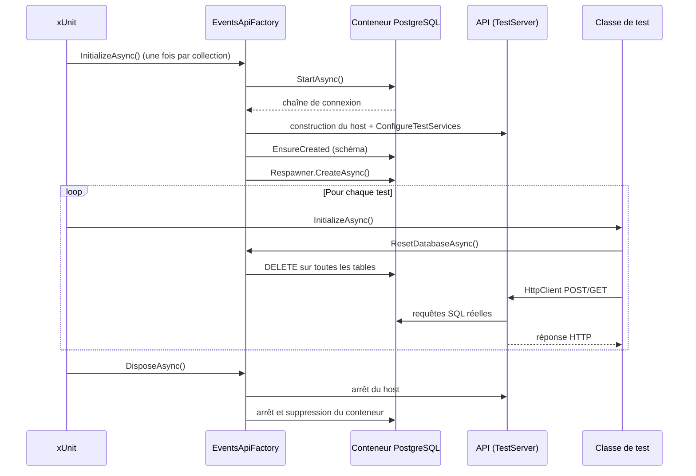

Les tests unitaires vérifient la logique, pas la tuyauterie : routage, sérialisation JSON, authentification, mapping EF Core, contraintes SQL. Pour ça, il faut démarrer l'API **pour de vrai**, face à une **vraie base de données**. `WebApplicationFactory` héberge l'application en mémoire, Testcontainers fournit un PostgreSQL jetable dans Docker, et Respawn remet la base à zéro entre deux tests. Voici l'assemblage complet sur une petite API d'inscriptions à des événements.

<!--more-->

# 1. L'API à tester

L'API permet à un utilisateur authentifié de s'inscrire à un événement (meetup, conférence…) et de consulter son inscription. Une personne ne peut s'inscrire qu'une fois au même événement : la règle est garantie par un **index unique** en base. Après l'inscription, un e-mail de confirmation part via un service externe.

Le modèle et le `DbContext` :

```csharp
// Projet Events.Api
using Microsoft.EntityFrameworkCore;

namespace Events.Api;

public sealed class Registration
{
    public Guid Id { get; init; } = Guid.NewGuid();
    public required string EventId { get; init; }
    public required string AttendeeEmail { get; init; }
    public DateTimeOffset RegisteredAt { get; init; }
}

public sealed class EventsDbContext(DbContextOptions<EventsDbContext> options) : DbContext(options)
{
    public DbSet<Registration> Registrations => Set<Registration>();

    protected override void OnModelCreating(ModelBuilder modelBuilder) =>
        // Une seule inscription par personne et par événement
        modelBuilder.Entity<Registration>()
            .HasIndex(r => new { r.EventId, r.AttendeeEmail })
            .IsUnique();
}

// Frontière externe : en production, un adaptateur SMTP ou un fournisseur d'e-mails
public interface IConfirmationSender
{
    Task SendAsync(Registration registration, CancellationToken ct);
}

public sealed class SmtpConfirmationSender : IConfirmationSender
{
    public Task SendAsync(Registration registration, CancellationToken ct) =>
        throw new NotImplementedException("Envoi SMTP réel, hors du périmètre de l'article");
}

public sealed record RegistrationDto(Guid Id, string EventId, string AttendeeEmail)
{
    public static RegistrationDto From(Registration r) => new(r.Id, r.EventId, r.AttendeeEmail);
}
```

Les endpoints, en Minimal API :

```csharp
// Program.cs (projet Events.Api)
using System.Security.Claims;
using Events.Api;
using Microsoft.AspNetCore.Authentication.JwtBearer;
using Microsoft.EntityFrameworkCore;
using Npgsql;

var builder = WebApplication.CreateBuilder(args);

// La lambda est évaluée à la résolution : elle verra la configuration surchargée par les tests
builder.Services.AddDbContext<EventsDbContext>(o =>
    o.UseNpgsql(builder.Configuration.GetConnectionString("Events")));

builder.Services.AddScoped<IConfirmationSender, SmtpConfirmationSender>();
builder.Services.AddSingleton(TimeProvider.System);

builder.Services.AddAuthentication(JwtBearerDefaults.AuthenticationScheme).AddJwtBearer();
builder.Services.AddAuthorization();

var app = builder.Build();
app.UseAuthentication();
app.UseAuthorization();

app.MapPost("/events/{eventId}/registrations", async (
    string eventId, ClaimsPrincipal user, EventsDbContext db,
    IConfirmationSender confirmations, TimeProvider time, CancellationToken ct) =>
{
    var registration = new Registration
    {
        EventId = eventId,
        AttendeeEmail = user.FindFirstValue(ClaimTypes.Email)!,
        RegisteredAt = time.GetUtcNow()
    };
    db.Registrations.Add(registration);

    try
    {
        await db.SaveChangesAsync(ct);
    }
    catch (DbUpdateException ex) when (ex.InnerException is PostgresException { SqlState: PostgresErrorCodes.UniqueViolation })
    {
        // L'index unique a parlé : déjà inscrit
        return Results.Conflict(new { error = "Déjà inscrit à cet événement." });
    }

    await confirmations.SendAsync(registration, ct);
    return Results.Created($"/registrations/{registration.Id}", RegistrationDto.From(registration));
}).RequireAuthorization();

app.MapGet("/registrations/{id:guid}", async (Guid id, EventsDbContext db, CancellationToken ct) =>
    await db.Registrations.FindAsync([id], ct) is { } registration
        ? Results.Ok(RegistrationDto.From(registration))
        : Results.NotFound()).RequireAuthorization();

app.Run();

// Rend la classe Program générée accessible au projet de test
public partial class Program;
```

# 2. Pourquoi une vraie base ?

Le provider EF Core *InMemory* et SQLite sont tentants, mais ils ne se comportent pas comme PostgreSQL : pas de contraintes identiques (InMemory **ignore les index uniques**, notre règle métier passerait donc inaperçue), pas de transactions réelles pour InMemory, collations et types différents. On teste alors un autre moteur que celui de la production. Avec **Testcontainers**, chaque session de test démarre le **même moteur, dans la même version**, au prix de quelques secondes de démarrage.

| Approche | Fidélité | Vitesse | Verdict |
|---|---|---|---|
| EF Core InMemory | ❌ Faible | ✅ Très rapide | À éviter pour l'intégration |
| SQLite en mémoire | ⚠️ Moyenne | ✅ Rapide | Dialecte SQL différent |
| Base partagée de dev | ✅ Bonne | ⚠️ Variable | Tests interdépendants, fragile en CI |
| **Testcontainers** | ✅ Identique à la prod | ⚠️ Démarrage ~2-5 s | ✅ Recommandé |

Seul prérequis : un moteur Docker disponible (Docker Desktop, Podman, ou l'agent CI). Les runners Linux de GitHub Actions l'ont nativement.

# 3. Packages

```bash
cd tests/Events.Api.IntegrationTests
dotnet add package Microsoft.AspNetCore.Mvc.Testing   # WebApplicationFactory
dotnet add package Testcontainers.PostgreSql          # conteneur PostgreSQL
dotnet add package Respawn                            # reset de la base
dotnet add reference ../../src/Events.Api
```

Le projet de test est un projet xUnit v3 classique (`dotnet new xunit3`), dont on remplace le SDK `Microsoft.NET.Sdk` par `Microsoft.NET.Sdk.Web` pour disposer des références ASP.NET Core. Les exemples utilisent deux notions xUnit : `IAsyncLifetime` (initialisation et nettoyage asynchrones) et les *collection fixtures* (un objet partagé par plusieurs classes de test, dont les tests s'exécutent alors séquentiellement).

# 4. Le cycle de vie

Démarrer un conteneur pour chaque test serait beaucoup trop lent. On démarre **un conteneur et une application par collection de tests**, et on se contente de **vider les tables** avant chaque test :



# 5. La fixture partagée : EventsApiFactory

```csharp
using System.Data.Common;
using Events.Api;
using Microsoft.AspNetCore.Authentication;
using Microsoft.AspNetCore.Hosting;
using Microsoft.AspNetCore.Mvc.Testing;
using Microsoft.AspNetCore.TestHost;
using Microsoft.Extensions.DependencyInjection;
using Microsoft.Extensions.DependencyInjection.Extensions;
using Npgsql;
using Respawn;
using Testcontainers.PostgreSql;

namespace Events.Api.IntegrationTests;

public sealed class EventsApiFactory : WebApplicationFactory<Program>, IAsyncLifetime
{
    // Image explicite et figée : même version qu'en production
    private readonly PostgreSqlContainer _postgres =
        new PostgreSqlBuilder("postgres:17-alpine").Build();

    private DbConnection _connection = default!;
    private Respawner _respawner = default!;

    public FakeConfirmationSender Confirmations { get; } = new();

    protected override void ConfigureWebHost(IWebHostBuilder builder)
    {
        builder.UseEnvironment("Testing");

        // Surcharge de la configuration : la chaîne de connexion pointe vers le conteneur
        builder.UseSetting("ConnectionStrings:Events", _postgres.GetConnectionString());

        // Exécuté APRÈS l'enregistrement des services de Program.cs
        builder.ConfigureTestServices(services =>
        {
            // On remplace la dépendance externe qu'on ne veut pas appeler
            services.RemoveAll<IConfirmationSender>();
            services.AddSingleton<IConfirmationSender>(Confirmations);

            // Authentification de test (voir section 7)
            services.AddAuthentication(TestAuthHandler.SchemeName)
                    .AddScheme<AuthenticationSchemeOptions, TestAuthHandler>(TestAuthHandler.SchemeName, _ => { });
        });
    }

    public async ValueTask InitializeAsync()
    {
        // 1. Le conteneur doit tourner AVANT la construction du host
        await _postgres.StartAsync(TestContext.Current.CancellationToken);

        // 2. Création du schéma (Services déclenche la construction du host)
        using (var scope = Services.CreateScope())
        {
            var db = scope.ServiceProvider.GetRequiredService<EventsDbContext>();
            await db.Database.EnsureCreatedAsync(TestContext.Current.CancellationToken);
        }

        // 3. Respawner : analyse le schéma une fois pour toutes
        _connection = new NpgsqlConnection(_postgres.GetConnectionString());
        await _connection.OpenAsync(TestContext.Current.CancellationToken);
        _respawner = await Respawner.CreateAsync(_connection, new RespawnerOptions
        {
            DbAdapter = DbAdapter.Postgres,
            SchemasToInclude = ["public"]
        });
    }

    public async Task ResetDatabaseAsync()
    {
        await _respawner.ResetAsync(_connection);
        Confirmations.Reset();
    }

    public override async ValueTask DisposeAsync()
    {
        await _connection.DisposeAsync();
        await base.DisposeAsync();      // arrête le host
        await _postgres.DisposeAsync(); // arrête et supprime le conteneur
    }
}
```

Quelques remarques :

- `UseSetting` est la façon la plus simple de surcharger la configuration lue par `Program.cs`. Plutôt que de retirer puis réenregistrer le `DbContext`, on change juste sa chaîne de connexion.
- Si l'on utilise des migrations plutôt que `EnsureCreated`, on appelle `MigrateAsync()` et on ajoute `TablesToIgnore = [new Table("__EFMigrationsHistory")]` pour que Respawn ne vide pas l'historique.
- `ConfigureTestServices` s'exécute après `Program.cs` : c'est l'endroit idéal pour remplacer un service.

La doublure de l'envoi d'e-mails est un simple fake écrit à la main, qui mémorise les confirmations « envoyées » :

```csharp
using System.Collections.Concurrent;
using Events.Api;

namespace Events.Api.IntegrationTests;

public sealed class FakeConfirmationSender : IConfirmationSender
{
    public ConcurrentQueue<Registration> Sent { get; } = new();

    public Task SendAsync(Registration registration, CancellationToken ct)
    {
        Sent.Enqueue(registration);
        return Task.CompletedTask;
    }

    public void Reset() => Sent.Clear();
}
```

## Collection fixture plutôt qu'assembly fixture

```csharp
[CollectionDefinition(Name)]
public sealed class ApiCollection : ICollectionFixture<EventsApiFactory>
{
    public const string Name = "Events API";
}
```

La collection garantit que les tests partageant la base **s'exécutent séquentiellement**. Une assembly fixture (nouveauté de xUnit v3) laisserait les classes tourner en parallèle : un test viderait la base pendant qu'un autre l'utilise.

# 6. Écrire les tests

```csharp
using System.Net;
using System.Net.Http.Json;
using Events.Api;

namespace Events.Api.IntegrationTests;

[Collection(ApiCollection.Name)]
public sealed class RegistrationsEndpointsTests(EventsApiFactory factory) : IAsyncLifetime
{
    private readonly HttpClient _client = factory.CreateClient();

    // Avant chaque test : base vide, fake réinitialisé
    public async ValueTask InitializeAsync() => await factory.ResetDatabaseAsync();
    public ValueTask DisposeAsync() => ValueTask.CompletedTask;

    private HttpClient AuthenticatedAs(string email)
    {
        _client.DefaultRequestHeaders.Add(TestAuthHandler.UserHeader, email);
        return _client;
    }

    [Fact]
    public async Task PostRegistration_ThenGetIt_ReturnsPersistedRegistration()
    {
        // Arrange
        var client = AuthenticatedAs("alice@example.com");
        var ct = TestContext.Current.CancellationToken;

        // Act
        var post = await client.PostAsync("/events/meetup-lyon-2026/registrations", content: null, ct);

        // Assert : création, puis relecture depuis PostgreSQL
        Assert.Equal(HttpStatusCode.Created, post.StatusCode);

        var fetched = await client.GetFromJsonAsync<RegistrationDto>(post.Headers.Location, ct);
        Assert.Equal("meetup-lyon-2026", fetched!.EventId);
        Assert.Equal("alice@example.com", fetched.AttendeeEmail);

        // La confirmation a bien été "envoyée"
        Assert.Equal(fetched.Id, Assert.Single(factory.Confirmations.Sent).Id);
    }

    [Fact]
    public async Task PostRegistration_Twice_Returns409()
    {
        var client = AuthenticatedAs("alice@example.com");
        var ct = TestContext.Current.CancellationToken;
        await client.PostAsync("/events/meetup-lyon-2026/registrations", content: null, ct);

        // Seul un vrai PostgreSQL lève la violation d'index unique (23505)
        var second = await client.PostAsync("/events/meetup-lyon-2026/registrations", content: null, ct);

        Assert.Equal(HttpStatusCode.Conflict, second.StatusCode);
        Assert.Single(factory.Confirmations.Sent);
    }

    [Fact]
    public async Task GetRegistration_WhenUnknown_Returns404()
    {
        var response = await AuthenticatedAs("alice@example.com")
            .GetAsync($"/registrations/{Guid.NewGuid()}", TestContext.Current.CancellationToken);

        Assert.Equal(HttpStatusCode.NotFound, response.StatusCode);
    }

    [Fact]
    public async Task PostRegistration_WithoutUser_Returns401()
    {
        var response = await _client.PostAsync(
            "/events/meetup-lyon-2026/registrations", content: null, TestContext.Current.CancellationToken);

        Assert.Equal(HttpStatusCode.Unauthorized, response.StatusCode);
    }
}
```

Grâce à Respawn, chaque test démarre sur une base vide : l'ordre d'exécution n'a aucune importance et un test peut affirmer « il y a exactement une confirmation » sans surprise. Le test du 409 illustre tout l'intérêt de l'approche : il traverse le routage, l'authentification, EF Core, l'index unique PostgreSQL et le mapping de l'exception en réponse HTTP.

# 7. L'authentification de test

On ne veut pas générer de vrais JWT dans les tests. On enregistre plutôt un `AuthenticationHandler` qui authentifie l'utilisateur à partir d'un en-tête, et qui renvoie `NoResult` en son absence pour pouvoir tester le 401 :

```csharp
using System.Security.Claims;
using System.Text.Encodings.Web;
using Microsoft.AspNetCore.Authentication;
using Microsoft.Extensions.Logging;
using Microsoft.Extensions.Options;

namespace Events.Api.IntegrationTests;

public sealed class TestAuthHandler(
    IOptionsMonitor<AuthenticationSchemeOptions> options,
    ILoggerFactory logger,
    UrlEncoder encoder)
    : AuthenticationHandler<AuthenticationSchemeOptions>(options, logger, encoder)
{
    public const string SchemeName = "Test";
    public const string UserHeader = "X-Test-User";

    protected override Task<AuthenticateResult> HandleAuthenticateAsync()
    {
        if (!Request.Headers.TryGetValue(UserHeader, out var email))
            return Task.FromResult(AuthenticateResult.NoResult()); // → 401 sur les endpoints protégés

        Claim[] claims =
        [
            new(ClaimTypes.NameIdentifier, email.ToString()),
            new(ClaimTypes.Email, email.ToString()),
            new(ClaimTypes.Name, $"Utilisateur de test {email}")
        ];
        var principal = new ClaimsPrincipal(new ClaimsIdentity(claims, SchemeName));
        return Task.FromResult(AuthenticateResult.Success(new AuthenticationTicket(principal, SchemeName)));
    }
}
```

`AddAuthentication(TestAuthHandler.SchemeName)` dans `ConfigureTestServices` redéfinit le schéma par défaut, car il s'exécute après la configuration de `Program.cs`. Si l'application définit explicitement `DefaultAuthenticateScheme` ou `DefaultChallengeScheme`, il faut aussi les surcharger, ces propriétés étant prioritaires sur `DefaultScheme`.

# 8. Bonnes pratiques

```csharp
// ❌ Un conteneur par test : 3 s × 200 tests = 10 minutes
public class SlowTests : IAsyncLifetime
{
    private readonly PostgreSqlContainer _db = new PostgreSqlBuilder("postgres:17-alpine").Build();
    // ...
}

// ✅ Un conteneur par collection + Respawn avant chaque test
[Collection(ApiCollection.Name)]
public class FastTests(EventsApiFactory factory) : IAsyncLifetime { /* ... */ }
```

- **Figer la version de l'image** (`postgres:17-alpine`, pas `postgres:latest`) pour des tests reproductibles.
- **Ne remplacer que les frontières externes** (e-mail, paiement, API tierces). La base, EF Core, le routage et la sérialisation restent réels : c'est tout l'intérêt.
- **Toujours passer `TestContext.Current.CancellationToken`** pour qu'un test bloqué ne fige pas la CI.
- **Séparer les projets** : `Events.Domain.Tests` (unitaires, sans Docker) et `Events.Api.IntegrationTests` (avec Docker), pour pouvoir lancer les premiers en continu.
- **Construire les données via l'API** quand c'est possible, plutôt qu'en SQL direct : les tests restent valides si le schéma évolue.

# Résumé

| Élément | Rôle |
|---|---|
| `WebApplicationFactory<Program>` | Héberge l'API en mémoire avec `TestServer` |
| `public partial class Program;` | Rend `Program` accessible au projet de test |
| `UseSetting(...)` | Surcharge la configuration (chaîne de connexion) |
| `ConfigureTestServices` | Remplace les services externes après `Program.cs` |
| `PostgreSqlBuilder("postgres:17-alpine")` | Base PostgreSQL réelle et jetable via Docker |
| `IAsyncLifetime` sur la factory | Démarre le conteneur avant le host, le supprime à la fin |
| `ICollectionFixture<T>` | Partage factory + conteneur, exécution séquentielle |
| `Respawner.ResetAsync` | Vide les tables avant chaque test |
| `TestAuthHandler` | Authentification simulée par en-tête, 401 testable |
| `factory.CreateClient()` | `HttpClient` branché directement sur le `TestServer` |

Avec ce montage, quelques dizaines de tests suffisent à couvrir ce que les tests unitaires ne voient pas : configuration, sécurité, contraintes de la base et format des réponses HTTP. Pour aller plus loin : [organiser ses tests avec xUnit v3](/2026/04/04/tests-xunit-v3.html) et [isoler la logique avec NSubstitute](/2026/04/05/tests-nsubstitute.html).
