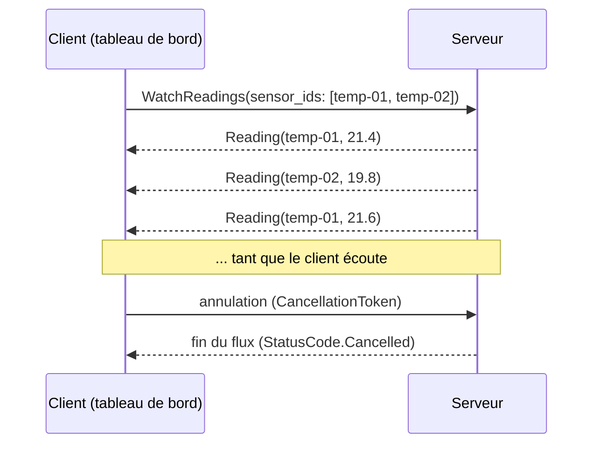
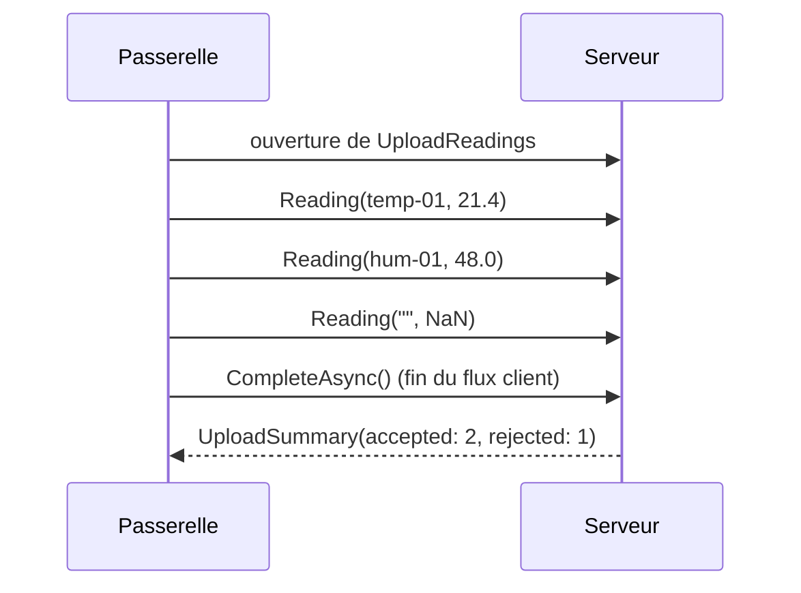
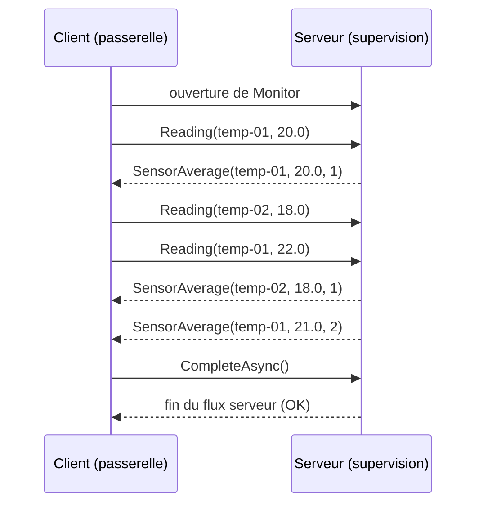
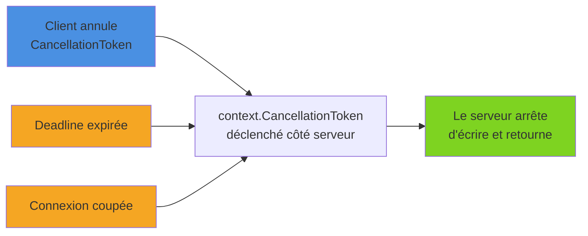

gRPC définit ses services dans un fichier `.proto` et propose quatre modes de communication : l'appel *unary* (une requête, une réponse, comme un appel REST classique) et trois modes de **streaming**. Le streaming est l'un des grands atouts du protocole : grâce à HTTP/2, un même appel peut transporter un flux de messages dans un sens, dans l'autre, ou dans les deux à la fois. Cet article implémente les trois modes de streaming en contract-first sur un service de télémétrie de capteurs : `.proto`, serveur, client, annulation, et quand préférer cette approche à SSE.

<!--more-->


# 1. Le contrat

L'exemple est un service `TelemetryService` qui collecte les mesures de capteurs (température, humidité…). Il expose une méthode unary et trois méthodes de streaming. Le mot-clé `stream` placé devant le type d'entrée et/ou de sortie suffit à changer la nature de l'appel :

```protobuf
syntax = "proto3";

option csharp_namespace = "TelemetryApi";

package telemetry;

service TelemetryService {
  // Unary : une requête, une réponse
  rpc GetSensor (GetSensorRequest) returns (Sensor);

  // Server streaming : une requête, un flux de mesures en direct
  rpc WatchReadings (WatchRequest) returns (stream Reading);

  // Client streaming : un flux de mesures envoyées par une passerelle, un seul résumé
  rpc UploadReadings (stream Reading) returns (UploadSummary);

  // Bidirectionnel : des mesures entrantes, des moyennes glissantes sortantes
  rpc Monitor (stream Reading) returns (stream SensorAverage);
}

message GetSensorRequest { string sensor_id = 1; }

message Sensor {
  string sensor_id = 1;
  string location = 2;
  string unit = 3;
}

message WatchRequest { repeated string sensor_ids = 1; }

message Reading {
  string sensor_id = 1;
  double value = 2;
  int64 timestamp_ms = 3; // horodatage Unix en millisecondes
}

message UploadSummary {
  int32 accepted = 1;
  int32 rejected = 2;
}

message SensorAverage {
  string sensor_id = 1;
  double average = 2;
  int32 count = 3;
}
```

La génération de code (`<Protobuf Include="Protos\telemetry.proto" GrpcServices="Server" />` côté serveur, `GrpcServices="Client"` côté client, avec le package `Grpc.AspNetCore` d'un côté et `Grpc.Net.Client` + `Google.Protobuf` + `Grpc.Tools` de l'autre) produit des signatures différentes selon le mode :

| Mode | Signature serveur générée | Objet d'appel côté client |
|------|---------------------------|---------------------------|
| Unary | `Task<TResponse> M(TRequest, ServerCallContext)` | `AsyncUnaryCall<TResponse>` |
| Server streaming | `Task M(TRequest, IServerStreamWriter<TResponse>, ServerCallContext)` | `AsyncServerStreamingCall<TResponse>` |
| Client streaming | `Task<TResponse> M(IAsyncStreamReader<TRequest>, ServerCallContext)` | `AsyncClientStreamingCall<TRequest, TResponse>` |
| Bidirectionnel | `Task M(IAsyncStreamReader<TRequest>, IServerStreamWriter<TResponse>, ServerCallContext)` | `AsyncDuplexStreamingCall<TRequest, TResponse>` |

Deux interfaces de `Grpc.Core` reviennent partout : `IServerStreamWriter<T>` (écrire dans le flux de réponse) et `IAsyncStreamReader<T>` (lire un flux entrant via `MoveNext()` / `Current`, ou plus simplement via la méthode d'extension `ReadAllAsync()` qui renvoie un `IAsyncEnumerable<T>`).

# 2. Server streaming

## Le principe

Le client envoie **une** requête, le serveur répond par un **flux** de messages, puis termine l'appel (ou le client l'annule).



## Implémentation serveur

```csharp
using Grpc.Core;
using TelemetryApi;

public class TelemetryServiceImpl(ILogger<TelemetryServiceImpl> logger)
    : TelemetryService.TelemetryServiceBase
{
    public override async Task WatchReadings(
        WatchRequest request,
        IServerStreamWriter<Reading> responseStream,
        ServerCallContext context)
    {
        using var timer = new PeriodicTimer(TimeSpan.FromSeconds(1));

        // context.CancellationToken est déclenché quand le client annule,
        // quand la deadline expire ou quand la connexion est coupée
        while (await timer.WaitForNextTickAsync(context.CancellationToken))
        {
            foreach (var sensorId in request.SensorIds)
            {
                // Mesure simulée : en réel, lecture d'un cache ou d'un bus
                var reading = new Reading
                {
                    SensorId = sensorId,
                    Value = Math.Round(18 + Random.Shared.NextDouble() * 6, 1),
                    TimestampMs = DateTimeOffset.UtcNow.ToUnixTimeMilliseconds()
                };

                // Une seule écriture à la fois : on attend toujours WriteAsync
                await responseStream.WriteAsync(reading);
            }
        }

        logger.LogInformation("Fin du flux de mesures");
    }
}
```

Le service est enregistré classiquement dans `Program.cs` avec `builder.Services.AddGrpc()` puis `app.MapGrpcService<TelemetryServiceImpl>()`.

Points importants :

- L'appel reste ouvert **tant que la méthode n'a pas retourné**. Quand elle se termine, le serveur envoie le statut final (`OK`) et le flux se ferme côté client.
- `WriteAsync` ne doit **jamais** être appelé en parallèle sur le même flux : chaque écriture doit être attendue avant la suivante.
- Si le client annule, `WaitForNextTickAsync` lève une `OperationCanceledException`. Le framework la traite comme une annulation normale, inutile de la capturer.

## Côté client

```csharp
using Grpc.Core;
using Grpc.Net.Client;
using TelemetryApi;

using var channel = GrpcChannel.ForAddress("https://localhost:5001");
var client = new TelemetryService.TelemetryServiceClient(channel);

// On arrête d'écouter au bout de 10 secondes
using var cts = new CancellationTokenSource(TimeSpan.FromSeconds(10));

using var call = client.WatchReadings(
    new WatchRequest { SensorIds = { "temp-01", "temp-02" } },
    cancellationToken: cts.Token);

try
{
    // ReadAllAsync : extension de Grpc.Core qui expose le flux en IAsyncEnumerable
    await foreach (var reading in call.ResponseStream.ReadAllAsync(cts.Token))
    {
        Console.WriteLine($"{reading.SensorId} : {reading.Value} °C");
    }
}
catch (RpcException ex) when (ex.StatusCode == StatusCode.Cancelled)
{
    Console.WriteLine("Flux annulé côté client.");
}
```

Le `using` sur l'objet d'appel est important : disposer un appel encore actif l'annule et libère le stream HTTP/2 sous-jacent.

# 3. Client streaming

## Le principe

Le client envoie un **flux** de messages, signale qu'il a terminé, et le serveur répond par **un seul** message. Cas typique : import en masse, upload par morceaux, envoi groupé de mesures par une passerelle IoT.



## Implémentation serveur

```csharp
public override async Task<UploadSummary> UploadReadings(
    IAsyncStreamReader<Reading> requestStream,
    ServerCallContext context)
{
    var summary = new UploadSummary();

    // La boucle se termine quand le client appelle CompleteAsync()
    await foreach (var reading in requestStream.ReadAllAsync(context.CancellationToken))
    {
        if (string.IsNullOrWhiteSpace(reading.SensorId)
            || double.IsNaN(reading.Value)
            || reading.Value is < -50 or > 150)
        {
            summary.Rejected++;
            continue;
        }

        // Ici : persistance (base de séries temporelles, EF Core…) avec context.CancellationToken
        summary.Accepted++;
    }

    return summary;
}
```

Le serveur peut aussi répondre **avant** la fin du flux (par exemple après une erreur de validation bloquante) : il suffit de retourner ou de lever une `RpcException`. Les messages restants du client sont alors ignorés.

## Côté client

```csharp
var now = DateTimeOffset.UtcNow.ToUnixTimeMilliseconds();

Reading[] readings =
[
    new() { SensorId = "temp-01", Value = 21.4, TimestampMs = now },
    new() { SensorId = "hum-01", Value = 48.0, TimestampMs = now },
    new() { SensorId = "", Value = double.NaN, TimestampMs = now } // sera rejetée
];

using var call = client.UploadReadings();

foreach (var reading in readings)
{
    await call.RequestStream.WriteAsync(reading);
}

// ✅ Indispensable : signale au serveur que le flux client est terminé
await call.RequestStream.CompleteAsync();

// AsyncClientStreamingCall est "awaitable" : équivalent à await call.ResponseAsync
var summary = await call;
Console.WriteLine($"Acceptées : {summary.Accepted}, rejetées : {summary.Rejected}");
```

```csharp
// ❌ Oubli de CompleteAsync : le serveur attend indéfiniment la suite du flux,
// et l'appel ne se termine qu'à l'expiration de la deadline (s'il y en a une)
using var call = client.UploadReadings();
await call.RequestStream.WriteAsync(readings[0]);
var summary = await call; // bloque
```

# 4. Streaming bidirectionnel

## Le principe

Les deux flux sont **indépendants** : le client et le serveur écrivent et lisent quand ils le souhaitent. Rien n'impose un ping-pong strict, même si c'est le schéma le plus courant.



## Implémentation serveur

```csharp
using System.Collections.Concurrent;

public class TelemetryServiceImpl : TelemetryService.TelemetryServiceBase
{
    // Somme et nombre de mesures par capteur
    private static readonly ConcurrentDictionary<string, (double Sum, int Count)> Stats = new();

    public override async Task Monitor(
        IAsyncStreamReader<Reading> requestStream,
        IServerStreamWriter<SensorAverage> responseStream,
        ServerCallContext context)
    {
        await foreach (var reading in requestStream.ReadAllAsync(context.CancellationToken))
        {
            var stats = Stats.AddOrUpdate(
                reading.SensorId,
                (reading.Value, 1),
                (_, current) => (current.Sum + reading.Value, current.Count + 1));

            await responseStream.WriteAsync(new SensorAverage
            {
                SensorId = reading.SensorId,
                Average = Math.Round(stats.Sum / stats.Count, 2),
                Count = stats.Count
            });
        }
        // Retourner = fermer le flux serveur
    }
}
```

Ici, lecture et écriture se font dans la même boucle, donc jamais en parallèle. Si le serveur doit **aussi** pousser des messages spontanément (alerte de seuil dépassé, capteur muet depuis trop longtemps), on sépare lecture et écriture en deux tâches, et on sérialise les écritures via un `Channel<T>` (System.Threading.Channels) consommé par une seule boucle d'écriture.

## Côté client

Côté client, la lecture et l'écriture tournent typiquement en **parallèle** : une tâche lit les réponses pendant que le code principal envoie les requêtes.

```csharp
using var call = client.Monitor();

// 1. Tâche de lecture des réponses, démarrée avant l'écriture
var readTask = Task.Run(async () =>
{
    await foreach (var avg in call.ResponseStream.ReadAllAsync())
    {
        Console.WriteLine($"{avg.SensorId} : moyenne {avg.Average} sur {avg.Count} mesures");
    }
});

// 2. Envoi des mesures
Reading[] readings =
[
    new() { SensorId = "temp-01", Value = 20.0 },
    new() { SensorId = "temp-02", Value = 18.0 },
    new() { SensorId = "temp-01", Value = 22.0 }
];

foreach (var reading in readings)
{
    await call.RequestStream.WriteAsync(reading);
}

// 3. Fin du flux client, puis attente de la fin du flux serveur
await call.RequestStream.CompleteAsync();
await readTask;
```

# 5. Annulation et durée de vie des flux

Un flux gRPC peut durer des heures. Il faut donc maîtriser sa fin, des deux côtés.



**Côté serveur**, `ServerCallContext.CancellationToken` est la seule source de vérité. On le transmet à tout ce qui est asynchrone : `ReadAllAsync`, `Task.Delay`, requêtes EF Core, appels HTTP. Une boucle `while (true)` qui l'ignore continue de tourner (et de consommer des ressources) après le départ du client.

```csharp
// ❌ Ignore l'annulation : la boucle survit au client
while (true)
{
    await responseStream.WriteAsync(reading);
    await Task.Delay(1000);
}

// ✅ S'arrête dès que le client annule, que la deadline expire ou que la connexion tombe
while (!context.CancellationToken.IsCancellationRequested)
{
    await responseStream.WriteAsync(reading);
    await Task.Delay(1000, context.CancellationToken);
}
```

**Côté client**, deux leviers :

- un `CancellationToken` passé à l'appel (`cancellationToken: cts.Token`) : l'annulation se traduit par une `RpcException` de statut `Cancelled` ;
- une **deadline** (`deadline: DateTime.UtcNow.AddMinutes(5)`), date absolue en UTC au-delà de laquelle l'appel échoue avec le statut `DeadlineExceeded`. Le serveur la reçoit aussi : son `context.CancellationToken` se déclenche à expiration.

## Les flux longs et l'infrastructure

Un flux ouvert longtemps sans trafic peut être coupé par un proxy ou un load balancer qui le juge inactif. Et une connexion HTTP/2 est limitée en nombre de streams simultanés (souvent 100 côté serveur). Pour un client qui maintient beaucoup de flux, on configure le handler :

```csharp
var handler = new SocketsHttpHandler
{
    // Pings HTTP/2 pour garder la connexion vivante à travers les proxys
    KeepAlivePingDelay = TimeSpan.FromSeconds(60),
    KeepAlivePingTimeout = TimeSpan.FromSeconds(30),
    PooledConnectionIdleTimeout = Timeout.InfiniteTimeSpan,
    // Ouvre une nouvelle connexion quand la limite de streams est atteinte
    EnableMultipleHttp2Connections = true
};

using var channel = GrpcChannel.ForAddress("https://localhost:5001",
    new GrpcChannelOptions { HttpHandler = handler });
```

# 6. Streaming gRPC ou SSE ?

.NET 10 a rendu les [Server-Sent Events très simples à exposer](/2025/07/08/SSE_Net10.html) avec `TypedResults.ServerSentEvents`. Les deux technologies poussent des données du serveur vers le client, mais elles ne visent pas les mêmes usages.

| Critère | Server-Sent Events | Streaming gRPC |
|---------|--------------------|----------------|
| Direction | Serveur → client uniquement | Les trois modes, dont bidirectionnel |
| Format | Texte (`text/event-stream`), souvent du JSON | Protobuf binaire, typé |
| Transport | HTTP/1.1 ou HTTP/2 | HTTP/2 |
| Navigateur | Natif (`EventSource`) | gRPC-Web, server streaming seulement |
| Reconnexion | Automatique (`EventSource`, `Last-Event-ID`) | À gérer soi-même |
| Contrat | Implicite | `.proto`, code généré |
| Proxys / CDN | Passe partout (c'est du HTTP classique) | Nécessite un support HTTP/2 de bout en bout |

On préfère **SSE** pour :

- des notifications vers un **navigateur** (tableau de bord, progression d'un traitement) ;
- un besoin purement descendant, où la reconnexion automatique est un vrai plus.

On préfère le **streaming gRPC** pour :

- la communication **entre services**, déjà en gRPC ;
- les volumes importants, où le binaire compte ;
- tout besoin **montant** (client streaming) ou **bidirectionnel** ;
- les clients multi-langages qui profitent du contrat `.proto`.

Pour les bases de gRPC (contrat `.proto`, appel unary, génération de code), voir [l'introduction à gRPC](/2026/01/24/Grpc.html).

# Résumé

| Mode | `.proto` | Serveur | Client |
|------|----------|---------|--------|
| **Server streaming** | `returns (stream T)` | `IServerStreamWriter<T>.WriteAsync` | `ResponseStream.ReadAllAsync()` |
| **Client streaming** | `rpc M (stream T)` | `IAsyncStreamReader<T>.ReadAllAsync` | `RequestStream.WriteAsync` + `CompleteAsync`, puis `await call` |
| **Bidirectionnel** | `stream` des deux côtés | Lecture + écriture (jamais d'écritures concurrentes) | Tâche de lecture en parallèle des écritures |
| **Annulation** | — | `context.CancellationToken` partout | `cancellationToken:` ou `deadline:` → `RpcException` |
| **Flux longs** | — | — | `KeepAlivePingDelay`, `EnableMultipleHttp2Connections` |

Le streaming transforme gRPC en bien plus qu'un simple RPC : mesures en direct, uploads massifs ou supervision temps réel s'expriment avec le même contrat typé. La règle d'or reste la même dans les trois modes : toujours propager le `CancellationToken`, et toujours terminer proprement les flux (`CompleteAsync` côté client, retour de méthode côté serveur).
