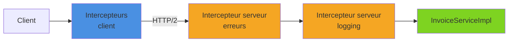
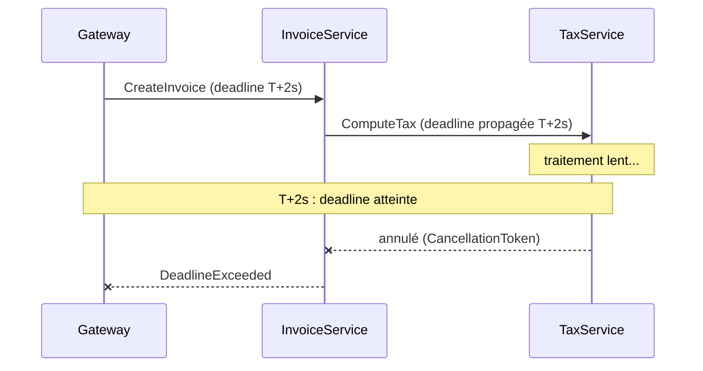

Une fois les services gRPC en place, viennent les préoccupations transverses : journaliser chaque appel, vérifier une clé d'API, transformer les exceptions en statuts propres, ne pas attendre indéfiniment un service lent, réessayer quand un service redémarre. gRPC en .NET répond à tout cela avec les **intercepteurs**, les **deadlines** et leur **propagation**, les **codes de statut** et des **retries** configurables au niveau du channel. Cet article met en place ces briques une par une sur un petit service de facturation.

<!--more-->


# Le service d'exemple

L'exemple est un service de facturation, `InvoiceService`, qui s'appuie lui-même sur un service de calcul de taxes, `TaxService`. Le contrat (`Protos/billing.proto`, compilé avec `GrpcServices="Both"` pour disposer à la fois des classes serveur et client) :

```protobuf
syntax = "proto3";

option csharp_namespace = "BillingApi";

package billing;

service InvoiceService {
  rpc GetInvoice (GetInvoiceRequest) returns (Invoice);
  rpc CreateInvoice (CreateInvoiceRequest) returns (Invoice);
}

service TaxService {
  rpc ComputeTax (ComputeTaxRequest) returns (TaxReply);
}

message GetInvoiceRequest { int32 id = 1; }

message CreateInvoiceRequest {
  int32 customer_id = 1;
  double amount_excl_tax = 2;
  string country = 3;
}

message Invoice {
  int32 id = 1;
  int32 customer_id = 2;
  double total = 3;
  string status = 4; // "draft", "sent", "paid"
}

message ComputeTaxRequest {
  double amount = 1;
  string country = 2;
}

message TaxReply { double tax = 1; }
```

L'implémentation serveur dérive de la classe générée `InvoiceService.InvoiceServiceBase` ; ses méthodes sont détaillées plus bas :

```csharp
using Grpc.Core;
using BillingApi;

// BillingDbContext : DbContext EF Core exposant un DbSet<InvoiceEntity> Invoices
// (InvoiceEntity : Id, CustomerId, Total, Status)
public class InvoiceServiceImpl(BillingDbContext dbContext, TaxService.TaxServiceClient taxes)
    : InvoiceService.InvoiceServiceBase
{
    // GetInvoice et CreateInvoice : voir sections 2 et 3
}
```

# 1. Les intercepteurs

## Le principe

Un intercepteur gRPC est l'équivalent d'un middleware ASP.NET Core, mais au niveau de l'**appel gRPC** : il voit le message désérialisé, le `ServerCallContext` (ou les `CallOptions` côté client) et peut agir avant et après l'exécution de la méthode.



Tous dérivent de la classe abstraite `Interceptor` (namespace `Grpc.Core.Interceptors`, package `Grpc.Core.Api`, déjà référencé par `Grpc.AspNetCore` et `Grpc.Net.Client`). On redéfinit uniquement les méthodes utiles :

| Côté | Méthodes à redéfinir |
|------|----------------------|
| Serveur | `UnaryServerHandler`, `ServerStreamingServerHandler`, `ClientStreamingServerHandler`, `DuplexStreamingServerHandler` |
| Client | `AsyncUnaryCall`, `AsyncServerStreamingCall`, `AsyncClientStreamingCall`, `AsyncDuplexStreamingCall`, `BlockingUnaryCall` |

Une méthode non redéfinie laisse simplement passer l'appel : un intercepteur qui ne traite que `UnaryServerHandler` n'aura **aucun effet** sur les appels en streaming.

> **Intercepteur ou middleware ?** Un middleware ASP.NET Core voit la requête HTTP brute (headers, chemin) mais pas le message Protobuf. L'intercepteur, lui, est propre à gRPC et fonctionne aussi côté client. Pour l'authentification « officielle », on préfère d'ailleurs le pipeline ASP.NET Core (`AddAuthentication`, `[Authorize]` sur le service), qui fonctionne avec gRPC.

## Intercepteur serveur : logging

```csharp
using System.Diagnostics;
using Grpc.Core;
using Grpc.Core.Interceptors;

public class ServerLoggingInterceptor(ILogger<ServerLoggingInterceptor> logger) : Interceptor
{
    public override async Task<TResponse> UnaryServerHandler<TRequest, TResponse>(
        TRequest request,
        ServerCallContext context,
        UnaryServerMethod<TRequest, TResponse> continuation)
    {
        var stopwatch = Stopwatch.StartNew();
        try
        {
            // Appel de l'intercepteur suivant, puis de la méthode du service
            var response = await continuation(request, context);
            logger.LogInformation("{Method} OK en {Elapsed} ms",
                context.Method, stopwatch.ElapsedMilliseconds);
            return response;
        }
        catch (RpcException ex)
        {
            logger.LogWarning("{Method} en échec ({Status}) en {Elapsed} ms",
                context.Method, ex.StatusCode, stopwatch.ElapsedMilliseconds);
            throw;
        }
    }

    public override async Task ServerStreamingServerHandler<TRequest, TResponse>(
        TRequest request,
        IServerStreamWriter<TResponse> responseStream,
        ServerCallContext context,
        ServerStreamingServerMethod<TRequest, TResponse> continuation)
    {
        logger.LogInformation("Début du flux {Method} ({Peer})", context.Method, context.Peer);
        await continuation(request, responseStream, context);
        logger.LogInformation("Fin du flux {Method}", context.Method);
    }
}
```

Les contraintes génériques (`where TRequest : class`) sont héritées de la classe de base : inutile de les répéter sur les `override`.

## Intercepteur serveur : authentification simple

Pour un service interne protégé par une clé d'API, un intercepteur suffit :

```csharp
public class ApiKeyInterceptor(IConfiguration configuration) : Interceptor
{
    private const string HeaderName = "x-api-key";

    public override Task<TResponse> UnaryServerHandler<TRequest, TResponse>(
        TRequest request,
        ServerCallContext context,
        UnaryServerMethod<TRequest, TResponse> continuation)
    {
        // Les clés de metadata gRPC sont normalisées en minuscules
        var apiKey = context.RequestHeaders.GetValue(HeaderName);

        if (apiKey != configuration["Grpc:ApiKey"])
        {
            throw new RpcException(new Status(StatusCode.Unauthenticated, "Clé d'API invalide"));
        }

        return continuation(request, context);
    }
}
```

## Intercepteur serveur : gestion des erreurs

Par défaut, toute exception qui n'est pas une `RpcException` produit un statut `Unknown` avec le message générique `Exception was thrown by handler` (le détail n'est exposé qu'avec `EnableDetailedErrors = true`, à réserver au développement). Un intercepteur peut traduire les exceptions métier en statuts gRPC parlants :

```csharp
public class ExceptionInterceptor(ILogger<ExceptionInterceptor> logger) : Interceptor
{
    public override async Task<TResponse> UnaryServerHandler<TRequest, TResponse>(
        TRequest request,
        ServerCallContext context,
        UnaryServerMethod<TRequest, TResponse> continuation)
    {
        try
        {
            return await continuation(request, context);
        }
        catch (Exception ex) when (ex is not RpcException)
        {
            throw MapException(ex, context);
        }
    }

    private RpcException MapException(Exception ex, ServerCallContext context) => ex switch
    {
        KeyNotFoundException => new(new Status(StatusCode.NotFound, ex.Message)),
        ArgumentException => new(new Status(StatusCode.InvalidArgument, ex.Message)),
        OperationCanceledException when context.CancellationToken.IsCancellationRequested
            => new(new Status(StatusCode.Cancelled, "Appel annulé")),
        _ => LogAndHide(ex, context)
    };

    private RpcException LogAndHide(Exception ex, ServerCallContext context)
    {
        logger.LogError(ex, "Erreur non gérée dans {Method}", context.Method);
        // ✅ On ne divulgue pas le message technique au client
        return new RpcException(new Status(StatusCode.Internal, "Erreur interne"));
    }
}
```

## Enregistrement côté serveur

```csharp
var builder = WebApplication.CreateBuilder(args);

builder.Services.AddGrpc(options =>
{
    // Ordre d'exécution = ordre d'ajout : ExceptionInterceptor enveloppe les autres
    options.Interceptors.Add<ExceptionInterceptor>();
    options.Interceptors.Add<ServerLoggingInterceptor>();
    options.EnableDetailedErrors = builder.Environment.IsDevelopment();
})
// Intercepteur réservé à un seul service
.AddServiceOptions<InvoiceServiceImpl>(options =>
{
    options.Interceptors.Add<ApiKeyInterceptor>();
});

var app = builder.Build();
app.MapGrpcService<InvoiceServiceImpl>();
app.Run();
```

Les intercepteurs ajoutés via `Interceptors.Add<T>()` sont créés **à chaque appel** par défaut (avec injection des dépendances du constructeur). Pour en faire un singleton, il suffit de l'enregistrer comme tel dans le conteneur DI.

## Intercepteur client

Côté client, l'intercepteur reçoit un `ClientInterceptorContext` et doit renvoyer l'objet d'appel. Pour agir sur la réponse d'un appel unary, on recrée un `AsyncUnaryCall<TResponse>` qui enveloppe la tâche d'origine :

```csharp
using Grpc.Core;
using Grpc.Core.Interceptors;

public class ClientLoggingInterceptor(ILogger<ClientLoggingInterceptor> logger) : Interceptor
{
    public override AsyncUnaryCall<TResponse> AsyncUnaryCall<TRequest, TResponse>(
        TRequest request,
        ClientInterceptorContext<TRequest, TResponse> context,
        AsyncUnaryCallContinuation<TRequest, TResponse> continuation)
    {
        // Ajout d'un header de corrélation sur chaque appel
        var headers = context.Options.Headers ?? new Metadata();
        headers.Add("x-correlation-id", Guid.NewGuid().ToString());

        // Deadline par défaut si l'appelant n'en a pas fourni
        var options = context.Options.WithHeaders(headers);
        if (options.Deadline is null)
        {
            options = options.WithDeadline(DateTime.UtcNow.AddSeconds(10));
        }

        var newContext = new ClientInterceptorContext<TRequest, TResponse>(
            context.Method, context.Host, options);

        logger.LogInformation("Appel {Method}", context.Method.FullName);
        var call = continuation(request, newContext);

        return new AsyncUnaryCall<TResponse>(
            HandleResponse(call.ResponseAsync, context.Method.FullName),
            call.ResponseHeadersAsync,
            call.GetStatus,
            call.GetTrailers,
            call.Dispose);
    }

    private async Task<TResponse> HandleResponse<TResponse>(Task<TResponse> inner, string method)
    {
        try
        {
            return await inner;
        }
        catch (RpcException ex)
        {
            logger.LogWarning("Échec de {Method} : {Status} {Detail}",
                method, ex.StatusCode, ex.Status.Detail);
            throw;
        }
    }
}
```

Deux façons de le brancher :

```csharp
// 1. Avec la client factory (package Grpc.Net.ClientFactory)
builder.Services.AddTransient<ClientLoggingInterceptor>();
builder.Services
    .AddGrpcClient<InvoiceService.InvoiceServiceClient>(o =>
        o.Address = new Uri("https://localhost:5001"))
    .AddInterceptor<ClientLoggingInterceptor>();

// 2. Sans DI : on intercepte le CallInvoker du channel
var invoker = channel.Intercept(new ClientLoggingInterceptor(logger));
var client = new InvoiceService.InvoiceServiceClient(invoker);
```

> Pour injecter un jeton d'authentification, on peut aussi utiliser `CallCredentials` (`.AddCallCredentials(...)` sur la factory). Elles ne sont envoyées que sur une connexion TLS, sauf à activer explicitement `UnsafeUseInsecureChannelCallCredentials`.

# 2. Deadlines et annulation

## Pas de deadline par défaut

En gRPC, un appel **n'a pas de limite de temps** par défaut. Si le serveur se bloque, le client attend indéfiniment, avec ses threads, ses connexions et ses utilisateurs. La deadline est une **date absolue** (en UTC) au-delà de laquelle l'appel échoue avec `DeadlineExceeded`, des deux côtés.

```csharp
// ❌ Aucune limite : un serveur bloqué bloque aussi le client
var invoice = await client.GetInvoiceAsync(new GetInvoiceRequest { Id = 1 });

// ✅ L'appel échoue proprement au bout de 2 secondes
try
{
    var invoice = await client.GetInvoiceAsync(
        new GetInvoiceRequest { Id = 1 },
        deadline: DateTime.UtcNow.AddSeconds(2));
}
catch (RpcException ex) when (ex.StatusCode == StatusCode.DeadlineExceeded)
{
    Console.WriteLine("Le service de facturation n'a pas répondu à temps.");
}
```

## Côté serveur : écouter le CancellationToken

La deadline est transmise au serveur dans le header `grpc-timeout`. Le serveur la retrouve dans `context.Deadline`, et surtout `context.CancellationToken` est déclenché à expiration (ou si le client annule). Il faut le propager à **tout** le travail asynchrone, sinon le serveur continue à travailler pour une réponse que personne n'attend plus.

```csharp
// Dans InvoiceServiceImpl (using Microsoft.EntityFrameworkCore pour FirstOrDefaultAsync)
public override async Task<Invoice> GetInvoice(GetInvoiceRequest request, ServerCallContext context)
{
    // ✅ Le token interrompt la requête SQL si le client abandonne
    var entity = await dbContext.Invoices
        .AsNoTracking()
        .FirstOrDefaultAsync(i => i.Id == request.Id, context.CancellationToken)
        ?? throw new RpcException(new Status(StatusCode.NotFound, $"Facture {request.Id} introuvable"));

    return new Invoice
    {
        Id = entity.Id, CustomerId = entity.CustomerId, Total = entity.Total, Status = entity.Status
    };
}
```

## Propagation entre services

Dans une chaîne d'appels (`Gateway → InvoiceService → TaxService`), la deadline doit **suivre** l'appel : si le client initial n'a plus que 800 ms, inutile que `InvoiceService` laisse 10 secondes à `TaxService`.



Avec la client factory, `EnableCallContextPropagation()` fait ce travail automatiquement : quand le client est utilisé **pendant le traitement d'un appel gRPC entrant**, il récupère la deadline et le `CancellationToken` du `ServerCallContext` courant.

```csharp
// Dans InvoiceService (package Grpc.AspNetCore, qui inclut Grpc.AspNetCore.Server.ClientFactory)
builder.Services
    .AddGrpcClient<TaxService.TaxServiceClient>(o =>
        o.Address = new Uri("https://tax-service"))
    .EnableCallContextPropagation(o =>
    {
        // Évite une erreur si le client est aussi utilisé hors d'un appel gRPC
        o.SuppressContextNotFoundErrors = true;
    });
```

```csharp
// Dans InvoiceServiceImpl (TaxServiceClient injecté par le constructeur)
public override async Task<Invoice> CreateInvoice(CreateInvoiceRequest request, ServerCallContext context)
{
    // Pas besoin de passer deadline ni cancellationToken : ils sont propagés
    var tax = await taxes.ComputeTaxAsync(new ComputeTaxRequest
    {
        Amount = request.AmountExclTax,
        Country = request.Country
    });

    return new Invoice
    {
        CustomerId = request.CustomerId,
        Total = request.AmountExclTax + tax.Tax,
        Status = "draft"
    };
}
```

# 3. Codes de statut et RpcException

Chaque appel gRPC se termine par un statut. Côté serveur, on renvoie une erreur en levant une `RpcException` ; côté client, toute erreur (serveur, réseau, annulation, deadline) arrive sous forme de `RpcException`.

| Code | Signification | Réessayable ? |
|------|---------------|---------------|
| `OK` | Succès | — |
| `InvalidArgument` | Requête invalide | Non |
| `NotFound` | Ressource absente | Non |
| `AlreadyExists` | Conflit de création | Non |
| `PermissionDenied` / `Unauthenticated` | Accès refusé / non authentifié | Non |
| `FailedPrecondition` | État incompatible (facture déjà payée…) | Non |
| `ResourceExhausted` | Quota ou limite atteinte | Avec délai |
| `Cancelled` | Annulé par l'appelant | Non |
| `DeadlineExceeded` | Deadline dépassée | Prudence (non idempotent) |
| `Unavailable` | Service indisponible, transitoire | **Oui** |
| `Internal` / `Unknown` | Erreur serveur | Généralement non |

```csharp
// Serveur : statut + metadata supplémentaires (trailers)
var trailers = new Metadata { { "invoice-id", request.Id.ToString() } };
throw new RpcException(new Status(StatusCode.NotFound, "Facture introuvable"), trailers);
```

```csharp
// Client
try
{
    var invoice = await client.GetInvoiceAsync(new GetInvoiceRequest { Id = 42 });
}
catch (RpcException ex)
{
    var message = ex.StatusCode switch
    {
        StatusCode.NotFound => $"Introuvable : {ex.Status.Detail}",
        StatusCode.Unavailable => "Facturation indisponible, réessayer plus tard",
        StatusCode.DeadlineExceeded => "Délai dépassé",
        _ => $"Erreur gRPC {ex.StatusCode}"
    };
    Console.WriteLine(message);
    Console.WriteLine(ex.Trailers.GetValue("invoice-id"));
}
```

Pour des erreurs structurées (liste de champs invalides, raison métier), le package `Grpc.StatusProto` implémente le modèle `google.rpc.Status` : on construit un `Google.Rpc.Status` avec des détails standard (`BadRequest`, `ErrorInfo`…), on lève `status.ToRpcException()`, et le client relit les détails via `ex.GetRpcStatus()?.GetDetail<BadRequest>()`. Ces détails voyagent dans les headers : il faut rester sous la limite habituelle de 8 Ko.

# 4. Retries via la service config

`Grpc.Net.Client` sait réessayer les appels en échec, configuré **par méthode** via la *service config* du channel (namespace `Grpc.Net.Client.Configuration`) :

```csharp
using Grpc.Core;
using Grpc.Net.Client;
using Grpc.Net.Client.Configuration;

var retryMethodConfig = new MethodConfig
{
    Names = { MethodName.Default }, // toutes les méthodes du channel
    RetryPolicy = new RetryPolicy
    {
        MaxAttempts = 4,                         // 1 appel + 3 retries
        InitialBackoff = TimeSpan.FromMilliseconds(200),
        MaxBackoff = TimeSpan.FromSeconds(2),
        BackoffMultiplier = 2,
        RetryableStatusCodes = { StatusCode.Unavailable }
    }
};

using var channel = GrpcChannel.ForAddress("https://localhost:5001", new GrpcChannelOptions
{
    ServiceConfig = new ServiceConfig { MethodConfigs = { retryMethodConfig } }
});
```

Avec la client factory, la même configuration passe par `.ConfigureChannel(o => o.ServiceConfig = ...)`.

Quelques règles à connaître :

- Le backoff réel est **aléatoire** entre 0 et la valeur courante (jitter), ce qui évite les tempêtes de retries synchronisées.
- Un appel n'est plus réessayé dès que le serveur a renvoyé des **headers de réponse** (l'appel est alors « committé ») : un flux serveur déjà commencé ne sera pas rejoué.
- Les messages envoyés sont mis en tampon pour pouvoir être rejoués (`MaxRetryBufferSize`, `MaxRetryBufferPerCallSize` sur `GrpcChannelOptions`).
- La deadline couvre **l'ensemble** des tentatives, pas chacune.
- Une alternative est le **hedging** (`HedgingPolicy`) : plusieurs tentatives envoyées en parallèle, la première réponse gagne. À réserver aux méthodes idempotentes.

## Et Polly ?

[Polly](/2026/02/15/polly.html) reste utile, mais pas au même niveau. Le statut gRPC voyage dans les **trailers** d'une réponse HTTP souvent en 200 : un handler de résilience HTTP (`AddStandardResilienceHandler` sur le `IHttpClientBuilder` de la factory) ne voit donc pas les erreurs gRPC applicatives, et son timeout peut couper des flux longs.

```csharp
using Polly;
using Polly.CircuitBreaker;

// ❌ Retry Polly + RetryPolicy gRPC empilés : jusqu'à 4 × 4 = 16 appels
// ✅ Retries transport dans la service config, Polly (ici un circuit breaker) autour de l'opération
var pipeline = new ResiliencePipelineBuilder()
    .AddCircuitBreaker(new CircuitBreakerStrategyOptions
    {
        ShouldHandle = new PredicateBuilder()
            .Handle<RpcException>(ex => ex.StatusCode is StatusCode.Unavailable
                                                    or StatusCode.DeadlineExceeded)
    })
    .Build();

var invoice = await pipeline.ExecuteAsync(async ct =>
    await client.GetInvoiceAsync(new GetInvoiceRequest { Id = 1 }, cancellationToken: ct));
```

En pratique : retries gRPC natifs pour les erreurs transitoires (`Unavailable`), Polly pour le circuit breaker, le fallback ou une orchestration plus large qui dépasse un seul appel.

# Résumé

| Sujet | API clé | À retenir |
|-------|---------|-----------|
| **Intercepteur serveur** | `Interceptor.UnaryServerHandler`… | Redéfinir aussi les handlers de streaming |
| **Enregistrement serveur** | `AddGrpc(o => o.Interceptors.Add<T>())`, `AddServiceOptions<T>` | Ordre d'ajout = ordre d'exécution |
| **Intercepteur client** | `Interceptor.AsyncUnaryCall`, `.AddInterceptor<T>()`, `channel.Intercept()` | Recréer le contexte pour ajouter headers ou deadline |
| **Deadline** | `deadline: DateTime.UtcNow.AddSeconds(n)` | Aucune par défaut : toujours en fixer une |
| **Annulation serveur** | `context.CancellationToken` | À passer à tout le travail asynchrone |
| **Propagation** | `EnableCallContextPropagation()` | Deadline et annulation suivent la chaîne d'appels |
| **Erreurs** | `RpcException`, `StatusCode`, `Grpc.StatusProto` | Ne pas exposer les messages techniques |
| **Retries** | `ServiceConfig` + `RetryPolicy` / `HedgingPolicy` | Ne pas cumuler avec des retries Polly |

Intercepteurs, deadlines et statuts forment le socle d'un service gRPC prêt pour la production : chaque appel est tracé, borné dans le temps et termine avec un code exploitable par le client.
