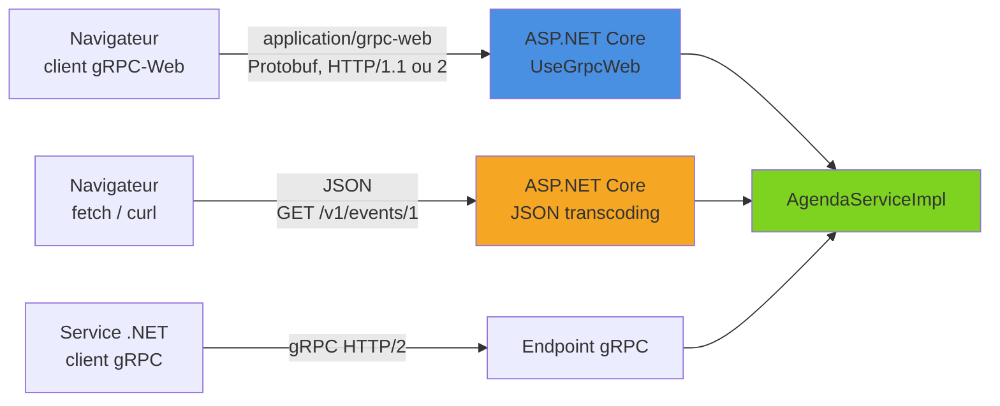
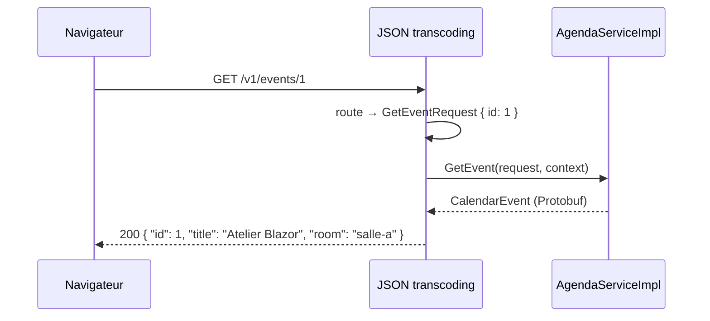

gRPC est taillé pour la communication entre services : contrat `.proto`, messages Protobuf binaires, transport HTTP/2. Mais un navigateur ne peut pas appeler directement un service gRPC, faute d'accès aux frames et aux trailers HTTP/2 depuis JavaScript. ASP.NET Core propose deux réponses complémentaires. **gRPC-Web** adapte le protocole pour qu'un client navigateur (JavaScript ou Blazor WebAssembly) parle encore Protobuf. Le **JSON transcoding** expose les mêmes méthodes sous forme d'API REST/JSON classique, appelable avec un simple `fetch`. Cet article met en place les deux sur un service d'agenda d'événements et les compare.

<!--more-->


# 1. Le problème : gRPC et le navigateur

gRPC repose sur des fonctionnalités HTTP/2 que les API du navigateur (`fetch`, `XMLHttpRequest`) n'exposent pas : contrôle fin des streams et surtout **trailers**, dans lesquels voyage le statut gRPC (`grpc-status`). Deux stratégies existent :



Dans les deux cas, **le code du service ne change pas** : ce sont le pipeline et la configuration qui évoluent. Un même service peut donc répondre simultanément en gRPC natif, en gRPC-Web et en JSON.

## Le service d'exemple

L'exemple est un `AgendaService` qui expose des événements (conférences, ateliers) : lecture d'un événement, liste paginée, création, et un flux des changements d'une salle. Son contrat complet, annoté pour le JSON transcoding, est détaillé en section 3 ; il est compilé dans le namespace `AgendaApi`. L'implémentation est un service gRPC ordinaire, ici avec un stockage en mémoire :

```csharp
using Grpc.Core;
using AgendaApi;

public class AgendaServiceImpl : AgendaService.AgendaServiceBase
{
    private static readonly Dictionary<int, CalendarEvent> Events = new()
    {
        [1] = new CalendarEvent
        {
            Id = 1, Title = "Atelier Blazor", StartsAt = "2026-05-12T09:00:00Z",
            Room = "salle-a", IsPublic = true
        }
    };

    public override Task<CalendarEvent> GetEvent(GetEventRequest request, ServerCallContext context) =>
        Events.TryGetValue(request.Id, out var evt)
            ? Task.FromResult(evt)
            : throw new RpcException(new Status(StatusCode.NotFound, $"Événement {request.Id} introuvable"));

    // ListEvents, CreateEvent et WatchRoom suivent le même schéma
}
```

# 2. gRPC-Web

## Le principe

gRPC-Web est une variante du protocole qui encode les trailers dans le corps de la réponse. Il fonctionne en HTTP/1.1 comme en HTTP/2, avec deux formats :

- `application/grpc-web` : Protobuf binaire ;
- `application/grpc-web-text` : Protobuf encodé en base64, nécessaire au server streaming dans les navigateurs.

Historiquement, un proxy (Envoy) traduisait gRPC-Web en gRPC. En .NET, un middleware fait ce travail directement dans l'application. Envoy reste une option pertinente s'il est déjà en place dans l'infrastructure.

## Côté serveur

```bash
dotnet add package Grpc.AspNetCore.Web
```

```csharp
var builder = WebApplication.CreateBuilder(args);

builder.Services.AddGrpc();

// CORS : nécessaire si la page n'est pas servie par le même domaine que l'API
builder.Services.AddCors(options => options.AddPolicy("GrpcWeb", policy =>
{
    policy.WithOrigins("https://agenda.example.com")
          .AllowAnyMethod()
          .AllowAnyHeader()
          // Le client doit pouvoir lire les headers propres à gRPC
          .WithExposedHeaders("Grpc-Status", "Grpc-Message",
              "Grpc-Encoding", "Grpc-Accept-Encoding", "Grpc-Status-Details-Bin");
}));

var app = builder.Build();

// Ordre : gRPC-Web puis CORS, avant le mapping des endpoints
app.UseGrpcWeb();
app.UseCors();

app.MapGrpcService<AgendaServiceImpl>()
   .EnableGrpcWeb()          // active gRPC-Web pour ce service
   .RequireCors("GrpcWeb");  // applique la politique CORS

app.Run();
```

Pour activer gRPC-Web sur **tous** les services sans appeler `EnableGrpcWeb()` sur chacun : `app.UseGrpcWeb(new GrpcWebOptions { DefaultEnabled = true })`.

```csharp
// ❌ Politique CORS qui n'expose pas Grpc-Status :
// le navigateur masque le header et le client ne sait pas si l'appel a réussi
policy.AllowAnyOrigin().AllowAnyMethod().AllowAnyHeader();

// ✅ Origines explicites + headers gRPC exposés
policy.WithOrigins("https://agenda.example.com")
      .AllowAnyMethod().AllowAnyHeader()
      .WithExposedHeaders("Grpc-Status", "Grpc-Message");
```

Le template gRPC n'active que HTTP/2. Pour que des clients HTTP/1.1 puissent appeler gRPC-Web, on autorise les deux protocoles (ce qui impose TLS sur le port pour la négociation ALPN) :

```json
{
  "Kestrel": {
    "EndpointDefaults": {
      "Protocols": "Http1AndHttp2"
    }
  }
}
```

## Client navigateur en JavaScript

Le client officiel est le package npm `grpc-web`, accompagné du plugin `protoc-gen-grpc-web` qui génère le code client depuis le `.proto` :

```bash
npm install grpc-web google-protobuf

# Génère agenda_pb.js (messages) et agenda_grpc_web_pb.js (client)
protoc -I=. agenda.proto \
  --js_out=import_style=commonjs:. \
  --grpc-web_out=import_style=commonjs,mode=grpcwebtext:.
```

```javascript
import { GetEventRequest } from './agenda_pb';
import { AgendaServiceClient } from './agenda_grpc_web_pb';

const client = new AgendaServiceClient('https://api.example.com');

const request = new GetEventRequest();
request.setId(1);

// Appel unary : callback (err, response)
client.getEvent(request, {}, (err, evt) => {
  if (err) {
    console.error(`Erreur gRPC ${err.code} : ${err.message}`);
    return;
  }
  console.log(`${evt.getTitle()} - ${evt.getStartsAt()} (${evt.getRoom()})`);
});
```

Les messages générés utilisent des accesseurs (`setId`, `getTitle`) plutôt que des objets JSON : on reste dans le monde Protobuf, fortement typé, avec l'option de générer des définitions TypeScript.

## Client Blazor WebAssembly

Une application Blazor WebAssembly tourne dans le navigateur et subit les mêmes contraintes. Le client gRPC .NET sait parler gRPC-Web grâce à `GrpcWebHandler` :

```bash
dotnet add package Grpc.Net.Client.Web
dotnet add package Grpc.Net.ClientFactory
```

```csharp
using Grpc.Net.Client.Web;
using AgendaApi;

builder.Services
    .AddGrpcClient<AgendaService.AgendaServiceClient>(options =>
    {
        options.Address = new Uri("https://api.example.com");
    })
    .ConfigurePrimaryHttpMessageHandler(() =>
        // GrpcWebText : requis pour le server streaming dans le navigateur
        new GrpcWebHandler(GrpcWebMode.GrpcWebText, new HttpClientHandler()));
```

Le composant injecte ensuite `AgendaService.AgendaServiceClient` comme n'importe quel service. Attention : en WebAssembly, seules les méthodes **asynchrones** (`GetEventAsync`) sont utilisables, les variantes synchrones bloquent l'application.

## Limites du streaming

gRPC propose trois modes de [streaming](/2026/04/18/grpc-streaming.html) en plus de l'appel unary, mais ils ne sont que partiellement disponibles dans le navigateur :

| Mode | gRPC natif | gRPC-Web (navigateur) |
|------|-----------|------------------------|
| Unary | ✅ | ✅ |
| Server streaming | ✅ | ✅ (mode `grpc-web-text`) |
| Client streaming | ✅ | ❌ |
| Bidirectionnel | ✅ | ❌ |

# 3. JSON transcoding

## Le principe

Le JSON transcoding (package `Microsoft.AspNetCore.Grpc.JsonTranscoding`) génère, à partir d'annotations dans le `.proto`, des **endpoints REST** qui désérialisent le JSON en message Protobuf, appellent directement la méthode du service **dans le même processus**, puis sérialisent la réponse en JSON. Aucun proxy, aucune génération de client côté appelant.



## Mise en place

```bash
dotnet add package Microsoft.AspNetCore.Grpc.JsonTranscoding
```

Dans le `.csproj`, la propriété `IncludeHttpRuleProtos` ajoute au build les fichiers `google/api/annotations.proto` et `google/api/http.proto` (auparavant, il fallait les copier à la main depuis le dépôt googleapis) :

```xml
<PropertyGroup>
  <TargetFramework>net10.0</TargetFramework>
  <IncludeHttpRuleProtos>true</IncludeHttpRuleProtos>
</PropertyGroup>

<ItemGroup>
  <Protobuf Include="Protos\agenda.proto" GrpcServices="Server" />
</ItemGroup>
```

```csharp
var builder = WebApplication.CreateBuilder(args);

// Un seul appel supplémentaire
builder.Services.AddGrpc().AddJsonTranscoding();

var app = builder.Build();
app.MapGrpcService<AgendaServiceImpl>();
app.Run();
```

## Annoter le contrat

Chaque méthode exposée en REST reçoit une option `google.api.http` qui précise le verbe et la route :

```protobuf
syntax = "proto3";

option csharp_namespace = "AgendaApi";

import "google/api/annotations.proto";

package agenda;

service AgendaService {
  // GET /v1/events/1 : {id} est lié au champ id de la requête
  rpc GetEvent (GetEventRequest) returns (CalendarEvent) {
    option (google.api.http) = {
      get: "/v1/events/{id}"
    };
  }

  // GET /v1/events?page=2 : les champs non liés à la route passent en query string
  rpc ListEvents (ListEventsRequest) returns (EventList) {
    option (google.api.http) = {
      get: "/v1/events"
    };
  }

  // POST /v1/events : le corps JSON entier est mappé sur la requête
  rpc CreateEvent (CreateEventRequest) returns (CalendarEvent) {
    option (google.api.http) = {
      post: "/v1/events"
      body: "*"
    };
  }

  // Server streaming : réponse en JSON délimité par des retours à la ligne
  rpc WatchRoom (WatchRoomRequest) returns (stream EventChange) {
    option (google.api.http) = {
      get: "/v1/rooms/{room}/changes"
    };
  }
}

message GetEventRequest { int32 id = 1; }
message ListEventsRequest { int32 page = 1; }
message CreateEventRequest {
  string title = 1;
  string starts_at = 2; // date ISO 8601, ex. 2026-05-12T09:00:00Z
  string room = 3;
  bool is_public = 4;
}
message CalendarEvent {
  int32 id = 1;
  string title = 2;
  string starts_at = 3;
  string room = 4;
  bool is_public = 5;
}
message EventList { repeated CalendarEvent events = 1; }
message WatchRoomRequest { string room = 1; }
message EventChange {
  int32 event_id = 1;
  string change = 2; // "created", "moved", "cancelled"
}
```

Les méthodes sans annotation restent accessibles uniquement en gRPC. Les noms JSON suivent la convention Protobuf : `is_public` devient `isPublic`, `starts_at` devient `startsAt`.

## Appeler l'API

```bash
# Lecture
curl https://localhost:5001/v1/events/1
# {"id":1,"title":"Atelier Blazor","startsAt":"2026-05-12T09:00:00Z","room":"salle-a","isPublic":true}

# Création
curl -X POST https://localhost:5001/v1/events \
  -H "Content-Type: application/json" \
  -d '{"title":"Meetup .NET","startsAt":"2026-06-02T18:30:00Z","room":"salle-b","isPublic":true}'
```

Depuis le navigateur, un simple `fetch('/v1/events/1')` suffit : ni client généré, ni connaissance de gRPC.

Quelques comportements à connaître :

- **Erreurs** : une `RpcException` est traduite en code HTTP (`NotFound` → 404, `InvalidArgument` → 400…) avec un corps JSON contenant le code gRPC et le message.
- **Streaming** : seul le server streaming est supporté. Chaque message écrit par `WriteAsync` est sérialisé en JSON sur sa propre ligne (*line-delimited JSON*). Client streaming et bidirectionnel ne sont pas transcodés.
- **HTTP/1.1** : le transcoding fonctionne en HTTP/1.1 et HTTP/2 ; la configuration `Http1AndHttp2` vue plus haut s'applique ici aussi.
- **Sérialisation** : `AddJsonTranscoding(o => o.JsonSettings.WriteIndented = true)` permet d'ajuster le JSON (`IgnoreDefaultValues`, `WriteEnumsAsIntegers`, etc.).

## OpenAPI pour le transcoding

Une API REST sans documentation perd une partie de son intérêt. Le package `Microsoft.AspNetCore.Grpc.Swagger` branche le transcoding sur **Swashbuckle** : les routes `google.api.http` apparaissent dans le document OpenAPI, et les commentaires du `.proto` deviennent des descriptions.

```bash
dotnet add package Microsoft.AspNetCore.Grpc.Swagger
```

```csharp
builder.Services.AddGrpc().AddJsonTranscoding();

// Rend les endpoints transcodés visibles par Swashbuckle
builder.Services.AddGrpcSwagger();
builder.Services.AddSwaggerGen(c =>
{
    c.SwaggerDoc("v1", new() { Title = "Agenda", Version = "v1" });
});

var app = builder.Build();

app.UseSwagger();
app.UseSwaggerUI(c => c.SwaggerEndpoint("/swagger/v1/swagger.json", "Agenda v1"));

app.MapGrpcService<AgendaServiceImpl>();
app.Run();
```

> **Attention** : ce package est **expérimental** et dépend de Swashbuckle, pas du générateur OpenAPI natif d'ASP.NET Core (`Microsoft.AspNetCore.OpenApi`). Les routes transcodées n'apparaissent pas dans le document produit par `AddOpenApi()`. Avant de s'appuyer dessus en production, il faut vérifier la compatibilité de la version disponible avec .NET 10 et la version de Swashbuckle utilisée.

# 4. gRPC-Web ou JSON transcoding ?

| Critère | gRPC-Web | JSON transcoding |
|---------|----------|------------------|
| **Format** | Protobuf (binaire ou base64) | JSON |
| **Client** | Généré (`grpc-web`, Blazor + `GrpcWebHandler`) | Aucun : `fetch`, `HttpClient`, curl |
| **Contrat côté client** | `.proto` partagé, typage fort | Implicite (ou OpenAPI) |
| **Modification du `.proto`** | Aucune | Annotations `google.api.http` |
| **Server streaming** | ✅ (`grpc-web-text`) | ✅ (JSON par ligne) |
| **Client / bidi streaming** | ❌ | ❌ |
| **Performance réseau** | Compacte | JSON plus verbeux |
| **Consommateurs typiques** | SPA ou Blazor de l'équipe | Partenaires, outils tiers, intégrations no-code |
| **Debug** | Outils spécifiques | Lisible dans les DevTools |

Les deux s'empilent sans conflit sur le même service :

```csharp
builder.Services.AddGrpc().AddJsonTranscoding();

var app = builder.Build();
app.UseGrpcWeb();
app.UseCors();

app.MapGrpcService<AgendaServiceImpl>()
   .EnableGrpcWeb()
   .RequireCors("GrpcWeb");
```

En règle générale :

- **gRPC-Web** quand le front est maîtrisé par l'équipe (Blazor WebAssembly en particulier) : on garde le contrat `.proto`, le typage et la compacité de bout en bout.
- **JSON transcoding** quand l'API doit être consommée par des tiers ou des outils qui attendent du REST : un seul service, deux façades, sans maintenir un contrôleur REST en double.
- **gRPC natif** entre services, où ni l'une ni l'autre n'est nécessaire.

# Résumé

| Sujet | Package / API | À retenir |
|-------|---------------|-----------|
| **gRPC-Web serveur** | `Grpc.AspNetCore.Web`, `UseGrpcWeb()`, `EnableGrpcWeb()` | Aucune modification du service |
| **CORS** | `AddCors`, `WithExposedHeaders("Grpc-Status", …)`, `RequireCors` | Exposer les headers gRPC |
| **Client JavaScript** | npm `grpc-web` + `protoc-gen-grpc-web` | Unary et server streaming uniquement |
| **Client Blazor WASM** | `Grpc.Net.Client.Web`, `GrpcWebHandler` | `GrpcWebText` pour le streaming, appels async seulement |
| **JSON transcoding** | `Microsoft.AspNetCore.Grpc.JsonTranscoding`, `AddJsonTranscoding()` | `IncludeHttpRuleProtos` + `google.api.http` |
| **OpenAPI** | `Microsoft.AspNetCore.Grpc.Swagger` + Swashbuckle | Expérimental, hors `AddOpenApi()` natif |
| **HTTP/1.1** | `Protocols: Http1AndHttp2` | TLS requis sur le port partagé |

gRPC-Web et le JSON transcoding lèvent le principal frein de gRPC hors du datacenter : son inaccessibilité depuis le navigateur. Le premier prolonge le contrat Protobuf jusqu'au front, le second offre une façade REST gratuite au-dessus des mêmes services. Combinés, ils permettent d'écrire la logique une seule fois et de l'exposer à chaque consommateur dans le format qui lui convient.
