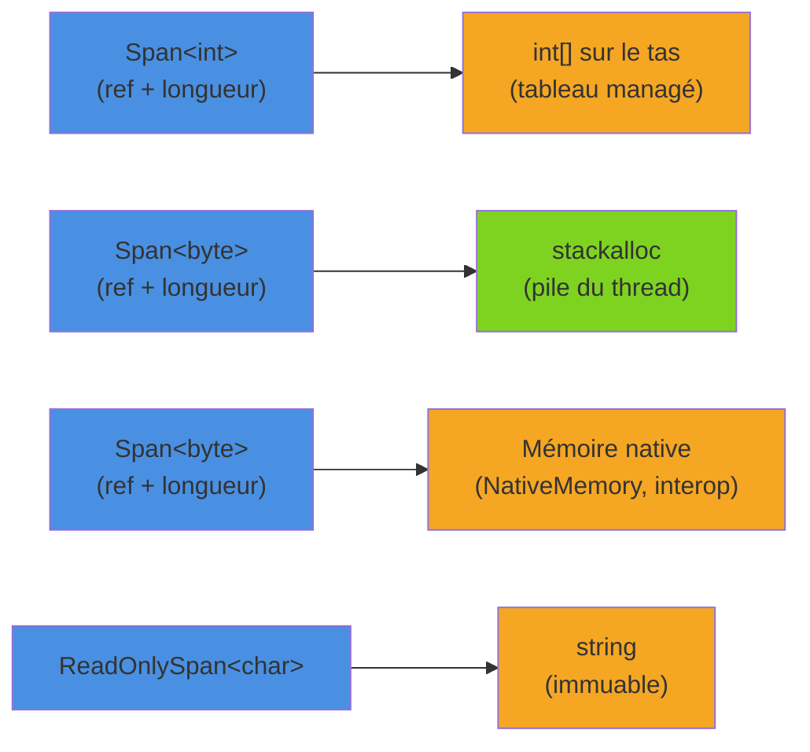

En .NET, chaque objet alloué sur le tas managé finit par coûter du travail au Garbage Collector, qui doit le parcourir puis libérer sa mémoire (voir [la pile et le tas](/2025/11/22/dotnet-basics-stack-heap.html) pour un rappel). Sur un chemin de code très sollicité (parsing, sérialisation, traitement de flux), ces petites allocations s'accumulent et deviennent visibles en latence comme en CPU. `Span<T>`, `ReadOnlySpan<T>` et `Memory<T>` permettent de manipuler des portions de mémoire **sans copier ni allouer**, tout en restant dans du code C# sûr.

<!--more-->

# 1. Pourquoi chercher à réduire les allocations ?

Une allocation sur le tas managé est très rapide : le runtime se contente d'avancer un pointeur. Le coût arrive plus tard :

- chaque allocation consomme le **budget de la génération 0** ; quand il est épuisé, une collection se déclenche ;
- une collection **suspend les threads** managés (au moins brièvement) ;
- les objets qui survivent sont **promus** et coûtent de plus en plus cher à collecter.

Le code suivant paraît anodin :

```csharp
// ❌ Chaque appel alloue : un tableau string[] + une string par morceau
public static int SumWithSplit(string line)
{
    int sum = 0;
    foreach (string part in line.Split(','))
    {
        sum += int.Parse(part, CultureInfo.InvariantCulture);
    }
    return sum;
}
```

Pour une ligne `"12,45,7,300"`, on alloue un tableau et quatre chaînes, simplement pour les lire une fois puis les jeter. Multiplié par des millions de lignes, cela fait autant d'objets à ramasser.

L'idée de `Span<T>` : au lieu de **copier** les morceaux dans de nouvelles chaînes, on **regarde** directement la portion concernée de la chaîne d'origine.

# 2. Span&lt;T&gt; et ReadOnlySpan&lt;T&gt;

## Une vue sur de la mémoire contiguë

Un `Span<T>` est une structure qui contient une **référence** vers le début d'une zone mémoire et une **longueur**. Il ne possède pas la mémoire : il la décrit. Cette mémoire peut provenir de trois endroits différents.



Quelle que soit l'origine, l'API est la même : indexeur, `Length`, `Slice`, `CopyTo`, `IndexOf`, etc. `ReadOnlySpan<T>` est la variante en lecture seule, utilisée notamment pour les chaînes (une `string` est immuable).

```csharp
int[] numbers = [1, 2, 3, 4, 5, 6];

Span<int> all = numbers;            // conversion implicite, aucune copie
Span<int> middle = all.Slice(2, 3); // [3, 4, 5] : même mémoire
middle[0] = 42;                     // modifie numbers[2]

Console.WriteLine(numbers[2]);      // 42

ReadOnlySpan<char> text = "Bonjour le monde";
ReadOnlySpan<char> word = text[8..10]; // "le" : opérateur de plage, sans allocation
```

## Le slicing ne copie rien

C'est le point clé : `Slice` (ou l'opérateur `[a..b]`) renvoie une **nouvelle vue** sur la même mémoire, pas une copie. À comparer avec `Substring`, qui alloue une nouvelle chaîne :

```csharp
string date = "2026-05-09";

// ❌ Trois allocations de chaînes
int y1 = int.Parse(date.Substring(0, 4));
int m1 = int.Parse(date.Substring(5, 2));
int d1 = int.Parse(date.Substring(8, 2));

// ✅ Zéro allocation : int.Parse accepte un ReadOnlySpan<char>
ReadOnlySpan<char> span = date;
int y2 = int.Parse(span[..4]);
int m2 = int.Parse(span[5..7]);
int d2 = int.Parse(span[8..]);
```

La plupart des API de la BCL ont aujourd'hui une surcharge acceptant un span : `int.Parse`, `Guid.TryParse`, `Encoding.GetBytes`, `Stream.Read`, `TryFormat`, etc.

## stackalloc : un buffer sur la pile

Pour un buffer temporaire de petite taille, on peut l'allouer directement **sur la pile** avec `stackalloc`. Il disparaît automatiquement à la sortie de la méthode, sans aucun travail pour le GC.

```csharp
using System.Security.Cryptography;

// ✅ 32 octets sur la pile, aucune allocation sur le tas
Span<byte> hash = stackalloc byte[32];
SHA256.HashData("payload"u8, hash);
Console.WriteLine(Convert.ToHexString(hash));
```

La pile est limitée (1 Mo par thread par défaut sous Windows). On ne fait donc **jamais** de `stackalloc` avec une taille arbitraire venant de l'extérieur. Le motif classique combine pile et pool (voir plus bas) :

```csharp
using System.Buffers;

public static string Normalize(ReadOnlySpan<char> input)
{
    const int StackLimit = 256;

    char[]? rented = null;
    Span<char> buffer = input.Length <= StackLimit
        ? stackalloc char[StackLimit]                                     // petit : pile
        : (rented = ArrayPool<char>.Shared.Rent(input.Length));           // gros : pool

    try
    {
        int written = input.ToUpperInvariant(buffer);
        return new string(buffer[..written]);                             // seule allocation : le résultat
    }
    finally
    {
        if (rented is not null)
        {
            ArrayPool<char>.Shared.Return(rented);
        }
    }
}
```

## ref struct : les contraintes à connaître

Pour garantir qu'un span ne pointe jamais vers une zone de pile déjà libérée, `Span<T>` est déclaré comme une `ref struct`. Le compilateur impose alors qu'il **reste sur la pile** :

| Interdit | Pourquoi |
|----------|----------|
| Champ d'une `class` ou d'une `struct` classique | L'objet pourrait vivre sur le tas, plus longtemps que la mémoire pointée |
| Boxing (`object o = span;`) | Le boxing place la valeur sur le tas |
| Capture dans une lambda ou une fonction locale capturante | La closure est un objet sur le tas |
| Variable vivante de part et d'autre d'un `await` ou d'un `yield` | L'état de la méthode est stocké dans un objet sur le tas |
| Argument générique, sauf si le paramètre déclare `allows ref struct` (C# 13) | Le code générique pourrait le boxer |

```csharp
// ❌ Ne compile pas
public class Parser
{
    private Span<byte> _buffer; // erreur : un ref struct ne peut pas être champ d'une classe
}

// ❌ Ne compile pas
public async Task ProcessAsync(byte[] data)
{
    Span<byte> span = data;
    await Task.Delay(10);
    span[0] = 1; // erreur : span utilisé après un await
}
```

Depuis C# 13, une variable `ref struct` est autorisée dans une méthode `async`, **tant qu'elle n'est pas utilisée après un `await`**. Pour conserver une référence à un buffer au-delà d'un `await`, il faut passer à `Memory<T>`.

# 3. Memory&lt;T&gt; : la version « tas » pour l'asynchrone

`Memory<T>` (et `ReadOnlyMemory<T>`) décrit la même chose qu'un span (une zone contiguë avec un début et une longueur), mais c'est une **struct classique** : on peut la stocker dans un champ, la capturer dans une lambda ou la garder de part et d'autre d'un `await`. Elle ne peut en revanche pas pointer vers la pile.

On travaille donc avec `Memory<T>` pour **transporter** le buffer, et on récupère un `Span<T>` via `.Span` au moment de le **traiter** de façon synchrone.

```csharp
using System.Buffers;

public static async Task<int> CountLinesAsync(Stream stream, CancellationToken ct)
{
    byte[] buffer = ArrayPool<byte>.Shared.Rent(16 * 1024);
    try
    {
        Memory<byte> memory = buffer;
        int count = 0;
        int read;

        // Stream.ReadAsync(Memory<byte>) renvoie un ValueTask<int>
        while ((read = await stream.ReadAsync(memory, ct)) > 0)
        {
            // Traitement synchrone : on passe par le Span
            count += memory.Span[..read].Count((byte)'\n');
        }

        return count;
    }
    finally
    {
        ArrayPool<byte>.Shared.Return(buffer);
    }
}
```

Règle simple pour les signatures :

- méthode **synchrone** → paramètre `Span<T>` / `ReadOnlySpan<T>` ;
- méthode **asynchrone** ou stockage dans un champ → `Memory<T>` / `ReadOnlyMemory<T>`.

Pour les rappels sur `ValueTask` et le fonctionnement de la machine à états, voir l'article sur [async/await](/2026/02/14/async-await.html).

# 4. ArrayPool&lt;T&gt; : réutiliser les tableaux

Quand un buffer est trop gros pour la pile, ou qu'il doit traverser un `await`, `ArrayPool<T>` évite d'allouer un nouveau tableau à chaque appel :

```csharp
using System.Buffers;

byte[] buffer = ArrayPool<byte>.Shared.Rent(4096); // peut renvoyer un tableau PLUS GRAND
try
{
    Span<byte> useful = buffer.AsSpan(0, 4096);    // on ne travaille que sur la taille demandée
    // ... utilisation ...
}
finally
{
    ArrayPool<byte>.Shared.Return(buffer, clearArray: true); // clearArray si données sensibles
}
```

Les pièges classiques :

- ❌ utiliser `buffer.Length` au lieu de la taille demandée : le tableau loué peut être plus grand ;
- ❌ continuer à utiliser le tableau après `Return` : un autre appelant peut déjà l'avoir récupéré ;
- ❌ rendre deux fois le même tableau ;
- ❌ oublier le `try/finally` : ce n'est pas une fuite mémoire (le GC finira par le collecter), mais le pool perd son intérêt.

# 5. string.Create : construire une chaîne sans intermédiaire

Construire une chaîne par concaténations ou via un `StringBuilder` produit des objets intermédiaires. Quand la longueur finale est connue, `string.Create` alloue **directement** la chaîne finale et donne accès à son contenu sous forme de `Span<char>` pendant l'initialisation :

```csharp
using System.Globalization;

public static class OrderFormatter
{
    // "ORD-000123" : 4 caractères de préfixe + 6 chiffres
    public static string FormatOrderId(int id) =>
        string.Create(10, id, static (span, value) =>
        {
            "ORD-".CopyTo(span);
            value.TryFormat(span[4..], out _, "D6", CultureInfo.InvariantCulture);
        });
}
```

Points à noter :

- la lambda est `static` et reçoit l'état (`id`) en paramètre : **aucune closure** n'est allouée ;
- l'exemple suppose un identifiant positif d'au plus 6 chiffres (sinon `TryFormat` renvoie `false`) ;
- la seule allocation est la chaîne résultat.

Pour des cas plus simples, l'interpolation de chaînes moderne (`$"ORD-{id:D6}"`) est déjà très optimisée par le compilateur via `DefaultInterpolatedStringHandler` ; `string.Create` se réserve aux chemins vraiment critiques.

# 6. Parsing sans allocation

Reprenons l'exemple du début. Depuis .NET 9, `MemoryExtensions.Split` sur un `ReadOnlySpan<char>` renvoie un énumérateur de `Range` : on découpe sans créer la moindre chaîne.

```csharp
using System.Globalization;

public static class Parsers
{
    // ❌ Version classique : 1 tableau + N chaînes par appel
    public static int SumWithSplit(string line)
    {
        int sum = 0;
        foreach (string part in line.Split(','))
        {
            sum += int.Parse(part, CultureInfo.InvariantCulture);
        }
        return sum;
    }

    // ✅ Version span : aucune allocation
    public static int SumWithSpan(ReadOnlySpan<char> line)
    {
        int sum = 0;
        foreach (Range range in line.Split(','))
        {
            sum += int.Parse(line[range], CultureInfo.InvariantCulture);
        }
        return sum;
    }
}
```

Le même principe s'applique à `EnumerateLines()` pour parcourir les lignes d'un texte, ou à `IndexOf` / `IndexOfAny` pour chercher un séparateur. Pour du parsing binaire ou de très gros flux, `System.IO.Pipelines` et `SequenceReader<T>` prolongent cette approche.

# 7. C# 14 : les spans deviennent des types de première classe

Les conversions `T[]` → `Span<T>` existaient déjà, mais sous forme d'opérateurs définis par l'utilisateur, que le compilateur ne prenait pas en compte partout. C# 14 introduit des **conversions implicites de span au niveau du langage** entre `T[]`, `Span<T>`, `ReadOnlySpan<T>` (et `string` → `ReadOnlySpan<char>`). Conséquence pratique : un span peut maintenant servir de **receveur de méthode d'extension** et participer à l'inférence de type générique.

```csharp
public static class SpanExtensions
{
    public static int SumFast(this ReadOnlySpan<int> values)
    {
        int sum = 0;
        foreach (int v in values)
        {
            sum += v;
        }
        return sum;
    }
}

int[] data = [1, 2, 3];

// C# 13 : il fallait écrire data.AsSpan().SumFast() ou ((ReadOnlySpan<int>)data).SumFast()
// ✅ C# 14 : conversion implicite tableau → ReadOnlySpan<int> sur le receveur
int total = data.SumFast();
```

Cette évolution a aussi un effet de bord : certains appels sur des tableaux peuvent désormais résoudre vers une surcharge de `MemoryExtensions` plutôt que vers `Enumerable`. C'est en général plus rapide, mais c'est un changement de comportement à garder en tête lors d'une montée de version (il est listé dans les breaking changes du compilateur).

# 8. Mesurer avant et après

Optimiser sans mesurer, c'est deviner. Avec [BenchmarkDotNet](/2026/04/12/benchmarkdotnet.html), l'attribut `[MemoryDiagnoser]` ajoute aux résultats les octets alloués par opération, ce qui est exactement l'indicateur visé ici.

```bash
dotnet new console -n SpanBench
cd SpanBench
dotnet add package BenchmarkDotNet
```

```csharp
using BenchmarkDotNet.Attributes;
using BenchmarkDotNet.Running;

// Parsers : la classe de la section 6, dans le même projet
BenchmarkRunner.Run<ParsingBenchmarks>();

[MemoryDiagnoser]
public class ParsingBenchmarks
{
    private const string Line = "12,45,7,300,8,1024,42,9,77,15";

    [Benchmark(Baseline = true)]
    public int Split() => Parsers.SumWithSplit(Line);

    [Benchmark]
    public int Span() => Parsers.SumWithSpan(Line);
}
```

```bash
# Toujours en Release, sans debugger attaché
dotnet run -c Release
```

Résultats indicatifs (l'ordre de grandeur compte plus que les valeurs exactes, qui dépendent de la machine) :

| Method | Mean | Ratio | Gen0 | Allocated |
|--------|-----:|------:|-----:|----------:|
| Split  | ~190 ns | 1.00 | 0.07 | ~400 B |
| Span   | ~110 ns | 0.58 | - | 0 B |

Le gain en temps est appréciable, mais le chiffre important est la colonne **Allocated** : zéro octet, donc zéro pression sur le GC, quel que soit le volume traité.

# 9. Quand ne pas en faire trop

- Les spans complexifient les signatures : on les réserve aux **chemins chauds** identifiés par un profilage ou un benchmark.
- `stackalloc` et `ArrayPool` demandent de la rigueur (tailles bornées, `try/finally`).
- Pour du code métier ordinaire, la lisibilité prime : un `Split` sur une chaîne lue une fois au démarrage ne pose aucun problème.

# Résumé

| Outil | Usage | Contrainte principale |
|-------|-------|-----------------------|
| `Span<T>` | Vue modifiable sur tableau, pile ou mémoire native | `ref struct` : reste sur la pile, pas de `await` |
| `ReadOnlySpan<T>` | Vue en lecture seule (chaînes, littéraux `u8`) | Idem |
| Slicing `[a..b]` | Sous-portion sans copie | Ne survit pas à la mémoire d'origine |
| `stackalloc` | Petit buffer temporaire sur la pile | Taille bornée (quelques centaines d'octets) |
| `Memory<T>` | Buffer transportable : champs, async, lambdas | Accès au contenu via `.Span` |
| `ArrayPool<T>` | Réutilisation de gros tableaux | `Rent` peut renvoyer plus grand, `Return` obligatoire |
| `string.Create` | Construire une chaîne en une seule allocation | Longueur connue à l'avance |
| `MemoryExtensions.Split` (.NET 9) | Découper sans créer de chaînes | Renvoie des `Range` |
| Conversions C# 14 | Tableau → span implicite, extensions sur spans | Résolution de surcharges parfois différente |

`Span<T>` et `Memory<T>` ne rendent pas le GC inutile, ils lui évitent du travail. Concrètement, chaque allocation évitée sur un chemin critique se traduit par moins de collections, donc moins de pauses et une latence plus stable.
