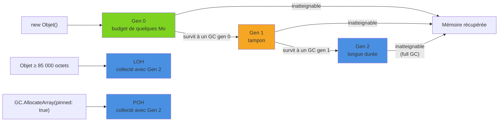

En .NET, on alloue des objets sans jamais les libérer explicitement : c'est le **Garbage Collector** (GC) qui s'en charge. Ce confort a un prix, des pauses et du CPU consommé, et comprendre comment le GC travaille permet d'écrire du code qui lui facilite la tâche plutôt que de le combattre. Cet article ouvre le capot : générations, tas spécialisés, modes de fonctionnement, configuration et outils de diagnostic.

<!--more-->

# 1. Le principe : marquer, puis compacter

Le GC de .NET est un collecteur **traçant** : il ne compte pas les références, il part des **racines** et suit tous les pointeurs pour déterminer ce qui est encore atteignable.

Les racines sont notamment :

- les variables locales et paramètres des méthodes en cours d'exécution (pile et registres) ;
- les champs `static` ;
- les handles GC (objets épinglés, `GCHandle`, objets en attente de finalisation).

Une collection se déroule en plusieurs phases :

1. **Suspension** des threads managés (selon le mode, voir plus bas).
2. **Mark** : parcours du graphe d'objets depuis les racines, chaque objet atteint est marqué vivant.
3. **Plan / Sweep** : tout ce qui n'est pas marqué est considéré comme mort ; l'espace est récupérable.
4. **Compact** : les objets survivants sont déplacés pour être contigus, et les références sont mises à jour. Le tas redevient un bloc compact où l'allocation consiste simplement à avancer un pointeur.
5. **Reprise** des threads.

Le compactage explique pourquoi l'allocation en .NET est si rapide, et aussi pourquoi épingler un objet (`fixed`, `GCHandle.Alloc(..., GCHandleType.Pinned)`) gêne le GC : un objet épinglé ne peut pas être déplacé et fragmente le tas.

# 2. Les générations

Le GC repose sur une observation empirique, l'**hypothèse générationnelle** : *la plupart des objets meurent jeunes*. Une chaîne temporaire, un DTO de requête, une closure LINQ vivent quelques microsecondes. À l'inverse, un objet qui a déjà survécu longtemps (cache, singleton) a de bonnes chances de vivre encore longtemps.

Le tas des petits objets (SOH, *Small Object Heap*) est donc découpé en trois générations :

| Génération | Contenu | Fréquence de collection |
|-----------|---------|------------------------|
| **Gen 0** | Objets fraîchement alloués | Très fréquente, très rapide |
| **Gen 1** | Survivants d'une collection gen 0 : « tampon » entre jeunes et vieux | Fréquente |
| **Gen 2** | Objets de longue durée | Rare, coûteuse (*full GC*) |

Collecter la génération N collecte aussi toutes les générations inférieures. Un objet qui survit à une collection est **promu** dans la génération suivante.



Pour qu'une collection gen 0 n'ait pas à parcourir toute la gen 2, le runtime maintient une **card table** : chaque écriture d'une référence dans un vieil objet marque la zone correspondante, et seules ces zones sont examinées comme racines supplémentaires. C'est pour cela que muter fréquemment des références dans de vieux objets (gros caches mutables) a un coût.

Conséquence pratique : **le pire profil d'objet est celui qui vit « un peu »**. Il survit à une ou deux collections, se fait promouvoir en gen 2, puis meurt. Il faudra alors une collection complète, la plus coûteuse, pour le récupérer. C'est typiquement le cas des objets conservés le temps d'une requête longue ou d'un traitement par lots.

On peut observer les générations depuis le code :

```csharp
var obj = new object();
Console.WriteLine(GC.GetGeneration(obj)); // 0

GC.Collect();                             // à ne faire que pour la démonstration
Console.WriteLine(GC.GetGeneration(obj)); // 1 (promu, car toujours référencé)

GC.Collect();
Console.WriteLine(GC.GetGeneration(obj)); // 2

Console.WriteLine($"Collections gen0={GC.CollectionCount(0)} gen1={GC.CollectionCount(1)} gen2={GC.CollectionCount(2)}");
```

# 3. LOH et POH : les tas spécialisés

## Large Object Heap (LOH)

Déplacer un objet de plusieurs mégaoctets lors du compactage coûterait cher. Les objets de **85 000 octets ou plus** (en pratique : gros tableaux, grosses chaînes) sont donc alloués dans le **LOH** :

- le LOH est logiquement rattaché à la **gen 2** : il n'est collecté que lors d'un full GC ;
- il n'est **pas compacté** par défaut, ce qui peut créer de la fragmentation ;
- allouer beaucoup de gros objets temporaires déclenche donc des collections gen 2.

```csharp
using System.Runtime;

var small = new byte[84_000];
var large = new byte[85_000];

Console.WriteLine(GC.GetGeneration(small)); // 0
Console.WriteLine(GC.GetGeneration(large)); // 2 (LOH)

// Demander un compactage du LOH au prochain full GC (ponctuel)
GCSettings.LargeObjectHeapCompactionMode = GCLargeObjectHeapCompactionMode.CompactOnce;
```

La parade principale est la **réutilisation** : `ArrayPool<T>`, `RecyclableMemoryStream`, ou le traitement en flux plutôt que le chargement complet en mémoire (voir l'article [Span&lt;T&gt; et Memory&lt;T&gt;](/2026/05/09/span-memory.html)).

## Pinned Object Heap (POH)

Depuis .NET 5, le **POH** accueille les objets destinés à rester épinglés (buffers passés à du code natif, I/O). Comme ils sont regroupés à part, ils ne fragmentent plus le SOH.

```csharp
// Tableau alloué directement dans le POH : jamais déplacé par le GC
byte[] ioBuffer = GC.AllocateArray<byte>(4096, pinned: true);

// Variante sans mise à zéro du contenu (plus rapide, à réserver aux buffers immédiatement écrasés)
byte[] raw = GC.AllocateUninitializedArray<byte>(4096, pinned: true);
```

Depuis .NET 7, le tas n'est plus organisé en grands segments mais en **régions** (4 Mo par défaut pour le SOH), ce qui permet au GC de rendre plus finement la mémoire au système et de réaffecter des régions d'une génération à l'autre.

# 4. Workstation, Server et Background GC

## Workstation vs Server

| Mode | Fonctionnement | Cible |
|------|---------------|-------|
| **Workstation** | Un seul tas, la collection s'exécute sur le thread qui l'a déclenchée | Applications desktop, outils CLI, petits services |
| **Server** | Un tas et un thread GC dédié **par cœur logique**, collections parallèles | Services à fort débit |

Le mode Server maximise le débit, au prix d'une consommation mémoire nettement plus élevée (plusieurs tas, budgets gen 0 plus gros). Par défaut, une application console utilise Workstation, alors qu'un projet basé sur le SDK `Microsoft.NET.Sdk.Web` (ASP.NET Core) active Server.

## Background GC

Le **Background GC** (activé par défaut, appelé « concurrent » dans la configuration) permet d'effectuer le marquage des collections **gen 2** pendant que les threads applicatifs continuent de tourner. Pendant ce temps, des collections gen 0/1 dites *éphémères* peuvent encore avoir lieu. Les pauses restent présentes, mais elles sont beaucoup plus courtes qu'avec un full GC bloquant.

On le désactive rarement : uniquement pour un processus batch où seul le débit global compte.

## DATAS : le Server GC qui s'adapte

Le défaut historique du Server GC est sa voracité : sur une machine à 32 cœurs, 32 tas sont créés même pour un petit service. En conteneur, cela se traduit par une consommation mémoire disproportionnée.

**DATAS** (*Dynamic Adaptation To Application Sizes*) corrige cela : le GC démarre avec un seul tas et **ajuste dynamiquement le nombre de tas** et le budget gen 0 en fonction de la taille réelle des données vivantes et du coût mesuré du GC (par défaut, il vise environ 2 % de temps passé à cause du GC).

- **.NET 8** : DATAS disponible en *opt-in* ;
- **.NET 9 et suivants** : DATAS est **activé par défaut** ; il ne concerne que le Server GC.

Pour un service conteneurisé, DATAS rapproche l'empreinte mémoire de celle du mode Workstation tout en gardant le parallélisme du mode Server lors des pics. Pour un benchmark de débit pur où la mémoire n'est pas un sujet, on peut le désactiver et comparer.

# 5. Configuration

Les réglages se font dans le `.csproj` (propriétés MSBuild), dans `runtimeconfig.template.json`, ou via des variables d'environnement `DOTNET_*`. Ils sont lus **au démarrage** du processus uniquement.

```xml
<Project Sdk="Microsoft.NET.Sdk.Web">
  <PropertyGroup>
    <TargetFramework>net10.0</TargetFramework>

    <!-- Server GC (déjà true par défaut avec le SDK Web) -->
    <ServerGarbageCollection>true</ServerGarbageCollection>

    <!-- Background GC (true par défaut) -->
    <ConcurrentGarbageCollection>true</ConcurrentGarbageCollection>

    <!-- DATAS : 1 = activé (défaut .NET 9+ en Server GC), 0 = désactivé -->
    <GarbageCollectionAdaptationMode>1</GarbageCollectionAdaptationMode>
  </PropertyGroup>

  <ItemGroup>
    <!-- Réglage sans propriété MSBuild dédiée : 0 à 9, plus la valeur est haute, plus le GC économise la mémoire -->
    <RuntimeHostConfigurationOption Include="System.GC.ConserveMemory" Value="5" />
  </ItemGroup>
</Project>
```

L'équivalent dans `runtimeconfig.template.json` (copié dans le `runtimeconfig.json` généré) :

```json
{
  "configProperties": {
    "System.GC.Server": true,
    "System.GC.Concurrent": true,
    "System.GC.DynamicAdaptationMode": 1,
    "System.GC.HeapHardLimitPercent": 70
  }
}
```

Et en variables d'environnement, pratique en conteneur (les valeurs numériques y sont en **hexadécimal**) :

```bash
export DOTNET_gcServer=1
export DOTNET_GCDynamicAdaptationMode=0
export DOTNET_GCHeapHardLimitPercent=0x46   # 70 %
```

En conteneur, le GC détecte la limite mémoire du cgroup et plafonne par défaut le tas à **75 %** de cette limite. `HeapHardLimit` / `HeapHardLimitPercent` permettent d'ajuster ce plafond.

On peut vérifier la configuration effective au runtime :

```csharp
using System.Runtime;

Console.WriteLine($"Server GC : {GCSettings.IsServerGC}");
Console.WriteLine($"Latence   : {GCSettings.LatencyMode}");

GCMemoryInfo info = GC.GetGCMemoryInfo();
Console.WriteLine($"Taille du tas     : {info.HeapSizeBytes / 1024 / 1024} Mo");
Console.WriteLine($"Fragmentation     : {info.FragmentedBytes / 1024 / 1024} Mo");
Console.WriteLine($"% temps de pause  : {info.PauseTimePercentage}");
Console.WriteLine($"Alloué depuis le démarrage : {GC.GetTotalAllocatedBytes() / 1024 / 1024} Mo");
```

# 6. IDisposable et finaliseurs

Le GC gère la **mémoire managée**, pas les ressources : connexions, handles de fichiers, sockets doivent être libérés de façon déterministe via `IDisposable`.

```csharp
// ✅ Libération déterministe, même en cas d'exception
await using var connection = new SqlConnection(connectionString);
await connection.OpenAsync();

using var stream = File.OpenRead("data.bin");
```

Un **finaliseur** (`~MaClasse()`) est un filet de sécurité pour les ressources **non managées**. Il a un coût important :

- l'objet est inscrit dans une file de finalisation dès sa création ;
- devenu inatteignable, il n'est **pas** libéré immédiatement : il est placé dans la file *f-reachable*, son finaliseur s'exécute sur un thread dédié, puis il faudra **une collection de plus** pour récupérer sa mémoire. Il est donc souvent promu, parfois jusqu'en gen 2.

En pratique, on n'écrit quasiment jamais de finaliseur : on encapsule le handle natif dans un `SafeHandle`, qui en possède déjà un, correctement implémenté.

```csharp
using Microsoft.Win32.SafeHandles;

// ✅ Classe scellée qui ne possède que des ressources managées ou des SafeHandle :
// pas de finaliseur, Dispose simple
public sealed class FileReader : IDisposable
{
    private readonly SafeFileHandle _handle;
    private bool _disposed;

    public FileReader(string path) =>
        _handle = File.OpenHandle(path, FileMode.Open, FileAccess.Read);

    public void Dispose()
    {
        if (_disposed) return;
        _handle.Dispose();
        _disposed = true;
    }
}
```

Si une classe définit malgré tout un finaliseur, sa méthode `Dispose()` doit appeler `GC.SuppressFinalize(this)` pour retirer l'objet de la file de finalisation et éviter le surcoût décrit plus haut.

# 7. Outils de diagnostic

## dotnet-counters : la vue en temps réel

```bash
dotnet tool install --global dotnet-counters

# Lister les processus .NET
dotnet-counters ps

# Suivre les compteurs du runtime d'un processus
dotnet-counters monitor --process-id 12345 --counters System.Runtime
```

On y surveille en priorité : le **nombre de collections par génération** (beaucoup de gen 2 = problème), le **pourcentage de temps en GC**, le **taux d'allocation** et la **taille du tas**. Depuis .NET 9, ces informations sont aussi exposées comme métriques `System.Diagnostics.Metrics` (par exemple `dotnet.gc.collections`, `dotnet.gc.pause.time`), donc exportables via [OpenTelemetry](/2025/05/01/OpenTelemetry.html) vers un tableau de bord.

## dotnet-gcdump : qui occupe le tas ?

```bash
dotnet tool install --global dotnet-gcdump

# Capture du graphe d'objets (déclenche un GC gen 2 dans le processus cible)
dotnet-gcdump collect --process-id 12345 --output app.gcdump

# Résumé en console : types les plus présents et leur taille
dotnet-gcdump report app.gcdump
```

Le fichier `.gcdump` s'ouvre aussi dans Visual Studio ou PerfView, ce qui permet de comparer deux captures et de retrouver les chemins de rétention (qui garde une référence vers cet objet ?). Pour aller plus loin sur les causes d'allocation, `dotnet-trace` collecte les événements détaillés du GC.

Et pour mesurer l'effet d'une optimisation sur un morceau de code précis, [BenchmarkDotNet](/2026/04/12/benchmarkdotnet.html) avec `[MemoryDiagnoser]` reste l'outil de référence.

# 8. Bonnes pratiques

- ✅ **Mesurer avant d'optimiser** : un taux de temps en GC de quelques pourcents est normal.
- ✅ Réduire les allocations sur les **chemins chauds** : `Span<T>`, `ArrayPool<T>`, `string.Create`, `StringBuilder` réutilisé.
- ✅ Éviter les objets de durée de vie « moyenne » qui finissent promus en gen 2.
- ✅ Réutiliser les gros buffers plutôt que d'allouer dans le LOH en boucle.
- ✅ Libérer les ressources avec `using` / `await using` ; préférer `SafeHandle` aux finaliseurs.
- ✅ Laisser les réglages par défaut (Server + Background + DATAS pour un service web) tant qu'une mesure ne justifie pas autre chose.
- ❌ Appeler `GC.Collect()` en production « pour libérer de la mémoire » : cela promeut des objets, casse les heuristiques du GC et provoque des pauses.
- ❌ Épingler des objets longtemps avec `fixed` ou `GCHandle` : utiliser le POH pour les buffers épinglés durablement.
- ❌ Garder des références inutiles dans des champs statiques ou des événements non désabonnés : c'est la cause n°1 des « fuites mémoire » en .NET.

# Résumé

| Notion | À retenir |
|--------|-----------|
| **Mark / Compact** | Le GC trace depuis les racines, puis compacte les survivants |
| **Gen 0 / 1 / 2** | La plupart des objets meurent en gen 0 ; les survivants sont promus |
| **LOH** | Objets ≥ 85 000 octets, collectés avec la gen 2, non compactés par défaut |
| **POH** | Objets épinglés (.NET 5+), via `GC.AllocateArray(..., pinned: true)` |
| **Workstation** | Un tas, faible empreinte : desktop, CLI |
| **Server** | Un tas par cœur, débit maximal : défaut pour ASP.NET Core |
| **Background GC** | Marquage gen 2 concurrent, activé par défaut |
| **DATAS** | Server GC adaptatif : opt-in en .NET 8, par défaut depuis .NET 9 |
| **Configuration** | `.csproj`, `runtimeconfig.template.json` ou `DOTNET_*`, lue au démarrage |
| **IDisposable** | Pour les ressources ; finaliseurs à éviter, préférer `SafeHandle` |
| **Outils** | `dotnet-counters` (temps réel), `dotnet-gcdump` (contenu du tas), BenchmarkDotNet |

Le GC de .NET est un composant très optimisé qui fonctionne bien avec ses réglages par défaut. Le levier le plus efficace reste presque toujours le même : **allouer moins**, et surtout moins d'objets à durée de vie intermédiaire.
