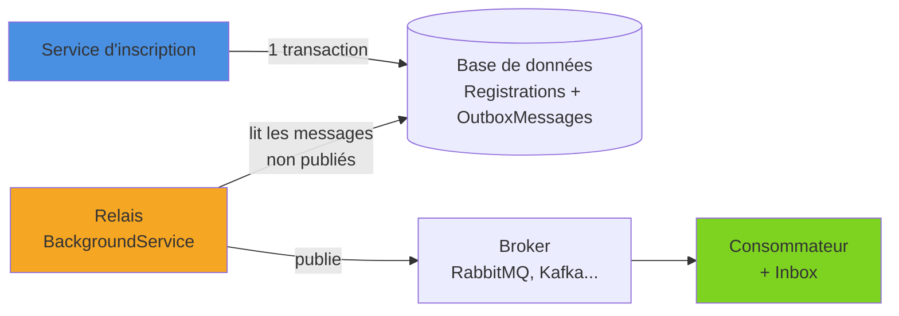
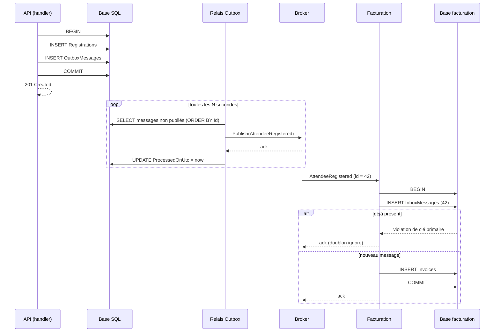

Dès qu'un service doit à la fois enregistrer une donnée en base **et** publier un événement sur un broker, il se heurte au problème du *dual write* : deux systèmes, deux écritures, et aucune transaction pour les lier. Le pattern **Outbox** résout ce problème en écrivant l'événement dans la même base, dans la même transaction que la donnée métier, puis en le publiant de manière asynchrone. C'est une brique de base de toute architecture pilotée par les événements, des projections CQRS à l'intégration entre microservices.

<!--more-->

# 1. Le problème du dual write

L'exemple de l'article est un service d'**inscription à des conférences**. Quand un participant s'inscrit, le service enregistre l'inscription en base, puis publie un événement `AttendeeRegistered` : le service de facturation émet la facture, le service des badges prépare le badge.

```csharp
using Microsoft.EntityFrameworkCore;

public class Registration
{
    public Guid Id { get; set; } = Guid.CreateVersion7();
    public required string ConferenceCode { get; set; }
    public required string AttendeeEmail { get; set; }
    public decimal Price { get; set; }
}

// L'événement publié vers les autres services
public sealed record AttendeeRegistered(
    Guid RegistrationId, string ConferenceCode, string AttendeeEmail, decimal Price);

public class RegistrationDbContext(DbContextOptions<RegistrationDbContext> options) : DbContext(options)
{
    public DbSet<Registration> Registrations => Set<Registration>();
}
```

La publication passe ici par le Pub/Sub de Dapr (`DaprClient.PublishEventAsync(pubsub, topic, données)`), mais le problème est le même avec n'importe quel broker. Le code naïf ressemble à ceci :

```csharp
// ❌ Dual write : deux écritures indépendantes, aucune garantie
public async Task RegisterAsync(Registration registration, CancellationToken ct)
{
    db.Registrations.Add(registration);
    await db.SaveChangesAsync(ct);                              // 1. commit SQL

    await daprClient.PublishEventAsync("pubsub", "registrations", // 2. publication broker
        new AttendeeRegistered(registration.Id, registration.ConferenceCode,
            registration.AttendeeEmail, registration.Price), ct);
}
```

Trois scénarios posent problème :

| Scénario | Conséquence |
|---|---|
| Le commit réussit, le processus plante avant la publication | Inscription enregistrée, **événement perdu** : ni facture, ni badge |
| Le broker est indisponible | Exception après le commit : l'inscription existe mais l'appelant croit à un échec |
| On publie **avant** le commit, puis le commit échoue | **Événement fantôme** : on facture une inscription qui n'existe pas |

Faute de transaction distribuée entre la base et le broker, il faut ramener les deux écritures dans **un seul** système transactionnel.

# 2. Le principe de l'Outbox

L'idée est simple :

1. Dans la **même transaction** que la modification métier, on insère une ligne dans une table `OutboxMessages` qui décrit l'événement.
2. Un processus séparé, le **relais**, lit périodiquement les messages non publiés, les envoie au broker, puis les marque comme publiés.
3. Côté consommateur, une table **Inbox** permet d'ignorer les doublons.



La garantie obtenue est **at-least-once** : un événement validé en base sera publié tôt ou tard, éventuellement plusieurs fois (si le relais plante entre la publication et le marquage). D'où l'importance de l'idempotence côté consommateur.

Le flux complet :



# 3. La table Outbox avec EF Core

Packages utilisés dans les exemples (SQL Server) :

```bash
dotnet add package Microsoft.EntityFrameworkCore.SqlServer
dotnet add package Dapr.Client
```

Le message d'outbox est une entité EF Core comme une autre :

```csharp
public sealed class OutboxMessage
{
    public long Id { get; set; }                     // identity : donne l'ordre d'insertion
    public Guid MessageId { get; set; } = Guid.CreateVersion7(); // identifiant transmis au consommateur
    public required string Type { get; set; }        // ex. "AttendeeRegistered"
    public required string Payload { get; set; }     // JSON sérialisé
    public DateTime OccurredOnUtc { get; set; }
    public DateTime? ProcessedOnUtc { get; set; }    // null = pas encore publié
    public int Attempts { get; set; }
    public string? LastError { get; set; }
}
```

```csharp
// Dans RegistrationDbContext
public DbSet<OutboxMessage> OutboxMessages => Set<OutboxMessage>();

protected override void OnModelCreating(ModelBuilder modelBuilder)
{
    modelBuilder.Entity<OutboxMessage>(b =>
    {
        b.ToTable("OutboxMessages");
        b.HasKey(m => m.Id);
        // Index filtré : le relais ne parcourt que les messages en attente
        b.HasIndex(m => m.Id)
         .HasFilter("[ProcessedOnUtc] IS NULL")
         .HasDatabaseName("IX_Outbox_Pending");
    });
}
```

## Option A : ajout explicite

La façon la plus lisible consiste à ajouter le message dans le handler, avant l'unique `SaveChangesAsync` :

```csharp
// ✅ Une seule transaction : l'inscription et l'événement sont commités ensemble
public async Task RegisterAsync(Registration registration, CancellationToken ct)
{
    db.Registrations.Add(registration);

    var evt = new AttendeeRegistered(registration.Id, registration.ConferenceCode,
        registration.AttendeeEmail, registration.Price);
    db.OutboxMessages.Add(new OutboxMessage
    {
        Type = nameof(AttendeeRegistered),
        Payload = JsonSerializer.Serialize(evt),
        OccurredOnUtc = DateTime.UtcNow
    });

    await db.SaveChangesAsync(ct); // SaveChanges est transactionnel par défaut
}
```

`SaveChangesAsync` encapsule toutes les insertions dans une transaction : soit les deux lignes sont écrites, soit aucune.

## Option B : un intercepteur et des événements de domaine

En DDD, les entités principales (les *agrégats*) enregistrent en mémoire des **événements de domaine**, des objets qui décrivent un fait métier survenu. Un `SaveChangesInterceptor`, classe appelée par EF Core au début de chaque `SaveChanges`, peut alors les convertir automatiquement en messages d'outbox :

```csharp
public interface IDomainEvent;

public abstract class AggregateRoot
{
    private readonly List<IDomainEvent> _events = [];
    public IReadOnlyList<IDomainEvent> DomainEvents => _events;
    protected void Raise(IDomainEvent evt) => _events.Add(evt);
    public void ClearDomainEvents() => _events.Clear();
}
```

Dans cette variante, `Registration` dérive de `AggregateRoot` et appelle `Raise(new AttendeeRegistered(...))` à sa création, `AttendeeRegistered` implémentant `IDomainEvent`.

```csharp
using Microsoft.EntityFrameworkCore;
using Microsoft.EntityFrameworkCore.Diagnostics;
using System.Text.Json;

public sealed class OutboxInterceptor : SaveChangesInterceptor
{
    public override ValueTask<InterceptionResult<int>> SavingChangesAsync(
        DbContextEventData eventData,
        InterceptionResult<int> result,
        CancellationToken cancellationToken = default)
    {
        if (eventData.Context is not { } context)
            return base.SavingChangesAsync(eventData, result, cancellationToken);

        var aggregates = context.ChangeTracker
            .Entries<AggregateRoot>()
            .Select(e => e.Entity)
            .Where(a => a.DomainEvents.Count > 0)
            .ToList();

        var messages = aggregates
            .SelectMany(a => a.DomainEvents)
            .Select(evt => new OutboxMessage
            {
                Type = evt.GetType().Name,
                // GetType() : on sérialise le type concret, pas l'interface
                Payload = JsonSerializer.Serialize(evt, evt.GetType()),
                OccurredOnUtc = DateTime.UtcNow
            })
            .ToList();

        aggregates.ForEach(a => a.ClearDomainEvents());

        // Ajoutés avant le calcul des changements : ils font partie de la même transaction
        context.Set<OutboxMessage>().AddRange(messages);

        return base.SavingChangesAsync(eventData, result, cancellationToken);
    }
}
```

```csharp
builder.Services.AddSingleton<OutboxInterceptor>();
builder.Services.AddDbContext<RegistrationDbContext>((sp, options) =>
    options.UseSqlServer(builder.Configuration.GetConnectionString("Registrations"))
           .AddInterceptors(sp.GetRequiredService<OutboxInterceptor>()));
```

Le service n'a plus à connaître l'outbox : l'agrégat appelle `Raise(...)` et l'événement part avec le `SaveChanges`. Plus automatique, mais aussi plus « magique » que l'ajout explicite.

# 4. Le relais : un BackgroundService

Il lit un lot de messages en attente, les publie, puis enregistre le résultat :

```csharp
using Dapr.Client;
using Microsoft.EntityFrameworkCore;
using System.Text;

public sealed class OutboxRelay(
    IServiceScopeFactory scopeFactory,
    ILogger<OutboxRelay> logger) : BackgroundService
{
    private const int BatchSize = 50;

    protected override async Task ExecuteAsync(CancellationToken stoppingToken)
    {
        using var timer = new PeriodicTimer(TimeSpan.FromSeconds(2));

        while (await timer.WaitForNextTickAsync(stoppingToken))
        {
            try
            {
                await PublishPendingAsync(stoppingToken);
            }
            catch (Exception ex) when (ex is not OperationCanceledException)
            {
                logger.LogError(ex, "Échec du cycle de relais Outbox");
            }
        }
    }

    private async Task PublishPendingAsync(CancellationToken ct)
    {
        // DbContext est scoped : on crée un scope par cycle
        await using var scope = scopeFactory.CreateAsyncScope();
        var db = scope.ServiceProvider.GetRequiredService<RegistrationDbContext>();
        var dapr = scope.ServiceProvider.GetRequiredService<DaprClient>();

        var messages = await db.OutboxMessages
            .Where(m => m.ProcessedOnUtc == null && m.Attempts < 10) // au-delà : alerte
            .OrderBy(m => m.Id)               // ordre d'insertion
            .Take(BatchSize)
            .ToListAsync(ct);

        foreach (var message in messages)
        {
            try
            {
                // Payload déjà sérialisé : on l'envoie tel quel, sans re-sérialisation
                await dapr.PublishByteEventAsync(
                    "pubsub", message.Type,
                    Encoding.UTF8.GetBytes(message.Payload),
                    "application/json",
                    new Dictionary<string, string> { ["cloudevent.id"] = message.MessageId.ToString() },
                    ct);

                message.ProcessedOnUtc = DateTime.UtcNow;
            }
            catch (Exception ex) when (ex is not OperationCanceledException)
            {
                message.Attempts++;
                message.LastError = ex.Message;
                logger.LogWarning(ex, "Publication impossible du message {Id}", message.Id);
                break; // on s'arrête pour ne pas publier les suivants avant celui-ci
            }
        }

        await db.SaveChangesAsync(ct);
    }
}
```

```csharp
builder.Services.AddDaprClient();
builder.Services.AddHostedService<OutboxRelay>();
```

Quelques remarques :

- Dapr enveloppe chaque message dans un CloudEvent, un format standard dont le champ `id` identifie le message ; la métadonnée `cloudevent.id` permet d'y placer le `MessageId`. C'est lui que le consommateur utilisera pour dédoublonner (détails dans l'article sur le [Pub/Sub Dapr](/2026/03/08/dapr-pub-sub.html)). Avec un autre broker, on le place dans un en-tête de message.
- Si le relais plante après `PublishEventAsync` mais avant `SaveChangesAsync`, le message sera republié au cycle suivant : c'est le **at-least-once** assumé.

## Plusieurs instances du relais

Si l'API tourne sur trois pods, trois relais lisent la même table et publient les mêmes messages. Deux solutions :

- **Un seul relais** : worker dédié avec une seule réplique, ou élection de leader.
- **Verrouillage de lignes** : chaque instance réserve son lot sans bloquer les autres.

```csharp
// SQL Server : READPAST saute les lignes déjà verrouillées par une autre instance.
// Dans une transaction explicite, pour que le verrou tienne jusqu'au marquage.
var messages = await db.OutboxMessages
    .FromSql($"""
        SELECT TOP ({BatchSize}) *
        FROM OutboxMessages WITH (UPDLOCK, READPAST, ROWLOCK)
        WHERE ProcessedOnUtc IS NULL
        ORDER BY Id
        """)
    .ToListAsync(ct);
```

L'équivalent PostgreSQL est `FOR UPDATE SKIP LOCKED`. Attention : avec plusieurs relais en parallèle, l'**ordre global** n'est plus garanti.

# 5. L'ordre des messages

L'ordre d'insertion (`Id` identity) donne un ordre total **à la source**, mais il peut être perdu à plusieurs endroits : relais parallèles, retries, partitions du broker, consommateurs concurrents. En pratique :

- On a surtout besoin d'un ordre **par agrégat**. Avec Kafka, utiliser l'identifiant de l'agrégat comme **clé de partition** garantit l'ordre par agrégat.
- Côté consommateur, la défense la plus robuste reste le **numéro de version** de l'agrégat dans l'événement : le consommateur mémorise la dernière version traitée et ignore tout événement plus ancien que l'état connu.

# 6. L'idempotence côté consommateur : l'Inbox

Puisque la livraison est at-least-once, chaque consommateur doit tolérer les doublons. Le pattern **Inbox** est le miroir de l'outbox : on enregistre l'identifiant du message traité **dans la même transaction** que l'effet métier.

```csharp
public sealed class InboxMessage
{
    public Guid MessageId { get; set; }     // clé primaire
    public DateTime ProcessedOnUtc { get; set; }
}
```

Côté facturation, le `DbContext` expose `InboxMessages` (clé primaire `MessageId`) et `Invoices` :

```csharp
public class Invoice
{
    public int Id { get; set; }
    public Guid RegistrationId { get; set; }
    public decimal Amount { get; set; }
}

// modelBuilder.Entity<InboxMessage>().HasKey(m => m.MessageId);

public async Task HandleAsync(Guid messageId, AttendeeRegistered evt, CancellationToken ct)
{
    await using var tx = await db.Database.BeginTransactionAsync(ct);

    // Déjà traité ? On acquitte sans rien faire
    if (await db.InboxMessages.AnyAsync(m => m.MessageId == messageId, ct))
        return;

    db.InboxMessages.Add(new InboxMessage { MessageId = messageId, ProcessedOnUtc = DateTime.UtcNow });

    // Effet cumulatif : traité deux fois, il produirait deux factures
    db.Invoices.Add(new Invoice { RegistrationId = evt.RegistrationId, Amount = evt.Price });

    try
    {
        await db.SaveChangesAsync(ct);
        await tx.CommitAsync(ct);
    }
    catch (DbUpdateException ex) when (ex.InnerException is SqlException { Number: 2627 or 2601 })
    {
        // Violation de clé primaire : deux livraisons simultanées, l'autre a gagné.
        // La transaction est annulée à la libération de tx, le message est acquitté sans effet.
    }
}
```

(`SqlException` vient de `Microsoft.Data.SqlClient` ; les codes 2627 et 2601 correspondent aux violations de clé primaire et d'index unique.)

La clé primaire sur `MessageId` est la vraie garantie : le `AnyAsync` n'est qu'une optimisation, il ne protège pas contre deux livraisons concurrentes.

> Quand l'opération est naturellement idempotente (un `UPSERT` sur une projection, un `SET statut = 'Expédiée'`), l'inbox est superflue. Elle devient indispensable pour les effets cumulatifs : émettre une facture, envoyer un e-mail, débiter un compte.

# 7. Le nettoyage

Sans purge, les tables outbox et inbox grossissent indéfiniment. Un job périodique suffit, avec `ExecuteDeleteAsync` qui supprime en base sans charger les entités :

```csharp
var cutoff = DateTime.UtcNow.AddDays(-7);

await db.OutboxMessages
    .Where(m => m.ProcessedOnUtc != null && m.ProcessedOnUtc < cutoff)
    .ExecuteDeleteAsync(ct);

await db.InboxMessages
    .Where(m => m.ProcessedOnUtc < cutoff)
    .ExecuteDeleteAsync(ct);
```

La durée de rétention de l'inbox doit être **supérieure** à la fenêtre pendant laquelle un doublon peut encore arriver (rétention du broker, durée maximale des retries).

# 8. Les alternatives

## CDC avec Debezium

Le **Change Data Capture** lit le journal de transactions de la base (WAL PostgreSQL, binlog MySQL, CDC SQL Server) au lieu d'interroger la table. **Debezium** fournit une transformation dédiée (*Outbox Event Router*) qui transforme chaque insertion dans la table outbox en message Kafka, routé vers un topic selon une colonne du message.

- ✅ Pas de polling, latence faible, ordre du journal respecté.
- ❌ Infrastructure lourde (Kafka Connect), CDC à activer côté base.

## MassTransit et Wolverine

Les frameworks de messagerie .NET intègrent une outbox transactionnelle avec EF Core. Avec MassTransit :

```csharp
// dotnet add package MassTransit.EntityFrameworkCore
builder.Services.AddMassTransit(x =>
{
    x.AddEntityFrameworkOutbox<RegistrationDbContext>(o =>
    {
        o.UseSqlServer();   // dialecte SQL pour le verrouillage
        o.UseBusOutbox();   // les Publish() passent par l'outbox
    });

    x.UsingRabbitMq((context, cfg) => cfg.ConfigureEndpoints(context));
});

// Dans RegistrationDbContext.OnModelCreating :
// modelBuilder.AddInboxStateEntity();
// modelBuilder.AddOutboxMessageEntity();
// modelBuilder.AddOutboxStateEntity();
```

Un `IPublishEndpoint.Publish(...)` suivi de `SaveChangesAsync` écrit le message dans l'outbox ; un service livré par MassTransit se charge du relais, et l'inbox est gérée côté consommateur. Attention à la licence : MassTransit v9 passe sous licence commerciale, la v8 restant open source. **Wolverine** (écosystème Critter Stack) offre une outbox durable comparable, avec SQL Server ou PostgreSQL et une intégration EF Core.

## L'outbox de Dapr

Dapr propose une outbox intégrée au building block **State management** (introduite en preview avec Dapr 1.12). On déclare un state store transactionnel avec des métadonnées supplémentaires :

```yaml
apiVersion: dapr.io/v1alpha1
kind: Component
metadata:
  name: registrations-outbox
spec:
  type: state.postgresql
  version: v1
  metadata:
  - name: connectionString
    value: "host=localhost user=postgres password=example port=5432 database=registrations"
  - name: outboxPublishPubsub     # obligatoire : composant pub/sub de destination
    value: "pubsub"
  - name: outboxPublishTopic      # obligatoire : topic qui reçoit les changements
    value: "registrations"
  - name: outboxDiscardWhenMissingState  # facultatif : abandonner si l'état a disparu
    value: "false"
```

Toute écriture **transactionnelle** sur ce store publie alors un message. Une opération marquée `outbox.projection` permet de publier un contenu différent de celui stocké :

```csharp
using Dapr.Client;
using System.Text.Json;

var key = $"registration-{registration.Id}";
var operations = new List<StateTransactionRequest>
{
    // Écrit en base
    new(key, JsonSerializer.SerializeToUtf8Bytes(registration), StateOperationType.Upsert),
    // Non écrit : sert uniquement de contenu au message publié (même clé obligatoire)
    new(key, JsonSerializer.SerializeToUtf8Bytes(new AttendeeRegistered(
            registration.Id, registration.ConferenceCode, registration.AttendeeEmail, registration.Price)),
        StateOperationType.Upsert,
        metadata: new Dictionary<string, string> { ["outbox.projection"] = "true" })
};

await daprClient.ExecuteStateTransactionAsync("registrations-outbox", operations);
```

Les contraintes à connaître :

- Le state store doit supporter les **transactions** (PostgreSQL, MySQL, SQL Server, Redis…), et seules les écritures passant par `ExecuteStateTransactionAsync` déclenchent l'outbox.
- La livraison reste **at-least-once** : l'inbox reste nécessaire côté consommateur.
- Les données sont écrites via l'API d'état de Dapr (paires clé/valeur), pas via vos tables EF Core : l'approche ne convient que si le modèle d'écriture vit déjà dans un state store Dapr (voir [la gestion d'état](/2026/03/01/dapr-etats.html)).

| Solution | Quand la choisir |
|---|---|
| Outbox maison (EF Core) | Besoin simple, contrôle total, pas de framework de messagerie |
| MassTransit / Wolverine | Messagerie riche déjà en place (sagas, retries, inbox incluse) |
| Debezium (CDC) | Gros volumes, Kafka déjà présent, latence faible |
| Outbox Dapr | Données déjà stockées dans un state store Dapr |

# Résumé

| Élément | Rôle |
|---|---|
| **Dual write** | Écrire en base puis publier sans transaction commune : perte ou événement fantôme |
| **Table Outbox** | Événement écrit dans la même transaction que la donnée métier |
| **Ajout explicite / intercepteur** | Deux façons d'alimenter l'outbox avec EF Core |
| **Relais** | `BackgroundService` qui publie les messages en attente puis les marque |
| **Plusieurs instances** | Instance unique ou `UPDLOCK, READPAST` / `FOR UPDATE SKIP LOCKED` |
| **Garantie** | At-least-once : doublons possibles, jamais de perte |
| **Inbox** | Identifiant du message traité, clé primaire, même transaction que l'effet |
| **Ordre** | Par agrégat : clé de partition et numéro de version |
| **Nettoyage** | `ExecuteDeleteAsync` périodique, rétention de l'inbox supérieure à la fenêtre de doublons |
| **Alternatives** | Debezium (CDC), MassTransit, Wolverine, outbox du state store Dapr |

Le pattern Outbox transforme un problème distribué insoluble en deux problèmes locaux simples : une transaction dans une seule base, et un consommateur idempotent. C'est le prix à payer pour une consistance éventuelle qui converge réellement.
