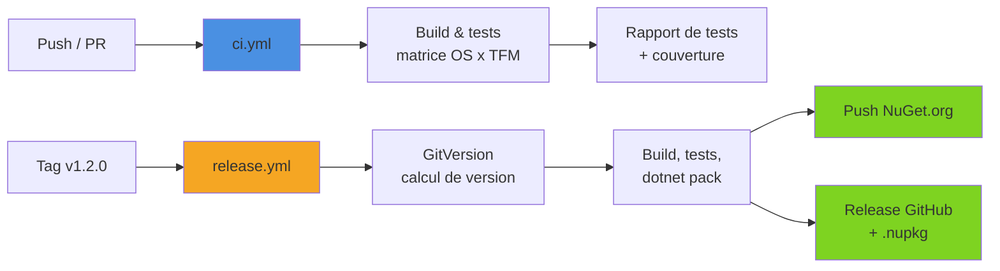
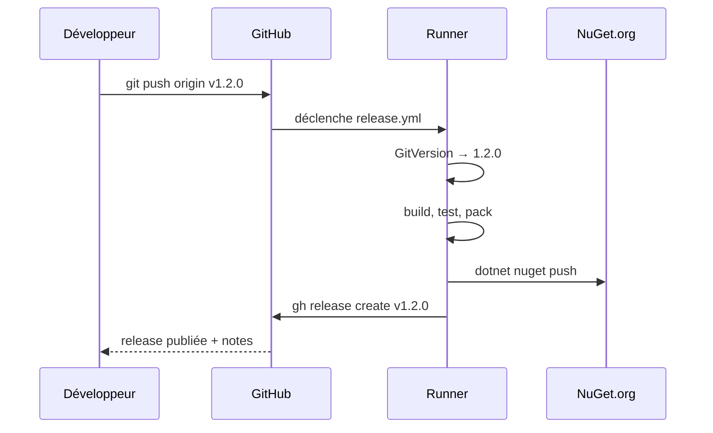

Un projet .NET hébergé sur GitHub peut disposer, en quelques fichiers YAML, d'une intégration continue complète : compilation et tests sur plusieurs OS et frameworks, rapport de couverture, versionning automatique, publication sur NuGet et release GitHub à chaque tag. Cet article construit pas à pas un pipeline réaliste pour une petite bibliothèque NuGet, avec les versions d'actions actuelles et les pièges classiques à éviter.

<!--more-->

# 1. Les bases d'un workflow

Un workflow GitHub Actions est un fichier YAML placé dans `.github/workflows/`. Il se compose de **déclencheurs** (`on`), de **jobs** exécutés sur des runners, et de **steps** qui appellent des actions ou des commandes shell.

L'exemple est une bibliothèque fictive, **SlugKit**, qui transforme un titre en *slug* d'URL (`"Hello World !"` → `hello-world`). Elle est publiée sur NuGet.org et testée avec xUnit. La structure cible du dépôt :

```bash
src/SlugKit/                # la bibliothèque (SlugKit.csproj)
tests/SlugKit.Tests/        # les tests xUnit
SlugKit.slnx                # la solution, compilée par dotnet build / test
.github/
├── dependabot.yml          # mises à jour automatiques des dépendances
└── workflows/
    ├── ci.yml              # build + tests à chaque push / pull request
    └── release.yml         # pack + NuGet + release GitHub sur tag v*
global.json                 # version du SDK figée
Directory.Build.props       # propriétés communes (lock files, métadonnées NuGet)
```

Le pipeline complet :



# 2. Préparer le dépôt

Deux fichiers rendent le build reproductible. D'abord `global.json`, qui fige le SDK utilisé localement **et** en CI :

```json
{
  "sdk": {
    "version": "10.0.100",
    "rollForward": "latestFeature"
  }
}
```

Ensuite `Directory.Build.props`, qui active les **fichiers de verrouillage** NuGet (`packages.lock.json`). Ils figent les versions transitives résolues et servent de clé au cache NuGet de `setup-dotnet` :

```xml
<Project>
  <PropertyGroup>
    <!-- Génère packages.lock.json pour chaque projet (à committer) -->
    <RestorePackagesWithLockFile>true</RestorePackagesWithLockFile>
    <!-- En CI, le restore échoue si le lock file n'est plus à jour -->
    <RestoreLockedMode Condition="'$(CI)' == 'true'">true</RestoreLockedMode>
    <!-- Builds déterministes sur les runners -->
    <ContinuousIntegrationBuild Condition="'$(CI)' == 'true'">true</ContinuousIntegrationBuild>
  </PropertyGroup>
</Project>
```

> GitHub Actions définit automatiquement la variable d'environnement `CI=true`, que MSBuild lit comme une propriété.

# 3. Le workflow de build et de tests

Première version, sur un seul OS :


```yaml
# .github/workflows/ci.yml
name: CI

on:
  push:
    branches: [ main ]
  pull_request:
    branches: [ main ]

# Un nouveau push sur la même branche annule le run en cours
concurrency:
  group: ${{ github.workflow }}-${{ github.ref }}
  cancel-in-progress: true

permissions:
  contents: read

env:
  DOTNET_NOLOGO: true
  DOTNET_CLI_TELEMETRY_OPTOUT: true

jobs:
  build:
    runs-on: ubuntu-latest
    steps:
      - uses: actions/checkout@v6

      - uses: actions/setup-dotnet@v5
        with:
          global-json-file: global.json   # même SDK qu'en local
          cache: true                     # cache NuGet indexé sur packages.lock.json

      - run: dotnet restore
      - run: dotnet build --no-restore --configuration Release
      - run: dotnet test --no-build --configuration Release
```


Points clés :

- `actions/checkout@v6` récupère le code ; `actions/setup-dotnet@v5` installe le SDK.
- `cache: true` met en cache le dossier des packages NuGet. La clé est calculée à partir des `packages.lock.json` : **sans lock file, l'action échoue**. Pour des lock files hors de la racine, `cache-dependency-path` accepte un chemin ou un motif.
- `--no-restore` et `--no-build` évitent de refaire le travail des étapes précédentes.
- Les tests s'exécutent sur chaque framework ciblé : pour une cible `net8.0`, le runtime .NET 8 doit aussi être installé (voir la section suivante).
- Le bloc `permissions` réduit le jeton `GITHUB_TOKEN` au strict nécessaire : c'est une bonne pratique de sécurité à appliquer partout.

# 4. Matrice OS et frameworks

SlugKit cible deux frameworks, pour rester utilisable par les applications encore en .NET 8 (LTS). Le projet de tests déclare les mêmes cibles, afin que les tests s'exécutent sur chacune :

```xml
<!-- src/SlugKit/SlugKit.csproj et tests/SlugKit.Tests/SlugKit.Tests.csproj -->
<PropertyGroup>
  <TargetFrameworks>net8.0;net10.0</TargetFrameworks>
</PropertyGroup>
```

Une telle bibliothèque doit être testée sur chacun de ces frameworks, et idéalement sur Windows, Linux et macOS (pour aller plus loin sur le multi-ciblage : [cibler plusieurs frameworks](/2026/01/10/cibler-plusieurs-frameworks-net.html)). La **matrice** génère un job par combinaison :


```yaml
jobs:
  build:
    name: Tests ${{ matrix.os }} / ${{ matrix.framework }}
    runs-on: ${{ matrix.os }}
    strategy:
      fail-fast: false              # laisser tourner les autres combinaisons en cas d'échec
      matrix:
        os: [ ubuntu-latest, windows-latest, macos-latest ]
        framework: [ net8.0, net10.0 ]
    steps:
      - uses: actions/checkout@v6

      - uses: actions/setup-dotnet@v5
        with:
          # SDK 10 pour compiler, runtime 8 pour exécuter les tests net8.0
          dotnet-version: |
            8.0.x
            10.0.x
          cache: true

      - run: dotnet restore
      - run: dotnet build --no-restore -c Release
      - run: dotnet test --no-build -c Release --framework ${{ matrix.framework }}
```


On obtient ici six jobs exécutés en parallèle. Quelques variantes utiles :

- `exclude` retire une combinaison (par exemple `net8.0` sur macOS si elle n'apporte rien) ;
- `include` ajoute une combinaison spécifique ou une variable supplémentaire ;
- les runners macOS et Windows consomment davantage de minutes sur les dépôts privés : une matrice complète sur `main` et une matrice réduite sur les pull requests est un compromis courant.

> Quand `dotnet-version` contient plusieurs versions, le SDK le plus récent est utilisé par défaut, sauf si un `global.json` impose autre chose.

# 5. Résultats de tests et couverture

Par défaut, un test en échec se résume à quelques lignes dans les logs. Deux améliorations rendent les résultats lisibles : un rapport de tests au format TRX, et un résumé de couverture affiché sur la page du run.

Les projets de tests référencent `coverlet.collector` (présent dans les templates `dotnet new xunit`) :

```bash
dotnet add tests/SlugKit.Tests package coverlet.collector
```

Puis, dans le job :


```yaml
    permissions:
      contents: read
      checks: write                 # nécessaire pour publier un check run

    steps:
      # ... checkout, setup-dotnet, restore, build ...

      - name: Tests
        run: >
          dotnet test --no-build -c Release
          --framework ${{ matrix.framework }}
          --logger "trx;LogFilePrefix=results"
          --collect "XPlat Code Coverage"
          --results-directory ./TestResults

      - name: Rapport de tests
        uses: dorny/test-reporter@v3
        if: ${{ !cancelled() }}       # publier même si les tests ont échoué
        with:
          name: Tests ${{ matrix.os }} ${{ matrix.framework }}
          path: TestResults/*.trx
          reporter: dotnet-trx

      - name: Couverture
        if: matrix.os == 'ubuntu-latest' && matrix.framework == 'net10.0'
        run: |
          dotnet tool install --global dotnet-reportgenerator-globaltool
          reportgenerator \
            -reports:"TestResults/**/coverage.cobertura.xml" \
            -targetdir:coverage \
            -reporttypes:"HtmlInline;MarkdownSummaryGithub"
          cat coverage/SummaryGithub.md >> $GITHUB_STEP_SUMMARY

      - name: Archiver le rapport HTML
        if: matrix.os == 'ubuntu-latest' && matrix.framework == 'net10.0'
        uses: actions/upload-artifact@v7
        with:
          name: coverage-report
          path: coverage/
```


Ce qu'on obtient :

- **dorny/test-reporter** crée un *check run* listant les tests réussis et en échec, avec le message d'erreur et la pile d'appels. Attention : sur les pull requests venant d'un **fork**, le jeton n'a pas le droit `checks: write` ; il faut alors passer par un workflow séparé déclenché par `workflow_run`.
- **ReportGenerator** fusionne les fichiers Cobertura produits par coverlet et écrit un tableau Markdown dans `$GITHUB_STEP_SUMMARY`, affiché directement sur la page du run.
- Le rapport HTML complet est archivé en artefact téléchargeable.

On ne calcule la couverture que sur une seule combinaison de la matrice : la répéter six fois n'apporte rien.

> Avec xUnit v3 et Microsoft.Testing.Platform, `dotnet test` peut fonctionner en mode MTP (configuré dans `global.json`), et les options de rapport et de couverture changent alors de syntaxe. Les exemples ci-dessus utilisent le mode VSTest classique, encore le plus répandu.

# 6. Versionner avec GitVersion

Pour publier un package, il faut un numéro de version. Plutôt que de le maintenir à la main dans le `.csproj`, l'outil GitVersion le calcule à partir de l'historique Git et des tags : un tag `v1.2.0` sur le commit courant donne la version `1.2.0`, et les commits suivants produisent des versions de préversion dérivées (voir [GitVersion](/2025/06/19/GitVersion.html) pour la configuration) :


```yaml
      - uses: actions/checkout@v6
        with:
          fetch-depth: 0              # GitVersion a besoin de tout l'historique et des tags

      - name: Installer GitVersion
        uses: gittools/actions/gitversion/setup@v4
        with:
          versionSpec: '6.x'

      - name: Calculer la version
        id: gitversion
        uses: gittools/actions/gitversion/execute@v4

      - run: echo "Version calculée : ${{ steps.gitversion.outputs.semVer }}"
```


Le piège le plus fréquent : oublier `fetch-depth: 0`. Par défaut, `actions/checkout` ne récupère que le dernier commit (*shallow clone*), et GitVersion échoue faute d'historique.

L'action `execute` expose les variables en **sorties de step** (`steps.gitversion.outputs.semVer`, `fullSemVer`, `majorMinorPatch`…) et en **variables d'environnement** (`GitVersion_SemVer`…) pour les steps suivants du même job.

# 7. Pack et publication sur NuGet

Le workflow de release se déclenche sur un tag `v*`. Il recompile, teste, empaquette avec la version calculée, puis pousse le package :


```yaml
# .github/workflows/release.yml
name: Release

on:
  push:
    tags: [ 'v*' ]                  # v1.2.0, v2.0.0-beta.1...

permissions:
  contents: write                   # nécessaire pour créer la release GitHub

jobs:
  release:
    runs-on: ubuntu-latest
    steps:
      - uses: actions/checkout@v6
        with:
          fetch-depth: 0

      - uses: actions/setup-dotnet@v5
        with:
          global-json-file: global.json
          cache: true

      - uses: gittools/actions/gitversion/setup@v4
        with:
          versionSpec: '6.x'

      - id: gitversion
        uses: gittools/actions/gitversion/execute@v4

      - run: dotnet restore
      - run: dotnet build --no-restore -c Release -p:Version=${{ steps.gitversion.outputs.semVer }}
      - run: dotnet test --no-build -c Release

      - name: Pack
        run: >
          dotnet pack src/SlugKit/SlugKit.csproj --no-build -c Release
          -p:PackageVersion=${{ steps.gitversion.outputs.semVer }}
          --output ./artifacts

      - name: Push NuGet.org
        run: >
          dotnet nuget push "./artifacts/*.nupkg"
          --api-key ${{ secrets.NUGET_API_KEY }}
          --source https://api.nuget.org/v3/index.json
          --skip-duplicate
```


Remarques :

- La clé API se crée sur nuget.org (portée limitée au package, expiration courte), puis s'enregistre dans **Settings > Secrets and variables > Actions** sous le nom `NUGET_API_KEY`. GitHub masque automatiquement les secrets dans les logs.
- `--skip-duplicate` évite un échec si la version existe déjà (relance d'un run, par exemple).
- Le `.snupkg` (symboles), s'il est généré via `<IncludeSymbols>` et `<SymbolPackageFormat>snupkg</SymbolPackageFormat>`, est poussé automatiquement avec le `.nupkg`.
- `-p:Version` au build assure que l'assembly porte la même version que le package.

## Alternative : le Trusted Publishing de NuGet

Plutôt qu'une clé API longue durée stockée en secret, nuget.org permet le **Trusted Publishing** : on déclare sur nuget.org une politique qui autorise un dépôt et un workflow précis, et l'action `NuGet/login` échange le jeton OIDC de GitHub contre une clé à durée de vie très courte.


```yaml
    permissions:
      contents: write
      id-token: write               # autorise l'émission du jeton OIDC

    steps:
      # ...
      - name: Connexion NuGet (OIDC)
        id: login
        uses: NuGet/login@v1
        with:
          user: ${{ secrets.NUGET_USER }}   # nom du compte nuget.org (pas l'e-mail)

      - run: >
          dotnet nuget push "./artifacts/*.nupkg"
          --api-key ${{ steps.login.outputs.NUGET_API_KEY }}
          --source https://api.nuget.org/v3/index.json
```


Plus aucun secret sensible à faire tourner : c'est l'option à privilégier pour un nouveau projet.

# 8. Créer la release GitHub

Dernière étape du job : créer la release associée au tag, avec les notes générées à partir des pull requests fusionnées et les packages en pièces jointes. La CLI `gh`, préinstallée sur les runners, suffit :


```yaml
      - name: Release GitHub
        env:
          GH_TOKEN: ${{ github.token }}
        run: >
          gh release create ${{ github.ref_name }} ./artifacts/*.nupkg
          --title "${{ github.ref_name }}"
          --generate-notes
          ${{ contains(github.ref_name, '-') && '--prerelease' || '' }}
```


L'expression finale marque la release comme *pre-release* quand le tag contient un tiret (`v2.0.0-beta.1`). Côté développeur, publier une version se résume désormais à :

```bash
git tag v1.2.0
git push origin v1.2.0
```



# 9. Dependabot

Dernière brique : garder à jour les packages NuGet **et** les actions elles-mêmes. Dependabot ouvre des pull requests automatiquement, qui passent par le workflow CI :

```yaml
# .github/dependabot.yml
version: 2
updates:
  - package-ecosystem: "nuget"
    directory: "/"
    schedule:
      interval: "weekly"
    open-pull-requests-limit: 10
    groups:
      # une seule PR pour toutes les mises à jour mineures et correctives
      minor-and-patch:
        update-types: [ "minor", "patch" ]

  - package-ecosystem: "github-actions"
    directory: "/"                  # analyse .github/workflows
    schedule:
      interval: "weekly"
```

L'écosystème `github-actions` est souvent oublié : c'est pourtant lui qui fera passer `actions/checkout@v6` à la version suivante le jour venu. Les mises à jour de `packages.lock.json` sont gérées par Dependabot en même temps que les références de packages.

# Bonnes pratiques

| ✅ À faire | ❌ À éviter |
|---|---|
| `permissions` minimales par workflow ou par job | Laisser les droits par défaut en écriture |
| `global.json` pour figer le SDK | Dépendre du SDK préinstallé sur le runner |
| Lock files + `cache: true` | Restaurer tous les packages à chaque run |
| `fetch-depth: 0` avec GitVersion | Shallow clone et version incohérente |
| Trusted Publishing ou clé API à portée limitée | Clé API globale sans expiration |
| `concurrency` pour annuler les runs obsolètes | Empiler les runs sur une branche active |
| Dependabot pour NuGet **et** actions | Actions figées sur des versions obsolètes |

# Résumé

| Besoin | Solution |
|---|---|
| Installer le SDK | `actions/setup-dotnet@v5` + `global-json-file` |
| Cache NuGet | `cache: true` + `packages.lock.json` |
| Plusieurs OS / frameworks | `strategy.matrix` + `dotnet test --framework` |
| Rapport de tests | `--logger trx` + `dorny/test-reporter@v3` |
| Couverture | `coverlet.collector` + ReportGenerator + `$GITHUB_STEP_SUMMARY` |
| Version | `gittools/actions/gitversion` (`setup` + `execute`), `fetch-depth: 0` |
| Publication NuGet | `dotnet pack` + `dotnet nuget push` (secret ou `NuGet/login`) |
| Release | Déclencheur `tags: ['v*']` + `gh release create --generate-notes` |
| Mises à jour | `.github/dependabot.yml` (`nuget` + `github-actions`) |

Avec ces deux workflows et un fichier Dependabot, chaque pull request est validée sur toutes les plateformes ciblées, et une release complète ne demande plus qu'un `git tag`.
