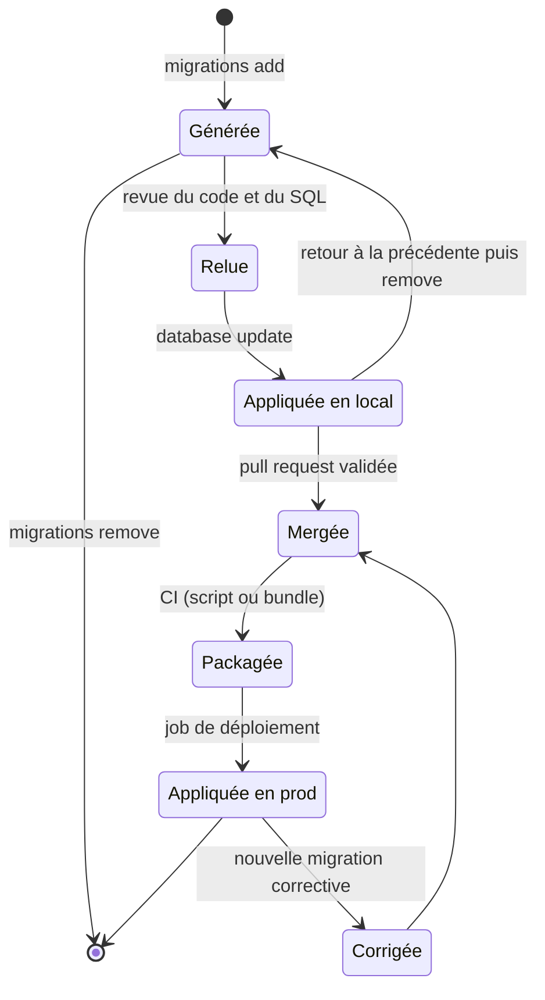
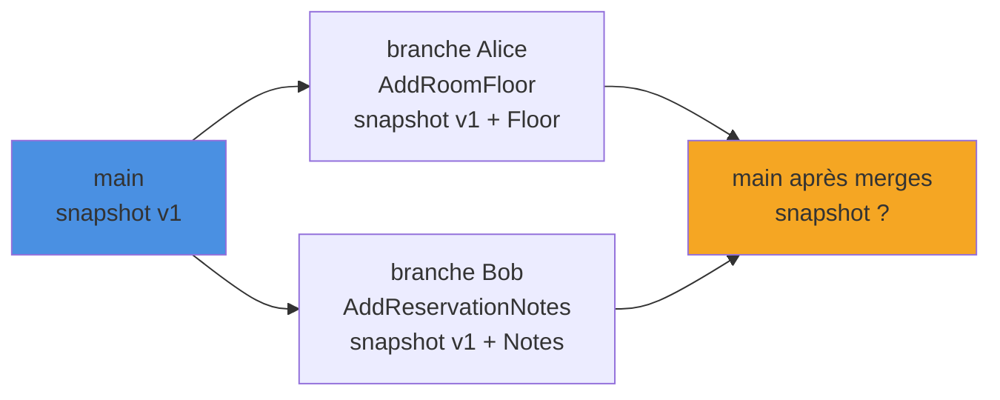

Créer une migration sur son poste est trivial : `dotnet ef migrations add`, puis `database update`. Les ennuis commencent quand plusieurs développeurs modifient le modèle en parallèle, et quand il faut appliquer ces migrations en production sans SDK, sans accès direct à la base et sans casser l'application en cours d'exécution. Cet article décrit un workflow d'équipe robuste avec EF Core 10 : snapshot, scripts idempotents, migration bundles, données de référence et pipeline GitHub Actions.

<!--more-->
 

# 1. Rappel : ce que contient une migration

Une migration EF Core, ce sont **trois fichiers** générés dans le projet qui contient le `DbContext` :

- `20260606081500_AddRoomFloor.cs` : les méthodes `Up()` et `Down()` (opérations de schéma) ;
- `20260606081500_AddRoomFloor.Designer.cs` : les métadonnées du modèle **à ce moment-là** ;
- `RoomBookingDbContextModelSnapshot.cs` : un instantané **unique** du modèle courant, réécrit à chaque migration.

C'est ce snapshot qui sert de référence : `migrations add` compare le modèle C# actuel au snapshot pour calculer le différentiel. Côté base, la table `__EFMigrationsHistory` liste les migrations déjà appliquées.

## 1.1. L'exemple de l'article

Tout l'article s'appuie sur une petite application de **réservation de salles de réunion**, découpée en deux projets : `src/RoomBooking.Infrastructure` contient le `DbContext` et les migrations, `src/RoomBooking.Api` est l'API qui le démarre (le *startup project* des commandes `dotnet ef`).

```csharp
// src/RoomBooking.Infrastructure/RoomBookingDbContext.cs
// dotnet add package Microsoft.EntityFrameworkCore.SqlServer
using Microsoft.EntityFrameworkCore;

public class Room
{
    public int Id { get; set; }
    public required string Name { get; set; }
    public int Capacity { get; set; }
}

public class Reservation
{
    public int Id { get; set; }
    public int RoomId { get; set; }
    public required string Title { get; set; }   // ajouté par la migration AddReservationTitle
    public DateTime StartsAtUtc { get; set; }
    public DateTime EndsAtUtc { get; set; }
}

// Table de référence : équipements disponibles dans les salles
public class Equipment
{
    public int Id { get; set; }
    public required string Code { get; set; }
    public required string Label { get; set; }
}

public class RoomBookingDbContext(DbContextOptions<RoomBookingDbContext> options) : DbContext(options)
{
    public DbSet<Room> Rooms => Set<Room>();
    public DbSet<Reservation> Reservations => Set<Reservation>();
    public DbSet<Equipment> Equipments => Set<Equipment>();
}
```

L'API enregistre ce contexte avec `AddDbContext` et `UseSqlServer`. L'historique de départ contient deux migrations : `InitialCreate` puis `AddReservationTitle`.

# 2. Le workflow au quotidien

## 2.1. Installer l'outil en local

On préfère un **manifeste d'outils local** à une installation globale : toute l'équipe et la CI utilisent la même version de `dotnet-ef`.

```bash
# À la racine du dépôt (une seule fois)
dotnet new tool-manifest
dotnet tool install dotnet-ef --version 10.0.*

# Sur un autre poste ou en CI
dotnet tool restore
```

## 2.2. Ajouter, vérifier, appliquer

```bash
# Options communes, pour ne pas les répéter
EF="--project src/RoomBooking.Infrastructure --startup-project src/RoomBooking.Api"

# 1. Générer la migration à partir du modèle modifié
dotnet ef migrations add AddRoomFloor $EF

# 2. Relire le code généré, et le SQL correspondant
dotnet ef migrations script --idempotent $EF

# 3. Appliquer sur la base locale
dotnet ef database update $EF
```

✅ **Toujours relire la migration** : un renommage de propriété peut être interprété comme `DropColumn` + `AddColumn`, avec perte de données. Dans ce cas, on corrige à la main avec `migrationBuilder.RenameColumn(...)`.

## 2.3. Revenir en arrière

```bash
# Supprime la DERNIÈRE migration et restaure le snapshot
# (refuse si elle est déjà appliquée à la base ciblée)
dotnet ef migrations remove $EF

# Ramener la base locale à une migration antérieure (exécute les Down())
dotnet ef database update AddReservationTitle $EF
```

Règle d'or : `migrations remove` uniquement pour une migration **qui n'a quitté ni le poste, ni la branche**. Une fois mergée ou appliquée sur une base partagée, on ne supprime plus : on écrit une **nouvelle migration corrective**.

## 2.4. Le cycle de vie d'une migration



# 3. Conflits de snapshot entre branches

## 3.1. Le problème

Alice et Bob partent de `main` le même jour. Alice ajoute une propriété `Room.Floor` (l'étage de la salle), Bob ajoute `Reservation.Notes`. Chacun génère sa migration : chaque snapshot ne connaît que **sa** modification.



Si Bob merge après Alice, deux cas :

- Git signale un conflit dans `RoomBookingDbContextModelSnapshot.cs` : c'est le cas favorable, on le voit ;
- Git fusionne **silencieusement** les deux modifications (lignes différentes du fichier) : le snapshot semble correct, mais le fichier `.Designer.cs` de la migration de Bob décrit un modèle sans `Floor`. Les migrations suivantes peuvent alors être fausses.

## 3.2. La résolution recommandée

La documentation EF Core préconise de **recréer** sa migration plutôt que de bricoler le snapshot :

```bash
# Côté Bob, AVANT de merger : annuler la migration locale
# (si elle a été appliquée en local, revenir d'abord à la migration précédente)
dotnet ef database update AddReservationTitle $EF
dotnet ef migrations remove $EF

# Récupérer le travail d'Alice
git fetch origin
git rebase origin/main

# Régénérer la migration sur un snapshot à jour
dotnet ef migrations add AddReservationNotes $EF
```

❌ Ne pas renommer les fichiers pour changer l'ordre des horodatages, ni lancer `migrations remove` après un merge déjà fait : la commande restaure le modèle décrit par le `.Designer.cs` précédent, qui peut ne pas contenir les changements de l'autre branche. Dans ce cas, on revient à un état cohérent avec Git, puis on applique la procédure ci-dessus.

> À noter : EF Core 11 (en préversion) enregistre l'identifiant de la dernière migration dans le snapshot. Deux migrations parallèles produisent donc **toujours** un conflit Git, ce qui rend la divergence impossible à rater.

## 3.3. Se protéger en CI

Deux garde-fous simples :

- `dotnet ef migrations has-pending-model-changes` (depuis EF Core 8) échoue si le modèle C# a changé sans migration correspondante : idéal pour détecter un snapshot incomplet ou une migration oubliée ;
- une **règle d'équipe** : une seule PR avec migration à la fois, rebasée sur `main` juste avant le merge.

# 4. Appliquer les migrations en production

## 4.1. Pourquoi ne pas appeler `Migrate()` au démarrage

Le code suivant est tentant :

```csharp
// ❌ Program.cs : migration automatique au démarrage
using (var scope = app.Services.CreateScope())
{
    var db = scope.ServiceProvider.GetRequiredService<RoomBookingDbContext>();
    await db.Database.MigrateAsync();
}
```

Il pose plusieurs problèmes en production :

- **Droits** : le compte de l'application doit pouvoir faire du DDL (`ALTER TABLE`, `DROP`…). On veut au contraire un compte applicatif limité à la lecture/écriture des données.
- **Plusieurs instances** : depuis EF Core 9, `Migrate()` pose un verrou global sur la base, ce qui évite la corruption. Mais toutes les instances attendent ce verrou au démarrage, et les health checks peuvent tuer les pods pendant une migration longue.
- **Aucune revue, échec bloquant** : le SQL est exécuté sans avoir été lu, et une migration qui échoue empêche l'application de démarrer.
- **Déploiements progressifs** : pendant un rolling update, l'ancienne version tourne déjà sur le nouveau schéma ; le moment de la migration doit être maîtrisé.

Autre point à connaître : depuis EF Core 9, `Migrate()` **lève une exception** si le modèle contient des changements non migrés (`RelationalEventId.PendingModelChangesWarning`). Mieux vaut le découvrir en CI qu'au démarrage en production.

✅ `MigrateAsync()` au démarrage reste acceptable pour le développement local, les tests et les petites applications mono-instance. Pour le reste, la migration devient une **étape de déploiement** à part entière.

## 4.2. Le script idempotent

```bash
dotnet ef migrations script --idempotent --output artifacts/migrate.sql $EF
```

Le script généré entoure chaque migration d'un test sur `__EFMigrationsHistory` :

```sql
IF NOT EXISTS (
    SELECT * FROM [__EFMigrationsHistory]
    WHERE [MigrationId] = N'20260606081500_AddRoomFloor'
)
BEGIN
    ALTER TABLE [Rooms] ADD [Floor] int NOT NULL DEFAULT 0;
END;
GO

IF NOT EXISTS (
    SELECT * FROM [__EFMigrationsHistory]
    WHERE [MigrationId] = N'20260606081500_AddRoomFloor'
)
BEGIN
    INSERT INTO [__EFMigrationsHistory] ([MigrationId], [ProductVersion])
    VALUES (N'20260606081500_AddRoomFloor', N'10.0.0');
END;
GO
```

On peut donc l'exécuter sur n'importe quelle base, quelle que soit la dernière migration appliquée. C'est la bonne option quand un **DBA doit relire et valider** le SQL, ou quand le déploiement passe par un outil SQL existant (`sqlcmd`, pipeline DACPAC…).

Pour un retour arrière, on génère un script « à l'envers » (`from` plus récent que `to`) :

```bash
dotnet ef migrations script AddRoomFloor AddReservationTitle --output artifacts/rollback.sql $EF
```

Limites : le support de l'idempotence dépend du provider (SQLite ne le supporte pas), et un script exécuté hors EF Core ne bénéficie ni du verrou de migration ni du seeding `UseSeeding` (voir section 5).

## 4.3. Les migration bundles

Un **bundle** est un exécutable autonome qui contient les migrations et applique celles qui manquent, exactement comme `database update`, mais **sans SDK, sans code source et sans outil `dotnet-ef`** sur la machine cible.

```bash
# Bundle autonome pour un runner ou un conteneur Linux
dotnet ef migrations bundle \
    --self-contained --target-runtime linux-x64 \
    --configuration Release \
    --output artifacts/efbundle --force $EF

# Exécution, avec un compte disposant des droits DDL
./artifacts/efbundle --connection "$DEPLOY_CONNECTION_STRING"

# Retour à une migration donnée (exécute les Down() plus récents)
./artifacts/efbundle AddReservationTitle --connection "$DEPLOY_CONNECTION_STRING"
```

Avantages par rapport au script : verrou de migration, gestion des transactions par EF Core, exécution du seeding. Inconvénient : on ne voit pas le SQL avant exécution. Une bonne pratique consiste à produire **les deux** artefacts en CI : le script pour la revue, le bundle pour l'exécution.

Le bundle construit le `DbContext` comme l'application : on fixe `ASPNETCORE_ENVIRONMENT`, et on n'embarque jamais de chaîne de connexion de production dans `appsettings.json`.

# 5. Données de référence : HasData ou UseSeeding ?

## 5.1. HasData : des données gérées par les migrations

```csharp
protected override void OnModelCreating(ModelBuilder modelBuilder)
{
    // Dans RoomBookingDbContext
    modelBuilder.Entity<Equipment>().HasData(
        new Equipment { Id = 1, Code = "PROJ", Label = "Vidéoprojecteur" },
        new Equipment { Id = 2, Code = "SCREEN", Label = "Écran interactif" },
        new Equipment { Id = 3, Code = "VISIO", Label = "Kit de visioconférence" });
}
```

Chaque modification de ces données produit, au prochain `migrations add`, des opérations `InsertData` / `UpdateData` / `DeleteData`. Les données font donc partie du snapshot et sont versionnées avec le schéma, ce qui les rend visibles dans le script idempotent.

Contraintes : **la clé primaire doit être fournie** (même si elle est générée par la base), changer la clé supprime la ligne existante, et les valeurs doivent être déterministes (pas de `DateTime.Now`, pas de `Guid.NewGuid()`). Microsoft appelle désormais cette fonctionnalité *model managed data* : elle convient aux petites tables statiques (équipements, statuts, unités).

## 5.2. UseSeeding / UseAsyncSeeding : du code exécuté après migration

Introduits avec EF Core 9, ces deux hooks sont appelés par `EnsureCreated`, `Migrate`, `dotnet ef database update` **et les bundles**, sous le verrou de migration :

```csharp
using Microsoft.EntityFrameworkCore;

// Program.cs de RoomBooking.Api
builder.Services.AddDbContext<RoomBookingDbContext>(options => options
    .UseSqlServer(builder.Configuration.GetConnectionString("RoomBooking"))
    // Appelé par Migrate(), database update et les bundles : à implémenter même si l'appli est 100 % async
    .UseSeeding((context, _) =>
    {
        if (!context.Set<Room>().Any(r => r.Name == "Accueil"))
        {
            context.Set<Room>().Add(new Room { Name = "Accueil", Capacity = 6 });
            context.SaveChanges();
        }
    })
    // Appelé par MigrateAsync() / EnsureCreatedAsync()
    .UseAsyncSeeding(async (context, _, ct) =>
    {
        if (!await context.Set<Room>().AnyAsync(r => r.Name == "Accueil", ct))
        {
            context.Set<Room>().Add(new Room { Name = "Accueil", Capacity = 6 });
            await context.SaveChangesAsync(ct);
        }
    }));
```

Le code doit être **idempotent** : il s'exécute à chaque migration, même quand aucune migration n'est appliquée. Il convient aux données qui dépendent de l'état de la base, aux clés générées, aux volumes importants ou aux données calculées. En revanche, il ne figure pas dans le script SQL : avec un déploiement par script, il faut un autre mécanisme.

| Critère | `HasData` | `UseSeeding` / `UseAsyncSeeding` |
|---|---|---|
| Versionné dans les migrations | ✅ Oui | ❌ Non (code C#) |
| Présent dans le script SQL | ✅ Oui | ❌ Non |
| Clé générée par la base | ❌ Non | ✅ Oui |
| Données dépendant de l'état | ❌ Non | ✅ Oui |
| Gros volumes | ❌ Alourdit le snapshot | ✅ Oui |
| Cas typique | Équipements, statuts, unités | Salle par défaut, compte admin, jeux de démo |

# 6. Un pipeline GitHub Actions

Un workflow GitHub Actions est un fichier YAML placé dans `.github/workflows/`, composé de jobs exécutés sur des runners. Celui-ci est dédié à la base de données : un premier job vérifie le modèle et produit les artefacts, un second les applique, protégé par un *environment* GitHub (approbation manuelle possible). Pour le build et les tests de l'application elle-même, voir [GitHub Actions pour un projet .NET](/2026/05/30/github-actions-dotnet.html).


```yaml
# .github/workflows/database.yml
name: Database

on:
  push:
    branches: [main]
  pull_request:

env:
  EF_ARGS: --project src/RoomBooking.Infrastructure --startup-project src/RoomBooking.Api --configuration Release

jobs:
  migrations:
    runs-on: ubuntu-latest
    steps:
      - uses: actions/checkout@v6

      - uses: actions/setup-dotnet@v5
        with:
          dotnet-version: 10.0.x

      - name: Restaurer dotnet-ef (manifeste local)
        run: dotnet tool restore

      # Échoue si une modification du modèle n'a pas de migration
      - name: Vérifier le modèle
        run: dotnet ef migrations has-pending-model-changes $EF_ARGS

      # Le script, pour la revue (DBA, PR)
      - name: Générer le script idempotent
        run: dotnet ef migrations script --idempotent --output artifacts/migrate.sql $EF_ARGS

      # Le bundle, pour l'exécution
      - name: Générer le bundle
        run: >
          dotnet ef migrations bundle --self-contained --target-runtime linux-x64
          --output artifacts/efbundle --force $EF_ARGS

      - uses: actions/upload-artifact@v7
        with:
          name: database
          path: artifacts/

  deploy-database:
    needs: migrations
    if: github.ref == 'refs/heads/main'
    runs-on: ubuntu-latest
    environment: production          # règles de protection et secrets dédiés
    steps:
      - uses: actions/download-artifact@v8
        with:
          name: database

      - name: Appliquer les migrations
        env:
          ASPNETCORE_ENVIRONMENT: Production
          # Compte de déploiement avec droits DDL, distinct du compte applicatif
          DB_CONNECTION: ${{ secrets.DB_DEPLOY_CONNECTION_STRING }}
        run: |
          chmod +x ./efbundle
          ./efbundle --connection "$DB_CONNECTION"
```


Quelques remarques :

- `chmod +x` est nécessaire car les artefacts GitHub ne conservent pas les permissions d'exécution.
- Le job de déploiement de l'application vient **après** `deploy-database` : on migre d'abord, puis on déploie le code, ce qui impose des migrations **rétrocompatibles** (ajouter une colonne nullable, puis la rendre obligatoire dans une version ultérieure).
- Le runner doit pouvoir joindre la base : runner auto-hébergé dans le réseau, règle de pare-feu temporaire, ou exécution du bundle sous forme de job dans le cluster.
- Pour vérifier que les migrations s'appliquent sur une base vierge, les tests d'intégration avec [Testcontainers](/2026/04/11/tests-integration-testcontainers.html) peuvent appeler `MigrateAsync()` plutôt que `EnsureCreated()`.

# 7. Bonnes pratiques

- ✅ Une migration = un changement fonctionnel, au nom explicite (`AddRoomFloor`, pas `Update12`).
- ✅ Migrations rétrocompatibles : *expand* (ajout) d'abord, *contract* (suppression) dans une version suivante.
- ❌ Modifier une migration déjà mergée ou appliquée.
- ❌ `EnsureCreated()` sur une base gérée par migrations : il crée le schéma sans historique, et `Migrate()` échoue ensuite.

# Résumé

| Besoin | Outil | Remarque |
|---|---|---|
| Créer / annuler une migration | `migrations add` / `remove` | `remove` seulement avant merge |
| Appliquer en local | `database update` | Accepte une migration cible pour revenir en arrière |
| Détecter une migration manquante | `migrations has-pending-model-changes` | EF Core 8+, à lancer en CI |
| Conflit de snapshot | Supprimer, rebaser, régénérer | Ne jamais réordonner les fichiers |
| Revue SQL par un DBA | `migrations script --idempotent` | Pas de verrou ni de seeding |
| Déploiement automatisé | `migrations bundle` | Sans SDK, verrou EF 9+, seeding exécuté |
| Migration au démarrage | `Database.MigrateAsync()` | Dev, tests, petites applis mono-instance |
| Données statiques versionnées | `HasData` | Clés fixes, petites tables |
| Données initiales dynamiques | `UseSeeding` / `UseAsyncSeeding` | EF Core 9+, code idempotent |
