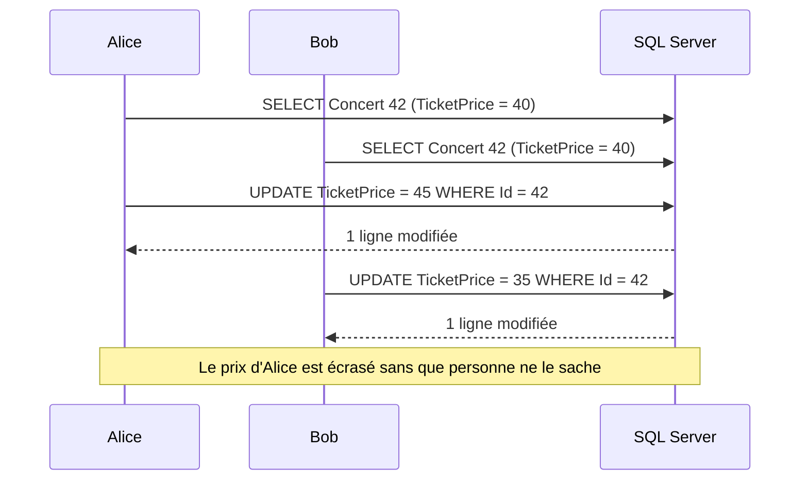
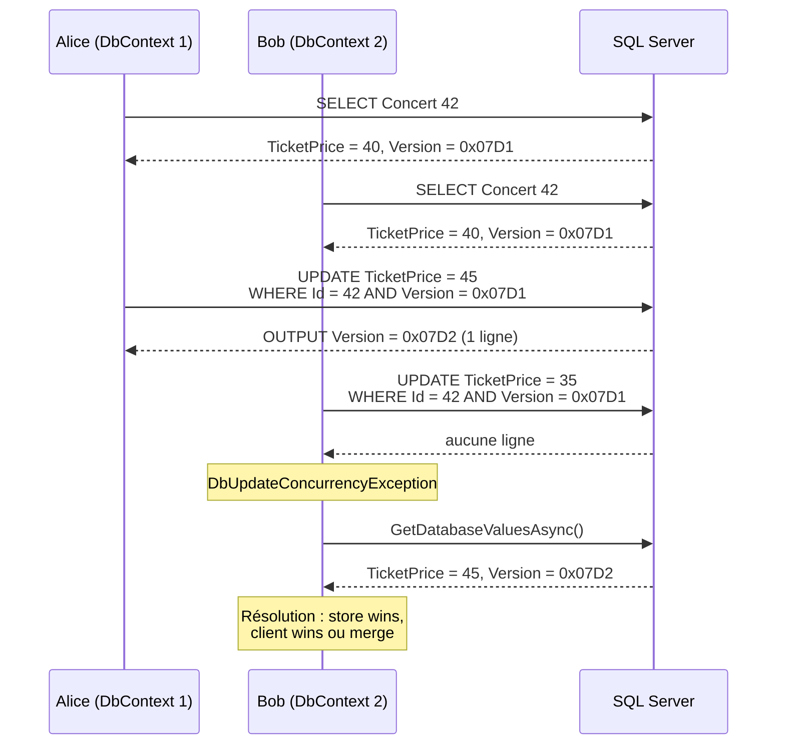

Deux employés d'une billetterie ouvrent la même fiche de concert, chacun modifie le prix du billet, chacun enregistre : sans précaution, le second écrase silencieusement le premier. C'est le problème du *lost update*. EF Core le résout par la **concurrence optimiste** : on ne verrouille rien à la lecture, mais on vérifie à l'écriture que la ligne n'a pas changé entre-temps. Cet article détaille les jetons de concurrence, la gestion de `DbUpdateConcurrencyException`, son exposition dans une API via les ETags, et la comparaison avec le verrouillage pessimiste.

<!--more-->
 

# 1. Le problème du lost update

Par défaut, EF Core génère un `UPDATE ... WHERE [Id] = @p` : seule la clé primaire est vérifiée. Le scénario suivant perd donc une modification :



Pour une entité chargée puis modifiée dans le même `DbContext`, le Change Tracker compare les valeurs lues aux valeurs courantes et n'envoie que les colonnes réellement modifiées, ce qui limite les dégâts. Mais deux modifications de la même colonne, ou une entité reconstruite depuis un DTO puis attachée (toutes colonnes en `Modified`), suffisent à perdre des données.

## 1.1. Le modèle de l'exemple

L'article s'appuie sur une petite billetterie : des concerts, avec un prix de billet et un nombre de places restantes, et leurs organisateurs.

```csharp
// dotnet add package Microsoft.EntityFrameworkCore.SqlServer
using Microsoft.EntityFrameworkCore;

public class ConcertDbContext(DbContextOptions<ConcertDbContext> options) : DbContext(options)
{
    public DbSet<Concert> Concerts => Set<Concert>();
    public DbSet<Organizer> Organizers => Set<Organizer>();
}

// Program.cs
builder.Services.AddDbContext<ConcertDbContext>(o =>
    o.UseSqlServer(builder.Configuration.GetConnectionString("Tickets")));
```

Les entités `Concert` et `Organizer` sont détaillées dans la section suivante, avec leur jeton de concurrence.

# 2. Les jetons de concurrence

Un **jeton de concurrence** (*concurrency token*) est une propriété dont la valeur **d'origine** est ajoutée au `WHERE` des `UPDATE` et `DELETE`. Si la ligne a changé, le `WHERE` ne trouve plus rien, aucune ligne n'est affectée, et EF Core lève une `DbUpdateConcurrencyException`.

## 2.1. rowversion avec `[Timestamp]` (SQL Server)

La solution la plus courante sur SQL Server : une colonne `rowversion`, que le moteur incrémente automatiquement à **chaque** modification de la ligne.

```csharp
using System.ComponentModel.DataAnnotations;

public class Concert
{
    public int Id { get; set; }
    public required string Title { get; set; }
    public decimal TicketPrice { get; set; }
    public int AvailableSeats { get; set; }

    [Timestamp] // rowversion : générée par SQL Server, jeton de concurrence
    public byte[] Version { get; set; } = [];
}
```

Équivalent en Fluent API :

```csharp
// Dans ConcertDbContext.OnModelCreating
modelBuilder.Entity<Concert>()
    .Property(c => c.Version)
    .IsRowVersion();
```

La migration crée une colonne `[Version] rowversion NOT NULL`. On n'écrit jamais cette propriété : c'est la base qui la gère.

Sur PostgreSQL, le provider Npgsql propose le même mécanisme avec la colonne système `xmin` : une propriété `uint Version` marquée `[Timestamp]` ou `IsRowVersion()` y est mappée automatiquement.

## 2.2. IsConcurrencyToken : un jeton géré par l'application

Quand la base ne fournit pas de rowversion, ou quand seule une colonne précise doit être protégée, on marque une propriété ordinaire comme jeton :

```csharp
public class Organizer
{
    public int Id { get; set; }
    public required string Email { get; set; }

    // Jeton géré par le code : il FAUT le changer à chaque modification
    public Guid ConcurrencyStamp { get; set; } = Guid.NewGuid();
}

modelBuilder.Entity<Organizer>()
    .Property(o => o.ConcurrencyStamp)
    .IsConcurrencyToken(); // ou [ConcurrencyCheck] sur la propriété
```

```csharp
organizer.Email = newEmail;
organizer.ConcurrencyStamp = Guid.NewGuid(); // ⚠️ à ne pas oublier
await db.SaveChangesAsync(ct);
```

C'est exactement ce que fait ASP.NET Core Identity avec `IdentityUser.ConcurrencyStamp`. L'oubli de la régénération rend la protection inopérante : un intercepteur de `SaveChanges` (une classe dérivée de `SaveChangesInterceptor`, appelée avant chaque enregistrement) peut s'en charger automatiquement pour toutes les entités modifiées.

On peut aussi marquer une colonne métier, par exemple `TicketPrice`, comme jeton : seules les modifications concurrentes **du prix** seront détectées.

## 2.3. Le SQL généré

Avec le `[Timestamp]` ci-dessus, une modification du prix produit (EF Core 10, SQL Server) :

```sql
SET NOCOUNT ON;
UPDATE [Concerts] SET [TicketPrice] = @p0
OUTPUT INSERTED.[Version]
WHERE [Id] = @p1 AND [Version] = @p2;
```

Deux détails :

- `[Version] = @p2` : c'est la valeur **d'origine** du jeton, celle lue au chargement de l'entité ;
- `OUTPUT INSERTED.[Version]` : EF Core récupère la nouvelle rowversion dans le même aller-retour et met à jour l'entité suivie. Un second `SaveChanges` sur la même instance fonctionnera donc sans conflit.

Si `OUTPUT` ne renvoie aucune ligne, EF Core en déduit que la ligne a été modifiée (ou supprimée) par quelqu'un d'autre. Le même scénario qu'en section 1 devient :



# 3. Gérer DbUpdateConcurrencyException

## 3.1. Ce que contient l'exception

`DbUpdateConcurrencyException.Entries` contient les `EntityEntry` en conflit. Pour chacune, trois jeux de valeurs sont disponibles :

| Valeurs | Obtenues par | Signification |
|---|---|---|
| Courantes | `entry.CurrentValues` | Ce que l'utilisateur veut enregistrer |
| Originales | `entry.OriginalValues` | Ce qui avait été lu au départ |
| En base | `await entry.GetDatabaseValuesAsync()` | Ce que contient la base **maintenant** (`null` si la ligne a été supprimée) |

Toute la résolution consiste à combiner ces trois jeux de valeurs.

## 3.2. Store wins : la base l'emporte

On abandonne les modifications locales et on recharge l'entité :

```csharp
try
{
    await db.SaveChangesAsync(ct);
}
catch (DbUpdateConcurrencyException ex)
{
    foreach (var entry in ex.Entries)
    {
        // Recharge les valeurs de la base, l'entité repasse en Unchanged
        await entry.ReloadAsync(ct);
    }
    // On informe l'utilisateur que ses changements n'ont pas été appliqués
}
```

## 3.3. Client wins : le client l'emporte

On garde les valeurs de l'utilisateur, mais on « rafraîchit » les valeurs d'origine pour que le prochain `WHERE` corresponde à l'état actuel de la base :

```csharp
catch (DbUpdateConcurrencyException ex)
{
    foreach (var entry in ex.Entries)
    {
        var databaseValues = await entry.GetDatabaseValuesAsync(ct);
        if (databaseValues is null)
        {
            throw new InvalidOperationException("L'élément a été supprimé entre-temps.");
        }

        // Les valeurs originales (dont Version) deviennent celles de la base
        entry.OriginalValues.SetValues(databaseValues);
    }

    await db.SaveChangesAsync(ct); // nouvelle tentative
}
```

C'est fonctionnellement un *last write wins*, mais **assumé** : on a détecté le conflit et choisi de l'ignorer.

## 3.4. Merge : fusionner propriété par propriété

La stratégie la plus fine : on n'applique une valeur locale que si l'utilisateur l'a réellement modifiée, sinon on prend celle de la base. Un vrai conflit (même propriété modifiée des deux côtés) est arbitré par une règle métier.

```csharp
using Microsoft.EntityFrameworkCore;

public static class ConcurrencyResolver
{
    public static async Task SaveWithMergeAsync(DbContext db, int maxRetries, CancellationToken ct)
    {
        for (var attempt = 1; ; attempt++)
        {
            try
            {
                await db.SaveChangesAsync(ct);
                return;
            }
            catch (DbUpdateConcurrencyException ex) when (attempt < maxRetries)
            {
                foreach (var entry in ex.Entries)
                {
                    var databaseValues = await entry.GetDatabaseValuesAsync(ct)
                        ?? throw new InvalidOperationException("L'élément a été supprimé entre-temps.");

                    foreach (var property in entry.Metadata.GetProperties())
                    {
                        if (property.IsConcurrencyToken || property.IsPrimaryKey())
                            continue;

                        var original = entry.OriginalValues[property];
                        var current = entry.CurrentValues[property];
                        var database = databaseValues[property];

                        var changedLocally = !Equals(original, current);
                        var changedRemotely = !Equals(original, database);

                        if (!changedLocally && changedRemotely)
                        {
                            // Seule la base a changé : on reprend sa valeur
                            entry.CurrentValues[property] = database;
                        }
                        else if (changedLocally && changedRemotely && !Equals(current, database))
                        {
                            // Vrai conflit : ici, règle métier ; à défaut, on remonte l'erreur
                            throw new ConcurrencyConflictException(entry.Metadata.Name, property.Name);
                        }
                    }

                    // Le prochain WHERE utilisera l'état actuel de la base
                    entry.OriginalValues.SetValues(databaseValues);
                }
            }
        }
    }
}

public sealed class ConcurrencyConflictException(string entity, string property)
    : Exception($"Conflit sur {entity}.{property} : la valeur a été modifiée par un autre utilisateur.");
```

Avec cette stratégie, Alice qui modifie le prix et Bob qui modifie le nombre de places enregistrent tous les deux sans erreur. En revanche, deux modifications **différentes** du prix sont remontées à l'utilisateur.

⚠️ `byte[]` se compare par référence avec `Equals` : c'est pour cela que les jetons (dont `Version`) sont exclus de la boucle. Pour une comparaison générique, `property.GetValueComparer().Equals(a, b)` utilise le comparateur d'EF Core.

# 4. Le cas d'une API : ETag et If-Match

Dans une API web, le cycle lecture → modification traverse le réseau, et le `DbContext` de la lecture n'existe plus au moment de l'écriture. Le jeton doit donc faire l'aller-retour avec le client. HTTP prévoit exactement cela : l'en-tête **`ETag`** en réponse, et l'en-tête **`If-Match`** sur la requête de modification.

## 4.1. Exposer la version

```csharp
app.MapGet("/concerts/{id:int}", async (int id, ConcertDbContext db, HttpContext http, CancellationToken ct) =>
{
    var concert = await db.Concerts.AsNoTracking()
        .FirstOrDefaultAsync(c => c.Id == id, ct);

    if (concert is null)
        return Results.NotFound();

    // ETag fort : la rowversion encodée en Base64, entre guillemets
    http.Response.Headers.ETag = $"\"{Convert.ToBase64String(concert.Version)}\"";
    return Results.Ok(new ConcertDto(concert.Id, concert.Title, concert.TicketPrice, concert.AvailableSeats));
});
```

## 4.2. Exiger la version à la modification

```csharp
app.MapPut("/concerts/{id:int}", async (
    int id, UpdateConcertDto dto, ConcertDbContext db, HttpContext http, CancellationToken ct) =>
{
    var ifMatch = http.Request.Headers.IfMatch.ToString();
    if (string.IsNullOrEmpty(ifMatch))
        return Results.StatusCode(StatusCodes.Status428PreconditionRequired);

    byte[] clientVersion;
    try
    {
        clientVersion = Convert.FromBase64String(ifMatch.Trim('"'));
    }
    catch (FormatException)
    {
        return Results.BadRequest("ETag invalide.");
    }

    var concert = await db.Concerts.FirstOrDefaultAsync(c => c.Id == id, ct);
    if (concert is null)
        return Results.NotFound();

    concert.Title = dto.Title;
    concert.TicketPrice = dto.TicketPrice;

    // Clé du mécanisme : la valeur ORIGINALE devient celle connue du client,
    // et non celle relue à l'instant
    db.Entry(concert).Property(c => c.Version).OriginalValue = clientVersion;

    try
    {
        await db.SaveChangesAsync(ct);
    }
    catch (DbUpdateConcurrencyException)
    {
        // Le client doit relire la ressource avant de réessayer
        return Results.Problem(
            statusCode: StatusCodes.Status412PreconditionFailed,
            title: "La ressource a été modifiée depuis votre dernière lecture.");
    }

    http.Response.Headers.ETag = $"\"{Convert.ToBase64String(concert.Version)}\"";
    return Results.NoContent();
});

public sealed record ConcertDto(int Id, string Title, decimal TicketPrice, int AvailableSeats);
public sealed record UpdateConcertDto(string Title, decimal TicketPrice);
```

❌ L'erreur classique consiste à relire l'entité puis à appeler `SaveChanges` sans toucher à `OriginalValue` : la version d'origine est alors celle **qu'on vient de lire**, et le conflit avec la lecture du client n'est jamais détecté.

✅ Variante sans relecture : `Attach` d'une entité reconstruite avec `Version = clientVersion`, puis marquage des propriétés modifiées (`db.Entry(concert).Property(c => c.TicketPrice).IsModified = true`). Une entité attachée prend ses valeurs courantes comme valeurs d'origine : la version qu'elle porte sert donc de jeton dans le `WHERE`. Pour aller plus loin sur ces états, voir la [partie sur le Change Tracker](/2025/08/09/EntityPart5.html).

| Situation | Code HTTP |
|---|---|
| `If-Match` absent alors qu'il est exigé | `428 Precondition Required` |
| ETag ne correspondant plus à la version en base | `412 Precondition Failed` |
| Mise à jour réussie | `204 No Content` (+ nouvel `ETag`) |

# 5. Et le verrouillage pessimiste ?

Le verrouillage **pessimiste** bloque la ligne dès la lecture : les autres transactions attendent. EF Core ne fournit pas d'API dédiée ; on passe par du SQL brut dans une transaction explicite.

```csharp
// Réserver `seats` places pour le concert `id`
await using var transaction = await db.Database.BeginTransactionAsync(ct);

// SQL Server : verrou de mise à jour sur la ligne jusqu'à la fin de la transaction
var concert = await db.Concerts
    .FromSql($"SELECT * FROM [Concerts] WITH (UPDLOCK, ROWLOCK) WHERE [Id] = {id}")
    .SingleAsync(ct);

if (concert.AvailableSeats < seats)
    throw new InvalidOperationException("Plus assez de places.");

concert.AvailableSeats -= seats;
await db.SaveChangesAsync(ct);

await transaction.CommitAsync(ct);
```

Sur PostgreSQL, l'équivalent est `SELECT ... FOR UPDATE`.

Pour un cas comme la réservation de places, une alternative souvent meilleure est l'**opération atomique** : `Where(c => c.Id == id && c.AvailableSeats >= seats)` suivi de `ExecuteUpdateAsync(s => s.SetProperty(c => c.AvailableSeats, c => c.AvailableSeats - seats))`, qui renvoie le nombre de lignes modifiées (0 = plus assez de places). Aucun verrou applicatif, aucun conflit : la base sérialise elle-même les mises à jour.

| Critère | Optimiste | Pessimiste |
|---|---|---|
| Verrou à la lecture | ❌ Aucun | ✅ Oui, jusqu'au commit |
| Coût sans conflit | Très faible | Verrous, attente, risque de deadlock |
| Conflit | Exception à gérer (retry, merge, 412) | Attente de l'autre transaction |
| Utilisable à travers HTTP | ✅ Oui (ETag) | ❌ Non (transaction trop longue) |
| Support EF Core | Natif (`[Timestamp]`, `IsConcurrencyToken`) | SQL brut (`UPDLOCK`, `FOR UPDATE`) |
| Cas typique | Formulaires, API REST, faible contention | Traitements courts à forte contention (réservation, compteur) |

# 6. Pièges courants

- ❌ **`ExecuteUpdate` / `ExecuteDelete` ignorent les jetons** : ils ne passent pas par le Change Tracker. Il faut ajouter soi-même la condition, par exemple `Where(c => c.Id == id && c.Version == clientVersion)`, puis tester le nombre de lignes affectées.
- ❌ **Supprimer une ligne déjà supprimée** déclenche aussi une `DbUpdateConcurrencyException` (aucune ligne affectée) : `GetDatabaseValuesAsync()` renvoie alors `null`.
- ❌ **Retry infini** : limiter le nombre de tentatives ; au-delà, remonter le conflit à l'utilisateur.
- ❌ **Oublier de régénérer un jeton applicatif** (`IsConcurrencyToken` sur un `Guid`) : la protection disparaît sans bruit.
- ✅ Tester le comportement avec deux `DbContext` distincts sur la même ligne, contre le vrai moteur : SQLite, par exemple, ne génère pas de `rowversion`.

# Résumé

| Élément | Rôle |
|---|---|
| `[Timestamp]` / `IsRowVersion()` | Jeton `rowversion` géré par SQL Server (`xmin` sur PostgreSQL) |
| `[ConcurrencyCheck]` / `IsConcurrencyToken()` | Jeton géré par l'application, à régénérer à chaque modification |
| `WHERE ... AND [Version] = @p` | Vérification à l'écriture, valeur **originale** du jeton |
| `DbUpdateConcurrencyException` | Levée quand aucune ligne n'est affectée |
| `entry.ReloadAsync()` | Store wins |
| `OriginalValues.SetValues(dbValues)` | Client wins (puis nouvelle tentative) |
| `CurrentValues` / `OriginalValues` / `GetDatabaseValuesAsync()` | Merge propriété par propriété |
| `ETag` + `If-Match` | Transport du jeton dans une API, `412` en cas de conflit |
| `UPDLOCK` / `FOR UPDATE` | Verrou pessimiste en SQL brut, transactions courtes |
