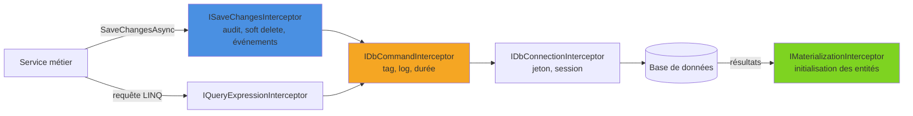

Sur une plateforme de blog, chaque article doit porter sa date de création et de dernière modification, et un article supprimé doit rester récupérable. Remplir `CreatedAt` et `UpdatedAt`, transformer un `DELETE` en suppression logique, journaliser les requêtes lentes, injecter un jeton d'accès sur la connexion : toutes ces préoccupations transverses n'ont rien à faire dans les services métier. EF Core propose pour cela des **intercepteurs**, des points d'extension appelés autour des commandes SQL, des connexions, de `SaveChanges` ou de la matérialisation des entités. Cet article passe en revue les principaux, leur enregistrement et les pièges à éviter.

<!--more-->
 

# 1. Vue d'ensemble

Un intercepteur est une classe qui implémente une interface dérivée de `IInterceptor`. Pour chaque interface, EF Core fournit une classe de base aux méthodes vides (`DbCommandInterceptor`, `SaveChangesInterceptor`…) : on ne redéfinit que ce dont on a besoin.



| Interface | Moment d'interception | Singleton |
|---|---|---|
| `IDbCommandInterceptor` | Création et exécution des commandes, erreurs | Non |
| `IDbConnectionInterceptor` | Ouverture / fermeture des connexions | Non |
| `IDbTransactionInterceptor` | Début, commit, rollback, savepoints | Non |
| `ISaveChangesInterceptor` | Avant / après `SaveChanges`, échec, conflit de concurrence | Non |
| `IMaterializationInterceptor` | Création et initialisation des entités lues | Oui |
| `IQueryExpressionInterceptor` | Arbre d'expression LINQ avant compilation | Oui |

La colonne « Singleton » est importante : les intercepteurs singleton sont enregistrés dans le fournisseur de services interne d'EF Core et partagés par tous les contextes.

Toutes les classes d'interception utilisées dans cet article se trouvent dans le namespace `Microsoft.EntityFrameworkCore.Diagnostics`.

## 1.1. Le modèle de l'exemple

Les exemples s'appuient sur un petit moteur de blog : des articles (`BlogPost`) et leurs commentaires (`Comment`, détaillé en section 5).

```csharp
// dotnet add package Microsoft.EntityFrameworkCore.SqlServer
using Microsoft.EntityFrameworkCore;

// AggregateRoot, IAuditable et ISoftDeletable sont définies en section 3
public class BlogPost : AggregateRoot, IAuditable, ISoftDeletable
{
    public int Id { get; set; }
    public required string Title { get; set; }
    public required string Slug { get; set; }      // unique : sert d'URL
    public string Body { get; set; } = "";

    public DateTime CreatedAt { get; set; }
    public DateTime? UpdatedAt { get; set; }
    public bool IsDeleted { get; set; }
    public DateTime? DeletedAt { get; set; }

    public List<Comment> Comments { get; set; } = [];

    public void Publish() => Raise(new PostPublished(Id, Slug)); // événement de domaine (3.3)
}

public class BlogDbContext(DbContextOptions<BlogDbContext> options) : DbContext(options)
{
    public DbSet<BlogPost> Posts => Set<BlogPost>();
    public DbSet<Comment> Comments => Set<Comment>();

    protected override void OnModelCreating(ModelBuilder modelBuilder)
    {
        modelBuilder.Entity<BlogPost>().HasIndex(p => p.Slug).IsUnique();
        modelBuilder.Entity<BlogPost>().Ignore(p => p.DomainEvents); // pas de colonne
    }
}
```

# 2. DbCommandInterceptor : agir sur le SQL

## 2.1. Modifier le SQL avant l'envoi

L'usage le plus courant consiste à modifier `command.CommandText` juste avant l'envoi, par exemple pour préfixer chaque requête d'un commentaire qui identifie l'application. On le retrouve ensuite dans les outils de supervision de la base.

```csharp
using System.Data.Common;
using Microsoft.EntityFrameworkCore.Diagnostics;

public sealed class AppTagInterceptor : DbCommandInterceptor
{
    public override InterceptionResult<DbDataReader> ReaderExecuting(
        DbCommand command, CommandEventData eventData, InterceptionResult<DbDataReader> result)
    {
        command.CommandText = "-- app: blog-api\n" + command.CommandText;
        return result;
    }

    public override ValueTask<InterceptionResult<DbDataReader>> ReaderExecutingAsync(
        DbCommand command, CommandEventData eventData, InterceptionResult<DbDataReader> result,
        CancellationToken cancellationToken = default)
    {
        command.CommandText = "-- app: blog-api\n" + command.CommandText;
        return ValueTask.FromResult(result);
    }
}
```

Pour couvrir aussi les `INSERT`/`UPDATE` et les requêtes scalaires, on redéfinit de la même façon `NonQueryExecuting` et `ScalarExecuting` (et leurs versions async).

## 2.2. Journaliser les requêtes lentes

Les méthodes `...Executed` reçoivent un `CommandExecutedEventData`, qui expose la **durée** d'exécution :

```csharp
using System.Data.Common;
using Microsoft.EntityFrameworkCore.Diagnostics;
using Microsoft.Extensions.Logging;

public sealed class SlowQueryInterceptor(ILogger<SlowQueryInterceptor> logger) : DbCommandInterceptor
{
    private static readonly TimeSpan Threshold = TimeSpan.FromMilliseconds(500);

    public override DbDataReader ReaderExecuted(
        DbCommand command, CommandExecutedEventData eventData, DbDataReader result)
    {
        LogIfSlow(command, eventData);
        return result;
    }

    public override ValueTask<DbDataReader> ReaderExecutedAsync(
        DbCommand command, CommandExecutedEventData eventData, DbDataReader result,
        CancellationToken cancellationToken = default)
    {
        LogIfSlow(command, eventData);
        return ValueTask.FromResult(result);
    }

    private void LogIfSlow(DbCommand command, CommandExecutedEventData eventData)
    {
        if (eventData.Duration > Threshold)
        {
            // Pas de valeurs de paramètres dans le log : uniquement le texte SQL
            logger.LogWarning("Requête lente ({Duration} ms) : {Sql}",
                eventData.Duration.TotalMilliseconds, command.CommandText);
        }
    }
}
```

Le texte SQL contient les tags posés avec `TagWith(...)`, ce qui permet de retrouver la requête LINQ d'origine.

## 2.3. Court-circuiter une commande

Les méthodes `...Executing` renvoient un `InterceptionResult<T>`. Retourner `InterceptionResult<DbDataReader>.SuppressWithResult(reader)` empêche l'exécution et fournit un résultat de remplacement : c'est la base d'un cache de second niveau. Puissant, mais à réserver à des besoins très ciblés.

# 3. SaveChangesInterceptor : la logique transverse d'écriture

`SavingChanges` / `SavingChangesAsync` sont appelés **au début** de `SaveChanges`, avant l'envoi des commandes : on peut encore modifier les entités suivies, et ces modifications partent dans la même transaction. L'appel à `ChangeTracker.Entries()` déclenche la détection des changements, les états (`Added`, `Modified`, `Deleted`) sont donc à jour.

## 3.1. Audit : CreatedAt / UpdatedAt

```csharp
public interface IAuditable
{
    DateTime CreatedAt { get; set; }
    DateTime? UpdatedAt { get; set; }
}
```

```csharp
using Microsoft.EntityFrameworkCore;
using Microsoft.EntityFrameworkCore.Diagnostics;

public sealed class AuditInterceptor(TimeProvider clock) : SaveChangesInterceptor
{
    public override InterceptionResult<int> SavingChanges(
        DbContextEventData eventData, InterceptionResult<int> result)
    {
        ApplyAudit(eventData.Context);
        return result;
    }

    public override ValueTask<InterceptionResult<int>> SavingChangesAsync(
        DbContextEventData eventData, InterceptionResult<int> result,
        CancellationToken cancellationToken = default)
    {
        ApplyAudit(eventData.Context);
        return ValueTask.FromResult(result);
    }

    private void ApplyAudit(DbContext? context)
    {
        if (context is null) return;

        var now = clock.GetUtcNow().UtcDateTime;

        foreach (var entry in context.ChangeTracker.Entries<IAuditable>())
        {
            switch (entry.State)
            {
                case EntityState.Added:
                    entry.Entity.CreatedAt = now;
                    break;

                case EntityState.Modified:
                    entry.Entity.UpdatedAt = now;
                    // Empêche d'écraser CreatedAt avec une valeur reçue d'un DTO
                    entry.Property(nameof(IAuditable.CreatedAt)).IsModified = false;
                    break;
            }
        }
    }
}
```

`TimeProvider` (singleton fourni par .NET) rend l'intercepteur testable : on injecte un `FakeTimeProvider` dans les tests.

## 3.2. Soft delete

On transforme un `Remove(...)` en mise à jour d'un indicateur :

```csharp
public interface ISoftDeletable
{
    bool IsDeleted { get; set; }
    DateTime? DeletedAt { get; set; }
}

public sealed class SoftDeleteInterceptor(TimeProvider clock) : SaveChangesInterceptor
{
    public override InterceptionResult<int> SavingChanges(
        DbContextEventData eventData, InterceptionResult<int> result)
    {
        ConvertDeletes(eventData.Context);
        return result;
    }

    public override ValueTask<InterceptionResult<int>> SavingChangesAsync(
        DbContextEventData eventData, InterceptionResult<int> result,
        CancellationToken cancellationToken = default)
    {
        ConvertDeletes(eventData.Context);
        return ValueTask.FromResult(result);
    }

    private void ConvertDeletes(DbContext? context)
    {
        if (context is null) return;

        foreach (var entry in context.ChangeTracker.Entries<ISoftDeletable>()
                     .Where(e => e.State == EntityState.Deleted))
        {
            entry.State = EntityState.Modified; // UPDATE au lieu de DELETE
            entry.Entity.IsDeleted = true;
            entry.Entity.DeletedAt = clock.GetUtcNow().UtcDateTime;
        }
    }
}
```

Côté lecture, un filtre global masque les lignes supprimées. EF Core 10 permet de **nommer** les filtres, pour n'en désactiver qu'un seul :

```csharp
// Dans BlogDbContext.OnModelCreating
modelBuilder.Entity<BlogPost>()
    .HasQueryFilter("SoftDelete", p => !p.IsDeleted);

// Corbeille de l'administration : on veut aussi voir les articles supprimés
var all = await db.Posts.IgnoreQueryFilters(["SoftDelete"]).ToListAsync(ct);
```

Limites à connaître :

- `ExecuteDeleteAsync()` envoie directement un `DELETE` sans charger les entités : il contourne le Change Tracker, donc l'intercepteur, et la suppression est physique.
- Les entités dépendantes marquées `Deleted` par une cascade côté client sont converties seulement si elles implémentent aussi `ISoftDeletable`.
- L'index unique sur `Slug` doit devenir un index filtré (`HasFilter("[IsDeleted] = 0")`), sinon on ne peut pas republier un article avec le slug d'un article « supprimé ».

## 3.3. Événements de domaine

Un événement de domaine est un objet qui décrit un fait métier survenu (`PostPublished`, `CommentAdded`…). Les entités principales, appelées agrégats, les accumulent en mémoire, et il faut les publier lors de l'enregistrement. Deux moments sont possibles :

- **avant** l'enregistrement (`SavingChangesAsync`) : on convertit les événements en messages d'outbox, insérés dans la même transaction. C'est le pattern Outbox, l'approche la plus fiable (détaillée dans l'article sur le [pattern Outbox](/2026/05/23/outbox-pattern.html)) ;
- **après** l'enregistrement (`SavedChangesAsync`) : on publie les événements en mémoire une fois la transaction validée.

```csharp
public interface IDomainEvent;

public sealed record PostPublished(int PostId, string Slug) : IDomainEvent;

public abstract class AggregateRoot
{
    private readonly List<IDomainEvent> _events = [];
    public IReadOnlyList<IDomainEvent> DomainEvents => _events;
    protected void Raise(IDomainEvent evt) => _events.Add(evt);
    public void ClearDomainEvents() => _events.Clear();
}

public interface IDomainEventDispatcher
{
    Task DispatchAsync(IDomainEvent domainEvent, CancellationToken ct);
}
```

`BlogPost` dérive de `AggregateRoot` : sa méthode `Publish()` appelle `Raise(new PostPublished(Id, Slug))`. L'intercepteur collecte puis publie ces événements une fois l'enregistrement validé :

```csharp
public sealed class DomainEventsInterceptor(IDomainEventDispatcher dispatcher) : SaveChangesInterceptor
{
    public override async ValueTask<int> SavedChangesAsync(
        SaveChangesCompletedEventData eventData, int result,
        CancellationToken cancellationToken = default)
    {
        if (eventData.Context is { } context)
        {
            var aggregates = context.ChangeTracker.Entries<AggregateRoot>()
                .Select(e => e.Entity)
                .Where(a => a.DomainEvents.Count > 0)
                .ToList();

            var events = aggregates.SelectMany(a => a.DomainEvents).ToList();
            aggregates.ForEach(a => a.ClearDomainEvents());

            foreach (var domainEvent in events)
            {
                await dispatcher.DispatchAsync(domainEvent, cancellationToken);
            }
        }

        return result;
    }
}
```

⚠️ Avec `SavedChangesAsync`, si la publication échoue, les données sont déjà enregistrées : l'événement est perdu. C'est acceptable pour des effets internes au processus (invalidation de cache, notification non critique), pas pour une intégration entre services, où l'outbox s'impose.

## 3.4. Les autres points d'interception

`ISaveChangesInterceptor` expose aussi `SaveChangesFailed`, `SaveChangesCanceled` et `ThrowingConcurrencyException`. Ce dernier est appelé avant la levée d'une `DbUpdateConcurrencyException` et permet de la supprimer après avoir résolu le conflit : cette exception signale qu'un `UPDATE` protégé par un jeton de concurrence n'a touché aucune ligne, parce qu'un autre utilisateur a modifié la ligne entre-temps. C'est une alternative centralisée à un `try/catch` autour de chaque `SaveChanges` (voir la [concurrence optimiste](/2026/06/07/EntityPart10.html)).

# 4. DbConnectionInterceptor : préparer la connexion

L'exemple classique : obtenir un jeton Microsoft Entra ID avant d'ouvrir la connexion à Azure SQL, de façon asynchrone.

```csharp
using System.Data.Common;
using Azure.Core;
using Azure.Identity;               // package Azure.Identity
using Microsoft.Data.SqlClient;
using Microsoft.EntityFrameworkCore.Diagnostics;

public sealed class EntraTokenInterceptor : DbConnectionInterceptor
{
    private static readonly TokenRequestContext Scope = new(["https://database.windows.net/.default"]);
    private readonly TokenCredential _credential = new DefaultAzureCredential();

    // Pas de version synchrone fiable : on interdit l'ouverture synchrone
    public override InterceptionResult ConnectionOpening(
        DbConnection connection, ConnectionEventData eventData, InterceptionResult result)
        => throw new InvalidOperationException("Ouvrir la connexion de manière asynchrone.");

    public override async ValueTask<InterceptionResult> ConnectionOpeningAsync(
        DbConnection connection, ConnectionEventData eventData, InterceptionResult result,
        CancellationToken cancellationToken = default)
    {
        var token = await _credential.GetTokenAsync(Scope, cancellationToken);
        ((SqlConnection)connection).AccessToken = token.Token;
        return result;
    }
}
```

> Depuis plusieurs versions, `Microsoft.Data.SqlClient` gère directement l'authentification Entra ID via la chaîne de connexion (`Authentication=Active Directory Default`). L'intercepteur reste utile pour une logique de jeton personnalisée.

Autre usage fréquent : après l'ouverture (`ConnectionOpenedAsync`), exécuter `sp_set_session_context` pour transmettre l'identifiant du tenant à une politique de *row-level security* SQL Server.

# 5. IMaterializationInterceptor : initialiser les entités lues

Appelé lors de la création des instances à partir des résultats d'une requête, il permet par exemple de renseigner une propriété non mappée :

```csharp
using System.ComponentModel.DataAnnotations.Schema;
using Microsoft.EntityFrameworkCore.Diagnostics;

public interface IHasRetrievedAt
{
    DateTime RetrievedAt { get; set; }
}

public class Comment : IHasRetrievedAt
{
    public int Id { get; set; }
    public int BlogPostId { get; set; }
    public required string Author { get; set; }
    public required string Text { get; set; }

    [NotMapped] // propriété purement applicative, aucune colonne
    public DateTime RetrievedAt { get; set; }
}

public sealed class RetrievedAtInterceptor : IMaterializationInterceptor
{
    public object InitializedInstance(MaterializationInterceptionData materializationData, object instance)
    {
        if (instance is IHasRetrievedAt entity)
        {
            entity.RetrievedAt = DateTime.UtcNow;
        }
        return instance;
    }
}
```

`materializationData.Context` donne accès au contexte, donc à ses services : on peut ainsi injecter un `ILogger` ou un service dans une entité riche. C'est un intercepteur **singleton** : une seule instance, sans état propre à une requête.

# 6. Enregistrer les intercepteurs

## 6.1. Directement

```csharp
protected override void OnConfiguring(DbContextOptionsBuilder optionsBuilder)
    => optionsBuilder.AddInterceptors(new RetrievedAtInterceptor());
```

## 6.2. Via l'injection de dépendances

```csharp
builder.Services.AddSingleton(TimeProvider.System);
builder.Services.AddSingleton<SoftDeleteInterceptor>();
builder.Services.AddSingleton<AuditInterceptor>();
builder.Services.AddSingleton<SlowQueryInterceptor>();
builder.Services.AddSingleton<RetrievedAtInterceptor>();

builder.Services.AddDbContext<BlogDbContext>((sp, options) => options
    .UseSqlServer(builder.Configuration.GetConnectionString("Blog"))
    .AddInterceptors(
        sp.GetRequiredService<SoftDeleteInterceptor>(),
        sp.GetRequiredService<AuditInterceptor>(),
        sp.GetRequiredService<SlowQueryInterceptor>(),
        sp.GetRequiredService<RetrievedAtInterceptor>()));
```

Les intercepteurs d'un même type sont appelés **dans l'ordre d'enregistrement** : ici, la conversion des suppressions passe avant l'audit, si bien qu'une ligne supprimée logiquement (devenue `Modified`) reçoit aussi son `UpdatedAt`.

## 6.3. Durée de vie : attention au pooling

Avec `AddDbContext`, la lambda de configuration est exécutée pour chaque contexte, avec le fournisseur de services du scope : un intercepteur `Scoped` est donc possible. Avec `AddDbContextPool`, qui recycle les instances de `DbContext` pour économiser leur création, les options sont construites **une seule fois** : l'intercepteur est capturé pour toute la vie de l'application. Il doit alors être sans état et enregistré comme singleton. Pour accéder à des données de la requête courante (l'auteur connecté, un identifiant de corrélation), on passe par un service lui-même singleton comme `IHttpContextAccessor`. À l'inverse, un intercepteur qui dépend d'un service `Scoped` (comme le `DomainEventsInterceptor` et son dispatcher) impose `AddDbContext` et un enregistrement `Scoped`.

# 7. Pièges

- ❌ **N'implémenter que la version async** : un appel à `SaveChanges()` (synchrone) ne passe que par `SavingChanges`. On implémente les deux, ou on fait lever une exception dans la version synchrone pour imposer l'asynchrone.
- ❌ **Bloquer sur de l'async** (`.Result`, `.Wait()`) dans une méthode synchrone : risque d'interblocage.
- ❌ **Travail coûteux dans un intercepteur de commande** : il est exécuté pour **chaque** requête SQL. Pas d'appel réseau, pas de sérialisation lourde, pas de log au niveau `Information` en production.
- ❌ **Logique métier cachée** : un intercepteur est invisible depuis le code appelant. On le réserve aux préoccupations techniques et transverses.
- ❌ **Oublier les opérations hors Change Tracker** : `ExecuteUpdate`, `ExecuteDelete` et le SQL brut ne déclenchent pas `SaveChangesInterceptor` (mais bien `DbCommandInterceptor`).
- ✅ Tester les intercepteurs avec le vrai provider : ils sont branchés sur le pipeline relationnel.

# Résumé

| Intercepteur | Méthodes clés | Usages typiques |
|---|---|---|
| `DbCommandInterceptor` | `ReaderExecuting`, `ReaderExecuted(Async)` | Tag, corrélation, requêtes lentes, hints |
| `SaveChangesInterceptor` | `SavingChanges(Async)` | Audit, soft delete, outbox |
| `SaveChangesInterceptor` | `SavedChanges(Async)` | Événements de domaine en mémoire |
| `SaveChangesInterceptor` | `ThrowingConcurrencyException(Async)` | Résolution centralisée des conflits |
| `DbConnectionInterceptor` | `ConnectionOpeningAsync`, `ConnectionOpenedAsync` | Jeton d'accès, contexte de session |
| `IMaterializationInterceptor` | `InitializedInstance` | Propriétés non mappées, injection de services |
| Enregistrement | `AddInterceptors(...)` | Singleton recommandé, obligatoire avec le pooling |
