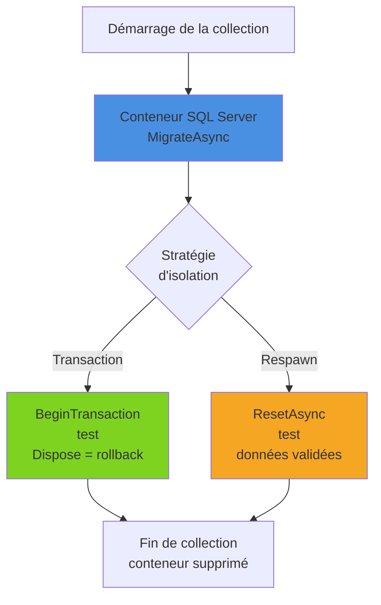

Un service qui passe par EF Core cache beaucoup de choses : traduction LINQ en SQL, contraintes, transactions, jetons de concurrence, intercepteurs. Le tester contre un faux moteur donne une confiance trompeuse : le test passe, la production échoue. Cet article compare les approches possibles (provider InMemory, SQLite en mémoire, vraie base avec Testcontainers), montre comment isoler les tests par transaction ou avec Respawn, et comment vérifier le SQL d'une requête sans même ouvrir de connexion.

<!--more-->
 

# 1. Ce qu'on veut vraiment tester

Dans du code EF Core, les bugs se cachent rarement dans le C# lui-même. Ils viennent plutôt :

- d'une requête LINQ **non traduisible**, ou traduite autrement qu'on le pensait ;
- d'une **contrainte** de base (unicité, clé étrangère, longueur) violée ;
- d'une différence de **sémantique** : comparaison de chaînes sensible ou non à la casse, `null`, arrondis sur `decimal` ;
- de la logique branchée sur `SaveChanges` : intercepteurs (classes appelées par EF Core avant chaque enregistrement, par exemple pour transformer une suppression en suppression logique), jetons de concurrence ;
- des **migrations** elles-mêmes.

Aucun de ces points n'est vérifié si la base est simulée. D'où la règle : la logique métier se teste unitairement, **sans** EF Core ; le code d'accès aux données se teste **contre le moteur de production**.

## 1.1. Le modèle de l'exemple

Les tests de cet article portent sur le catalogue d'une bibliothèque : des livres classés par genre, avec suppression logique, et des adhérents identifiés par leur e-mail.

```csharp
// dotnet add package Microsoft.EntityFrameworkCore.SqlServer
using Microsoft.EntityFrameworkCore;
using Microsoft.EntityFrameworkCore.Diagnostics;

public class Book
{
    public int Id { get; set; }
    public required string Title { get; set; }
    public required string Isbn { get; set; }
    public string Summary { get; set; } = "";     // résumé, texte long
    public int GenreId { get; set; }
    public bool IsAvailable { get; set; } = true;  // false = emprunté
    public bool IsDeleted { get; set; }            // suppression logique
}

public class Genre
{
    public int Id { get; set; }
    public required string Name { get; set; }
}

public class Member
{
    public int Id { get; set; }
    public required string Email { get; set; }
}

public class LibraryDbContext(DbContextOptions<LibraryDbContext> options) : DbContext(options)
{
    public DbSet<Book> Books => Set<Book>();
    public DbSet<Genre> Genres => Set<Genre>();
    public DbSet<Member> Members => Set<Member>();

    protected override void OnModelCreating(ModelBuilder modelBuilder)
    {
        modelBuilder.Entity<Book>().HasQueryFilter(b => !b.IsDeleted); // livres supprimés masqués
        modelBuilder.Entity<Book>().HasIndex(b => b.Isbn).IsUnique();
        modelBuilder.Entity<Book>().HasOne<Genre>().WithMany().HasForeignKey(b => b.GenreId);
        modelBuilder.Entity<Member>().HasIndex(m => m.Email).IsUnique();

        // Données de référence, insérées par les migrations
        modelBuilder.Entity<Genre>().HasData(
            new Genre { Id = 1, Name = "Roman" },
            new Genre { Id = 2, Name = "Science-fiction" },
            new Genre { Id = 3, Name = "Histoire" });
    }
}

// Transforme un Remove(book) en UPDATE IsDeleted = 1
// (version synchrone SavingChanges omise pour la concision)
public sealed class SoftDeleteInterceptor : SaveChangesInterceptor
{
    public override ValueTask<InterceptionResult<int>> SavingChangesAsync(
        DbContextEventData eventData, InterceptionResult<int> result,
        CancellationToken cancellationToken = default)
    {
        foreach (var entry in eventData.Context!.ChangeTracker.Entries<Book>()
                     .Where(e => e.State == EntityState.Deleted))
        {
            entry.State = EntityState.Modified;
            entry.Entity.IsDeleted = true;
        }
        return ValueTask.FromResult(result);
    }
}
```

Les tests utilisent xUnit v3 (`TestContext.Current.CancellationToken`, `IAsyncLifetime` avec `ValueTask`).

# 2. Pourquoi éviter le provider InMemory

Le package `Microsoft.EntityFrameworkCore.InMemory` est tentant : une ligne de configuration, aucun prérequis, des tests très rapides. Mais ce n'est pas une base relationnelle, et la documentation EF Core elle-même déconseille de l'utiliser pour tester.

```csharp
// ❌ Ce test est vert avec InMemory... et la requête échoue en production
[Fact]
public async Task SearchByEmail_IgnoresCase()
{
    var ct = TestContext.Current.CancellationToken;
    var options = new DbContextOptionsBuilder<LibraryDbContext>()
        .UseInMemoryDatabase(Guid.NewGuid().ToString())
        .Options;

    await using var db = new LibraryDbContext(options);
    db.Members.Add(new Member { Email = "alice@biblio.fr" });
    db.Members.Add(new Member { Email = "alice@biblio.fr" }); // doublon : l'index unique n'est pas vérifié
    await db.SaveChangesAsync(ct);

    // Méthode C# arbitraire : exécutée en mémoire par InMemory,
    // mais impossible à traduire en SQL (InvalidOperationException sur SQL Server)
    var found = await db.Members
        .Where(m => SameEmail(m.Email, "ALICE@biblio.fr"))
        .ToListAsync(ct);

    Assert.Equal(2, found.Count);
}

private static bool SameEmail(string a, string b)
    => string.Equals(a, b, StringComparison.OrdinalIgnoreCase);
```

Ce que le provider InMemory ne fait pas :

| Comportement | InMemory | Base relationnelle |
|---|---|---|
| Index uniques, clés étrangères | ❌ Ignorés | ✅ Vérifiés |
| Transactions | ❌ Ignorées (avertissement levé en exception par défaut) | ✅ Réelles |
| Comparaison de chaînes | Sémantique C# | Collation de la base |
| `FromSql`, SQL brut | ❌ Non supporté | ✅ |
| `ExecuteUpdate` / `ExecuteDelete` | ❌ Non supporté | ✅ |
| `rowversion`, valeurs par défaut SQL, colonnes calculées | ❌ | ✅ |
| Requête non traduisible en SQL | Exécutée en mémoire sans erreur | ❌ Exception |

Le dernier point est le plus sournois : InMemory exécute n'importe quelle expression LINQ, y compris celles qu'EF Core refusera de traduire face à SQL Server.

# 3. SQLite en mémoire : un compromis

SQLite est une vraie base relationnelle, embarquée dans le processus. En mode mémoire, la base vit tant que **la connexion reste ouverte** : il faut donc créer la connexion soi-même et la garder pendant tout le test.

```csharp
// dotnet add package Microsoft.EntityFrameworkCore.Sqlite
using Microsoft.Data.Sqlite;
using Microsoft.EntityFrameworkCore;

public sealed class SqliteMemberTests : IAsyncLifetime
{
    private readonly SqliteConnection _connection = new("DataSource=:memory:");
    private LibraryDbContext _db = default!;

    public async ValueTask InitializeAsync()
    {
        await _connection.OpenAsync(); // la base existe tant que la connexion est ouverte

        var options = new DbContextOptionsBuilder<LibraryDbContext>()
            .UseSqlite(_connection)
            .Options;

        _db = new LibraryDbContext(options);
        await _db.Database.EnsureCreatedAsync(); // schéma créé depuis le modèle, sans migrations
    }

    public async ValueTask DisposeAsync()
    {
        await _db.DisposeAsync();
        await _connection.DisposeAsync();
    }

    [Fact]
    public async Task Email_MustBeUnique()
    {
        var ct = TestContext.Current.CancellationToken;
        _db.Members.Add(new Member { Email = "alice@biblio.fr" });
        _db.Members.Add(new Member { Email = "alice@biblio.fr" });

        // ✅ L'index unique est bien vérifié
        await Assert.ThrowsAsync<DbUpdateException>(() => _db.SaveChangesAsync(ct));
    }
}
```

C'est nettement mieux qu'InMemory (contraintes, transactions, vraie traduction SQL), mais le dialecte reste différent de celui de la production :

- pas de `rowversion` : un `[Timestamp]` n'est pas généré automatiquement, la concurrence optimiste (détection des modifications concurrentes via une colonne de version) ne se teste donc pas ;
- pas de schémas, types plus pauvres (`decimal` stocké en texte, `DateTimeOffset` limité) ;
- comparaisons de chaînes sensibles à la casse par défaut ;
- SQL brut écrit pour SQL Server (`WITH (UPDLOCK)`, fonctions `EF.Functions` spécifiques) non exécutable ;
- schéma créé par `EnsureCreated` : les migrations SQL Server ne sont pas testées.

SQLite convient donc à une application qui tourne **réellement** sur SQLite, ou à des tests rapides sur des requêtes simples, en complément d'une suite sur le vrai moteur.

# 4. Une vraie base avec Testcontainers

Testcontainers démarre depuis le code de test un conteneur Docker jetable, ici une vraie instance SQL Server, et le supprime à la fin. Docker doit donc être disponible sur le poste et sur le runner de CI. Pour tester une API complète de la même façon, voir les [tests d'intégration avec Testcontainers](/2026/04/11/tests-integration-testcontainers.html).

```bash
dotnet add package Testcontainers.MsSql
dotnet add package Respawn
dotnet add package Microsoft.EntityFrameworkCore.SqlServer
```

```csharp
using Microsoft.Data.SqlClient;
using Microsoft.EntityFrameworkCore;
using Testcontainers.MsSql;

public sealed class SqlServerFixture : IAsyncLifetime
{
    // Image figée : même version majeure qu'en production
    private readonly MsSqlContainer _container =
        new MsSqlBuilder("mcr.microsoft.com/mssql/server:2022-CU14-ubuntu-22.04").Build();

    public string ConnectionString { get; private set; } = "";

    public async ValueTask InitializeAsync()
    {
        await _container.StartAsync();

        // Base dédiée plutôt que master
        ConnectionString = new SqlConnectionStringBuilder(_container.GetConnectionString())
        {
            InitialCatalog = "LibraryTests"
        }.ConnectionString;

        await using var db = CreateContext();
        await db.Database.MigrateAsync(); // ✅ les migrations sont testées au passage
    }

    // Mêmes intercepteurs qu'en production : ils font partie de ce qu'on teste
    public LibraryDbContext CreateContext() => new(
        new DbContextOptionsBuilder<LibraryDbContext>()
            .UseSqlServer(ConnectionString)
            .AddInterceptors(new SoftDeleteInterceptor())
            .Options);

    public ValueTask DisposeAsync() => _container.DisposeAsync();
}

[CollectionDefinition(Name)]
public sealed class SqlServerCollection : ICollectionFixture<SqlServerFixture>
{
    public const string Name = "SQL Server";
}
```

Une fixture de collection xUnit est créée une seule fois et partagée par toutes les classes marquées du même `[Collection]` : le conteneur démarre donc **une fois par collection** (quelques secondes), puis tous les tests de la collection le partagent. Reste à isoler les tests entre eux : deux stratégies.

# 5. Isoler les tests

## 5.1. Une transaction annulée par test

Chaque test ouvre une transaction qu'il ne valide jamais : à la libération du contexte, tout est annulé.

```csharp
[Collection(SqlServerCollection.Name)]
public sealed class BookPersistenceTests(SqlServerFixture fixture) : IAsyncLifetime
{
    private readonly LibraryDbContext _db = fixture.CreateContext();

    public async ValueTask InitializeAsync()
        => await _db.Database.BeginTransactionAsync(TestContext.Current.CancellationToken);

    // Pas de Commit : la transaction est annulée à la libération
    public ValueTask DisposeAsync() => _db.DisposeAsync();

    [Fact]
    public async Task SoftDelete_HidesBookFromQueries()
    {
        var ct = TestContext.Current.CancellationToken;

        // Arrange
        var book = new Book { Title = "Dune", Isbn = "978-2266320481", GenreId = 2 };
        _db.Books.Add(book);
        await _db.SaveChangesAsync(ct);

        // Act
        _db.Books.Remove(book);
        await _db.SaveChangesAsync(ct);
        _db.ChangeTracker.Clear(); // ⚠️ sinon la lecture peut servir l'instance déjà suivie

        // Assert : invisible par défaut, mais toujours présent en base
        Assert.False(await _db.Books.AnyAsync(b => b.Id == book.Id, ct));
        Assert.True(await _db.Books.IgnoreQueryFilters()
            .AnyAsync(b => b.Id == book.Id && b.IsDeleted, ct));
    }
}
```

Avantages : très rapide, aucune donnée résiduelle, aucun nettoyage à écrire. Limites :

- si le code testé appelle lui-même `BeginTransactionAsync`, EF Core lève une exception (transaction déjà en cours) ;
- si le code testé utilise **un autre** `DbContext`, il faut lui faire partager la même connexion et la même transaction (`UseSqlServer(connection)` puis `Database.UseTransaction(...)`) ;
- `ChangeTracker.Clear()` est indispensable entre l'*arrange* et l'*assert*, sinon on vérifie le cache du contexte et non la base.

## 5.2. Respawn : vider la base entre deux tests

Quand le code testé gère ses propres transactions, ou pour des tests de bout en bout, on laisse les données être validées et on **nettoie avant chaque test** avec Respawn, qui calcule une fois l'ordre des `DELETE` d'après les clés étrangères :

```csharp
using Respawn;
using Respawn.Graph;

// Dans SqlServerFixture, après MigrateAsync()
private Respawner _respawner = default!;

private async Task CreateRespawnerAsync()
{
    _respawner = await Respawner.CreateAsync(ConnectionString, new RespawnerOptions
    {
        DbAdapter = DbAdapter.SqlServer,
        TablesToIgnore =
        [
            new Table("__EFMigrationsHistory"), // historique des migrations
            new Table("Genres")                 // données de référence (HasData)
        ]
    });
}

public Task ResetAsync() => _respawner.ResetAsync(ConnectionString);
```

Chaque classe de test appelle `fixture.ResetAsync()` dans son `InitializeAsync`. On conserve la table `Genres`, remplie par `HasData` lors des migrations, sinon les tests suivants ne trouveraient plus les genres référencés par leurs livres.



# 6. Tester les requêtes

## 6.1. Contre la base

Une requête réutilisable s'écrit volontiers comme une méthode d'extension sur `IQueryable<T>` :

```csharp
public static class BookQueries
{
    public static IQueryable<BookDto> AvailableInGenre(this IQueryable<Book> books, int genreId)
        => books
            .Where(b => b.IsAvailable && b.GenreId == genreId)
            .OrderBy(b => b.Title)
            .Select(b => new BookDto(b.Id, b.Title, b.Isbn));
}

public sealed record BookDto(int Id, string Title, string Isbn);
```

Elle se teste avec les fixtures précédentes : on insère quelques lignes, on vide le Change Tracker, on exécute la requête et on vérifie le résultat. C'est le seul moyen de s'assurer qu'elle est **traduisible** et qu'elle renvoie les bonnes lignes avec la collation réelle.

## 6.2. Vérifier le SQL avec ToQueryString

`ToQueryString()` renvoie le SQL que générerait la requête, **sans ouvrir de connexion**. On peut donc vérifier la forme d'une requête dans un test unitaire ultra-rapide :

```csharp
[Fact]
public void AvailableInGenre_FiltersAndProjectsOnServer()
{
    // Aucune connexion n'est ouverte : la chaîne n'a pas besoin d'être valide
    using var db = new LibraryDbContext(new DbContextOptionsBuilder<LibraryDbContext>()
        .UseSqlServer("Server=unused;Database=unused")
        .Options);

    var sql = db.Books.AvailableInGenre(3).ToQueryString();

    Assert.Contains("[b].[GenreId] = @genreId", sql);   // filtre côté serveur, paramétré
    Assert.Contains("ORDER BY [b].[Title]", sql);
    Assert.DoesNotContain("[b].[Summary]", sql);        // projection : pas de colonne volumineuse
}
```

Le SQL obtenu ressemble à ceci (EF Core 10 simplifie les noms de paramètres) :

```sql
DECLARE @genreId int = 3;

SELECT [b].[Id], [b].[Title], [b].[Isbn]
FROM [Books] AS [b]
WHERE [b].[IsDeleted] = CAST(0 AS bit) AND [b].[IsAvailable] = CAST(1 AS bit) AND [b].[GenreId] = @genreId
ORDER BY [b].[Title]
```

On y retrouve le filtre global de soft delete déclaré dans `OnModelCreating` : `ToQueryString()` montre la requête **réellement** envoyée, filtres compris.

C'est utile pour verrouiller des propriétés importantes : présence d'un `TagWith`, absence de colonnes volumineuses, `AsSplitQuery` effectif, filtre global appliqué. En revanche, comparer le SQL **complet** caractère par caractère rend les tests fragiles à chaque mise à jour d'EF Core : on teste des fragments significatifs, pas le texte entier.

# 7. Repository ou pas ?

Une question revient souvent : faut-il encapsuler EF Core derrière des repositories pour pouvoir le simuler ?

- `DbContext` est **déjà** une unité de travail, et `DbSet<T>` déjà un repository. Simuler `DbSet<T>` avec un framework de mock est laborieux (`IQueryable`, `IAsyncEnumerable`) et ne teste rien d'utile : le mock exécute le LINQ en mémoire, exactement comme InMemory.
- ✅ Un repository **orienté domaine** (`ILoanRepository.GetActiveLoanAsync`, `AddAsync`), aux méthodes peu nombreuses et expressives, a du sens : il sert de frontière pour tester les services métier avec un mock, comme dans l'article sur [NSubstitute](/2026/04/05/tests-nsubstitute.html). Son implémentation EF Core se teste alors contre la vraie base.
- ❌ Un repository générique (`IRepository<T>` avec `GetAll()`, `Find(Expression<...>)`) qui expose `IQueryable` n'apporte que de l'indirection : les requêtes restent écrites dans les services et ne sont toujours pas testées.

En résumé : on simule **au-dessus** d'EF Core (le repository métier), jamais **EF Core lui-même**.

# 8. Tableau comparatif

| Approche | Fidélité | Vitesse | Contraintes / transactions | Migrations testées | Usage recommandé |
|---|---|---|---|---|---|
| Provider InMemory | ❌ Faible | ✅ Très rapide | ❌ Non | ❌ Non | À éviter |
| Mock de `DbSet<T>` | ❌ Nulle | ✅ Très rapide | ❌ Non | ❌ Non | À éviter |
| SQLite en mémoire | ⚠️ Moyenne | ✅ Rapide | ✅ Oui (dialecte SQLite) | ❌ Non | Appli SQLite, requêtes simples |
| `ToQueryString()` | ⚠️ Forme du SQL uniquement | ✅ Très rapide | — | — | Verrouiller la traduction d'une requête |
| Testcontainers + transaction | ✅ Identique à la prod | ⚠️ Démarrage ~quelques s | ✅ Oui | ✅ Oui | Repositories, requêtes, intercepteurs |
| Testcontainers + Respawn | ✅ Identique à la prod | ⚠️ Un peu plus lent | ✅ Oui | ✅ Oui | Code gérant ses transactions, tests d'API |

Les durées sont des ordres de grandeur : le démarrage d'un conteneur SQL Server prend typiquement quelques secondes, puis chaque test s'exécute en quelques millisecondes à quelques dizaines de millisecondes.

# Résumé

| Pratique | Pourquoi |
|---|---|
| Pas de provider InMemory | Pas de contraintes, pas de transactions, LINQ exécuté en mémoire |
| SQLite en mémoire avec connexion ouverte | Compromis rapide, mais dialecte et types différents |
| Testcontainers + `MigrateAsync()` | Même moteur que la prod, migrations testées |
| Une fixture de collection | Un seul conteneur pour tous les tests |
| Transaction non validée par test | Isolation rapide, rollback automatique |
| Respawn (`TablesToIgnore`) | Quand le code gère ses transactions ; garder l'historique et les données de référence |
| `ChangeTracker.Clear()` avant l'assert | Vérifier la base, pas le cache du contexte |
| `ToQueryString()` | Contrôler le SQL sans connexion |
| Repository métier simulé, EF Core réel derrière | Tests unitaires des services + tests d'intégration des requêtes |
