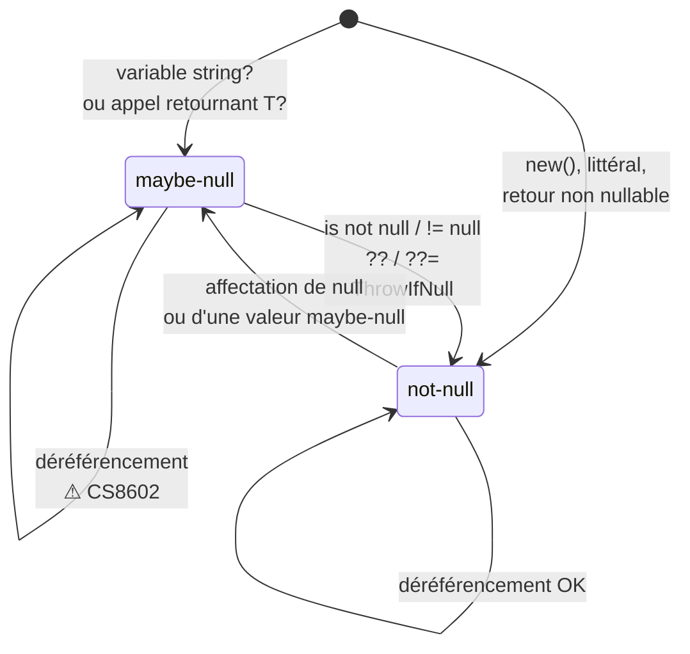
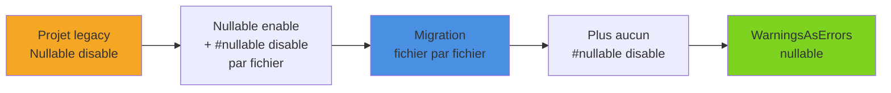

La `NullReferenceException` reste l'exception la plus fréquente en production .NET. Depuis C# 8, les **nullable reference types** (NRT) permettent au compilateur de suivre la nullabilité de chaque référence et de signaler, à la compilation, les déréférencements dangereux. Cet article détaille le fonctionnement de l'analyse de flux, les annotations (`?`, `!`, attributs), les cas des génériques et de `required`, la migration d'un projet existant, et l'interaction avec EF Core et System.Text.Json.

<!--more-->

# 1. Le principe : rendre l'intention explicite

Avant C# 8, un `string` pouvait toujours valoir `null` : le type ne disait rien de l'intention. Avec les NRT activés, la distinction devient explicite :

- `string` : référence **non nullable**, censée ne jamais valoir `null` ;
- `string?` : référence **nullable**, qu'il faut tester avant usage.

Point essentiel : contrairement à `int?` (qui est un vrai type `Nullable<int>`), `string?` **n'existe pas à l'exécution**. C'est une annotation lue par le compilateur, matérialisée dans les métadonnées par des attributs (`[Nullable]`, `[NullableContext]`). Aucun contrôle n'est ajouté au runtime : il s'agit d'une analyse statique, qui produit des **warnings**, pas des erreurs.

## Activation

Les templates `dotnet new` activent la fonctionnalité par défaut depuis .NET 6. Dans le `.csproj` :

```xml
<PropertyGroup>
  <TargetFramework>net10.0</TargetFramework>
  <Nullable>enable</Nullable>
</PropertyGroup>
```

La propriété `Nullable` accepte quatre valeurs :

| Valeur | Annotations (`?`) | Warnings |
|---|---|---|
| `disable` | ignorées (comportement historique) | non |
| `enable` | actives | oui |
| `annotations` | actives | non |
| `warnings` | non (tout est « oblivious ») | oui |

# 2. L'analyse de flux : maybe-null et not-null

Le compilateur attribue à chaque expression un **état de nullabilité** (null-state) : *not-null* ou *maybe-null*. Cet état évolue au fil du code, en fonction des affectations et des tests.

```csharp
string? GetNickname(int userId) => userId == 42 ? "Neo" : null;

void Display(int userId)
{
    string? nickname = GetNickname(userId); // maybe-null

    // ❌ CS8602 : déréférencement d'une référence potentiellement null
    Console.WriteLine(nickname.Length);

    if (nickname is null)
        return;

    // ✅ ici nickname est not-null : plus de warning
    Console.WriteLine(nickname.Length);

    nickname = null;                 // redevient maybe-null
    nickname ??= "Anonyme";          // not-null à nouveau
    Console.WriteLine(nickname.ToUpperInvariant());
}
```



Les principaux warnings à connaître :

| Code | Signification |
|---|---|
| CS8600 | Conversion d'une valeur possiblement null vers un type non nullable |
| CS8602 | Déréférencement d'une référence possiblement null |
| CS8603 | Retour possiblement null pour un type de retour non nullable |
| CS8604 | Argument possiblement null passé à un paramètre non nullable |
| CS8618 | Champ ou propriété non nullable non initialisé en sortie de constructeur |
| CS8625 | Littéral `null` converti en type non nullable |

## Les limites de l'analyse

L'analyse est volontairement **pragmatique**, pas exhaustive :

```csharp
if (order.Customer is not null)
{
    RecalculerRemises(order);           // pourrait remettre Customer à null...
    Console.WriteLine(order.Customer.Name); // ...mais aucun warning
}

var names = new string[10];   // dix éléments null, aucun warning
string first = names[0];      // null à l'exécution malgré le type non nullable
```

Le compilateur ne suit pas les effets de bord des appels de méthode, ni le contenu des tableaux, ni les `default` de structs contenant des références. Les NRT réduisent fortement les `NullReferenceException`, sans les éliminer totalement.

# 3. L'opérateur `!` (null-forgiving) et pourquoi l'éviter

Le suffixe `!` dit au compilateur : « fais-moi confiance, cette valeur n'est pas null ». Il fait passer l'état à *not-null* sans aucune vérification.

```csharp
// ❌ On fait taire le compilateur ; si FindUser renvoie null, crash plus loin
User user = repository.FindUser(id)!;
SendEmail(user.Email);

// ✅ On traite réellement le cas null
User user = repository.FindUser(id)
    ?? throw new NotFoundException($"Utilisateur {id} introuvable");
```

Chaque `!` est une dette : il masque exactement l'erreur que la fonctionnalité doit détecter. Il reste acceptable dans quelques cas ciblés :

- propriétés initialisées par un framework (navigations EF Core, voir plus bas) ;
- tests unitaires, pour vérifier volontairement le comportement avec `null` (`new Service(null!)`) ;
- code dont l'invariant est garanti mais que l'analyse ne peut pas prouver, avec un commentaire.

Dans un code métier, un `!` doit être justifié en revue de code. La forme `null!` en initialisation de propriété est particulièrement dangereuse : elle désactive CS8618 sans rien garantir.

# 4. Les attributs d'analyse

Le `?` ne suffit pas à décrire toutes les API. Le namespace `System.Diagnostics.CodeAnalysis` fournit des attributs qui affinent le contrat.

## Conditionnels : `[NotNullWhen]` et `[MaybeNullWhen]`

Le cas d'école est le pattern `TryXxx` :

```csharp
using System.Diagnostics.CodeAnalysis;

public bool TryGetCustomer(int id, [NotNullWhen(true)] out Customer? customer)
{
    customer = _cache.GetValueOrDefault(id);
    return customer is not null;
}

if (TryGetCustomer(42, out var customer))
{
    Console.WriteLine(customer.Name); // ✅ not-null quand le retour est true
}
```

`string.IsNullOrEmpty(string? value)` est annoté `[NotNullWhen(false)]` : après `if (!string.IsNullOrEmpty(s))`, `s` est considéré non null.

## Pré- et postconditions : `[AllowNull]`, `[DisallowNull]`, `[MaybeNull]`, `[NotNull]`

```csharp
// Le getter ne renvoie jamais null, mais le setter accepte null (=> valeur par défaut)
[AllowNull]
public string DisplayName
{
    get => _displayName;
    set => _displayName = value ?? "Sans nom";
}
private string _displayName = "Sans nom";

// Méthode de garde : après l'appel, l'argument est not-null
public static void EnsureNotNull([NotNull] object? value, string paramName)
{
    if (value is null) throw new ArgumentNullException(paramName);
}
```

`[MaybeNull]` signale à l'inverse qu'un retour ou un paramètre `out` peut être null même si son type ne l'indique pas ; depuis C# 9, la syntaxe `T?` sur un générique non contraint couvre la plupart de ces cas. En pratique, `ArgumentNullException.ThrowIfNull(value)` (annoté `[NotNull]`) remplace avantageusement les gardes maison.

## Entre membres : `[MemberNotNull]` et `[MemberNotNullWhen]`

Quand l'initialisation est factorisée dans une méthode, le compilateur ne la « voit » pas depuis le constructeur. `[MemberNotNull]` le lui indique :

```csharp
public class Invoice
{
    private List<InvoiceLine> _lines;

    public Invoice() => Reset(); // ✅ pas de CS8618

    [MemberNotNull(nameof(_lines))]
    public void Reset() => _lines = [];

    public string? PaymentReference { get; private set; }

    [MemberNotNullWhen(true, nameof(PaymentReference))]
    public bool IsPaid => PaymentReference is not null;
}

if (invoice.IsPaid)
    Console.WriteLine(invoice.PaymentReference.Length); // ✅
```

## `[NotNullIfNotNull]`

Pour une méthode qui renvoie null seulement si son entrée est null :

```csharp
[return: NotNullIfNotNull(nameof(input))]
public static string? Normalize(string? input) => input?.Trim().ToLowerInvariant();

string a = Normalize("  Paris ");  // ✅ pas de warning : entrée non nulle
string? b = Normalize(null);       // maybe-null
```

Enfin, `[DoesNotReturn]` et `[DoesNotReturnIf(bool)]` signalent qu'une méthode lève systématiquement (ou selon un booléen), ce qui permet au compilateur de poursuivre l'analyse correctement après l'appel.

# 5. `required` et `init` : garantir l'initialisation

Le warning CS8618 pousse souvent vers un constructeur, ou pire vers `= null!`. Depuis C# 11, le modificateur `required` oblige l'appelant à renseigner la propriété dans l'initialiseur d'objet :

```csharp
public class CreateCustomerCommand
{
    public required string Email { get; init; }
    public required string LastName { get; init; }
    public string? Phone { get; init; }   // facultatif, explicitement nullable
}

var ok = new CreateCustomerCommand { Email = "a@b.fr", LastName = "Durand" };

// ❌ CS9035 : le membre requis 'LastName' doit être défini
var ko = new CreateCustomerCommand { Email = "a@b.fr" };
```

`required` et nullabilité sont **orthogonaux** : `required string? Comment` signifie « à renseigner explicitement, éventuellement avec null ». Combiné à `init`, on obtient des objets immuables et complets, dans la lignée des [records](/2025/11/29/records.html). Un constructeur qui initialise lui-même tous les membres requis peut être marqué `[SetsRequiredMembers]`.

# 6. Les génériques : `T?`, `notnull`, `class?`

Les génériques sont la partie la plus subtile, car `T` peut être un type valeur ou référence, nullable ou non.

```csharp
// T? sans contrainte (C# 9+) : "la valeur par défaut de T"
// - pour T = string  -> string? (peut être null)
// - pour T = int     -> int (et non int?) !
public static T? FindOrDefault<T>(IEnumerable<T> items, Func<T, bool> predicate)
{
    foreach (var item in items)
        if (predicate(item)) return item;
    return default;
}

// Contrainte notnull : T ne peut pas être un type nullable
public class Registry<TKey, TValue> where TKey : notnull
{
    private readonly Dictionary<TKey, TValue> _items = new();
}

var r1 = new Registry<string, int>();   // ✅
var r2 = new Registry<string?, int>();  // ⚠ CS8714 : string? ne respecte pas notnull
```

| Contrainte | Types acceptés |
|---|---|
| `where T : class` | référence non nullable (`string`) |
| `where T : class?` | référence nullable ou non (`string`, `string?`) |
| `where T : struct` | type valeur non nullable |
| `where T : notnull` | référence ou valeur non nullable |
| aucune | tout, y compris `string?` et `int?` |

Le piège classique : `T?` sans contrainte, avec `T = int`, ne produit **pas** `int?`. Pour un vrai « absent » sur les types valeur, il faut `where T : struct` et `T?`, ou un type résultat dédié.

# 7. Migrer un projet existant

Activer `<Nullable>enable</Nullable>` sur une grosse solution produit souvent des centaines de warnings. Une migration progressive est plus réaliste.

## Stratégie fichier par fichier

```csharp
#nullable enable       // active annotations + warnings jusqu'à la fin du fichier
#nullable disable      // désactive tout
#nullable restore      // revient au réglage du projet
#nullable enable warnings      // seulement les warnings
#nullable enable annotations   // seulement les annotations
```

Deux approches possibles :

1. **Bottom-up** : laisser le projet en `disable` et ajouter `#nullable enable` en tête des fichiers migrés, en commençant par les couches basses (domaine, utilitaires) qui sont consommées par les autres.
2. **Top-down** : passer le projet en `enable`, puis ajouter `#nullable disable` en tête des fichiers non encore traités, et retirer progressivement ces directives.

La seconde approche a l'avantage que **tout nouveau fichier** naît avec les NRT activés. Les avertissements restants se suivent alors simplement par un `grep '#nullable disable'`.

## Rendre les warnings bloquants

Une fois un projet migré, il faut empêcher la régression :

```xml
<PropertyGroup>
  <Nullable>enable</Nullable>
  <!-- tous les warnings de nullabilité deviennent des erreurs -->
  <WarningsAsErrors>$(WarningsAsErrors);nullable</WarningsAsErrors>
</PropertyGroup>
```

Le mot-clé `nullable` regroupe l'ensemble des warnings de nullabilité, ce qui évite de lister CS8600, CS8602, etc. On peut aussi l'imposer à toute la solution via un `Directory.Build.props`, et le vérifier en CI (voir [GitHub Actions pour un projet .NET](/2026/05/30/github-actions-dotnet.html)).



# 8. Interaction avec EF Core

Avec les NRT activés, EF Core déduit le caractère obligatoire d'une colonne depuis l'annotation :

```csharp
public class Customer
{
    public int Id { get; set; }
    public required string Name { get; set; }   // NOT NULL
    public string? Phone { get; set; }          // NULL

    // Navigation obligatoire : renseignée par EF au chargement
    public Address Address { get; set; } = null!;
    // Collection : initialisée, jamais null
    public List<Order> Orders { get; set; } = [];
}

public class ShopContext(DbContextOptions<ShopContext> options) : DbContext(options)
{
    // ✅ forme recommandée : pas de setter, pas de warning CS8618
    public DbSet<Customer> Customers => Set<Customer>();
}
```

Points d'attention :

- **Activer les NRT sur un modèle existant modifie le schéma** : toutes les propriétés `string` deviennent `NOT NULL`. Générer une migration juste après l'activation et la relire est indispensable.
- La navigation obligatoire `Address` est l'un des rares cas où `= null!` est accepté (c'est d'ailleurs ce que recommande la documentation EF Core) : EF garantit la valeur lorsqu'elle est chargée, mais elle reste null si on oublie l'`Include`. Le `!` est ici un compromis, pas une garantie.

Pour le détail du mapping et de la configuration, voir la série [Entity Framework](/2025/06/01/EntityPart1.html).

# 9. Désérialisation JSON : `RespectNullableAnnotations`

Historiquement, System.Text.Json ignore les annotations : `{"name": null}` produit un `Name` null dans une propriété `string`, sans aucune erreur. Depuis **.NET 9**, l'option `RespectNullableAnnotations` change ce comportement :

```csharp
using System.Text.Json;

#nullable enable
public record Product(string Name, string? Description);

var options = new JsonSerializerOptions { RespectNullableAnnotations = true };

// ❌ JsonException : le paramètre 'Name' n'accepte pas null
JsonSerializer.Deserialize<Product>("""{"Name":null}""", options);

// ⚠ Aucune exception : une propriété ABSENTE n'est pas vérifiée
var p = JsonSerializer.Deserialize<Product>("{}", options); // p.Name == null
```

Deux nuances importantes :

- **Valeur `null` explicite ≠ propriété absente.** Pour exiger la présence, il faut `required`, `[JsonRequired]` ou, pour les paramètres de constructeur, `RespectRequiredConstructorParameters = true` (également .NET 9).
- **Limites** : la vérification ne s'applique ni au type racine, ni aux éléments de collection (`List<string>` et `List<string?>` sont indiscernables au runtime), ni aux membres génériques.

L'option peut être activée globalement par un feature switch :

```xml
<ItemGroup>
  <RuntimeHostConfigurationOption
      Include="System.Text.Json.Serialization.RespectNullableAnnotationsDefault"
      Value="true" />
</ItemGroup>
```

En .NET 10, le preset `JsonSerializerOptions.Strict` active d'un coup `RespectNullableAnnotations`, `RespectRequiredConstructorParameters`, refuse les membres inconnus et les propriétés dupliquées. Dans une Minimal API ASP.NET Core, on applique l'option via `builder.Services.ConfigureHttpJsonOptions(o => o.SerializerOptions.RespectNullableAnnotations = true);`, ce qui transforme un payload invalide en erreur 400 plutôt qu'en `NullReferenceException` plus loin dans le code.

# 10. Bonnes pratiques

- ✅ Activer `<Nullable>enable</Nullable>` sur tout nouveau projet, et `WarningsAsErrors` dès que possible.
- ✅ Préférer `is null` / `is not null` à `== null` : insensible à une surcharge d'opérateur (voir [Égalité et identité](/2025/11/23/egalite-identite.html)).
- ✅ Valider aux frontières (entrées d'API, désérialisation, base de données) puis manipuler des types non nullables dans le cœur métier.
- ✅ Utiliser `required` plutôt que `= null!` pour les propriétés obligatoires.
- ✅ Annoter les API publiques avec les attributs adaptés (`TryXxx`, méthodes de garde).
- ❌ Disperser des `!` pour faire disparaître les warnings.
- ❌ Considérer les NRT comme une garantie runtime : une bibliothèque non annotée ou de la réflexion peut toujours injecter un `null`.

# Résumé

| Élément | Rôle |
|---|---|
| `<Nullable>enable</Nullable>` | Active annotations et warnings pour le projet |
| `string?` | Référence pouvant valoir null (annotation compile-time uniquement) |
| Analyse de flux | Suit l'état *maybe-null* / *not-null* de chaque expression |
| `!` | Force l'état *not-null* sans vérification : à réserver aux cas justifiés |
| `[NotNullWhen]`, `[MaybeNullWhen]` | Nullabilité conditionnée au retour booléen |
| `[AllowNull]`, `[DisallowNull]`, `[MaybeNull]`, `[NotNull]` | Pré- et postconditions fines |
| `[MemberNotNull]`, `[NotNullIfNotNull]` | Contrats entre membres, entrée/sortie |
| `required` + `init` | Initialisation obligatoire par l'appelant (C# 11) |
| `T?`, `notnull`, `class?` | Nullabilité dans les génériques |
| `#nullable`, `WarningsAsErrors nullable` | Migration progressive puis verrouillage |
| EF Core | Propriété non nullable = colonne `NOT NULL` |
| `RespectNullableAnnotations` | System.Text.Json refuse les `null` explicites (.NET 9+) |

Les nullable reference types ne suppriment pas `null` du langage, mais ils le rendent **visible** : chaque `?` documente une intention, chaque warning signale un cas oublié. Bien utilisés, ils déplacent une grande partie des `NullReferenceException` de la production vers la compilation.
