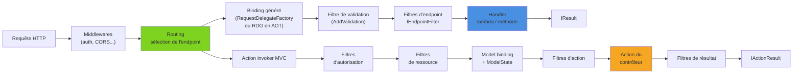

Depuis .NET 6, ASP.NET Core propose deux façons d'écrire une API HTTP : les **Controllers** MVC, historiques et très outillés, et les **Minimal APIs**, plus légères et devenues le modèle mis en avant par les templates. Avec .NET 10, l'écart fonctionnel s'est presque refermé : validation intégrée, OpenAPI natif, filtres, groupes de routes. Cet article compare les deux approches sur le même endpoint, montre comment organiser proprement des Minimal APIs, et propose une grille de choix nuancée.

<!--more-->

# 1. Le même endpoint, écrit des deux façons

L'exemple suivi dans tout l'article est une petite API de **gestion de tâches** (une *todo list* d'équipe). Premier besoin : récupérer une tâche par son identifiant, avec un `404` si elle n'existe pas. Les types utilisés sont volontairement minimaux :

```csharp
// Contrat exposé par l'API
public record TodoResponse(Guid Id, string Title, bool IsDone, DateOnly? DueDate);

public record PagedResult<T>(IReadOnlyList<T> Items, int Page, int PageSize, int Total);

// Service applicatif (EF Core, Dapper ou en mémoire : peu importe pour la comparaison)
public interface ITodoService
{
    Task<TodoResponse?> GetByIdAsync(Guid id, CancellationToken ct);
    Task<PagedResult<TodoResponse>> SearchAsync(TodoSearch search, CancellationToken ct);
    Task<TodoResponse> CreateAsync(CreateTodoRequest request, CancellationToken ct);
}
```

`TodoSearch` et `CreateTodoRequest` sont définis plus bas, dans les sections sur la validation et le binding.

## Version Controller

```csharp
using Microsoft.AspNetCore.Mvc;

[ApiController]
[Route("api/todos")]
public class TodosController(ITodoService todos) : ControllerBase
{
    [HttpGet("{id:guid}")]
    [ProducesResponseType<TodoResponse>(StatusCodes.Status200OK)]
    [ProducesResponseType(StatusCodes.Status404NotFound)]
    public async Task<ActionResult<TodoResponse>> GetById(Guid id, CancellationToken ct)
    {
        var todo = await todos.GetByIdAsync(id, ct);
        return todo is null ? NotFound() : Ok(todo);
    }
}
```

```csharp
// Program.cs
builder.Services.AddControllers();
// ...
app.MapControllers();
```

## Version Minimal API

```csharp
using Microsoft.AspNetCore.Http.HttpResults;

app.MapGet("/api/todos/{id:guid}",
    async Task<Results<Ok<TodoResponse>, NotFound>> (
        Guid id, ITodoService todos, CancellationToken ct) =>
    {
        var todo = await todos.GetByIdAsync(id, ct);
        return todo is null ? TypedResults.NotFound() : TypedResults.Ok(todo);
    });
```

Les deux versions font exactement la même chose. Les différences tiennent à ce qui les entoure :

- Le Controller est une **classe** instanciée à chaque requête, avec ses dépendances injectées par le constructeur, et découverte par convention (`AddControllers` + `MapControllers`).
- La Minimal API est un **délégué** enregistré explicitement ; ses dépendances sont des paramètres du handler, résolues par requête.
- Le type de retour `Results<Ok<TodoResponse>, NotFound>` décrit les réponses possibles **dans la signature** : le compilateur vérifie qu'on ne renvoie rien d'autre, et OpenAPI en déduit la documentation sans attribut.

# 2. Deux pipelines différents

Les deux modèles partagent le même socle : middlewares, routing par endpoints, autorisation. La divergence commence une fois l'endpoint sélectionné.



Côté Minimal API, le pipeline est court : un délégué de binding (généré à l'exécution, ou à la compilation en AOT), puis une chaîne de filtres d'endpoint, puis le handler. Côté MVC, l'*action invoker* déroule un pipeline de filtres à plusieurs étages, la découverte des contrôleurs, les conventions, les formatters, le `ModelState`. C'est plus riche, et c'est aussi plus de travail par requête.

# 3. Organiser des Minimal APIs

La critique classique : « tout finit dans un `Program.cs` de 800 lignes ». Ce n'est pas une fatalité. Trois outils suffisent à structurer proprement.

## MapGroup : préfixe et conventions partagés

```csharp
var todos = app.MapGroup("/api/todos")
    .WithTags("Todos")             // regroupement dans OpenAPI
    .RequireAuthorization();        // s'applique à tous les endpoints du groupe

todos.MapGet("/{id:guid}", GetById);
todos.MapPost("/", Create);
```

Un groupe porte tout ce qu'on mettrait sur un contrôleur : préfixe de route, autorisation, filtres, rate limiting, tags. Les groupes peuvent s'imbriquer (`/api` → `/todos`).

## Une méthode d'extension par feature

```csharp
using Microsoft.AspNetCore.Http.HttpResults;

namespace TeamTodo.Api.Features.Todos;

public static class TodoEndpoints
{
    public static RouteGroupBuilder MapTodoEndpoints(this IEndpointRouteBuilder app)
    {
        var group = app.MapGroup("/api/todos")
            .WithTags("Todos")
            .RequireAuthorization();

        group.MapGet("/{id:guid}", GetById).WithName("GetTodoById");
        group.MapGet("/", Search);
        group.MapPost("/", Create);

        return group;
    }

    // ✅ Handlers en méthodes statiques nommées : testables, lisibles dans les stack traces
    private static async Task<Results<Ok<TodoResponse>, NotFound>> GetById(
        Guid id, ITodoService todos, CancellationToken ct)
    {
        var todo = await todos.GetByIdAsync(id, ct);
        return todo is null ? TypedResults.NotFound() : TypedResults.Ok(todo);
    }

    private static async Task<Ok<PagedResult<TodoResponse>>> Search(
        [AsParameters] TodoSearch search, ITodoService todos, CancellationToken ct)
        => TypedResults.Ok(await todos.SearchAsync(search, ct));

    private static async Task<CreatedAtRoute<TodoResponse>> Create(
        CreateTodoRequest request, ITodoService todos, CancellationToken ct)
    {
        var todo = await todos.CreateAsync(request, ct);
        return TypedResults.CreatedAtRoute(todo, "GetTodoById", new { id = todo.Id });
    }
}
```

```csharp
// Program.cs reste un sommaire
app.MapTodoEndpoints();
app.MapProjectEndpoints();
```

Cette organisation « un fichier par feature » rapproche naturellement les Minimal APIs d'une architecture par tranches verticales.

## TypedResults et Results&lt;…&gt;

| Écriture | Type renvoyé | Métadonnées OpenAPI |
|---|---|---|
| `Results.Ok(x)` | `IResult` | ❌ à déclarer avec `.Produces<T>()` |
| `TypedResults.Ok(x)` | `Ok<T>` | ✅ déduites automatiquement |
| `Results<Ok<T>, NotFound>` | union de types | ✅ toutes les branches documentées |

```csharp
// ❌ IResult : OpenAPI ne sait pas ce que renvoie l'endpoint
app.MapGet("/a/{id}", (int id) => id > 0 ? Results.Ok(id) : Results.NotFound());

// ✅ Union typée : vérifiée à la compilation, documentée automatiquement
app.MapGet("/b/{id}", Results<Ok<int>, NotFound> (int id) =>
    id > 0 ? TypedResults.Ok(id) : TypedResults.NotFound());
```

Les types `TypedResults` ont un autre avantage : un test unitaire peut appeler le handler et vérifier directement `result.Result is NotFound`, sans serveur HTTP.

# 4. Validation

## Controllers : ModelState et [ApiController]

Avec `[ApiController]`, les DataAnnotations sont évaluées pendant le model binding et une réponse `400` `ValidationProblemDetails` est renvoyée automatiquement si le `ModelState` est invalide. C'est le comportement qu'on connaît depuis des années.

## Minimal APIs : la validation intégrée de .NET 10

Jusqu'à .NET 9, les Minimal APIs n'avaient pas de validation : il fallait FluentValidation ou un filtre maison. .NET 10 ajoute une validation native, activée par un seul appel :

```csharp
using System.ComponentModel.DataAnnotations;

builder.Services.AddValidation();

public record CreateTodoRequest(
    [Required, StringLength(200)] string Title,
    DateOnly? DueDate,
    [Range(1, 5)] int Priority,
    [MaxLength(20)] List<ChecklistItemRequest>? Checklist);

public record ChecklistItemRequest(
    [Required, StringLength(100)] string Label);
```

Le fonctionnement mérite d'être compris :

- `AddValidation` s'appuie sur un **source generator** qui découvre les types utilisés comme paramètres des handlers (et leurs types imbriqués) ; pas de réflexion, donc compatible AOT.
- Un **filtre d'endpoint** est ajouté à chaque endpoint concerné. Il valide la query, les en-têtes et le corps, et répond `400` avec un `ProblemDetails` listant les erreurs avant même que le handler soit appelé.
- Le générateur ne voit que l'assembly où `AddValidation` est appelé : si les endpoints vivent dans une autre bibliothèque, il faut l'appeler depuis celle-ci.
- `IValidatableObject` et les `ValidationAttribute` personnalisés sont pris en charge pour les règles plus complexes.
- Les API ont été déplacées dans le namespace et package `Microsoft.Extensions.Validation`, réutilisable hors HTTP.

On peut désactiver la validation pour un endpoint précis :

```csharp
app.MapPost("/import", (CreateTodoRequest request) => TypedResults.Accepted("/import"))
    .DisableValidation();
```

FluentValidation reste pertinent pour des règles métier riches (règles conditionnelles, validation asynchrone avec accès base) ; pour la validation de forme, l'outil intégré suffit désormais.

# 5. Filtres d'endpoint vs filtres MVC

Les deux modèles ont leur mécanisme d'interception autour du handler.

## Filtre d'endpoint (Minimal API)

```csharp
public sealed class RequireTenantFilter : IEndpointFilter
{
    public async ValueTask<object?> InvokeAsync(
        EndpointFilterInvocationContext context, EndpointFilterDelegate next)
    {
        if (!context.HttpContext.Request.Headers.ContainsKey("X-Tenant-Id"))
        {
            return TypedResults.Problem(
                "L'en-tête X-Tenant-Id est obligatoire.",
                statusCode: StatusCodes.Status400BadRequest);
        }

        // Les arguments déjà bindés sont accessibles : context.GetArgument<Guid>(0)
        return await next(context);
    }
}

// Sur un endpoint ou un groupe entier
app.MapGroup("/api/todos").AddEndpointFilter<RequireTenantFilter>();
```

## Filtre d'action (MVC)

```csharp
using Microsoft.AspNetCore.Mvc;
using Microsoft.AspNetCore.Mvc.Filters;

public sealed class RequireTenantAttribute : ActionFilterAttribute
{
    public override async Task OnActionExecutionAsync(
        ActionExecutingContext context, ActionExecutionDelegate next)
    {
        if (!context.HttpContext.Request.Headers.ContainsKey("X-Tenant-Id"))
        {
            context.Result = new BadRequestObjectResult("L'en-tête X-Tenant-Id est obligatoire.");
            return; // court-circuit : l'action n'est pas exécutée
        }

        await next();
    }
}
```

| | Filtres d'endpoint | Filtres MVC |
|---|---|---|
| Étages | Un seul type, chaîné | Autorisation, ressource, action, exception, résultat |
| Accès aux arguments | `GetArgument<T>(index)` | `ActionArguments` (dictionnaire par nom) |
| Application | Endpoint ou groupe | Action, contrôleur ou global |
| Exceptions | `try/catch` dans le filtre | Filtre d'exception dédié |
| Accès au `ModelState` | ❌ (pas de `ModelState`) | ✅ |

Le modèle MVC est plus fin, mais en pratique un filtre d'endpoint couvre l'essentiel des besoins : validation, logging, contrôle d'en-têtes, transformation du résultat. Pour une logique transverse à **toute** l'application, un middleware reste le bon niveau : il voit passer toutes les requêtes, avant même la sélection de l'endpoint.

# 6. Binding des paramètres

Les Minimal APIs infèrent la source de chaque paramètre :

| Paramètre | Source inférée |
|---|---|
| Nom présent dans le template de route (`{id}`) | Route |
| Type simple (`int`, `string`, `Guid`...) | Query string |
| Type enregistré dans le conteneur DI | Services (`[FromServices]` implicite) |
| `HttpContext`, `CancellationToken`, `ClaimsPrincipal` | Spéciaux, fournis par le framework |
| Type complexe sur POST/PUT/PATCH | Corps JSON |

Le `[FromServices]` implicite existe aussi côté Controllers depuis .NET 7 pour les paramètres d'action, avec `[ApiController]`. Pour un service à clé, on utilise `[FromKeyedServices("clé")]` dans les deux modèles.

## [AsParameters] : regrouper les paramètres

Quand la liste de paramètres s'allonge, `[AsParameters]` permet de les regrouper dans un type dont chaque propriété (ou paramètre de constructeur) est bindée selon les mêmes règles :

```csharp
using Microsoft.AspNetCore.Mvc;

public record struct TodoSearch(
    [FromQuery] bool? Done,
    [FromQuery] int? Page,
    [FromQuery(Name = "size")] int? PageSize);

// GET /api/todos?done=false&page=2&size=50
group.MapGet("/", Search); // Search([AsParameters] TodoSearch search, ...)
```

C'est l'équivalent Minimal API d'un `[FromQuery] TodoSearch search` côté Controller, avec la possibilité de mélanger route, query, en-têtes et services dans le même objet.

# 7. OpenAPI

Les deux modèles sont pris en charge par le générateur natif `Microsoft.AspNetCore.OpenApi`, qui produit par défaut des documents **OpenAPI 3.1** en .NET 10 :

```csharp
builder.Services.AddOpenApi();
app.MapOpenApi(); // /openapi/v1.json
```

- **Controllers** : la documentation vient des attributs (`[ProducesResponseType]`, `[Consumes]`) et des commentaires XML, désormais pris en charge nativement en .NET 10.
- **Minimal APIs** : `TypedResults` et `Results<…>` alimentent automatiquement les réponses ; on complète avec `.WithName()`, `.WithSummary()`, `.WithDescription()`, `.ProducesProblem()`.

```csharp
group.MapGet("/{id:guid}", GetById)
    .WithName("GetTodoById")
    .WithSummary("Récupère une tâche par son identifiant")
    .ProducesProblem(StatusCodes.Status500InternalServerError);
```

# 8. Performances et Native AOT

Sur le débit brut, les Minimal APIs ont un avantage, car leur pipeline est plus court et leur binding est un délégué spécialisé plutôt qu'un mécanisme générique. Dans une vraie application, la base de données et le réseau dominent largement ce coût : ce n'est presque jamais un critère décisif à lui seul.

Le vrai différenciateur est **Native AOT** :

- Les **Minimal APIs** sont compatibles AOT. Avec `<PublishAot>true</PublishAot>`, le *Request Delegate Generator* (RDG) génère le code de binding à la compilation, et `WebApplication.CreateSlimBuilder` réduit la surface du framework.
- **MVC n'est pas compatible** Native AOT : il repose massivement sur la réflexion (découverte des contrôleurs, model binding, filtres).

```csharp
using System.Text.Json.Serialization;

var builder = WebApplication.CreateSlimBuilder(args);

// En AOT, la sérialisation JSON doit passer par un contexte généré
builder.Services.ConfigureHttpJsonOptions(options =>
    options.SerializerOptions.TypeInfoResolverChain.Insert(0, AppJsonContext.Default));

[JsonSerializable(typeof(TodoResponse))]
[JsonSerializable(typeof(PagedResult<TodoResponse>))]
internal partial class AppJsonContext : JsonSerializerContext;
```

Pour une fonction serverless, un conteneur qui doit démarrer en quelques dizaines de millisecondes ou un service à faible empreinte mémoire, cela tranche le débat.

# 9. Comment choisir

| Critère | Minimal APIs | Controllers |
|---|---|---|
| Nouveau projet .NET 10 | ✅ choix par défaut des templates | ✅ toujours supporté |
| Native AOT | ✅ | ❌ |
| Validation intégrée | ✅ `AddValidation` (.NET 10) | ✅ `[ApiController]` + `ModelState` |
| Organisation | Méthodes d'extension + `MapGroup`, à structurer soi-même | Conventions imposées (un contrôleur = une ressource) |
| Filtres | Un niveau, simple | Pipeline à cinq étages |
| OData, `JsonPatch`, formatters XML, conventions avancées | Partiel ou à la main | ✅ écosystème mature |
| Équipe habituée à MVC, base existante | Coût de migration | ✅ continuité |
| Tests unitaires des handlers | ✅ fonctions statiques + `TypedResults` | ✅ instanciation du contrôleur |
| Architecture par features / vertical slices | ✅ naturel | Possible, moins direct |

## Recommandation

- **Nouveau service, API HTTP classique** : Minimal APIs, organisées par feature avec `MapGroup` et des handlers statiques typés. C'est la direction prise par l'équipe ASP.NET Core, et les manques d'hier (validation, OpenAPI, filtres) sont comblés.
- **Application existante en Controllers** : aucune urgence à migrer. Les deux modèles cohabitent dans la même application (`MapControllers()` et `MapGroup()` côte à côte) : on peut écrire les nouvelles features en Minimal APIs sans toucher à l'existant.
- **Besoins couverts uniquement par MVC** (OData, conventions applicatives globales, model binders exotiques) : restez sur les Controllers, c'est précisément leur point fort.
- **AOT ou démarrage à froid critique** : Minimal APIs, sans discussion.

Le piège à éviter n'est pas de choisir l'un ou l'autre, c'est d'écrire des Minimal APIs **sans structure** : la légèreté du modèle impose de s'imposer ses propres conventions.

# Résumé

| Sujet | Minimal APIs | Controllers |
|---|---|---|
| Définition | Délégué enregistré avec `MapGet`/`MapPost` | Classe `ControllerBase` + attributs |
| Organisation | `MapGroup` + méthode d'extension par feature | Un contrôleur par ressource |
| Types de retour | `TypedResults`, `Results<…>` | `ActionResult<T>`, `IActionResult` |
| Validation | `AddValidation()` (.NET 10, source generator) | `[ApiController]` + `ModelState` |
| Interception | `IEndpointFilter` | Filtres MVC (5 types) |
| Binding | Inféré, `[AsParameters]`, services implicites | Attributs `[From*]`, services implicites (.NET 7+) |
| OpenAPI | Déduit des types + `.WithSummary()` | Attributs + commentaires XML |
| Native AOT | ✅ (RDG) | ❌ |
| Recommandation | Défaut pour les nouveaux projets | Existant et besoins spécifiques MVC |
