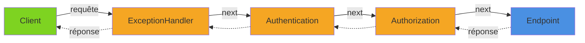
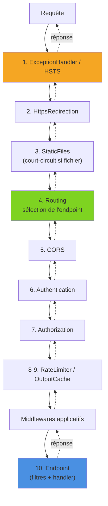
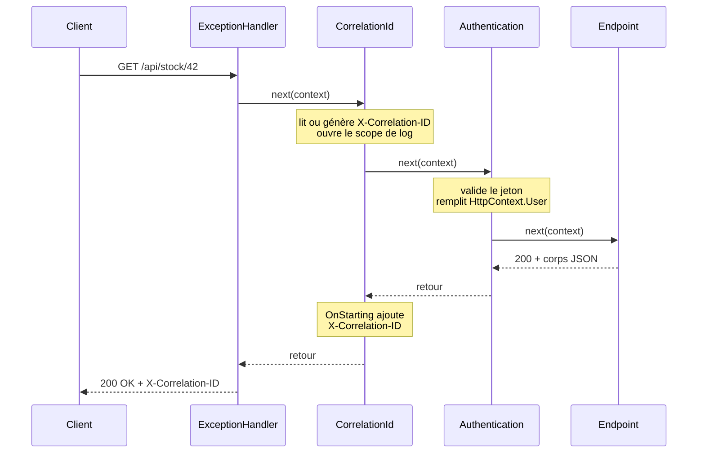

Chaque requête qui arrive dans une application ASP.NET Core traverse une chaîne de **middlewares** avant d'atteindre un endpoint, puis la remonte en sens inverse avec la réponse. Authentification, gestion des erreurs, CORS, compression, fichiers statiques : tout est middleware. Comprendre ce pipeline, son ordre et ses pièges est indispensable dès qu'on dépasse le template par défaut.

<!--more-->

# 1. Le principe du pipeline

Un middleware est un composant qui reçoit le `HttpContext` et une référence vers le **suivant** (`next`). Il peut agir avant d'appeler `next`, après, ou ne jamais l'appeler (court-circuit). Le pipeline est donc une suite de poupées russes : le premier middleware enregistré est le plus externe, le premier à voir la requête et le dernier à voir la réponse.



Techniquement, chaque middleware est un `RequestDelegate` (`Task (HttpContext)`) qui en enveloppe un autre. Le pipeline est construit une seule fois au démarrage, puis exécuté pour chaque requête.

# 2. Use, Run, Map, MapWhen, UseWhen

Ces cinq méthodes de `IApplicationBuilder` permettent de composer le pipeline.

## Use : le middleware « classique »

```csharp
app.Use(async (context, next) =>
{
    // Avant : la requête descend
    var start = Stopwatch.GetTimestamp();

    await next(context);

    // Après : la réponse remonte
    var elapsed = Stopwatch.GetElapsedTime(start);
    app.Logger.LogInformation("{Path} traité en {Elapsed} ms",
        context.Request.Path, elapsed.TotalMilliseconds);
});
```

## Run : middleware terminal

`Run` ne reçoit pas de `next` : il termine le pipeline. Tout ce qui est enregistré après n'est jamais atteint.

```csharp
app.Run(async context => await context.Response.WriteAsync("Fin du pipeline"));
```

## Map : branche par préfixe de chemin

```csharp
// Toutes les requêtes /legacy/* partent dans une branche séparée
app.Map("/legacy", legacy =>
{
    legacy.Use(async (ctx, next) => { /* ... */ await next(ctx); });
    legacy.Run(ctx => ctx.Response.WriteAsync("API legacy"));
});
```

Dans la branche, `Request.Path` est amputé du préfixe et celui-ci est déplacé dans `Request.PathBase`.

## MapWhen et UseWhen : branche par condition

La différence entre les deux est essentielle :

```csharp
// MapWhen : branche TERMINALE, la requête ne rejoint jamais le pipeline principal
app.MapWhen(ctx => ctx.Request.Query.ContainsKey("debug"), branch =>
{
    branch.Run(ctx => ctx.Response.WriteAsync("Mode debug"));
});

// UseWhen : branche qui REJOINT le pipeline principal ensuite
app.UseWhen(ctx => ctx.Request.Path.StartsWithSegments("/api"), branch =>
{
    branch.UseMiddleware<ApiKeyMiddleware>(); // middleware maison vérifiant un en-tête X-Api-Key, seulement pour /api
});
```

| Méthode | Condition | Rejoint le pipeline principal |
|---|---|---|
| `Use` | Toujours | ✅ (via `next`) |
| `Run` | Toujours | ❌ terminal |
| `Map` | Préfixe de chemin | ❌ |
| `MapWhen` | Prédicat | ❌ |
| `UseWhen` | Prédicat | ✅ (si la branche n'est pas court-circuitée) |

# 3. L'ordre recommandé

L'ordre d'enregistrement **est** l'ordre d'exécution. Un middleware d'authentification placé après l'endpoint ne sert à rien ; un gestionnaire d'exceptions placé en fin de chaîne ne voit pas les exceptions des middlewares précédents. Voici l'ordre recommandé par la documentation pour une API :

```csharp
var app = builder.Build();

if (app.Environment.IsDevelopment())
    app.UseDeveloperExceptionPage();   // implicite en Development avec WebApplication
else
{
    app.UseExceptionHandler();         // 1. capture tout ce qui suit
    app.UseHsts();
}

app.UseHttpsRedirection();             // 2.
app.UseStaticFiles();                  // 3. peut court-circuiter tôt
app.UseRouting();                      // 4. sélectionne l'endpoint
app.UseCors();                         // 5. après le routing, avant l'auth
app.UseAuthentication();               // 6. qui est l'utilisateur ?
app.UseAuthorization();                // 7. a-t-il le droit ? (lit les métadonnées de l'endpoint)
app.UseRateLimiter();                  // 8. politiques par endpoint
app.UseOutputCache();                  // 9.
app.UseMiddleware<CorrelationIdMiddleware>(); // middlewares applicatifs

app.MapInventoryEndpoints();           // 10. endpoints (méthode d'extension regroupant les MapGet/MapPost)
app.Run();
```



Avec `WebApplication`, `UseRouting` et l'exécution des endpoints sont ajoutés implicitement au début et à la fin du pipeline si on ne les appelle pas. On les appelle explicitement quand un middleware doit se placer **avant** le routing ou quand on veut rendre l'ordre visible.

# 4. Écrire un middleware

## Classe conventionnelle

C'est la forme la plus courante. Aucune interface : une classe avec un constructeur prenant un `RequestDelegate` et une méthode `InvokeAsync(HttpContext)`.

```csharp
// Petite abstraction d'horloge, enregistrée en scoped pour l'exemple
public interface IClock { DateTimeOffset UtcNow { get; } }
public sealed class SystemClock : IClock { public DateTimeOffset UtcNow => DateTimeOffset.UtcNow; }
// builder.Services.AddScoped<IClock, SystemClock>();

public sealed class RequestTimingMiddleware(RequestDelegate next, ILogger<RequestTimingMiddleware> logger)
{
    public async Task InvokeAsync(HttpContext context, IClock clock) // ← dépendance scoped injectée ici
    {
        var start = clock.UtcNow;
        await next(context);
        logger.LogInformation("Durée : {Duration}", clock.UtcNow - start);
    }
}

app.UseMiddleware<RequestTimingMiddleware>();
```

Point crucial : une classe conventionnelle est instanciée **une seule fois**, au démarrage. Elle se comporte comme un singleton.

```csharp
// AppDbContext : un DbContext EF Core, enregistré en scoped par AddDbContext
// ❌ DbContext scoped capturé dans le constructeur d'un singleton :
//    même instance pour toutes les requêtes, problèmes de concurrence
public sealed class AuditMiddleware(RequestDelegate next, AppDbContext db) { /* ... */ }

// ✅ Les dépendances scoped passent par les paramètres d'InvokeAsync
public sealed class AuditMiddleware(RequestDelegate next)
{
    public async Task InvokeAsync(HttpContext context, AppDbContext db) { /* ... */ }
}
```

## IMiddleware : activation par le conteneur

L'alternative est d'implémenter `IMiddleware`. Le middleware est alors résolu **depuis le conteneur DI à chaque requête**, avec la durée de vie qu'on lui donne :

```csharp
// Contexte par requête : le locataire (client) courant d'une application multi-tenant
public sealed class TenantContext { public string? TenantId { get; set; } }

public sealed class TenantMiddleware(TenantContext tenant) : IMiddleware
{
    public async Task InvokeAsync(HttpContext context, RequestDelegate next)
    {
        tenant.TenantId = context.Request.Headers["X-Tenant-Id"].ToString();
        await next(context);
    }
}

builder.Services.AddScoped<TenantContext>();
builder.Services.AddScoped<TenantMiddleware>(); // ← obligatoire, sinon exception au premier appel

app.UseMiddleware<TenantMiddleware>();
```

| | Conventionnel | `IMiddleware` |
|---|---|---|
| Instanciation | Une fois au démarrage | À chaque requête, par le conteneur |
| Dépendances scoped | Paramètres d'`InvokeAsync` | Constructeur |
| Enregistrement DI | Non requis | Requis |
| Typage | Par convention (pas d'interface) | Fortement typé |
| Arguments supplémentaires à `UseMiddleware` | ✅ | ❌ |

# 5. Court-circuiter le pipeline

Ne pas appeler `next` arrête la descente : les middlewares suivants et l'endpoint ne sont pas exécutés, la réponse remonte immédiatement.

```csharp
// Options liées à la section "Maintenance" de la configuration
public sealed class MaintenanceOptions { public bool Enabled { get; set; } }
// builder.Services.Configure<MaintenanceOptions>(builder.Configuration.GetSection("Maintenance"));

public sealed class MaintenanceMiddleware(RequestDelegate next, IOptionsMonitor<MaintenanceOptions> options)
{
    public async Task InvokeAsync(HttpContext context)
    {
        if (options.CurrentValue.Enabled)
        {
            context.Response.StatusCode = StatusCodes.Status503ServiceUnavailable;
            context.Response.Headers.RetryAfter = "120";
            await context.Response.WriteAsync("Maintenance en cours.");
            return; // ← court-circuit
        }

        await next(context);
    }
}
```

Depuis .NET 8, un endpoint peut aussi court-circuiter les middlewares placés après le routing (authentification, autorisation, CORS...), utile pour les health checks ou les URL de bruit :

```csharp
app.MapGet("/health", () => TypedResults.Ok()).ShortCircuit();
app.MapShortCircuit(404, "robots.txt", "favicon.ico");
```

# 6. Exemple complet : un middleware de corrélation

Objectif : chaque requête porte un identifiant de corrélation, repris de l'en-tête entrant s'il existe, sinon généré, renvoyé dans la réponse et ajouté au scope des logs.

```csharp
using Microsoft.Extensions.Primitives;

public sealed class CorrelationIdMiddleware(RequestDelegate next, ILogger<CorrelationIdMiddleware> logger)
{
    public const string HeaderName = "X-Correlation-ID";

    public async Task InvokeAsync(HttpContext context)
    {
        var correlationId = context.Request.Headers.TryGetValue(HeaderName, out StringValues values)
                            && !StringValues.IsNullOrEmpty(values)
                            && values.ToString().Length <= 64      // ne pas faire confiance à l'entrée
            ? values.ToString()
            : Guid.NewGuid().ToString("N");

        context.TraceIdentifier = correlationId;

        // ✅ L'en-tête est ajouté juste avant l'envoi de la réponse, quoi qu'il arrive en aval
        context.Response.OnStarting(() =>
        {
            context.Response.Headers[HeaderName] = correlationId;
            return Task.CompletedTask;
        });

        using (logger.BeginScope(new Dictionary<string, object> { ["CorrelationId"] = correlationId }))
        {
            await next(context);
        }
    }
}
```

Placé juste après `UseExceptionHandler`, il garantit que tous les logs de la requête, y compris ceux de l'authentification, portent l'identifiant. Dans une application instrumentée avec [OpenTelemetry](/2025/05/01/OpenTelemetry.html), le `TraceId` W3C joue déjà ce rôle entre services ; un identifiant de corrélation métier reste utile pour les clients externes et le support.

Voici le parcours d'une requête à travers trois middlewares :



# 7. Gestion des erreurs : UseExceptionHandler et IExceptionHandler

Historiquement, on passait une lambda à `UseExceptionHandler` pour fabriquer la réponse d'erreur à la main. Depuis .NET 8, l'approche plus propre est `IExceptionHandler`, combinée aux `ProblemDetails` (le format d'erreur JSON standard de la RFC 9457). L'exemple traduit deux exceptions métier en codes HTTP :

```csharp
using Microsoft.AspNetCore.Diagnostics;
using Microsoft.AspNetCore.Mvc;

// Exceptions levées par la couche métier
public sealed class NotFoundException(string message) : Exception(message);
public sealed class ConflictException(string message) : Exception(message);

public sealed class DomainExceptionHandler(IProblemDetailsService problemDetailsService) : IExceptionHandler
{
    public async ValueTask<bool> TryHandleAsync(
        HttpContext httpContext, Exception exception, CancellationToken cancellationToken)
    {
        var (status, title) = exception switch
        {
            NotFoundException => (StatusCodes.Status404NotFound, "Ressource introuvable"),
            ConflictException => (StatusCodes.Status409Conflict, "Conflit"),
            _ => (0, (string?)null)
        };

        if (status == 0)
            return false; // ← pas pour moi : le handler suivant (ou le comportement par défaut) prend le relais

        httpContext.Response.StatusCode = status;
        return await problemDetailsService.TryWriteAsync(new ProblemDetailsContext
        {
            HttpContext = httpContext,
            Exception = exception,
            ProblemDetails = new ProblemDetails
            {
                Status = status,
                Title = title,
                Detail = exception.Message
            }
        });
    }
}
```

```csharp
builder.Services.AddProblemDetails(options =>
    options.CustomizeProblemDetails = ctx =>
        ctx.ProblemDetails.Extensions["traceId"] = ctx.HttpContext.TraceIdentifier);

builder.Services.AddExceptionHandler<DomainExceptionHandler>(); // appelés dans l'ordre d'enregistrement

var app = builder.Build();
app.UseExceptionHandler();   // sans argument : s'appuie sur IExceptionHandler + ProblemDetails
app.UseStatusCodePages();    // ProblemDetails aussi pour les 404/405 sans corps
```

Si aucun handler ne renvoie `true`, le middleware produit une réponse `500` au format `ProblemDetails`, sans fuite de stack trace. Changement à connaître en .NET 10 : les exceptions traitées par un `IExceptionHandler` qui renvoie `true` ne sont plus journalisées en erreur par le middleware. Pour retrouver l'ancien comportement :

```csharp
app.UseExceptionHandler(new ExceptionHandlerOptions
{
    SuppressDiagnosticsCallback = _ => false
});
```

# 8. Middleware ou filtre d'endpoint ?

Les deux interceptent une requête, mais pas au même niveau. Un filtre d'endpoint (`IEndpointFilter`) s'attache à un endpoint ou à un groupe de Minimal APIs et s'exécute autour du handler, une fois les paramètres bindés :

```csharp
app.MapPost("/api/stock/{sku}/adjust", (string sku, int delta) => TypedResults.Ok())
   .AddEndpointFilter(async (ctx, next) =>
   {
       var delta = ctx.GetArgument<int>(1);           // argument déjà bindé
       if (delta == 0)
           return TypedResults.BadRequest("Ajustement nul.");
       return await next(ctx);
   });
```

Pour une comparaison plus large avec les filtres MVC, voir [Minimal APIs vs Controllers](/2026/06/27/minimal-api-vs-controllers.html).

| | Middleware | Filtre d'endpoint |
|---|---|---|
| Portée | Toute l'application (ou une branche) | Un endpoint ou un groupe |
| Position | Avant/après le routing | Après binding, autour du handler |
| Connaît l'endpoint | Seulement après `UseRouting` (`GetEndpoint()`) | ✅ toujours |
| Accès aux arguments bindés | ❌ | ✅ `GetArgument<T>()` |
| Accès au résultat typé | ❌ (seulement le flux de réponse) | ✅ valeur de retour du handler |
| Requêtes non routées (404, fichiers) | ✅ | ❌ |
| Exemples typiques | Erreurs, corrélation, CORS, compression | Validation, contrôle métier, audit d'un endpoint |

Règle simple : si la logique concerne le **protocole HTTP** et toutes les requêtes, c'est un middleware ; si elle concerne les **arguments ou le résultat** d'endpoints précis, c'est un filtre. On retrouve la même distinction côté gRPC avec les [intercepteurs](/2026/04/25/grpc-intercepteurs-deadlines.html).

# 9. Les pièges classiques

## Écrire après que la réponse a commencé

Dès que le premier octet du corps est envoyé, le code de statut et les en-têtes sont figés.

```csharp
// ❌ InvalidOperationException si l'endpoint a déjà écrit le corps
app.Use(async (context, next) =>
{
    await next(context);
    context.Response.Headers["X-Server-Time"] = DateTime.UtcNow.ToString("O");
});

// ✅ OnStarting s'exécute juste avant l'envoi des en-têtes
app.Use(async (context, next) =>
{
    context.Response.OnStarting(() =>
    {
        context.Response.Headers["X-Server-Time"] = DateTime.UtcNow.ToString("O");
        return Task.CompletedTask;
    });
    await next(context);
});
```

De même, dans un middleware de gestion d'erreurs maison, il faut tester `context.Response.HasStarted` avant de tenter de réécrire la réponse : si elle a commencé, on ne peut plus que journaliser et laisser la connexion se terminer.

## Mauvais ordre routing / auth

```csharp
// ❌ L'autorisation s'exécute avant que l'endpoint soit connu :
//    les [Authorize] / RequireAuthorization() ne sont pas évalués correctement
app.UseAuthorization();
app.UseRouting();

// ❌ Autorisation avant authentification : HttpContext.User est encore anonyme
app.UseAuthorization();
app.UseAuthentication();

// ✅ Routing → CORS → Authentication → Authorization
app.UseRouting();
app.UseCors();
app.UseAuthentication();
app.UseAuthorization();
```

## Autres erreurs fréquentes

- **Ne pas `await` `next`** : la suite du pipeline s'exécute sans que le middleware attende sa fin ; les exceptions et le code « après » sont perdus.
- **Lire le corps de la requête** sans `context.Request.EnableBuffering()` : le flux n'est lisible qu'une fois, l'endpoint reçoit un corps vide.
- **Faire un travail coûteux dans un middleware global** alors qu'il ne concerne que quelques routes : préférer `UseWhen` ou un filtre d'endpoint.
- **Capturer un service scoped** dans le constructeur d'un middleware conventionnel (voir section 4).

# Résumé

| Notion | À retenir |
|---|---|
| Pipeline | Chaîne de `RequestDelegate`, aller puis retour, ordre d'enregistrement = ordre d'exécution |
| `Use` / `Run` | Middleware avec `next` / middleware terminal |
| `Map` / `MapWhen` | Branche terminale par chemin / par prédicat |
| `UseWhen` | Branche conditionnelle qui rejoint le pipeline |
| Ordre | ExceptionHandler → HTTPS → StaticFiles → Routing → CORS → AuthN → AuthZ → RateLimiter → endpoints |
| Classe conventionnelle | Singleton, dépendances scoped dans `InvokeAsync` |
| `IMiddleware` | Résolu par le conteneur à chaque requête, enregistrement DI obligatoire |
| Court-circuit | Ne pas appeler `next`, ou `ShortCircuit()` / `MapShortCircuit` sur un endpoint |
| Erreurs | `AddProblemDetails` + `IExceptionHandler` + `UseExceptionHandler()` |
| Middleware vs filtre | HTTP transverse → middleware ; arguments/résultat d'un endpoint → filtre |
| Pièges | En-têtes après le début de la réponse (`OnStarting`), ordre routing/auth, `await next` |
