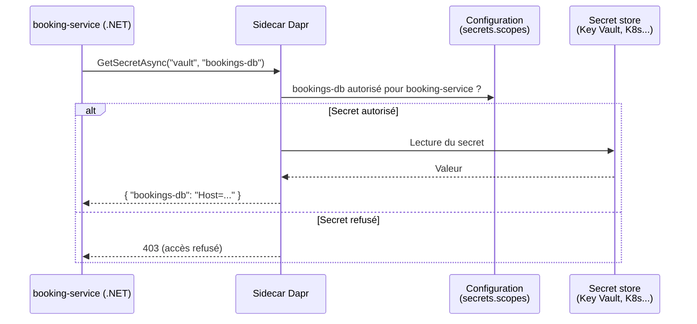
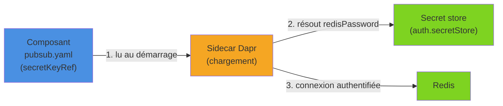

Une chaîne de connexion dans un `appsettings.json`, une clé d'API dans un YAML versionné : les secrets finissent toujours par fuiter quand on les traite comme de la configuration ordinaire. Le building block **Secrets** de Dapr expose une API unique pour lire des secrets, quel que soit le coffre sous-jacent (fichier local, variables d'environnement, Kubernetes, Azure Key Vault, HashiCorp Vault…), et permet aux composants eux-mêmes de référencer ces secrets. On voit ici l'API, son utilisation depuis .NET (Dapr 1.18, SDK .NET 1.18), l'intégration à `IConfiguration` et le contrôle d'accès, à travers un service de réservation de salles qui doit se connecter à sa base et à une API de paiement tierce.

<!--more-->


# Le problème

Dapr est un runtime qui s'exécute en **sidecar** à côté de chaque application : le code lui parle sur `localhost`, et le sidecar accède à l'infrastructure décrite dans des **composants** YAML (state store, pub/sub, secret store…). Le building block Secrets est l'une de ces API.

L'exemple de l'article est un service `booking-service` qui gère des réservations de salles de réunion. Il a besoin de deux secrets :

- la **chaîne de connexion PostgreSQL** de sa base (`ConnectionStrings:Bookings`) ;
- la **clé de l'API de paiement** tierce qui encaisse les réservations payantes (`payment-api-key`).

Les gérer correctement soulève plusieurs questions :

- **Où les stocker ?** En local, un fichier ou des variables d'environnement ; en production, Kubernetes Secrets, Azure Key Vault, AWS Secrets Manager, Vault… Chacun a son SDK et son mode d'authentification.
- **Comment éviter les fuites ?** Un secret dans un `appsettings.json` ou un YAML versionné finit tôt ou tard dans l'historique Git.
- **Qui a le droit de lire quoi ?** Un service d'envoi de rappels par e-mail n'a aucune raison de lire la chaîne de connexion de la base des réservations.
- **Comment configurer l'infrastructure ?** Les composants Dapr eux-mêmes (state store, pub/sub, bindings) ont besoin de mots de passe.

Dapr répond à ces quatre points avec les **secret stores**, les **références de secrets** dans les composants et les **scopes**.

# 1. Fonctionnement

L'application demande un secret à son sidecar, qui vérifie la politique d'accès puis interroge le secret store configuré :



Un secret est identifié par un **nom** et peut contenir **une ou plusieurs paires clé/valeur** : c'est pour cela que l'API renvoie toujours un dictionnaire. Pour un store simple (fichier en mode clé/valeur, variable d'environnement), le dictionnaire contient une seule entrée dont la clé est le nom du secret ; pour un secret Kubernetes, il contient toutes les clés du secret.

# 2. Les secret stores

## Fichier local (développement)

Fichier `secrets/dev-secrets.json` (à exclure de Git !) :

```json
{
  "ConnectionStrings": {
    "Bookings": "Host=localhost;Database=bookings;Username=app;Password=dev"
  },
  "payment-api-key": "sk_test_51Hx...",
  "redis-password": "dev"
}
```

```yaml
# components/secretstore.yaml
apiVersion: dapr.io/v1alpha1
kind: Component
metadata:
  name: secretstore
spec:
  type: secretstores.local.file
  version: v1
  metadata:
    - name: secretsFile
      value: "./secrets/dev-secrets.json"
    - name: nestedSeparator
      value: ":"               # valeur par défaut
```

Par défaut (`multiValued: "false"`), les objets JSON imbriqués sont **aplatis** avec le séparateur : le secret s'appelle donc `ConnectionStrings:Bookings`, exactement la syntaxe des clés de `IConfiguration`. Avec `multiValued: "true"`, seul le premier niveau est conservé et `ConnectionStrings` renvoie un dictionnaire contenant `Bookings`.

❌ Ce store n'est **pas destiné à la production** : le fichier est en clair sur le disque.

## Variables d'environnement

```yaml
apiVersion: dapr.io/v1alpha1
kind: Component
metadata:
  name: envstore
spec:
  type: secretstores.local.env
  version: v1
  metadata:
    - name: prefix
      value: "BOOKING_"        # optionnel : limite aux variables BOOKING_*, préfixe retiré
```

Pratique en CI ou dans un conteneur. Par sécurité, ce store refuse de lire `APP_API_TOKEN` et toute variable commençant par `DAPR_`.

## Kubernetes

En mode Kubernetes, Dapr fournit **automatiquement** un secret store nommé `kubernetes`, qui lit les `Secret` du namespace de l'application ; aucun composant n'est nécessaire. On peut néanmoins le déclarer explicitement (type `secretstores.kubernetes`), ou désactiver le store intégré avec l'annotation `dapr.io/disable-builtin-k8s-secret-store: "true"`.

```bash
kubectl create secret generic bookings-db \
  --from-literal=connectionString="Host=pg;Database=bookings;Username=app;Password=***"
```

`GetSecretAsync("kubernetes", "bookings-db")` renverra alors `{ "connectionString": "Host=pg;..." }`.

## Azure Key Vault (production)

```yaml
apiVersion: dapr.io/v1alpha1
kind: Component
metadata:
  name: vault
spec:
  type: secretstores.azure.keyvault
  version: v1
  metadata:
    - name: vaultName
      value: "kv-bookings-prod"
    # Avec une identité managée assignée par l'utilisateur, seul azureClientId est requis ;
    # avec Workload Identity sur AKS, il est même inutile.
    - name: azureClientId
      value: "00000000-0000-0000-0000-000000000000"
```

✅ En production, on privilégie l'**identité managée** ou Workload Identity : aucun mot de passe n'est nécessaire pour accéder au coffre. L'authentification par `azureTenantId` + `azureClientId` + `azureClientSecret` reste possible, mais elle déplace simplement le problème (où stocker ce client secret ?).

Le point clé, comme pour les autres building blocks : **le code est identique** d'un store à l'autre. Passer du fichier local à Key Vault ne demande que de changer de YAML (et de nommer le composant de la même façon dans les deux environnements).

# 3. Lire des secrets depuis .NET

```bash
dotnet add package Dapr.AspNetCore
```

## GetSecretAsync

```csharp
using Dapr.Client;

public class PaymentKeyProvider(DaprClient dapr)
{
    private const string StoreName = "secretstore";

    public async Task<string> GetApiKeyAsync(CancellationToken ct = default)
    {
        // Renvoie Dictionary<string, string>
        Dictionary<string, string> secret =
            await dapr.GetSecretAsync(StoreName, "payment-api-key", cancellationToken: ct);

        // Store "mono-valeur" : la clé est le nom du secret
        return secret["payment-api-key"];
    }
}
```

Certains stores acceptent des métadonnées, par exemple une version précise dans Key Vault :

```csharp
var secret = await dapr.GetSecretAsync(
    "vault",
    "payment-api-key",
    new Dictionary<string, string> { ["version_id"] = "3f0c2a..." });
```

## GetBulkSecretAsync

```csharp
// Dictionary<string, Dictionary<string, string>> : nom du secret -> paires clé/valeur
var all = await dapr.GetBulkSecretAsync("secretstore");

foreach (var (secretName, values) in all)
{
    // ✅ On logue les noms, jamais les valeurs
    Console.WriteLine($"{secretName} : {values.Count} clé(s)");
}
```

`GetBulkSecretAsync` ne renvoie que les secrets **autorisés** par les scopes (voir plus bas). À réserver au chargement initial : on évite de l'appeler à chaque requête.

## API HTTP sous-jacente

```http
GET http://localhost:3500/v1.0/secrets/secretstore/payment-api-key

GET http://localhost:3500/v1.0/secrets/secretstore/bulk
```

## Le client dédié Dapr.SecretsManagement

Depuis la version 1.18 du SDK, le package `Dapr.SecretsManagement` propose un client spécialisé, `DaprSecretsManagementClient` (classe abstraite, donc facile à substituer dans les tests), enregistré par `AddDaprSecretsManagementClient()` :

```csharp
builder.Services.AddDaprSecretsManagementClient();

// Dans un service : IReadOnlyDictionary<string, string>
var secret = await secretsClient.GetSecretAsync("vault", "bookings-db");
```

Il est livré avec un source generator capable de produire une interface fortement typée (`[SecretStore("vault")]`, `[Secret("…")]`). `DaprClient` reste toutefois pleinement supporté, et c'est lui qu'utilise l'extension de configuration présentée ci-dessous.

# 4. Intégrer les secrets à IConfiguration

Appeler `GetSecretAsync` partout disperse la logique. Le package `Dapr.Extensions.Configuration` fournit un **configuration provider** : les secrets sont chargés au démarrage dans `IConfiguration`, et le reste de l'application utilise les mécanismes habituels (`GetConnectionString`, Options pattern…).

```bash
dotnet add package Dapr.Extensions.Configuration
```

## Charger des secrets précis

```csharp
using Dapr.Client;
using Dapr.Extensions.Configuration;

var builder = WebApplication.CreateBuilder(args);

// Le provider a besoin d'un DaprClient AVANT la construction du conteneur DI
var daprClient = new DaprClientBuilder().Build();

builder.Configuration.AddDaprSecretStore(
    store: "secretstore",
    secretDescriptors:
    [
        new DaprSecretDescriptor("ConnectionStrings:Bookings"),      // obligatoire
        new DaprSecretDescriptor("payment-api-key")                   // obligatoire
    ],
    client: daprClient,
    sidecarWaitTimeout: TimeSpan.FromSeconds(10)); // attend que le sidecar soit prêt

builder.Services.AddDaprClient();

// Le secret aplati "ConnectionStrings:Bookings" est vu comme une chaîne de connexion classique
// (ici pour Npgsql, ou pour un DbContext EF Core avec UseNpgsql)
var bookingsCs = builder.Configuration.GetConnectionString("Bookings");

// La clé d'API alimente un HttpClient typé vers le prestataire de paiement
builder.Services.AddHttpClient("payments", client =>
{
    client.BaseAddress = new Uri("https://api.paiement.example.com/");
    client.DefaultRequestHeaders.Authorization =
        new("Bearer", builder.Configuration["payment-api-key"]);
});

var app = builder.Build();
```

`sidecarWaitTimeout` est important : au démarrage, l'application et son sidecar se lancent en parallèle, et la lecture échouerait si le sidecar n'était pas encore prêt. Un `DaprSecretDescriptor` marqué `isRequired: true` (valeur par défaut) fait échouer le démarrage si le secret est absent, ce qui est souvent préférable à une erreur tardive ; `isRequired: false` le rend optionnel.

## Charger tout un store avec des délimiteurs

Azure Key Vault n'accepte ni `:` ni `_` dans les noms de secrets, seulement des lettres, chiffres et tirets. La convention habituelle consiste à utiliser `--` comme séparateur de section, que le provider convertit en `:` :

```csharp
// Secret Key Vault "ConnectionStrings--Bookings" => clé de configuration "ConnectionStrings:Bookings"
builder.Configuration.AddDaprSecretStore(
    store: "vault",
    client: daprClient,
    keyDelimiters: ["--"],
    sidecarWaitTimeout: TimeSpan.FromSeconds(10));
```

Cette surcharge s'appuie sur la lecture en bulk : elle charge tous les secrets autorisés par les scopes, d'où l'intérêt de bien les restreindre.

⚠️ Les valeurs sont lues **une fois au démarrage**. Une rotation de secret nécessite un redémarrage de l'application (ou une relecture explicite via `GetSecretAsync`).

# 5. Référencer des secrets dans les composants

Les composants Dapr ont eux aussi besoin d'identifiants : un state store (le stockage clé/valeur exposé par Dapr) doit se connecter à sa base, un pub/sub à son broker. Plutôt que `value: "..."` en clair, on utilise `secretKeyRef`, et on indique dans quel store chercher avec `auth.secretStore`.

```yaml
# components/statestore.yaml : brouillons de réservation stockés dans PostgreSQL
apiVersion: dapr.io/v1alpha1
kind: Component
metadata:
  name: statestore
spec:
  type: state.postgresql
  version: v1
  metadata:
    - name: connectionString
      secretKeyRef:
        name: ConnectionStrings:Bookings   # nom du secret
        key: ConnectionStrings:Bookings    # clé dans le secret (identique pour un store mono-valeur)
auth:
  secretStore: secretstore                 # composant secret store à utiliser
```

```yaml
# components/pubsub.yaml (en Kubernetes)
apiVersion: dapr.io/v1alpha1
kind: Component
metadata:
  name: pubsub
spec:
  type: pubsub.redis
  version: v1
  metadata:
    - name: redisHost
      value: "redis:6379"
    - name: redisPassword
      secretKeyRef:
        name: redis              # secret Kubernetes "redis"
        key: password            # clé "password" de ce secret
# Pas de bloc auth : en mode Kubernetes, le store "kubernetes" est utilisé par défaut
```



La référence est résolue par le sidecar au chargement du composant : l'application ne voit jamais le mot de passe Redis, et le YAML peut être versionné sans risque. Le même mécanisme s'applique aux bindings (mot de passe SMTP, clé de compte de stockage…).

# 6. Scopes et contrôle d'accès

Par défaut, une application peut lire **tous** les secrets des stores auxquels elle a accès. Deux niveaux de restriction existent.

## Restreindre l'accès au composant

```yaml
apiVersion: dapr.io/v1alpha1
kind: Component
metadata:
  name: vault
spec:
  type: secretstores.azure.keyvault
  version: v1
  metadata:
    - name: vaultName
      value: "kv-bookings-prod"
scopes:
  - booking-service            # seul ce service charge ce composant
```

## Restreindre les secrets lisibles

La ressource `Configuration` permet de définir, par store, une politique par défaut et des listes d'autorisation ou d'interdiction :

```yaml
# config/booking-service.yaml
apiVersion: dapr.io/v1alpha1
kind: Configuration
metadata:
  name: booking-service-config
spec:
  secrets:
    scopes:
      - storeName: vault
        defaultAccess: deny
        allowedSecrets: ["ConnectionStrings--Bookings", "payment-api-key"]
      - storeName: kubernetes
        defaultAccess: deny       # aucun secret Kubernetes lisible par l'application
```

Les listes `allowedSecrets` et `deniedSecrets` sont prioritaires sur `defaultAccess` :

| defaultAccess | allowedSecrets | deniedSecrets | Résultat |
|---------------|----------------|---------------|----------|
| `deny` | — | — | Aucun accès |
| `allow` (défaut) | — | `["s1"]` | Tout sauf `s1` |
| `deny` | `["s1"]` | — | Uniquement `s1` |
| `deny` | `["s1"]` | `["s2"]` | Uniquement `s1` |

La configuration s'applique avec `--config` en local, ou avec l'annotation `dapr.io/config: booking-service-config` sur le pod en Kubernetes.

```bash
dapr run --app-id booking-service --app-port 5000 --dapr-http-port 3500 \
    --resources-path ./components \
    --config ./config/booking-service.yaml \
    -- dotnet run --project BookingService
```

# 7. Bonnes pratiques

✅ À faire :

- **Un nom de composant stable** (`secretstore`) entre environnements : fichier local en développement, Key Vault en production, sans toucher au code.
- **`defaultAccess: deny`** et listes d'autorisation explicites pour chaque service.
- **Identité managée / Workload Identity** pour accéder au coffre, plutôt qu'un client secret.
- **`secretKeyRef` systématique** dans les composants : aucun YAML ne doit contenir de valeur sensible.
- **Fichiers de secrets locaux dans `.gitignore`**, et un hook de pré-commit qui bloque les fuites (voir [Husky](/2025/10/18/Husky.html)).
- **Charger au démarrage** via `AddDaprSecretStore` plutôt que d'appeler le sidecar à chaque requête.

❌ À éviter :

```csharp
// ❌ Logger une valeur de secret, même en Debug
logger.LogDebug("Connexion : {Cs}", secret["ConnectionStrings:Bookings"]);

// ❌ Renvoyer un secret dans une réponse d'API (endpoint de diagnostic trop bavard)
app.MapGet("/debug/config", (IConfiguration config) => config.AsEnumerable());

// ✅ Logger uniquement la présence du secret
logger.LogInformation("Clé de l'API de paiement chargée : {Loaded}",
    !string.IsNullOrEmpty(app.Configuration["payment-api-key"]));
```

# Résumé

| Aspect | Détail |
|--------|--------|
| **API** | `GET http://localhost:3500/v1.0/secrets/{store}/{name}` et `/bulk` |
| **SDK .NET** | `DaprClient.GetSecretAsync`, `GetBulkSecretAsync` ; client dédié `Dapr.SecretsManagement` (1.18) |
| **Configuration** | `Dapr.Extensions.Configuration` : `AddDaprSecretStore` + `DaprSecretDescriptor` / `keyDelimiters` |
| **Stores** | `secretstores.local.file`, `secretstores.local.env`, `kubernetes` (intégré), `secretstores.azure.keyvault`, HashiCorp Vault, AWS… |
| **Composants** | `secretKeyRef` (`name` + `key`) et `auth.secretStore` |
| **Contrôle d'accès** | `scopes` sur le composant, `spec.secrets.scopes` dans la `Configuration` |
| **Production** | Key Vault ou Kubernetes, identité managée, `defaultAccess: deny` |

Avec un secret store, la chaîne de connexion et la clé d'API du service de réservation ne figurent plus nulle part dans le dépôt : le code lit `IConfiguration` comme d'habitude, les composants passent par `secretKeyRef`, et chaque service n'accède qu'aux secrets dont il a réellement besoin. Passer d'un fichier local à Key Vault ne demande alors qu'un changement de YAML.
