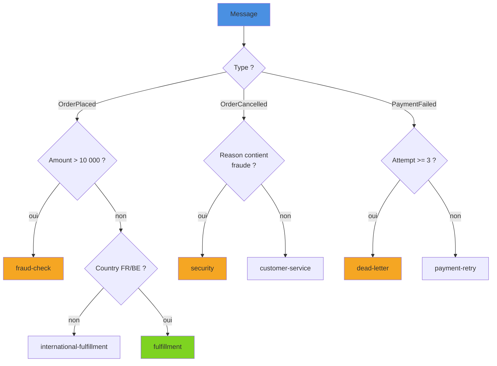

Introduit timidement en C# 7, le pattern matching s'est enrichi à chaque version jusqu'à devenir l'un des outils les plus expressifs du langage. Tests de type, comparaisons, décomposition d'objets, analyse de listes : on peut désormais exprimer en une seule `switch` expression des règles métier qui demandaient autrefois une cascade de `if`. Cet article passe en revue tous les patterns disponibles, l'exhaustivité vérifiée par le compilateur, deux exemples métier réalistes et les pièges classiques.

<!--more-->

# 1. Les deux points d'entrée : `is` et `switch`

Un **pattern** décrit une forme que doit avoir une valeur. On l'utilise à trois endroits :

```csharp
// 1. L'opérateur is : renvoie un booléen, peut déclarer une variable
if (shape is Circle c)
    Console.WriteLine(c.Radius);

// 2. L'instruction switch (avec case ... when)
switch (shape)
{
    case Circle { Radius: 0 }:
        Console.WriteLine("Cercle dégénéré");
        break;
    case Circle c when c.Radius > 100:
        Console.WriteLine("Grand cercle");
        break;
    case null:
        throw new ArgumentNullException(nameof(shape));
}

// 3. La switch expression (C# 8) : une expression qui produit une valeur
double area = shape switch
{
    Circle c    => Math.PI * c.Radius * c.Radius,
    Rectangle r => r.Width * r.Height,
    _           => throw new NotSupportedException()
};
```

La switch expression est la forme la plus utilisée aujourd'hui : concise, orientée valeur, et vérifiée par le compilateur pour l'exhaustivité. Les **bras** sont évalués **dans l'ordre**, de haut en bas ; le premier qui correspond l'emporte.

Pour les exemples suivants, on s'appuie sur ce modèle :

```csharp
public abstract record Shape;
public record Circle(double Radius) : Shape;
public record Rectangle(double Width, double Height) : Shape;

public enum CustomerTier { Standard, Silver, Gold }
public record Address(string City, string Country);
public record Customer(string Name, CustomerTier Tier, Address Address);
public record Order(Customer Customer, decimal Total, int ItemCount, bool IsFirstOrder);
```

# 2. Patterns de type, de constante et `var`

## Pattern de déclaration et pattern de type

```csharp
object value = GetValue();

if (value is int n)          // déclaration (C# 7) : test + variable
    Console.WriteLine(n + 1);

string kind = value switch
{
    int    => "entier",      // pattern de type seul (C# 9)
    string => "chaîne",
    null   => "rien",
    _      => "autre"
};
```

Un pattern de type **ne correspond jamais à `null`** : `value is string s` vaut `false` si `value` est null. C'est ce qui rend `is` plus sûr qu'un cast.

## Pattern de constante

```csharp
if (input is null) { /* ... */ }        // ✅ ignore toute surcharge de ==
if (status is OrderStatus.Cancelled) { /* ... */ }
if (command is "quit") { /* ... */ }
```

La valeur doit être une **constante de compilation** (littéral, `const`, membre d'enum, `null`). `is null` et `is not null` sont la manière idiomatique de tester la nullité (voir [Nullable reference types](/2026/06/20/nullable-reference-types.html)).

## Pattern `var` et discard `_`

```csharp
// var correspond toujours, y compris à null : utile pour nommer un résultat intermédiaire
if (ComputeScore(order) is var score && score > 80) { /* ... */ }

// _ (discard) : "n'importe quoi", y compris null, typiquement en dernier bras
var label = code switch { 200 => "OK", 404 => "Introuvable", _ => "Autre" };
```

# 3. Patterns relationnels et logiques (C# 9)

Les opérateurs `<`, `<=`, `>`, `>=` se combinent avec `and`, `or`, `not` et des parenthèses :

```csharp
string Category(int age) => age switch
{
    < 0               => throw new ArgumentOutOfRangeException(nameof(age)),
    < 12              => "enfant",
    >= 12 and < 18    => "adolescent",
    >= 18 and < 65    => "adulte",
    _                 => "senior"
};

bool IsLetter(char c) => c is (>= 'a' and <= 'z') or (>= 'A' and <= 'Z');

bool IsWeekend(DayOfWeek d) => d is DayOfWeek.Saturday or DayOfWeek.Sunday;

if (customer is not null and { Tier: not CustomerTier.Standard }) { /* ... */ }
```

La priorité est : `not` > `and` > `or`. Les parenthèses sont rarement indispensables, mais améliorent nettement la lisibilité dès que les trois opérateurs se mélangent.

# 4. Patterns de propriété (C# 8, étendus en C# 10)

Le pattern de propriété teste les membres d'un objet, récursivement :

```csharp
if (order is { Total: > 1000m, Customer: { Tier: CustomerTier.Gold } })
    Console.WriteLine("Grosse commande d'un client Gold");

// Pattern de propriété étendu (C# 10) : accès par chemin
if (order is { Customer.Address.Country: "FR", Customer.Address.City: "Lyon" })
    Console.WriteLine("Livraison lyonnaise");

// { } : "non null", avec capture
if (order.Customer.Name is { Length: > 0 } name)
    Console.WriteLine(name);
```

Le pattern de propriété inclut implicitement un test de nullité à chaque niveau : si `Customer` ou `Address` vaut null, le pattern échoue simplement, **sans `NullReferenceException`**. C'est une différence majeure avec `order.Customer.Address.City == "Lyon"`.

# 5. Patterns positionnels : `Deconstruct`, tuples et records

Un pattern positionnel décompose la valeur via une méthode `Deconstruct`. Les records positionnels la génèrent automatiquement (voir [Records en C#](/2025/11/29/records.html)) :

```csharp
string Describe(Shape shape) => shape switch
{
    Circle(0)                          => "point",
    Circle(var r) when r > 100         => "grand cercle",
    Rectangle(var w, var h) when w == h => $"carré de côté {w}",
    Rectangle(_, 0) or Rectangle(0, _) => "rectangle plat",
    _                                  => "forme quelconque"
};
```

Sur une classe classique, il suffit d'écrire la méthode :

```csharp
public class GeoPoint(double lat, double lon)
{
    public double Lat { get; } = lat;
    public double Lon { get; } = lon;

    public void Deconstruct(out double lat, out double lon) => (lat, lon) = (Lat, Lon);
}

string Hemisphere(GeoPoint p) => p switch
{
    ( >= 0, _) => "Nord",
    _          => "Sud"
};
```

Les **tuples** permettent de matcher plusieurs valeurs à la fois, idéal pour une machine à états :

```csharp
public enum State { Draft, Submitted, Approved, Rejected }
public enum WorkflowAction { Submit, Approve, Reject, Reopen }

State Transition(State current, WorkflowAction action) => (current, action) switch
{
    (State.Draft,     WorkflowAction.Submit)  => State.Submitted,
    (State.Submitted, WorkflowAction.Approve) => State.Approved,
    (State.Submitted, WorkflowAction.Reject)  => State.Rejected,
    (State.Rejected,  WorkflowAction.Reopen)  => State.Draft,
    _ => throw new InvalidOperationException($"{action} interdit depuis {current}")
};
```

# 6. List patterns et slices (C# 11)

Les list patterns s'appliquent à tout type **dénombrable** (`Length` ou `Count`) et **indexable** : tableaux, `List<T>`, `Span<T>`, `string`… Le slice `..` correspond à zéro ou plusieurs éléments, et peut être capturé (`.. var rest`) si le type supporte les plages.

Exemple : un petit interpréteur de ligne de commande.

```csharp
// Help, Add et Remove : méthodes de l'application renvoyant un string
string Execute(string[] args) => args switch
{
    []                                   => Help(),
    ["help" or "--help" or "-h"]         => Help(),
    ["add", var name]                    => Add(name, 1),
    ["add", var name, "--qty", var qty]
        when int.TryParse(qty, out var n) => Add(name, n),
    ["remove", .. var names] when names.Length > 0
                                         => Remove(names),
    [var unknown, ..]                    => $"Commande inconnue : {unknown}"
};
```

Autres usages fréquents :

```csharp
bool StartsAndEndsWithZero(int[] values) => values is [0, .., 0];

// Validation d'un en-tête de fichier : 2 octets "magiques" puis le reste
bool IsPng(ReadOnlySpan<byte> data) => data is [0x89, 0x50, 0x4E, 0x47, ..];

// Les patterns récursifs s'imbriquent dans les éléments
bool HasHeaderRow(List<string[]> rows) => rows is [["Id", "Nom", ..], ..];
```

Sur un tableau, `.. var rest` **alloue** un nouveau tableau ; sur un `Span<T>`, la capture est une simple vue, sans allocation (voir [Span&lt;T&gt; et Memory&lt;T&gt;](/2026/05/09/span-memory.html)). Depuis C# 11, un `ReadOnlySpan<char>` peut aussi être comparé directement à une constante chaîne : `span is "GET"`.

# 7. Exemple métier : calcul de remise

Les règles de remise sont typiquement le genre de logique qui dégénère en `if` imbriqués. En switch expression, chaque règle tient sur une ligne et l'ordre de priorité est visible :

```csharp
public static decimal ComputeDiscountRate(Order order) => order switch
{
    // 1. Première commande d'au moins 50 € : 15 %
    { IsFirstOrder: true, Total: >= 50m }                     => 0.15m,

    // 2. Clients Gold : 12 % au-delà de 100 €, sinon 8 %
    { Customer.Tier: CustomerTier.Gold, Total: >= 100m }      => 0.12m,
    { Customer.Tier: CustomerTier.Gold }                      => 0.08m,

    // 3. Clients Silver : 5 % au-delà de 200 €
    { Customer.Tier: CustomerTier.Silver, Total: >= 200m }    => 0.05m,

    // 4. Grosses quantités livrées en France ou Belgique : 3 %
    { ItemCount: > 10, Customer.Address.Country: "FR" or "BE" } => 0.03m,

    _ => 0m
};
```

Ajouter une règle revient à insérer une ligne au bon rang. Les tests unitaires s'écrivent naturellement par bras, et le compilateur signale une règle devenue inatteignable (voir section 9).

# 8. Exemple métier : routage de messages

Dans un consommateur de bus (par exemple derrière un [pattern Outbox](/2026/05/23/outbox-pattern.html)), on route chaque message vers une file selon son type et son contenu :

```csharp
using System.Diagnostics;

public abstract record Message(Guid OrderId);
public record OrderPlaced(Guid OrderId, decimal Amount, string Country) : Message(OrderId);
public record OrderCancelled(Guid OrderId, string Reason) : Message(OrderId);
public record PaymentFailed(Guid OrderId, int Attempt) : Message(OrderId);

public static string Route(Message message) => message switch
{
    OrderPlaced { Amount: > 10_000m }              => "fraud-check",
    OrderPlaced { Country: not ("FR" or "BE") }    => "international-fulfillment",
    OrderPlaced                                    => "fulfillment",

    OrderCancelled(_, var reason)
        when reason.Contains("fraude", StringComparison.OrdinalIgnoreCase)
                                                   => "security",
    OrderCancelled                                 => "customer-service",

    PaymentFailed { Attempt: >= 3 }                => "dead-letter",
    PaymentFailed                                  => "payment-retry",

    _ => throw new UnreachableException($"Message non géré : {message.GetType().Name}")
};
```



Le dernier bras reste nécessaire : la hiérarchie `Message` est ouverte (n'importe qui peut en dériver), le compilateur ne peut donc pas prouver que les trois types couvrent tous les cas.

# 9. Exhaustivité et warnings

Le compilateur analyse les bras d'une switch expression et signale :

| Code | Situation |
|---|---|
| CS8509 | La switch expression ne couvre pas toutes les valeurs possibles (warning) |
| CS8524 | Seule une valeur d'enum **non nommée** n'est pas couverte (warning) |
| CS8655 | Le cas `null` n'est pas couvert (warning, avec NRT) |
| CS8510 | Un bras est déjà couvert par un bras précédent (**erreur**) |

```csharp
// ⚠ CS8524 : même si tous les membres sont listés, (CustomerTier)42 est possible
decimal Rate(CustomerTier tier) => tier switch
{
    CustomerTier.Standard => 0m,
    CustomerTier.Silver   => 0.05m,
    CustomerTier.Gold     => 0.1m,
};

// ❌ CS8510 : le second bras ne peut jamais être atteint
string Size(int n) => n switch
{
    > 0   => "positif",
    > 100 => "grand",     // déjà couvert par > 0
    _     => "négatif ou nul"
};
```

Si un warning d'exhaustivité est ignoré et qu'aucun bras ne correspond à l'exécution, une `SwitchExpressionException` est levée. Il est recommandé de traiter CS8509 en erreur (`<WarningsAsErrors>$(WarningsAsErrors);CS8509</WarningsAsErrors>`) et de terminer explicitement par un `_ => throw ...` porteur de sens lorsque la couverture complète n'est pas démontrable.

# 10. Pièges courants

**`not` ne s'applique qu'à son voisin immédiat.**

```csharp
// ❌ Lu comme (not Saturday) or Sunday, soit simplement "not Saturday" : le dimanche passe le test
if (day is not DayOfWeek.Saturday or DayOfWeek.Sunday) { }

// ✅
if (day is not (DayOfWeek.Saturday or DayOfWeek.Sunday)) { }
```

**L'ordre des bras compte.** Le premier bras correspondant gagne : les cas spécifiques doivent précéder les cas généraux. Le compilateur ne détecte que les bras totalement inatteignables, pas une priorité métier mal ordonnée.

**`var` et `_` correspondent à `null`, pas `{ }` ni les patterns de type.**

```csharp
string? s = null;
bool a = s is var x;   // true, x == null
bool b = s is { };     // false
bool c = s is string;  // false
```

**Pas de variables dans les patterns.** `price is maxPrice` ne compile pas si `maxPrice` n'est pas une constante : utiliser une clause `when` ou une comparaison classique.

**Effets de bord.** Les propriétés et `Deconstruct` peuvent être appelés plusieurs fois, dans un ordre non garanti. Ils doivent rester purs et peu coûteux.

**Switch géante.** Au-delà d'une quinzaine de bras ou avec beaucoup de `when` complexes, une table de règles ou du polymorphisme reste souvent plus maintenable.

# Résumé

| Pattern | Exemple | Version C# |
|---|---|---|
| Déclaration | `x is Circle c` | 7.0 |
| Constante | `x is null`, `x is 42`, `x is "quit"` | 7.0 |
| `var` | `x is var v` | 7.0 |
| `switch` avec patterns et `when` | `case Circle c when c.Radius > 0:` | 7.0 |
| Switch expression | `x switch { ... }` | 8.0 |
| Propriété | `{ Total: > 100m }` | 8.0 |
| Positionnel (Deconstruct, records) | `Rectangle(var w, var h)` | 8.0 |
| Tuple | `(State.Draft, WorkflowAction.Submit)` | 8.0 |
| Discard | `_ => ...` | 8.0 |
| Type seul | `int => "entier"` | 9.0 |
| Relationnel | `< 12`, `>= 18` | 9.0 |
| Logique | `and`, `or`, `not` | 9.0 |
| Parenthésé | `not (A or B)` | 9.0 |
| Propriété étendu | `{ Customer.Address.City: "Lyon" }` | 10 |
| List pattern | `[var first, .., var last]` | 11 |
| Slice | `[_, .. var rest]` | 11 |
| `Span<char>` vs constante | `span is "GET"` | 11 |

Le pattern matching transforme des conditions impératives en **descriptions déclaratives de la forme des données**. Combiné aux records et aux nullable reference types, il permet d'écrire des règles métier lisibles, testables et vérifiées en partie par le compilateur.
