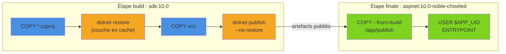
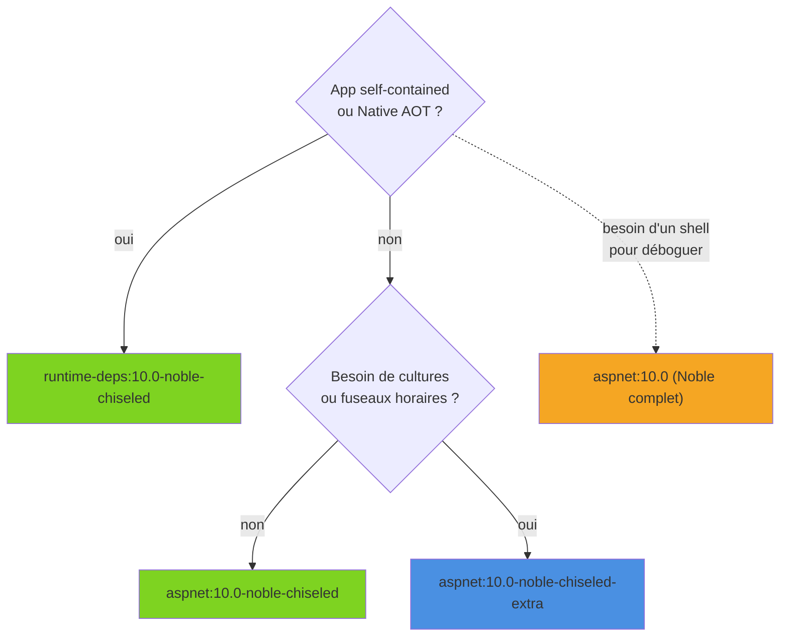

Mettre une API ASP.NET Core dans un conteneur prend dix lignes de Dockerfile. Obtenir une image **petite, rapide à construire, non-root et sans shell inutile** demande un peu plus de méthode. Cet article passe en revue le Dockerfile multi-stage bien fait, le choix des images de base .NET 10 (dont les variantes *chiseled*), la publication sans Dockerfile avec `dotnet publish /t:PublishContainer`, puis l'exécution en conditions réelles : health checks, limites mémoire, scan de vulnérabilités et CI.

<!--more-->

# 1. Le Dockerfile multi-stage

Le principe : une première étape construit l'application avec l'image **SDK** (lourde, pleine d'outils), une seconde étape ne récupère que le résultat du `publish` dans une image **runtime** minimale. Le SDK, les sources et les packages NuGet ne finissent jamais dans l'image livrée.



```dockerfile
# syntax=docker/dockerfile:1

# ---------- Étape 1 : build ----------
# $BUILDPLATFORM : le SDK tourne toujours dans l'architecture de la machine de build,
# même quand on produit une image arm64 (pas d'émulation QEMU pour la compilation).
FROM --platform=$BUILDPLATFORM mcr.microsoft.com/dotnet/sdk:10.0 AS build
ARG TARGETARCH
WORKDIR /src

# 1) On copie UNIQUEMENT les fichiers qui influencent le restore.
#    Tant qu'ils ne changent pas, la couche "restore" est réutilisée depuis le cache.
#    (À adapter : COPY échoue si un fichier est absent, retirer les Directory.*.props inutiles.)
COPY Directory.Build.props Directory.Packages.props ./
COPY src/Boutique.Api/Boutique.Api.csproj src/Boutique.Api/
COPY src/Boutique.Domain/Boutique.Domain.csproj src/Boutique.Domain/

# 2) Restore, avec un cache BuildKit pour les packages NuGet (partagé entre builds).
RUN --mount=type=cache,id=nuget,target=/root/.nuget/packages \
    dotnet restore src/Boutique.Api/Boutique.Api.csproj -a $TARGETARCH

# 3) Le code source ensuite : une modification de .cs n'invalide que les couches suivantes.
COPY src/ src/

# 4) Publish sans refaire le restore (même architecture que le restore, sinon erreur).
RUN --mount=type=cache,id=nuget,target=/root/.nuget/packages \
    dotnet publish src/Boutique.Api/Boutique.Api.csproj \
        -c Release -a $TARGETARCH --no-restore \
        -o /app/publish /p:UseAppHost=false

# ---------- Étape 2 : runtime ----------
FROM mcr.microsoft.com/dotnet/aspnet:10.0-noble-chiseled AS final
WORKDIR /app
COPY --from=build /app/publish .

EXPOSE 8080
USER $APP_UID

# Forme "exec" obligatoire : il n'y a pas de shell dans une image chiseled.
ENTRYPOINT ["dotnet", "Boutique.Api.dll"]
```

Les points qui font la différence :

- **L'ordre des `COPY`** : Docker invalide une couche dès que ses entrées changent. Copier tout le dépôt avant le restore (❌ `COPY . .` puis `dotnet restore`) relance le téléchargement de tous les packages à chaque modification d'un fichier `.cs`. Copier d'abord les `.csproj` (✅) rend le restore quasi instantané tant que les dépendances ne bougent pas.
- **`--no-restore`** sur le `publish` évite un second restore implicite, et garantit qu'on utilise bien la couche mise en cache.
- **`--mount=type=cache`** conserve le dossier `~/.nuget/packages` entre deux builds, même quand la couche restore est invalidée (ajout d'un package) : seuls les nouveaux packages sont téléchargés.

# 2. Choisir l'image de base

Microsoft publie quatre familles d'images sur `mcr.microsoft.com/dotnet/` :

| Image | Contenu | Usage |
|---|---|---|
| `sdk` | SDK complet, outils, shell | Étape de build uniquement |
| `aspnet` | Runtime .NET + ASP.NET Core | API, sites web (framework-dependent) |
| `runtime` | Runtime .NET seul | Console, Worker Service |
| `runtime-deps` | Uniquement les dépendances natives (libc, OpenSSL…) | App *self-contained* ou Native AOT |

Avec .NET 10, le tag par défaut (`10.0`, `latest`) est basé sur **Ubuntu 24.04 « Noble »** ; les images Debian ne sont plus publiées. Chaque famille se décline ensuite en variantes :

| Tag (exemple pour `aspnet`) | Particularités |
|---|---|
| `10.0` / `10.0-noble` | Ubuntu complet : shell, `apt`, ICU, tzdata |
| `10.0-noble-chiseled` | Ubuntu « ciselé » : ni shell, ni gestionnaire de paquets, non-root par défaut, sans ICU ni tzdata |
| `10.0-noble-chiseled-extra` | Chiseled + ICU + tzdata (globalisation et fuseaux horaires) |
| `10.0-noble-chiseled-composite` | Chiseled avec runtime précompilé en *composite* (démarrage plus rapide) |
| `10.0-alpine` | Alpine (musl) : très petite, avec shell ; variante `-extra` disponible |
| `10.0-azurelinux3.0-distroless` | Équivalent « distroless » sur Azure Linux |

Les images **chiseled** sont le bon défaut en production : la surface d'attaque est réduite au strict nécessaire (pas de `bash`, pas de `apt`, donc rien à exploiter pour un attaquant qui obtiendrait une exécution de commande), et elles sont nettement plus petites que l'Ubuntu complet.

Le piège à connaître : **sans ICU ni tzdata**, l'application tourne en globalisation invariante. Un `TimeZoneInfo.FindSystemTimeZoneById("Europe/Paris")` ou un tri de chaînes sensible à la culture `fr-FR` ne se comportera pas comme sur un poste de développement.

```xml
<!-- ✅ Si l'app n'a pas besoin de cultures : on l'assume explicitement -->
<PropertyGroup>
  <InvariantGlobalization>true</InvariantGlobalization>
</PropertyGroup>
<!-- Sinon : utiliser la variante 10.0-noble-chiseled-extra -->
```



# 3. Non-root et port 8080

Depuis .NET 8, toutes les images Linux contiennent un utilisateur `app` (UID 1654), exposé dans la variable d'environnement `APP_UID`. Les images chiseled l'utilisent déjà par défaut ; pour les images Ubuntu complètes et Alpine, c'est à nous de l'activer :

```dockerfile
# ✅ Le processus ne tourne pas en root
USER $APP_UID
```

Conséquence directe : un utilisateur non-root ne peut pas écouter sur un port inférieur à 1024. C'est pourquoi ASP.NET Core écoute par défaut sur le **port 8080** dans les images officielles (variable `ASPNETCORE_HTTP_PORTS=8080`), et non plus sur 80 comme avant .NET 8. Les vieux `docker run -p 80:80` doivent devenir :

```bash
docker run --rm -p 8080:8080 boutique-api:1.0
```

# 4. Sans Dockerfile : `dotnet publish /t:PublishContainer`

Le SDK .NET sait construire une image OCI **tout seul**, sans Docker pour le build (Docker ou Podman ne servent que pour charger l'image localement). Il choisit l'image de base, applique l'utilisateur non-root, déclare le port, et produit des couches identiques à celles d'un bon Dockerfile.

```bash
# Image locale "boutique-api:latest", poussée dans le démon Docker local
dotnet publish src/Boutique.Api -c Release --os linux --arch x64 /t:PublishContainer
```

Tout se configure par propriétés MSBuild dans le `.csproj` :

```xml
<PropertyGroup>
  <TargetFramework>net10.0</TargetFramework>

  <!-- Nom de l'image (par défaut : AssemblyName) -->
  <ContainerRepository>boutique/api</ContainerRepository>

  <!-- Plusieurs tags séparés par ";" (par défaut : latest) -->
  <ContainerImageTags>1.4.0;latest</ContainerImageTags>

  <!-- Suffixe ajouté au tag de l'image de base inférée : aspnet:10.0-noble-chiseled -->
  <ContainerFamily>noble-chiseled</ContainerFamily>

  <!-- Ou bien l'image complète, qui rend ContainerFamily inopérant -->
  <!-- <ContainerBaseImage>mcr.microsoft.com/dotnet/aspnet:10.0-noble-chiseled-extra</ContainerBaseImage> -->

  <!-- Registre cible : sans cette propriété, l'image va dans le démon local -->
  <!-- <ContainerRegistry>ghcr.io</ContainerRegistry> -->
</PropertyGroup>

<ItemGroup>
  <ContainerEnvironmentVariable Include="DOTNET_gcServer" Value="1" />
  <ContainerLabel Include="org.opencontainers.image.vendor" Value="Boutique" />
</ItemGroup>
```

Quelques règles d'inférence utiles :

- projet ASP.NET Core → image `aspnet`, autre projet → `runtime`, projet *self-contained* → `runtime-deps` ;
- le tag de base suit le `TargetFramework` (`net10.0` → `10.0`) ;
- le port est déduit de `ASPNETCORE_HTTP_PORTS` (donc 8080) ;
- l'utilisateur est `app`, référencé par son UID.

Pour un projet console qui n'est ni web ni Worker, il faut activer la fonctionnalité avec `<EnableSdkContainerSupport>true</EnableSdkContainerSupport>`. Et `-p ContainerArchiveOutputPath=./images/` produit un `.tar.gz` au lieu de pousser l'image, pratique pour la scanner avant publication.

**Dockerfile ou PublishContainer ?** Le SDK ne sait pas exécuter d'instruction `RUN` : impossible d'installer un paquet système ou de lancer un script pendant le build. Dans ce cas, on garde un Dockerfile ou on prépare une image de base personnalisée référencée par `ContainerBaseImage`. Pour une API classique, `PublishContainer` suffit et supprime un fichier à maintenir.

# 5. Tailles d'image

Les chiffres ci-dessous sont des **ordres de grandeur indicatifs** (taille non compressée, architecture amd64, hors code applicatif sauf mention). Ils varient d'un patch à l'autre ; `docker images` donne la valeur exacte pour un cas donné.

| Image | Ordre de grandeur |
|---|---|
| `sdk:10.0` | ~ 800 Mo à 900 Mo |
| `aspnet:10.0` (Noble complet) | ~ 220 Mo à 230 Mo |
| `aspnet:10.0-noble-chiseled-extra` | ~ 150 Mo |
| `aspnet:10.0-alpine` | ~ 120 Mo |
| `aspnet:10.0-noble-chiseled` | ~ 110 Mo à 120 Mo |
| `runtime-deps:10.0-noble-chiseled` | ~ 10 Mo à 15 Mo |
| App self-contained + trimming sur `runtime-deps` chiseled | ~ 40 Mo à 60 Mo |
| App Native AOT sur `runtime-deps` chiseled | ~ 20 Mo à 30 Mo |

Le gain le plus visible vient du multi-stage (ne pas livrer le SDK : un facteur 4 à 8). Passer ensuite d'Ubuntu complet à chiseled divise encore la taille par deux environ.

# 6. À l'exécution

## Variables d'environnement

La configuration ASP.NET Core lit les variables d'environnement ; le double underscore remplace le `:` des sections :

```bash
docker run --rm -p 8080:8080 \
  -e ASPNETCORE_ENVIRONMENT=Staging \
  -e ConnectionStrings__Default="Host=db;Database=boutique;Username=app;Password=secret" \
  -e Logging__LogLevel__Default=Warning \
  boutique-api:1.0
```

Les secrets n'ont rien à faire dans le Dockerfile (`ENV`) ni dans les propriétés `ContainerEnvironmentVariable` : ils seraient visibles dans les métadonnées de l'image. On les injecte au lancement, via l'orchestrateur ou un gestionnaire de secrets.

## Health checks

Côté application, l'endpoint de santé standard :

```csharp
// Program.cs (.NET 10, Microsoft.NET.Sdk.Web : aucun package supplémentaire)
var builder = WebApplication.CreateBuilder(args);
builder.Services.AddHealthChecks();

var app = builder.Build();
app.MapHealthChecks("/healthz");
app.Run();
```

Sous Kubernetes, les sondes `livenessProbe` / `readinessProbe` en `httpGet` interrogent cet endpoint depuis l'extérieur : rien à mettre dans l'image. L'instruction `HEALTHCHECK` de Docker, elle, exécute une commande **dans** le conteneur, et c'est là que ça coince : les images .NET n'embarquent ni `curl` ni `wget`, et une image chiseled n'a même pas de shell.

Une solution qui fonctionne partout : faire jouer à l'application elle-même le rôle de sonde.

```csharp
// Program.cs : mode "sonde" déclenché par un argument
if (args.Contains("--healthcheck"))
{
    using var http = new HttpClient { Timeout = TimeSpan.FromSeconds(3) };
    try
    {
        using var response = await http.GetAsync("http://localhost:8080/healthz");
        return response.IsSuccessStatusCode ? 0 : 1;
    }
    catch
    {
        return 1; // conteneur marqué "unhealthy"
    }
}

var builder = WebApplication.CreateBuilder(args);
// ... configuration habituelle ...
var app = builder.Build();
app.MapHealthChecks("/healthz");
await app.RunAsync();
return 0;
```

```dockerfile
# Forme exec : pas de shell nécessaire
HEALTHCHECK --interval=30s --timeout=5s --start-period=10s --retries=3 \
    CMD ["dotnet", "Boutique.Api.dll", "--healthcheck"]
```

Chaque vérification démarre un processus .NET : on garde un intervalle raisonnable.

## Limites mémoire, CPU et GC

Le runtime .NET lit les limites du cgroup. Avec `docker run -m 512m --cpus 2`, `Environment.ProcessorCount` vaut 2 et le GC plafonne par défaut le tas à **75 %** de la limite mémoire. Le Server GC (un tas par cœur, choisi par défaut par ASP.NET Core) était autrefois réputé vorace en conteneur ; depuis .NET 9, le mode DATAS (*Dynamic Adaptation To Application Sizes*), activé par défaut, adapte le nombre de tas à la charge réelle et règle l'essentiel du problème. Pour le détail des générations et des modes, voir [le Garbage Collector .NET](/2026/05/16/garbage-collector.html).

```bash
# Plafond du tas à 70 % de la limite du conteneur (valeur HEXADÉCIMALE : 0x46 = 70)
docker run --rm -m 512m --cpus 2 \
  -e DOTNET_GCHeapHardLimitPercent=0x46 \
  boutique-api:1.0
```

❌ Un conteneur sans limite mémoire laisse le GC croire qu'il dispose de toute la RAM de l'hôte, jusqu'à l'OOM kill par l'orchestrateur. ✅ Toujours fixer une limite, et laisser le runtime s'y adapter.

# 7. `.dockerignore` et scan de vulnérabilités

Le contexte de build envoyé à Docker doit être minimal : des dossiers `bin/` et `obj/` copiés depuis Windows peuvent même casser le build Linux (fichiers `project.assets.json` incohérents).

```text
# .dockerignore
**/bin/
**/obj/
**/.vs/
**/.vscode/
**/*.user
**/TestResults/
**/node_modules/
.git/
Dockerfile*
docker-compose*.yml
*.md
```

Une image n'est sûre qu'au moment où elle est construite : de nouvelles CVE sont publiées chaque semaine. Deux outils courants pour scanner une image :

```bash
# Trivy (Aqua Security) : vulnérabilités OS et packages NuGet de l'image
trivy image --severity HIGH,CRITICAL boutique-api:1.0

# Docker Scout, intégré à Docker Desktop
docker scout cves boutique-api:1.0
```

Côté code, `dotnet list package --vulnerable --include-transitive` vérifie les dépendances NuGet avant même de construire l'image. Et reconstruire régulièrement l'image (même sans changement de code) permet de récupérer les correctifs du tag `10.0-noble-chiseled`, mis à jour à chaque patch .NET et Ubuntu.

# 8. Publier depuis GitHub Actions

Avec `PublishContainer`, la publication d'image vers le GitHub Container Registry (ghcr.io) tient dans un workflow complet de quelques étapes, déclenché par un tag de version (pour un pipeline de build et de tests plus complet, voir [GitHub Actions pour un projet .NET](/2026/05/30/github-actions-dotnet.html)) :


```yaml
name: container

on:
  push:
    tags: ['v*']

permissions:
  contents: read
  packages: write   # nécessaire pour pousser sur ghcr.io

jobs:
  image:
    runs-on: ubuntu-latest
    steps:
      - uses: actions/checkout@v6

      - uses: actions/setup-dotnet@v5
        with:
          dotnet-version: 10.0.x

      - name: Connexion à ghcr.io
        uses: docker/login-action@v3
        with:
          registry: ghcr.io
          username: ${{ github.actor }}
          password: ${{ secrets.GITHUB_TOKEN }}

      - name: Construire et pousser l'image
        env:
          # Variable d'environnement plutôt que /p: : évite l'échappement du ";"
          ContainerImageTags: ${{ github.ref_name }};latest
        run: >
          dotnet publish src/Boutique.Api/Boutique.Api.csproj
          -c Release --os linux --arch x64
          /t:PublishContainer
          -p ContainerRegistry=ghcr.io
          -p ContainerRepository=mon-org/boutique-api
```


Le SDK réutilise les identifiants écrits par `docker login`. Le nom de dépôt doit être en **minuscules**, ce que `github.repository_owner` ne garantit pas : d'où la valeur écrite en dur ici. Avec un Dockerfile, on remplace la dernière étape par `docker/setup-buildx-action` et `docker/build-push-action`, qui gèrent aussi le cache de couches entre runs. Dans les deux cas, on ajoute une étape de scan avant le push, et on épingle les actions tierces par SHA de commit plutôt que par tag mobile.

# 9. Docker Compose pour le développement local

Pour lancer l'API avec sa base de données sur un poste :

```yaml
# compose.yaml
services:
  api:
    build: .
    ports:
      - "8080:8080"
    environment:
      ASPNETCORE_ENVIRONMENT: Development
      ConnectionStrings__Default: "Host=db;Database=boutique;Username=postgres;Password=postgres"
    depends_on:
      db:
        condition: service_healthy   # attend que PostgreSQL réponde
    deploy:
      resources:
        limits:
          memory: 512M
          cpus: "1.0"

  db:
    image: postgres:17
    environment:
      POSTGRES_PASSWORD: postgres
    healthcheck:
      test: ["CMD-SHELL", "pg_isready -U postgres"]
      interval: 5s
      retries: 10
```

```bash
docker compose up --build
```

Dès que l'application compte plusieurs services .NET, de l'observabilité et des dépendances à câbler, [.NET Aspire](/2026/03/28/dotnet-aspire.html) offre une alternative plus intégrée : orchestration décrite en C#, chaînes de connexion injectées automatiquement et tableau de bord OpenTelemetry, sans fichier YAML à maintenir.

# Résumé

| Sujet | À retenir |
|---|---|
| Multi-stage | `sdk:10.0` pour construire, image runtime minimale pour exécuter |
| Cache | Copier les `.csproj` avant les sources, `--mount=type=cache` pour NuGet, `--no-restore` au publish |
| Image de base | `aspnet:10.0-noble-chiseled` par défaut, `-extra` pour ICU/tzdata, `runtime-deps` pour self-contained/AOT |
| Sécurité | `USER $APP_UID`, port 8080, pas de shell en chiseled, secrets injectés au runtime |
| Sans Dockerfile | `dotnet publish /t:PublishContainer` + `ContainerRepository`, `ContainerImageTags`, `ContainerFamily`, `ContainerBaseImage` |
| Tailles | Ordres de grandeur : ~ 850 Mo (SDK) → ~ 220 Mo (Noble) → ~ 115 Mo (chiseled) → ~ 25 Mo (AOT) |
| Health checks | Sondes HTTP de l'orchestrateur ; pour `HEALTHCHECK`, une sonde en forme exec (pas de `curl`) |
| Mémoire | Toujours fixer une limite ; le GC plafonne le tas à 75 %, ajustable via `DOTNET_GCHeapHardLimitPercent` (hexa) |
| Hygiène | `.dockerignore` strict, scan Trivy / Docker Scout, reconstruction régulière |
| CI et local | `PublishContainer` vers ghcr.io dans GitHub Actions ; Compose pour le local, Aspire en alternative |
