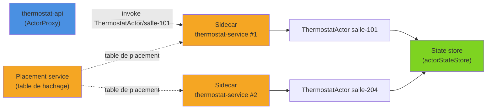
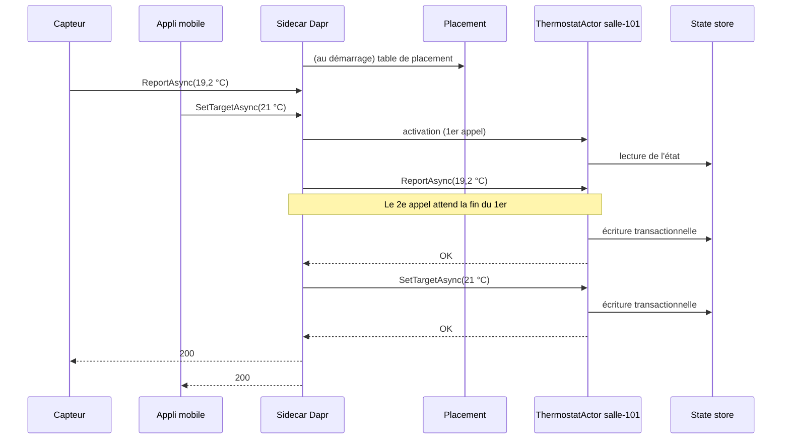

La plupart des API de Dapr (invocation de service, état, pub/sub…) sont sans état côté runtime : chaque appel est indépendant. Les **Actors** proposent un tout autre modèle de programmation : des milliers, voire des millions de petits objets avec état, identifiés par un ID, activés à la demande et qui traitent leurs messages **un par un**. On voit ici le modèle virtual actors à travers un parc de thermostats connectés, son implémentation avec `Dapr.Actors` (Dapr 1.18, SDK .NET 1.18), les timers et reminders, et les cas où ce modèle est un bon choix… ou pas.

<!--more-->


# Le problème

Pour situer : Dapr est un runtime qui s'exécute en **sidecar** à côté de chaque application ; le code lui parle sur `localhost` et le sidecar prend en charge l'infrastructure (stockage, messagerie…), décrite dans des **composants** YAML.

Prenons un bâtiment équipé de thermostats connectés, un par salle. Chaque thermostat reçoit deux types de messages :

- les **relevés de température** de son capteur, toutes les quelques secondes ;
- les **changements de consigne** envoyés depuis l'application mobile des occupants ou par le gestionnaire du bâtiment.

Avec un simple stockage clé/valeur, chaque message suit le même schéma :

1. on lit l'état du thermostat (consigne, dernière température) ;
2. on le modifie ;
3. on le réécrit, avec un ETag pour détecter les écritures concurrentes.

Si un relevé et un changement de consigne arrivent au même moment, l'une des écritures échoue sur l'ETag : il faut gérer le conflit, réessayer, et répéter ce code dans chaque endpoint qui touche au thermostat. Même chose pour un panier d'achat modifié depuis deux onglets, ou pour un compteur partagé.

Le modèle d'acteur règle ce problème autrement : **une seule entité possède l'état du thermostat**, et toutes les opérations sur ce thermostat passent par elle, l'une après l'autre. Plus de conflit possible, donc plus de code de gestion de conflit.

# 1. Le modèle virtual actors

Dapr implémente le modèle **virtual actors**, popularisé par Microsoft Orleans :

- **Un acteur = un type + un ID.** `ThermostatActor` / `salle-101` est le thermostat de la salle 101. Il y a autant d'instances que d'IDs.
- **Activation à la demande.** On n'instancie jamais un acteur explicitement : le premier appel l'active, son état est chargé depuis le state store.
- **Désactivation automatique.** Après une période d'inactivité (60 minutes par défaut), l'acteur est désactivé et l'objet libéré. L'état, lui, reste dans le store. L'acteur existe donc toujours, « virtuellement ».
- **Tour par tour (turn-based).** Un acteur ne traite qu'**un appel à la fois**. Les appels concurrents vers le même ID sont mis en file d'attente par le runtime. À l'intérieur d'une méthode d'acteur, on n'a ni verrou ni `ConcurrentDictionary` à gérer.
- **Distribution.** Les acteurs sont répartis entre toutes les instances de l'application. C'est le **placement service** qui décide quelle instance héberge quel acteur.



Chaque sidecar reçoit du placement service une table de hachage cohérente qui associe chaque couple type/ID à une instance. Quand on appelle `ThermostatActor/salle-101`, le sidecar sait vers quelle instance router l'appel, même si l'acteur n'a jamais été activé. Si une instance disparaît, la table est recalculée et ses acteurs seront réactivés ailleurs au prochain appel, avec leur état intact.

En local, `dapr init` démarre les conteneurs `dapr_placement` et `dapr_scheduler` ; en Kubernetes, ils font partie du plan de contrôle installé par Dapr.

# 2. Prérequis : un state store pour les acteurs

L'état des acteurs est stocké dans un state store transactionnel, explicitement désigné par `actorStateStore` :

```yaml
# components/statestore.yaml
apiVersion: dapr.io/v1alpha1
kind: Component
metadata:
  name: statestore
spec:
  type: state.redis
  version: v1
  metadata:
    - name: redisHost
      value: "localhost:6379"
    - name: actorStateStore
      value: "true"            # un seul composant par application peut porter ce flag
```

Le composant installé par `dapr init` dans `~/.dapr/components` porte déjà ce flag. En production, le mot de passe Redis passe bien sûr par un `secretKeyRef` vers un secret store (voir [la gestion des secrets](/2026/07/12/dapr-secrets.html) pour le détail).

# 3. Définir un acteur

```bash
# Projet partagé (interfaces + DTO)
dotnet add package Dapr.Actors
# Service qui héberge les acteurs
dotnet add package Dapr.Actors.AspNetCore
```

## L'interface

L'interface est partagée entre l'hôte et les clients. Elle hérite de `IActor`, et ses méthodes respectent deux règles : elles renvoient `Task` ou `Task<T>`, et prennent **au plus un argument**.

```csharp
using Dapr.Actors;

namespace Building.Contracts;

public record TemperatureReading(double Celsius, DateTimeOffset Timestamp);

public record BoostRequest(double TargetCelsius, TimeSpan Duration);

public record ThermostatSnapshot(double TargetCelsius, double? CurrentCelsius, bool Heating);

public interface IThermostatActor : IActor
{
    Task ReportAsync(TemperatureReading reading);   // un seul paramètre : on regroupe dans un DTO
    Task SetTargetAsync(double targetCelsius);
    Task StartBoostAsync(BoostRequest request);
    Task<ThermostatSnapshot> GetAsync();
}
```

## L'implémentation

```csharp
using Dapr.Actors.Runtime;
using Building.Contracts;

namespace ThermostatService;

public record ThermostatState(double TargetCelsius, double? CurrentCelsius);

[Actor(TypeName = "ThermostatActor")]   // nom utilisé par les clients et dans les URL
public class ThermostatActor(ActorHost host) : Actor(host), IThermostatActor
{
    private const string StateKey = "state";
    private static readonly ThermostatState Default = new(TargetCelsius: 19, CurrentCelsius: null);

    protected override Task OnActivateAsync()
    {
        Logger.LogInformation("Activation du thermostat {ActorId}", Id);
        return Task.CompletedTask;
    }

    public async Task ReportAsync(TemperatureReading reading)
    {
        // Pas de verrou, pas d'ETag : aucun autre appel ne s'exécute en parallèle sur ce thermostat
        var state = await StateManager.GetOrAddStateAsync(StateKey, Default);
        await StateManager.SetStateAsync(StateKey, state with { CurrentCelsius = reading.Celsius });
        // SaveStateAsync est appelé automatiquement par le runtime à la fin de la méthode
    }

    public async Task SetTargetAsync(double targetCelsius)
    {
        var state = await StateManager.GetOrAddStateAsync(StateKey, Default);
        await StateManager.SetStateAsync(StateKey, state with { TargetCelsius = targetCelsius });
    }

    public async Task<ThermostatSnapshot> GetAsync()
    {
        var result = await StateManager.TryGetStateAsync<ThermostatState>(StateKey);
        var state = result.HasValue ? result.Value : Default;

        // Chauffe si la température mesurée est 0,5 °C sous la consigne
        var heating = state.CurrentCelsius is { } current && current < state.TargetCelsius - 0.5;
        return new ThermostatSnapshot(state.TargetCelsius, state.CurrentCelsius, heating);
    }

    public Task StartBoostAsync(BoostRequest request) => Task.CompletedTask; // voir section 5
}
```

Quelques points sur le `StateManager` :

- il met en **cache** l'état de l'acteur et le persiste en une seule transaction à la fin de chaque méthode, si elle se termine sans exception ;
- `GetStateAsync` lève une exception si la clé n'existe pas : on préfère `TryGetStateAsync` (qui renvoie un `ConditionalValue<T>`) ou `GetOrAddStateAsync` ;
- `SetStateAsync` et `AddStateAsync` acceptent un TTL en surcharge, pratique pour un état éphémère.

## L'hébergement

```csharp
using ThermostatService;
using Dapr.Actors;

var builder = WebApplication.CreateBuilder(args);

builder.Services.AddActors(options =>
{
    options.Actors.RegisterActor<ThermostatActor>();
    options.ActorIdleTimeout = TimeSpan.FromMinutes(30);   // désactivation après 30 min d'inactivité
    options.UseJsonSerialization = true;                   // System.Text.Json plutôt que DataContract
});

var app = builder.Build();

// Endpoints appelés par le sidecar : /dapr/config, activation, invocation, timers, reminders
app.MapActorsHandlers();

app.Run();
```

`UseJsonSerialization` évite le `DataContractSerializer` utilisé par défaut pour les appels via proxy, peu à l'aise avec les records positionnels. Il faut alors l'activer **des deux côtés** : hôte et clients.

```bash
dapr run --app-id thermostat-service --app-port 5010 --dapr-http-port 3510 \
    --resources-path ./components \
    -- dotnet run --project ThermostatService --urls http://localhost:5010
```

# 4. Appeler un acteur : le proxy

Côté client (ici une API `thermostat-api` qui reçoit les relevés et les commandes de l'application mobile), `ActorProxy` génère à la volée une implémentation de l'interface qui passe par le sidecar :

```csharp
using Dapr.Actors;
using Dapr.Actors.Client;
using Building.Contracts;

var builder = WebApplication.CreateBuilder(args);

// Fabrique de proxies, avec la même sérialisation que l'hôte
builder.Services.AddSingleton<IActorProxyFactory>(
    new ActorProxyFactory(new ActorProxyOptions { UseJsonSerialization = true }));

var app = builder.Build();

IThermostatActor Thermostat(IActorProxyFactory proxies, string roomId) =>
    proxies.CreateActorProxy<IThermostatActor>(new ActorId(roomId), "ThermostatActor");

app.MapPost("/thermostats/{roomId}/readings",
    async (string roomId, TemperatureReading reading, IActorProxyFactory proxies) =>
    {
        await Thermostat(proxies, roomId).ReportAsync(reading);
        return Results.Accepted();
    });

// PUT /thermostats/salle-101/target?target=21
app.MapPut("/thermostats/{roomId}/target",
    async (string roomId, double target, IActorProxyFactory proxies) =>
    {
        await Thermostat(proxies, roomId).SetTargetAsync(target);
        return Results.NoContent();
    });

app.MapGet("/thermostats/{roomId}", async (string roomId, IActorProxyFactory proxies) =>
    await Thermostat(proxies, roomId).GetAsync());

app.Run();
```

Dans le service qui héberge les acteurs, `AddActors` enregistre déjà un `IActorProxyFactory` configuré avec les mêmes options. La méthode statique `ActorProxy.Create<IThermostatActor>(actorId, "ThermostatActor", options)` reste disponible hors injection de dépendances.

Le proxy n'est qu'une façade sur une API HTTP, utilisable depuis n'importe quel langage :

```http
PUT http://localhost:3500/v1.0/actors/ThermostatActor/salle-101/method/GetAsync
```

Le déroulé de deux appels concurrents vers le même thermostat :



# 5. Timers et reminders

Un acteur peut se programmer des rappels. Dapr propose deux mécanismes aux garanties très différentes.

| | Timer | Reminder |
|---|---|---|
| **Persistance** | Aucune, en mémoire | Persisté par le service Scheduler |
| **Désactivation de l'acteur** | Le timer est perdu | Le reminder réactive l'acteur |
| **Redémarrage / failover** | Perdu | Survit |
| **Callback** | Méthode nommée `Task M(byte[] data)` | `IRemindable.ReceiveReminderAsync` |
| **Politique de retry** | Non | Oui (3 tentatives par défaut) |
| **Usage typique** | Tâche périodique tant que l'acteur est actif | Échéance métier qui doit arriver coûte que coûte |

Depuis Dapr 1.15, les reminders sont stockés par le service **Scheduler** (et non plus dans le state store), ce qui a nettement amélioré leur tenue en charge.

## Reminder : fin du mode « boost »

Un occupant peut demander un **boost** : 23 °C pendant deux heures, puis retour automatique à la consigne précédente. Ce retour doit avoir lieu même si l'application a redémarré entre-temps : c'est un reminder.

```csharp
[Actor(TypeName = "ThermostatActor")]
public class ThermostatActor(ActorHost host) : Actor(host), IThermostatActor, IRemindable
{
    private const string StateKey = "state";
    private const string PreviousTargetKey = "previous-target";
    private const string BoostEndReminder = "boost-end";
    private static readonly ThermostatState Default = new(19, null);

    public async Task StartBoostAsync(BoostRequest request)
    {
        var state = await StateManager.GetOrAddStateAsync(StateKey, Default);

        // On mémorise la consigne normale (sauf si un boost est déjà en cours)
        if (!await StateManager.ContainsStateAsync(PreviousTargetKey))
            await StateManager.SetStateAsync(PreviousTargetKey, state.TargetCelsius);

        await StateManager.SetStateAsync(StateKey, state with { TargetCelsius = request.TargetCelsius });

        // Réenregistrer un reminder du même nom remplace le précédent :
        // un second boost repousse simplement l'échéance
        await RegisterReminderAsync(
            BoostEndReminder,
            state: [],                             // charge utile facultative (byte[])
            dueTime: request.Duration,
            period: TimeSpan.FromMilliseconds(-1)); // -1 ms = pas de répétition
    }

    public async Task ReceiveReminderAsync(string reminderName, byte[] state, TimeSpan dueTime, TimeSpan period)
    {
        if (reminderName != BoostEndReminder)
            return;

        var previous = await StateManager.TryGetStateAsync<double>(PreviousTargetKey);
        if (previous.HasValue)
        {
            var current = await StateManager.GetOrAddStateAsync(StateKey, Default);
            await StateManager.SetStateAsync(StateKey, current with { TargetCelsius = previous.Value });
            await StateManager.TryRemoveStateAsync(PreviousTargetKey);
            Logger.LogInformation("Fin du boost pour {ActorId}, retour à {Target} °C", Id, previous.Value);
        }
    }

    // ... ReportAsync, SetTargetAsync, GetAsync (cf. plus haut)
}
```

On peut supprimer un reminder avec `UnregisterReminderAsync(nom)`, par exemple si l'occupant annule le boost.

## Timer : surveiller le capteur

Second besoin : tant que le thermostat est actif, on vérifie toutes les 30 secondes que son capteur a bien émis récemment. Si l'acteur est désactivé (plus aucun message depuis 30 minutes), la vérification n'a plus de sens : un timer suffit.

```csharp
[Actor(TypeName = "ThermostatActor")]
public class ThermostatActor(ActorHost host, TimeProvider clock)
    : Actor(host), IThermostatActor, IRemindable
{
    private DateTimeOffset _lastSeen;

    protected override async Task OnActivateAsync()
    {
        _lastSeen = clock.GetUtcNow();

        // Les timers ne survivent pas à la désactivation : on les (ré)enregistre à l'activation
        await RegisterTimerAsync(
            "heartbeat-check",
            nameof(CheckHeartbeatAsync),   // méthode appelée
            callbackParams: null,
            dueTime: TimeSpan.FromSeconds(30),
            period: TimeSpan.FromSeconds(30));
    }

    public async Task ReportAsync(TemperatureReading reading)
    {
        _lastSeen = reading.Timestamp;
        var state = await StateManager.GetOrAddStateAsync(StateKey, Default);
        await StateManager.SetStateAsync(StateKey, state with { CurrentCelsius = reading.Celsius });
    }

    private Task CheckHeartbeatAsync(byte[] data)
    {
        if (clock.GetUtcNow() - _lastSeen > TimeSpan.FromMinutes(2))
            Logger.LogWarning("Capteur de {ActorId} silencieux depuis plus de 2 minutes", Id);

        return Task.CompletedTask;
    }

    // ... autres membres
}
```

Les acteurs sont créés par le conteneur d'injection de dépendances : `TimeProvider` (enregistré avec `builder.Services.AddSingleton(TimeProvider.System)`) est injecté comme n'importe quel service. Les callbacks de timer et de reminder respectent eux aussi le **tour par tour** : ils ne s'exécutent jamais en parallèle d'une méthode de l'acteur.

# 6. Réentrance

Le tour par tour a un piège : si `A` appelle `B`, qui rappelle `A`, l'appel de `B` vers `A` attend la fin de… l'appel en cours sur `A`. C'est un **interblocage**. Ce serait le cas si un `BuildingActor` (le bâtiment) interrogeait ses thermostats, et qu'un thermostat rappelait le bâtiment pour connaître le mode global (été/hiver). La réentrance autorise un acteur à recevoir un appel qui appartient à la **même chaîne d'appels** (suivie grâce à l'en-tête `Dapr-Reentrancy-Id`) :

```csharp
builder.Services.AddActors(options =>
{
    options.Actors.RegisterActor<ThermostatActor>();
    options.ReentrancyConfig = new ActorReentrancyConfig
    {
        Enabled = true,
        MaxStackDepth = 32   // valeur par défaut : nombre maximal d'appels réentrants imbriqués
    };
});
```

Le SDK transmet cette configuration au sidecar via `/dapr/config`. Les appels issus d'une autre chaîne restent sérialisés comme avant.

❌ La réentrance ne doit pas devenir une béquille : un graphe d'appels cyclique entre acteurs est souvent le signe d'un découpage à revoir (ici, passer le mode global en paramètre suffirait).

# 7. Quand utiliser (ou non) les acteurs

✅ Bons candidats :

- **Entités nombreuses, indépendantes et adressables par ID** : thermostats et capteurs IoT, paniers, sessions de jeu, comptes de fidélité.
- **Opérations courtes sur une seule entité**, avec de la concurrence sur cette entité.
- **Échéances par entité** : fin de boost, expiration, relance, timeout (reminders).

❌ Mauvais candidats :

- **Requêtes transverses** : « toutes les salles au-dessus de 25 °C ». L'état d'un acteur n'est pas requêtable via l'API d'état : il faut maintenir une projection à côté (par exemple alimentée par des événements publiés par les acteurs).
- **Acteur central très sollicité** (un compteur global pour tout le bâtiment) : tout passe par une seule file, c'est un goulet d'étranglement.
- **Traitements longs** dans une méthode : ils bloquent tous les autres appels vers cet acteur. Un processus métier de plusieurs étapes qui dure des heures relève plutôt d'un moteur de workflow (Dapr propose le building block Workflow, lui-même construit sur les acteurs).
- **Transactions entre plusieurs acteurs** : chaque acteur est transactionnel pour lui-même, pas au-delà.

Autres limites à connaître :

- l'état est sérialisé en JSON dans le store : on garde des états **petits** (pas d'historique de relevés dans l'acteur, mais une base de séries temporelles à côté) ;
- une méthode d'acteur peut être rejouée en cas de failover : les effets de bord externes (envoi d'une alerte) doivent rester idempotents.

# Résumé

| Aspect | Détail |
|--------|--------|
| **Modèle** | Virtual actors : type + ID, activation à la demande, désactivation après inactivité |
| **Concurrence** | Tour par tour : un appel à la fois par acteur, réentrance optionnelle |
| **Packages** | `Dapr.Actors` (interfaces, proxy), `Dapr.Actors.AspNetCore` (hébergement) |
| **Hébergement** | `AddActors` + `RegisterActor<T>()`, `app.MapActorsHandlers()` |
| **Client** | `IActorProxyFactory.CreateActorProxy<T>(new ActorId(id), "Type")` ou `ActorProxy.Create<T>` |
| **État** | `StateManager` (cache + transaction en fin de méthode), composant avec `actorStateStore: "true"` |
| **Timers** | En mémoire, perdus à la désactivation, `RegisterTimerAsync` |
| **Reminders** | Persistés par le Scheduler, `RegisterReminderAsync` + `IRemindable` |
| **Infrastructure** | Placement service (répartition), Scheduler (reminders) |

Les acteurs excellent pour des entités fines, nombreuses et sollicitées en parallèle, comme un parc de thermostats : chaque salle a son état, ses échéances et sa file d'appels, sans verrou ni ETag dans le code. Ils trouvent leurs limites dès qu'il faut interroger l'ensemble des entités ou coordonner un processus long, qui appellent d'autres outils.
