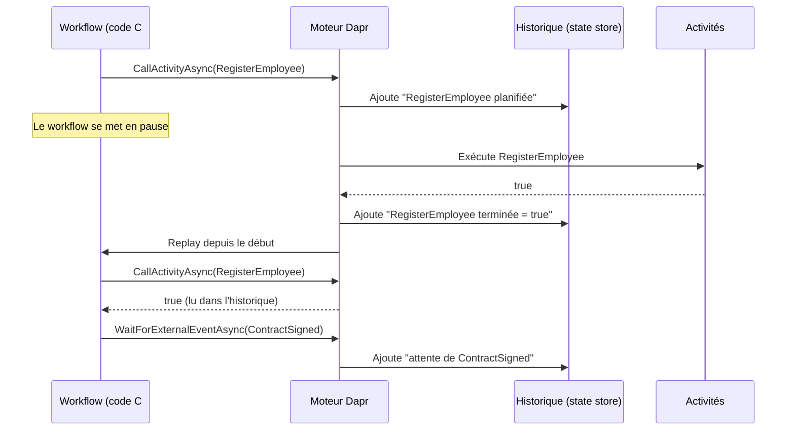
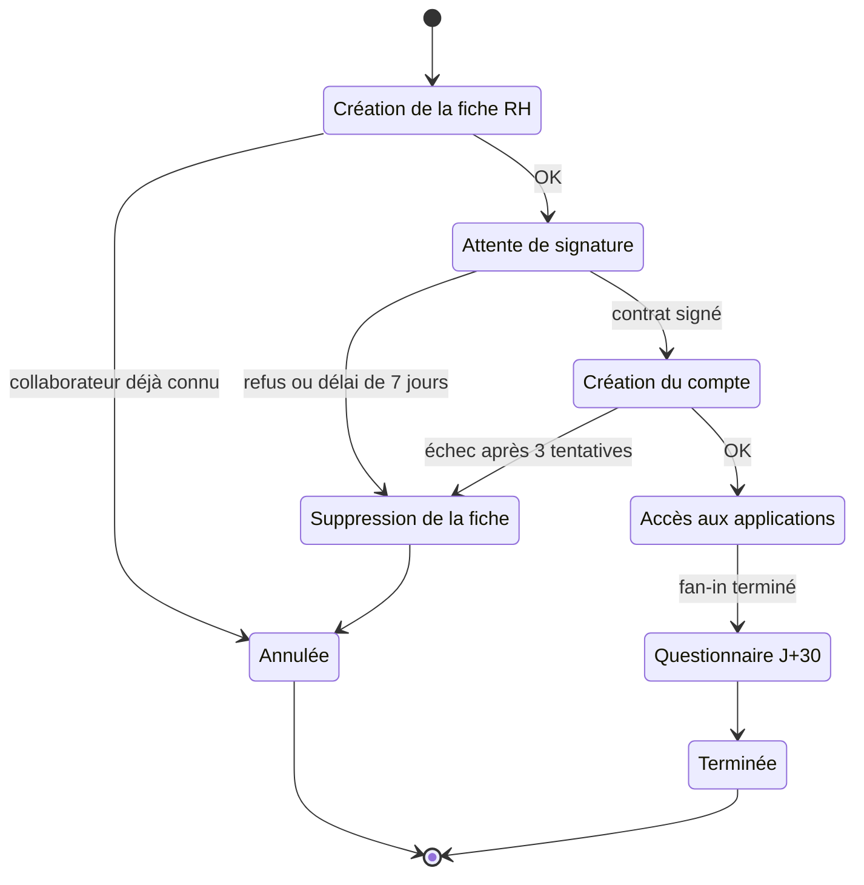

Accueillir un nouveau collaborateur, c'est créer sa fiche RH, attendre qu'il signe son contrat, ouvrir son compte, lui donner accès à une demi-douzaine d'applications, puis lui envoyer un questionnaire un mois après son arrivée. Un processus qui dure des jours, qui doit survivre aux redémarrages et savoir annuler ce qui a été fait si quelque chose échoue. Le building block **Workflow** de Dapr permet d'écrire ce processus comme du code C# séquentiel, rendu **durable** par le runtime. On voit ici les principes (déterminisme, replay), les patterns (chaînage, fan-out/fan-in, événements externes, timers, compensation) et la gestion des instances, avec Dapr 1.18 et le SDK .NET 1.18.

<!--more-->


# Le problème

Pour situer : Dapr est un runtime qui s'exécute en **sidecar** à côté de chaque application et lui expose, sur `localhost`, des API prêtes à l'emploi (état, messagerie, appels entre services…). Le moteur de workflow en fait partie.

Sans moteur de workflow, un processus long comme l'onboarding se construit généralement avec des messages : chaque service réagit à un événement et en publie un autre (chorégraphie). Ça fonctionne, mais :

- **la logique est éclatée** entre plusieurs handlers : personne ne voit le processus d'un seul coup d'œil ;
- **l'état d'avancement** (« où en est l'arrivée de Julie ? ») doit être reconstitué à la main ;
- **les délais** (« contrat non signé sous 7 jours ») demandent un planificateur à côté ;
- **la compensation** (« le compte n'a pas pu être créé, supprimer la fiche RH ») est dispersée et facile à oublier.

Un workflow est une **orchestration** : un chef d'orchestre décrit les étapes, et le runtime garantit que le processus reprend là où il s'était arrêté après un crash.

# 1. Principes : activités, historique et replay

Un workflow Dapr se compose de deux types de briques :

- **le workflow** lui-même, qui orchestre : il appelle des activités, attend des événements, arme des timers ;
- **les activités**, qui font le vrai travail : appel HTTP, écriture en base, publication d'un message.

Le runtime enregistre chaque étape dans un **historique** persisté (dans le state store des acteurs : le moteur de workflow s'appuie sur le modèle d'acteurs de Dapr en interne, voir [les Actors](/2026/08/01/dapr-actors.html) pour aller plus loin). Quand une activité se termine, le workflow n'est pas « réveillé » au milieu de sa méthode : il est **rejoué depuis le début**. Lors de ce replay, chaque `await` sur une étape déjà terminée renvoie immédiatement le résultat stocké dans l'historique, sans réexécuter l'activité.



Conséquence directe : le code du workflow **doit être déterministe**. Rejoué avec le même historique, il doit prendre exactement les mêmes décisions.

| ❌ Interdit dans un workflow | ✅ Équivalent déterministe |
|---|---|
| `DateTime.UtcNow`, `TimeProvider` | `context.CurrentUtcDateTime` |
| `Guid.NewGuid()`, `Random` | `context.NewGuid()` ou valeur produite par une activité |
| `Task.Delay`, `Thread.Sleep` | `context.CreateTimer(...)` |
| `HttpClient`, `DaprClient`, base de données | Une activité |
| `ILogger` injecté (logs dupliqués à chaque replay) | `context.CreateReplaySafeLogger<T>()` |
| `Task.Run`, threads, `ConfigureAwait(false)` | `await` simple sur les tâches du contexte |

Les activités, elles, n'ont **aucune restriction** : elles peuvent faire des I/O, utiliser l'injection de dépendances… mais elles s'exécutent **au moins une fois** (at-least-once) et doivent donc être idempotentes.

# 2. Mise en place

```bash
dotnet add package Dapr.Workflow
dotnet add package Dapr.AspNetCore   # DaprClient pour les activités
```

Le moteur a besoin d'un state store (composant de stockage clé/valeur Dapr) marqué `actorStateStore: "true"` ; celui créé par `dapr init` convient en local.

## Les modèles

```csharp
namespace Onboarding.Workflows;

public record OnboardingRequest(
    string EmployeeId,
    string FullName,
    string ManagerEmail,
    DateOnly StartDate,
    IReadOnlyList<string> Applications);   // ex. ["messagerie", "chat", "gitlab", "paie"]

public record ContractSignature(bool Signed, string? Comment);

public record AccessRequest(string EmployeeId, string Application);

public record WelcomePack(string EmployeeId, string[] AccessIds);

public record OnboardingResult(string EmployeeId, bool Success, string Message);
```

## Une activité

Une activité hérite de `WorkflowActivity<TInput, TOutput>` et profite de l'injection de dépendances :

```csharp
using Dapr.Client;
using Dapr.Workflow;

namespace Onboarding.Workflows;

public sealed class RegisterEmployeeActivity(DaprClient dapr, ILogger<RegisterEmployeeActivity> logger)
    : WorkflowActivity<OnboardingRequest, bool>
{
    public override async Task<bool> RunAsync(WorkflowActivityContext context, OnboardingRequest request)
    {
        logger.LogInformation("Création de la fiche RH de {EmployeeId} (workflow {InstanceId})",
            request.EmployeeId, context.InstanceId);

        // Invocation de service : appel du service "hr-service" via son sidecar, par son app-id.
        // Le service appelé doit être idempotent, car l'activité peut être exécutée plusieurs fois.
        return await dapr.InvokeMethodAsync<OnboardingRequest, bool>("hr-service", "employees", request);
    }
}
```

Les autres activités (`DeleteEmployeeRecordActivity`, `CreateAccountActivity`, `GrantAccessActivity`, `SendWelcomeActivity`, `SendSurveyActivity`) suivent le même modèle.

## L'enregistrement

```csharp
using Dapr.Workflow;
using Onboarding.Workflows;

var builder = WebApplication.CreateBuilder(args);

builder.Services.AddDaprClient();
builder.Services.AddDaprWorkflow(options =>
{
    options.RegisterWorkflow<OnboardingWorkflow>();
    options.RegisterActivity<RegisterEmployeeActivity>();
    options.RegisterActivity<DeleteEmployeeRecordActivity>();
    options.RegisterActivity<CreateAccountActivity>();
    options.RegisterActivity<GrantAccessActivity>();
    options.RegisterActivity<SendWelcomeActivity>();
    options.RegisterActivity<SendSurveyActivity>();
});

var app = builder.Build();
// ... endpoints de gestion (section 4)
app.Run();
```

`AddDaprWorkflow` enregistre le `DaprWorkflowClient` et un service hébergé qui se connecte au sidecar en gRPC pour recevoir le travail à exécuter. Depuis le SDK 1.18, un source generator sait découvrir workflows et activités automatiquement, ce qui rend les appels `Register…` facultatifs ; les garder explicites reste parfaitement supporté et lisible.

# 3. Le workflow d'onboarding

Le processus complet :



Et sa traduction en C#, qui se lit de haut en bas comme le diagramme :

```csharp
using Dapr.Workflow;

namespace Onboarding.Workflows;

public sealed class OnboardingWorkflow : Workflow<OnboardingRequest, OnboardingResult>
{
    // 3 tentatives, 5 s puis 10 s d'attente entre elles
    private static readonly WorkflowTaskOptions AccountRetry = new(
        RetryPolicy: new WorkflowRetryPolicy(
            maxNumberOfAttempts: 3,
            firstRetryInterval: TimeSpan.FromSeconds(5),
            backoffCoefficient: 2.0));

    public override async Task<OnboardingResult> RunAsync(WorkflowContext context, OnboardingRequest request)
    {
        var logger = context.CreateReplaySafeLogger<OnboardingWorkflow>();

        // 1. Chaînage : le résultat d'une étape conditionne la suite
        context.SetCustomStatus("Création de la fiche RH");
        var registered = await context.CallActivityAsync<bool>(nameof(RegisterEmployeeActivity), request);
        if (!registered)
            return new(request.EmployeeId, false, "Collaborateur déjà enregistré");

        // 2. Événement externe avec délai : signature du contrat
        context.SetCustomStatus("En attente de signature du contrat");
        try
        {
            var signature = await context.WaitForExternalEventAsync<ContractSignature>(
                "ContractSigned", timeout: TimeSpan.FromDays(7));

            if (!signature.Signed)
                return await CompensateAsync(context, request, "Contrat refusé par le candidat");
        }
        catch (TaskCanceledException)
        {
            // Le délai (timer durable) a expiré avant l'événement
            return await CompensateAsync(context, request, "Contrat non signé sous 7 jours");
        }

        // 3. Création du compte avec retry, puis compensation si tout échoue (saga)
        context.SetCustomStatus("Création du compte");
        try
        {
            await context.CallActivityAsync(nameof(CreateAccountActivity), request, AccountRetry);
        }
        catch (WorkflowTaskFailedException ex)
        {
            logger.LogWarning("Création du compte impossible pour {EmployeeId} : {Error}",
                request.EmployeeId, ex.FailureDetails.ErrorMessage);
            return await CompensateAsync(context, request, "Échec de création du compte");
        }

        // 4. Fan-out / fan-in : un accès par application, en parallèle
        context.SetCustomStatus("Ouverture des accès");
        var grants = request.Applications
            .Select(app => context.CallActivityAsync<string>(
                nameof(GrantAccessActivity), new AccessRequest(request.EmployeeId, app)))
            .ToList();
        string[] accessIds = await Task.WhenAll(grants);

        await context.CallActivityAsync(nameof(SendWelcomeActivity),
            new WelcomePack(request.EmployeeId, accessIds));

        // 5. Timer durable : survit aux redémarrages, aucune ressource consommée pendant l'attente
        context.SetCustomStatus("Accueilli, questionnaire programmé");
        await context.CreateTimer(TimeSpan.FromDays(30));
        await context.CallActivityAsync(nameof(SendSurveyActivity), request.EmployeeId);

        return new(request.EmployeeId, true, $"{accessIds.Length} accès ouverts");
    }

    private static async Task<OnboardingResult> CompensateAsync(
        WorkflowContext context, OnboardingRequest request, string reason)
    {
        context.SetCustomStatus($"Compensation : {reason}");
        await context.CallActivityAsync(nameof(DeleteEmployeeRecordActivity), request.EmployeeId);
        return new(request.EmployeeId, false, reason);
    }
}
```

Quelques remarques :

- **Chaînage** : chaque `await` est un point de sauvegarde. Si le processus tombe pendant la création du compte, il reprend à cette étape, sans recréer la fiche RH.
- **Fan-out / fan-in** : planifier plusieurs activités sans les attendre, puis `Task.WhenAll`, les exécute en parallèle, potentiellement sur plusieurs instances du service. Pour des centaines d'éléments, l'extension `ProcessInParallelAsync` du SDK limite le nombre de tâches simultanées (`maxConcurrency`, 5 par défaut).
- **Événement externe** : `WaitForExternalEventAsync` avec un `TimeSpan` combine en interne un timer durable et l'attente ; à l'expiration, il lève une `TaskCanceledException`. Attendre sept jours ne consomme ni thread ni mémoire : l'instance est simplement endormie dans le state store.
- **Erreurs** : une activité qui lève une exception (après épuisement des retries) remonte dans le workflow sous la forme d'une `WorkflowTaskFailedException`, dont `FailureDetails` donne le type et le message d'origine.
- **Compensation** : c'est le pattern **saga** orchestré. Chaque étape réussie qui modifie un autre système a son action inverse, appelée explicitement en cas d'échec. Ici une seule étape est à défaire (la fiche RH) ; avec plusieurs, on les annule dans l'ordre inverse. On retrouve la même préoccupation de cohérence sans transaction distribuée que dans [le pattern Outbox](/2026/05/23/outbox-pattern.html) ; les deux sont d'ailleurs complémentaires : l'outbox fiabilise la publication d'un événement, la saga coordonne plusieurs étapes.

# 4. Gérer les instances

Le `DaprWorkflowClient`, injecté par `AddDaprWorkflow`, pilote les instances :

```csharp
// Démarrer : l'ID d'instance métier facilite le suivi
app.MapPost("/onboardings", async (OnboardingRequest request, DaprWorkflowClient workflows) =>
{
    var instanceId = await workflows.ScheduleNewWorkflowAsync(
        name: nameof(OnboardingWorkflow),
        instanceId: $"onboarding-{request.EmployeeId}",
        input: request);

    return Results.Accepted($"/onboardings/{instanceId}", new { instanceId });
});

// Consulter l'état
app.MapGet("/onboardings/{instanceId}", async (string instanceId, DaprWorkflowClient workflows) =>
{
    var state = await workflows.GetWorkflowStateAsync(instanceId, getInputsAndOutputs: true);
    if (!state.Exists)
        return Results.NotFound();

    return Results.Ok(new
    {
        Status = state.RuntimeStatus.ToString(),        // Running, Completed, Failed...
        Step = state.ReadCustomStatusAs<string>(),       // valeur passée à SetCustomStatus
        Result = state.IsWorkflowCompleted ? state.ReadOutputAs<OnboardingResult>() : null
    });
});

// Envoyer l'événement attendu par le workflow (appelé par l'outil de signature électronique)
app.MapPost("/onboardings/{instanceId}/contract",
    async (string instanceId, ContractSignature signature, DaprWorkflowClient workflows) =>
    {
        await workflows.RaiseEventAsync(instanceId, "ContractSigned", signature);
        return Results.Accepted();
    });

// Arrêter définitivement (aucune compensation n'est exécutée !)
app.MapDelete("/onboardings/{instanceId}", async (string instanceId, DaprWorkflowClient workflows) =>
{
    await workflows.TerminateWorkflowAsync(instanceId);
    return Results.NoContent();
});
```

Le client propose aussi `SuspendWorkflowAsync` / `ResumeWorkflowAsync` (mise en pause), `WaitForWorkflowCompletionAsync` (pratique dans les tests d'intégration) et `PurgeInstanceAsync`, qui supprime l'historique d'une instance terminée. Sans purge ni politique de rétention, les historiques s'accumulent dans le state store.

Les statuts possibles (`WorkflowRuntimeStatus`) :

| Statut | Signification |
|---|---|
| `Pending` | Planifié, pas encore démarré (démarrage différé possible via `startTime`) |
| `Running` | En cours, y compris en attente d'un timer ou d'un événement |
| `Suspended` | Mis en pause par `SuspendWorkflowAsync` |
| `Completed` | Terminé normalement, sortie disponible |
| `Failed` | Exception non gérée dans le workflow |
| `Terminated` | Arrêté par `TerminateWorkflowAsync` |

Les mêmes opérations existent en HTTP, utiles pour un script ou un outil d'administration :

```http
POST http://localhost:3500/v1.0/workflows/dapr/OnboardingWorkflow/start?instanceID=onboarding-e042
GET  http://localhost:3500/v1.0/workflows/dapr/onboarding-e042
POST http://localhost:3500/v1.0/workflows/dapr/onboarding-e042/raiseEvent/ContractSigned
POST http://localhost:3500/v1.0/workflows/dapr/onboarding-e042/terminate
```

```bash
dapr run --app-id onboarding-service --app-port 5000 --dapr-http-port 3500 \
    --resources-path ./components \
    -- dotnet run --project OnboardingService --urls http://localhost:5000
```

# 5. Limites et bonnes pratiques

✅ À faire :

- **Des entrées et sorties légères** : elles sont sérialisées dans l'historique. Pour un gros document (le contrat PDF), on passe une référence (URL de blob, ID).
- **Des activités idempotentes** : l'ID d'instance (`context.InstanceId`) fait une bonne clé d'idempotence côté service appelé.
- **Un ID d'instance métier** (`onboarding-e042`) plutôt qu'un GUID aléatoire : on retrouve l'instance sans table de correspondance, et on empêche deux onboardings simultanés pour la même personne.
- **`ContinueAsNew`** pour un workflow « éternel » (boucle de surveillance) : il redémarre avec un historique vide au lieu de le faire grossir indéfiniment.

❌ À éviter :

```csharp
// ❌ Non déterministe : le replay prendra une autre branche
if (DateTime.UtcNow.Hour < 12) { /* ... */ }

// ✅ Horloge rejouable
if (context.CurrentUtcDateTime.Hour < 12) { /* ... */ }

// ❌ I/O directe dans le workflow
var exists = await httpClient.GetFromJsonAsync<bool>("...");

// ✅ Déléguer à une activité
var exists = await context.CallActivityAsync<bool>(nameof(CheckEmployeeActivity), employeeId);
```

⚠️ **Modifier le code d'un workflow** alors que des instances sont en cours est risqué : l'historique ne correspond plus au code et le replay échoue. Avec un processus qui dure plus d'un mois, comme ici, c'est presque inévitable. Le SDK 1.17 a introduit le versioning (par exemple `context.IsPatched("v2")` pour faire coexister ancienne et nouvelle branche) ; à défaut, on laisse les anciennes instances se terminer avant de déployer.

⚠️ Les workflows Dapr ne sont pas faits pour la **faible latence** : chaque étape implique des écritures dans le state store. Pour un traitement de quelques millisecondes, un simple appel de service suffit.

# Résumé

| Aspect | Détail |
|--------|--------|
| **Package** | `Dapr.Workflow` : `AddDaprWorkflow` + `RegisterWorkflow<T>()` / `RegisterActivity<T>()` |
| **Workflow** | `Workflow<TInput, TOutput>` + `RunAsync(WorkflowContext, TInput)`, code déterministe |
| **Activité** | `WorkflowActivity<TInput, TOutput>`, I/O autorisées, exécution at-least-once |
| **Durabilité** | Historique persisté et replay ; repose sur les acteurs |
| **Patterns** | Chaînage, fan-out/fan-in (`Task.WhenAll`), événement externe, timer durable, saga |
| **Erreurs** | `WorkflowRetryPolicy`, `WorkflowTaskFailedException`, compensation explicite |
| **Gestion** | `DaprWorkflowClient` : `ScheduleNewWorkflowAsync`, `GetWorkflowStateAsync`, `RaiseEventAsync`, `TerminateWorkflowAsync`, `PurgeInstanceAsync` |
| **Limites** | Déterminisme, taille des payloads, versioning, latence |

Les workflows Dapr transforment un processus étalé sur des semaines, comme l'arrivée d'un collaborateur, en une méthode C# qui se lit de haut en bas : attentes, délais, parallélisme et compensation y sont explicites, et le runtime se charge de la reprise après panne. Le prix à payer est une discipline stricte de déterminisme dans le code du workflow et une attention particulière au versioning.
